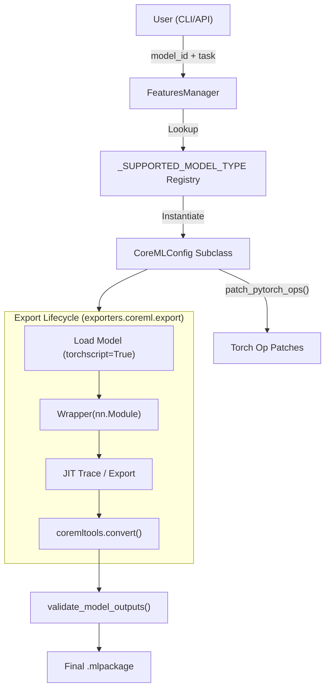
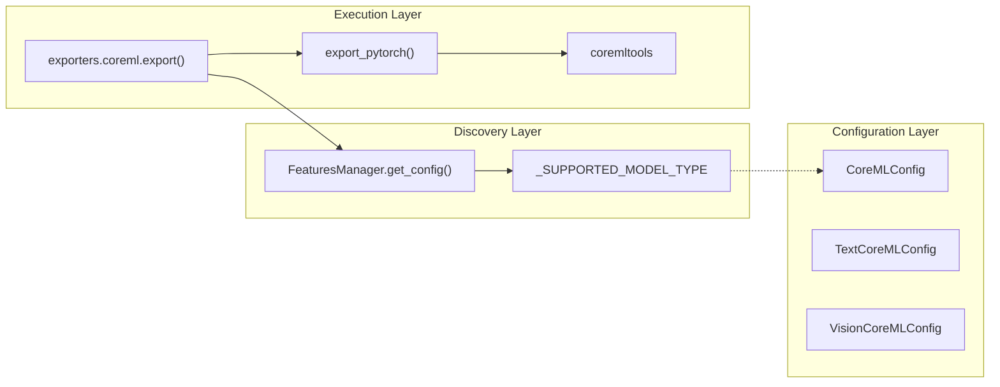

<!-- source: DeepWiki mcp.deepwiki.com · repo huggingface/exporters · page 1 Overview · fetched 2026-10-26 -->

# Overview

Relevant source files

The following files were used as context for generating this wiki page:

- [DESIGN_NOTES.md](DESIGN_NOTES.md)
- [README.md](README.md)
- [setup.py](setup.py)

The `huggingface/exporters` repository provides a specialized toolkit for converting 🤗 Transformers models into the **Core ML** format. This allows for high-performance, on-device inference on Apple hardware (iOS, macOS, tvOS, and watchOS) by leveraging the CPU, GPU, and Apple Neural Engine (ANE).

The library is built as an abstraction layer over `coremltools`, designed to handle the complexities of Transformer architectures—such as dynamic sequence lengths, KV-caching (`use_past`), and modality-specific preprocessing—automatically [DESIGN_NOTES.md:1-13]().

## Key Capabilities

*   **Ready-made Configurations**: Supports a wide array of architectures including BERT, GPT-2, ViT, MobileViT, and Llama out of the box [README.md:62-79]().
*   **Automated Pre/Post-processing**: Automatically injects image normalization (mean/std), softmax layers for classifiers, and argmax/upsampling for segmentation models directly into the Core ML graph [DESIGN_NOTES.md:25-38]().
*   **Validation Pipeline**: Includes a built-in verification system that compares Core ML inference results against the original PyTorch/TensorFlow reference outputs to ensure numerical parity [README.md:109-114]().
*   **Flexible Exports**: Supports the modern `.mlpackage` (ML Program) format and allows for weight quantization during the export process [README.md:121-126]().

## System Architecture

The repository follows a layered design that bridges the gap between high-level Hugging Face `AutoModel` classes and the low-level `coremltools` MIL (Model Intermediate Language) representation.

### Logic Flow: From Transformer to Core ML
The diagram below illustrates how a user request flows through the internal registry and configuration layers to produce a validated model.

**Conversion Pipeline Flow**

Sources: [src/exporters/coreml/features.py:452-480](), [src/exporters/coreml/convert.py:1120-1160](), [DESIGN_NOTES.md:9-15]()

### Core Components

| Component | Responsibility | Key Entities |
| :--- | :--- | :--- |
| **Configuration** | Defines inputs, outputs, and model-specific logic. | `CoreMLConfig`, `InputDescription` |
| **Registry** | Maps model architectures to their supported tasks. | `FeaturesManager`, `_SUPPORTED_MODEL_TYPE` |
| **Exporter** | Handles the actual conversion and JIT tracing. | `export()`, `export_pytorch()`, `Wrapper` |
| **Validation** | Verifies numerical accuracy on macOS. | `validate_model_outputs()` |

Sources: [src/exporters/coreml/config.py:54-70](), [src/exporters/coreml/features.py:452-460](), [src/exporters/coreml/convert.py:891-910]()

## Code Entity Map

The following diagram maps the high-level functional stages to the specific classes and functions responsible for them in the `exporters.coreml` package.

**Code Entity Relationship**

Sources: [src/exporters/coreml/features.py:452-500](), [src/exporters/coreml/convert.py:1120-1150](), [src/exporters/coreml/config.py:54-150]()

## Navigation

For detailed technical information, please refer to the following child pages:

*   **[Getting Started](#1.1)**: Installation requirements (Transformers ≥ 4.30, CoreMLTools ≥ 7) and a quick-start guide for the CLI and Python API.
*   **[Supported Models and Tasks](#1.2)**: A complete list of supported architectures (BERT, ViT, etc.) and tasks (classification, mask-filling, etc.), including known limitations.

---
Sources: [setup.py:15-18](), [README.md:62-82](), [DESIGN_NOTES.md:43-70]()

---

