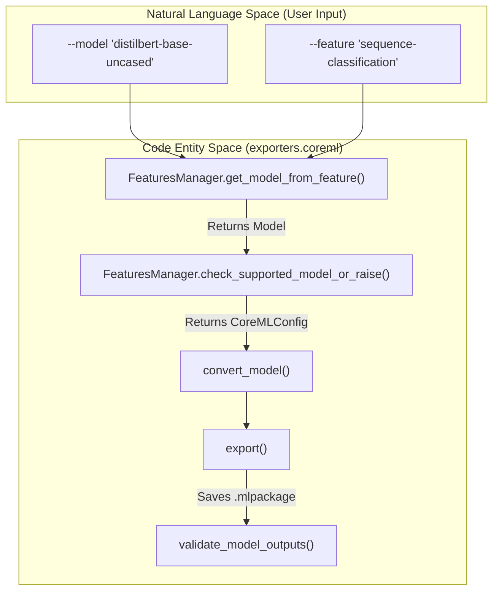
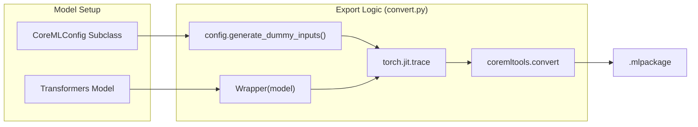

<!-- source: DeepWiki mcp.deepwiki.com · repo huggingface/exporters · page 1.1 Getting Started · fetched 2026-10-26 -->

# Getting Started

<details>
<summary>Relevant source files</summary>

The following files were used as context for generating this wiki page:

- [README.md](README.md)
- [setup.py](setup.py)
- [src/exporters/coreml/__main__.py](src/exporters/coreml/__main__.py)

</details>


The `huggingface/exporters` package provides a streamlined workflow for converting 🤗 Transformers models to Apple's Core ML format. It abstracts the complexity of `coremltools` by using pre-defined configuration objects tailored for specific model architectures and tasks.

## Installation and Requirements

To ensure compatibility with the latest Transformer architectures and Core ML features (such as ML Programs), the environment must meet specific dependency versions.

### Dependencies
*   **Python**: `>= 3.8.0` [setup.py:14-14]()
*   **Transformers**: `>= 4.30.0` [setup.py:16-16]()
*   **coremltools**: `>= 7` [setup.py:17-17]()

### Environment Setup
While conversion can be performed on Linux, **macOS 12.0+** is required to run the validation step, as it depends on the proprietary Core ML framework to execute the generated `.mlpackage` [README.md:52-52](), [src/exporters/coreml/__main__.py:65-65]().

```bash
# Clone the repository
git clone https://github.com/huggingface/exporters.git
cd exporters

# Install in editable mode
pip install -e .
```
Sources: [README.md:37-48](), [setup.py:14-18]()

---

## Quick-Start: Command Line Interface (CLI)

The easiest way to export a model is via the `exporters.coreml` module. The CLI automatically handles preprocessor loading, model instantiation, and validation.

### Exporting from the Hub
To export a model like `distilbert-base-uncased` to the current directory:

```bash
python -m exporters.coreml --model=distilbert-base-uncased exported/
```
[README.md:99-99]()

### Exporting Local Checkpoints
If you have a local directory containing `pytorch_model.bin` (or `tf_model.h5`) and the associated tokenizer/processor files, point the `--model` argument to that path:

```bash
python -m exporters.coreml --model=./local-checkpoint-dir/ exported/
```
[README.md:145-145]()

### Data Flow: CLI Execution
The diagram below illustrates how the CLI translates a model ID into a serialized Core ML file.

**CLI Export Pipeline**

Sources: [src/exporters/coreml/__main__.py:138-141](), [src/exporters/coreml/__main__.py:45-51](), [src/exporters/coreml/__main__.py:70-70]()

---

## Programmatic API

For integration into existing Python pipelines, you can use the `FeaturesManager` and `export` functions directly.

### Basic Export Script
This approach allows for more control over the model loading and configuration.

```python
from exporters.coreml import export, FeaturesManager
from transformers import AutoTokenizer, AutoModelForSequenceClassification

model_id = "distilbert-base-uncased"
feature = "sequence-classification"

# 1. Load preprocessor and model
tokenizer = AutoTokenizer.from_pretrained(model_id)
model = AutoModelForSequenceClassification.from_pretrained(model_id)

# 2. Retrieve the appropriate CoreMLConfig
model_kind, model_config_class = FeaturesManager.check_supported_model_or_raise(model, feature=feature)
config = model_config_class(model.config)

# 3. Export to Core ML
mlmodel = export(preprocessor=tokenizer, model=model, config=config)
mlmodel.save("DistilBert.mlpackage")
```
Sources: [src/exporters/coreml/__main__.py:119-141](), [src/exporters/coreml/__main__.py:45-60]()

---

## Core Components and Implementation

The export process relies on a mapping between Transformers architectures and specialized Core ML configurations.

### The FeaturesManager
The `FeaturesManager` acts as the central registry. It maps a "feature" (e.g., `text-classification`, `token-classification`) to the correct `AutoModel` class and identifies the `CoreMLConfig` required for that specific architecture.
[src/exporters/coreml/features.py]()

### The Export Workflow
When `export()` is called, the system performs the following steps:
1.  **Wrapper Initialization**: The PyTorch model is wrapped in a `Wrapper` class to standardize inputs/outputs.
2.  **JIT Tracing**: The model is traced using `torch.jit.trace` with dummy inputs generated by the `CoreMLConfig`.
3.  **Conversion**: `coremltools.convert` is called, using the traced model and the input/output descriptions defined in the `CoreMLConfig`.
4.  **Metadata**: The resulting `MLModel` is populated with metadata and saved as an `mlpackage`.

**Component Interaction Diagram**

Sources: [src/exporters/coreml/__main__.py:35-51](), [README.md:119-121]()

### Output and Validation
Upon successful export, the tool validates the model by comparing the Core ML inference results against the original PyTorch/TensorFlow reference. It checks:
*   **Output Names**: Ensuring keys in the output dictionary match [README.md:110-110]().
*   **Output Shapes**: Ensuring tensor dimensions are identical [README.md:112-112]().
*   **Precision**: Ensuring values are within the absolute tolerance (`atol`) [README.md:113-113]().

Sources: [src/exporters/coreml/validate.py:30-30](), [src/exporters/coreml/__main__.py:62-72]()

---

