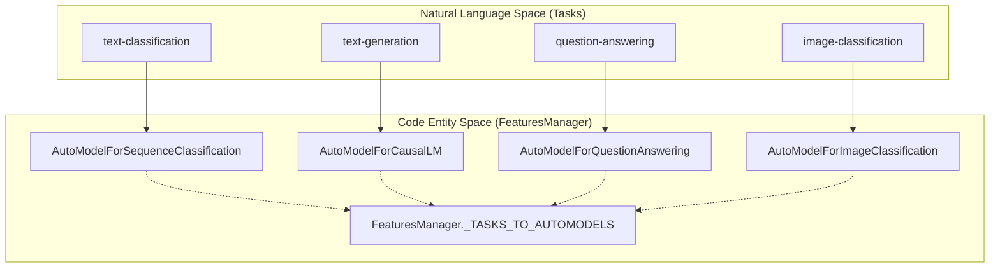
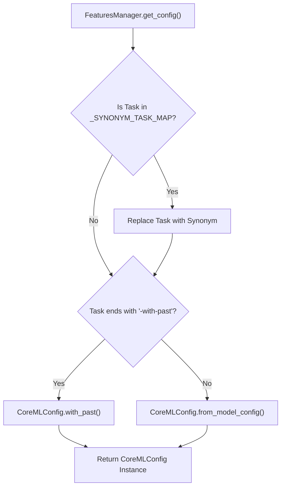

<!-- source: DeepWiki mcp.deepwiki.com · repo huggingface/exporters · page 1.2 Supported Models and Tasks · fetched 2026-10-26 -->

# Supported Models and Tasks

Relevant source files

The following files were used as context for generating this wiki page:

- [MODELS.md](MODELS.md)
- [README.md](README.md)
- [src/exporters/coreml/features.py](src/exporters/coreml/features.py)

The `exporters` library provides a structured framework for converting Hugging Face Transformers models to Apple's Core ML format. Support is determined by the availability of a `CoreMLConfig` object for a specific architecture, which defines the inputs, outputs, and necessary graph patches for a successful export [MODELS.md:19-21]().

## Supported Architectures and Tasks

The `FeaturesManager` class maintains the registry of supported models and their associated tasks (features). Each entry in the `_SUPPORTED_MODEL_TYPE` registry maps a model architecture to a set of features and its corresponding `CoreMLConfig` implementation [src/exporters/coreml/features.py:149-155]().

### Natural Language Processing (NLP)

| Architecture | Supported Features | Key Limitations |
| :--- | :--- | :--- |
| **BERT** | `feature-extraction`, `fill-mask`, `text-generation`, `multiple-choice`, `question-answering`, `text-classification`, `token-classification` | `BertLMHeadModel` depends on specific `coremltools` versions [MODELS.md:44-54]() |
| **GPT-2** | `feature-extraction`, `text-generation`, `text-classification`, `token-classification` | No `use_past` support due to fixed sequence lengths [MODELS.md:114-123]() |
| **Llama / Mistral** | `text-generation` | Optimized for Causal LM tasks [MODELS.md:124-126, 139-141]() |
| **BART / T5** | `feature-extraction`, `text2text-generation` | Seq2Seq models often only support `use_past=False` currently [MODELS.md:36-40, 210-214]() |

### Computer Vision (CV)

| Architecture | Supported Features | Implementation Notes |
| :--- | :--- | :--- |
| **ViT** | `feature-extraction`, `image-classification`, `masked-im` | Standard vision transformer support [src/exporters/coreml/features.py:330-335]() |
| **MobileViT** | `feature-extraction`, `image-classification`, `semantic-segmentation` | Highly optimized for mobile deployment [MODELS.md:241-245]() |
| **ConvNeXT** | `feature-extraction`, `image-classification` | CNN-based architecture support [MODELS.md:225-228]() |
| **YOLOS** | `object-detection` | Supports object detection task with bounding box outputs [src/exporters/coreml/features.py:343-346]() |

### Audio and Multimodal

| Architecture | Supported Features |
| :--- | :--- |
| **Whisper** | `automatic-speech-recognition` [src/exporters/coreml/features.py:337-341]() |
| **Wav2Vec2** | `automatic-speech-recognition` [src/exporters/coreml/features.py:324-328]() |

**Sources:** [src/exporters/coreml/features.py:99-350](), [MODELS.md:34-270]()

---

## Task-to-Code Mapping

The following diagram illustrates how high-level task strings (Features) map to specific `transformers` AutoModel classes and the internal `CoreMLConfig` hierarchy.

### Entity Mapping: Tasks to AutoModels

**Sources:** [src/exporters/coreml/features.py:99-120](), [src/exporters/coreml/features.py:133-147]()

---

## Known Limitations and Failure Modes

### Conversion Failures
Some models may appear to convert successfully but fail during runtime or consume excessive resources:
*   **RoFormer / Splinter:** These models trigger a known failure mode where Core ML attempts to allocate massive amounts of RAM (100+ GB) during model loading, eventually crashing the process [MODELS.md:186-199]().

### Feature Limitations
*   **Flexible Shapes:** Many architectures (like GPT-2) do not support flexible sequence lengths in their current Core ML implementation, which precludes the use of Key-Value (KV) caching (`use_past`) [MODELS.md:116-117]().
*   **Version Sensitivity:** Certain models like `BertLMHeadModel` or `ErnieForCausalLM` are sensitive to the `coremltools` version and may break on versions newer than specific commits (e.g., `50c5569`) [MODELS.md:54, 106]().

### Framework Support
*   **TensorFlow:** While the infrastructure exists, many TF-based AutoModels are currently commented out or not yet fully implemented in the registry [src/exporters/coreml/features.py:121-131]().

**Sources:** [MODELS.md:17-32](), [src/exporters/coreml/features.py:121-131]()

---

## Feature Resolution Logic

The `FeaturesManager` handles the resolution of tasks, including synonyms and "with-past" variants.

### Logic Flow: Task Resolution

**Sources:** [src/exporters/coreml/features.py:67-96](), [src/exporters/coreml/features.py:133-147]()

---

