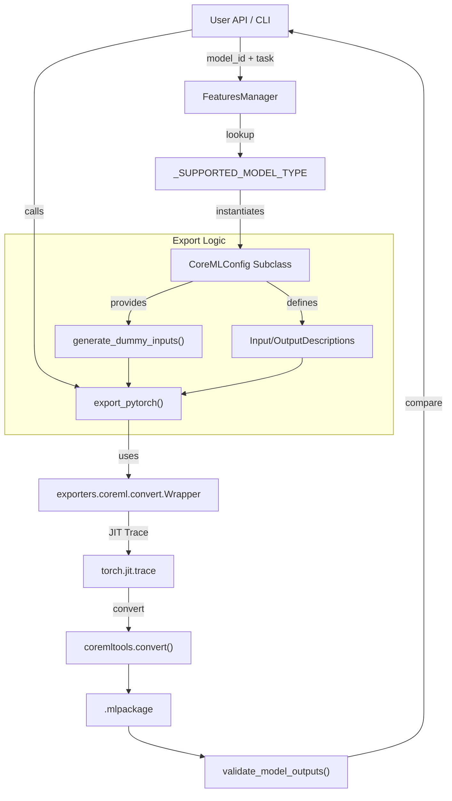
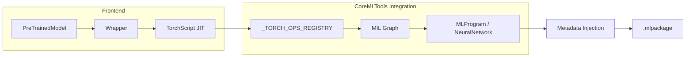

<!-- source: DeepWiki mcp.deepwiki.com · repo huggingface/exporters · page 2 Core Architecture · fetched 2026-10-26 -->

# Core Architecture

Relevant source files

The following files were used as context for generating this wiki page:

- [DESIGN_NOTES.md](DESIGN_NOTES.md)
- [src/exporters/coreml/config.py](src/exporters/coreml/config.py)
- [src/exporters/coreml/convert.py](src/exporters/coreml/convert.py)

The `exporters` library follows a layered design intended to bridge the gap between Hugging Face Transformers and Apple's Core ML framework. It automates the complex process of model tracing, tensor type conversion, and metadata injection, ensuring that exported models are "plug-and-play" for iOS and macOS developers.

The architecture is built around four primary pillars:
1.  **Configuration (`CoreMLConfig`)**: Defines the "contract" for the export, including input/output shapes and modalities.
2.  **Registry (`FeaturesManager`)**: Maps model architectures to specific tasks and their corresponding configuration classes.
3.  **Pipeline (`export`)**: Executes the transformation from PyTorch/TensorFlow to Core ML MIL (Model Intermediate Language) and finally `.mlpackage`.
4.  **Validation (`validate_model_outputs`)**: Ensures parity between the original framework's output and the exported Core ML model.

### System Overview Diagram

The following diagram illustrates how a user request flows through the internal code entities to produce a Core ML artifact.

"System Flow: From AutoModel to Core ML"

**Sources:** [src/exporters/coreml/features.py:449-480](), [src/exporters/coreml/convert.py:596-645](), [src/exporters/coreml/config.py:108-124]()

---

### CoreMLConfig: The Configuration Layer
The `CoreMLConfig` class acts as the central blueprint for the export process. It abstracts away the differences between text, vision, and audio models by requiring a `modality` property in every subclass [src/exporters/coreml/config.py:115-116]().

Key responsibilities include:
*   **Input/Output Mapping**: Using `InputDescription` and `OutputDescription` to define how internal tensors map to user-friendly Core ML names [src/exporters/coreml/config.py:44-93]().
*   **Dynamic Shapes**: Managing flexible sequence lengths via `ct.RangeDim` for text models [src/exporters/coreml/convert.py:97-101]().
*   **Operator Patching**: Providing a `patch_pytorch_ops` hook to override or fix PyTorch operations that `coremltools` cannot natively convert [src/exporters/coreml/config.py:277-283]().

For details on implementing custom configurations, see [CoreMLConfig: The Configuration Layer](#2.1).

**Sources:** [src/exporters/coreml/config.py:96-124](), [src/exporters/coreml/config.py:172-181]()

---

### FeaturesManager: The Model Registry
The `FeaturesManager` is a static discovery engine. It maintains the `_SUPPORTED_MODEL_TYPE` registry, which associates Transformers model types (e.g., `bert`, `gpt2`, `vit`) with their supported tasks (e.g., `sequence-classification`, `image-segmentation`) [src/exporters/coreml/features.py:449-455]().

It handles:
*   **Model Loading**: Automatically selecting the correct `AutoModel` class for a given task [src/exporters/coreml/features.py:562-570]().
*   **Task Synonyms**: Resolving aliases like `sentiment-analysis` to the canonical `text-classification` task [src/exporters/coreml/features.py:441-447]().

For details on the registry and supported architectures, see [FeaturesManager: The Model Registry](#2.2).

**Sources:** [src/exporters/coreml/features.py:482-508](), [src/exporters/coreml/features.py:592-610]()

---

### Export Pipeline
The export pipeline transforms a live model instance into a serialized Core ML file. The process typically uses `export_pytorch()`, which wraps the model in a `Wrapper` class to handle dictionary-to-tuple output conversions required by `torch.jit.trace` [src/exporters/coreml/convert.py:503-520]().

"Data Transformation Pipeline"

Key features of the pipeline:
*   **Modality Handling**: Automatically configures `ct.ImageType` for vision models to enable native camera integration on iOS [src/exporters/coreml/convert.py:202-215]().
*   **Quantization**: Supports post-training quantization via `coremltools.optimize.torch` [src/exporters/coreml/convert.py:706-715]().

For details on the conversion lifecycle, see [Export Pipeline](#2.3).

**Sources:** [src/exporters/coreml/convert.py:596-650](), [src/exporters/coreml/convert.py:756-780]()

---

### Validation Pipeline
After export, the system verifies the integrity of the model using `validate_model_outputs`. This step generates dummy inputs for both the original framework (PyTorch/TF) and the Core ML runtime [src/exporters/coreml/convert.py:829-845]().

Validation includes:
*   **Precision Check**: Comparing output tensors using absolute tolerance (`atol`) [src/exporters/coreml/convert.py:908-912]().
*   **Classifier Parity**: Verifying that class labels in the Core ML metadata match the `id2label` mapping in the Transformers config [src/exporters/coreml/convert.py:890-900]().
*   **Hardware Gating**: Automatically skipping Core ML inference if the host system is not running macOS [src/exporters/coreml/convert.py:867-870]().

For details on validation logic and error thresholds, see [Validation Pipeline](#2.4).

**Sources:** [src/exporters/coreml/convert.py:804-827](), [src/exporters/coreml/convert.py:920-935]()

---

