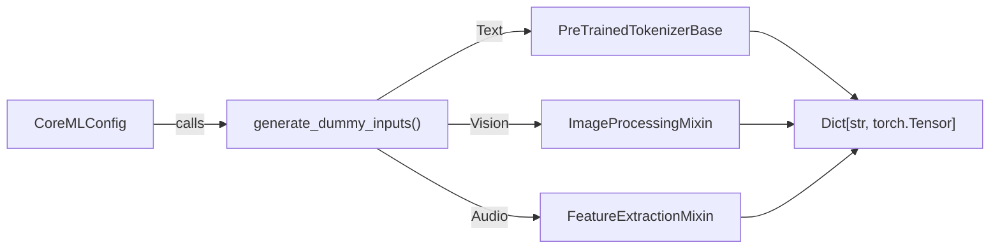

<!-- source: DeepWiki mcp.deepwiki.com · repo huggingface/exporters · page 2.1 CoreMLConfig: The Configuration Layer · fetched 2026-10-26 -->

# CoreMLConfig: The Configuration Layer

<details>
<summary>Relevant source files</summary>

The following files were used as context for generating this wiki page:

- [src/exporters/coreml/config.py](src/exporters/coreml/config.py)
- [src/exporters/coreml/models.py](src/exporters/coreml/models.py)

</details>


The `CoreMLConfig` class serves as the architectural blueprint for the export process. It defines how a Hugging Face Transformers model is mapped to a Core ML model, managing the translation of input/output specifications, task-specific behaviors, and hardware-specific optimizations. By subclassing `CoreMLConfig`, the library provides tailored export logic for different model architectures while maintaining a consistent interface for the export pipeline.

### Core Entities and Relationship

The following diagram illustrates how the `CoreMLConfig` orchestrates the relationship between the Transformers model configuration and the requirements of the Core ML format.

**Configuration Entity Mapping**
```mermaid
graph TD
    subgraph "Natural Language & Task Space"
        Task["Task (e.g., 'text-classification')"]
        Modality["Modality (e.g., 'text', 'vision')"]
    end

    subgraph "Code Entity Space: src/exporters/coreml/config.py"
        ConfigBase["CoreMLConfig"]
        InDesc["InputDescription"]
        OutDesc["OutputDescription"]
        
        ConfigBase -->|defines| InDesc
        ConfigBase -->|defines| OutDesc
        ConfigBase -->|uses| Task
        ConfigBase -->|has| Modality
    end

    subgraph "Model Specializations: src/exporters/coreml/models.py"
        BertConfig["BertCoreMLConfig"]
        GPT2Config["GPT2CoreMLConfig"]
        LlamaConfig["LlamaCoreMLConfig"]
        
        BertConfig --|> ConfigBase
        GPT2Config --|> ConfigBase
        LlamaConfig --|> ConfigBase
    end
```
Sources: [src/exporters/coreml/config.py:96-107](), [src/exporters/coreml/models.py:52-53](), [src/exporters/coreml/models.py:270-271]()

---

### Input and Output Descriptions

The conversion process relies on two primary data classes to describe the interface of the generated Core ML model:

*   **`InputDescription`**: Defines properties such as the input name, optionality, and shape constraints. For text models, it handles `sequence_length` (fixed or flexible ranges), and for vision models, it specifies `color_layout` (RGB/BGR) [src/exporters/coreml/config.py:45-69]().
*   **`OutputDescription`**: Defines the model outputs, including post-processing flags like `do_softmax` for classifiers or `do_upsample` and `do_argmax` for semantic segmentation tasks [src/exporters/coreml/config.py:72-94]().

### Modality and Task Handling

Every `CoreMLConfig` must define a `modality` (e.g., `"text"`, `"vision"`, `"audio"`) [src/exporters/coreml/config.py:115-116](). The configuration uses the `task` attribute to determine which inputs and outputs are required. For example, a `vision` model in a `semantic-segmentation` task will automatically include logic for resizing outputs to match input dimensions if `do_upsample` is set [src/exporters/coreml/config.py:84-86]().

Sources: [src/exporters/coreml/config.py:108-125](), [src/exporters/coreml/models.py:35-39]()

---

### Sequence Length and Flexible Shapes

Core ML supports both fixed and flexible input shapes. `CoreMLConfig` manages this through:
*   **`input_ids_sequence_length`**: Determines the size of text inputs [src/exporters/coreml/config.py:207-219]().
*   **Flexible Shapes**: If `sequence_length` is provided as a tuple `(min, max)` in `InputDescription`, the exporter configures Core ML to accept variable-length inputs within that range [src/exporters/coreml/config.py:57-60]().

### KV-Cache (use_past) Support

For autoregressive models (like GPT-2 or Llama), `CoreMLConfig` supports the `use_past` flag. When enabled, the configuration:
1.  Appends `past_key_values` to the model inputs [src/exporters/coreml/config.py:178-180]().
2.  Adds `present_key_values` to the model outputs [src/exporters/coreml/config.py:313-315]().
3.  Automatically calculates the shapes for these tensors based on the model's hidden size and number of layers [src/exporters/coreml/config.py:461-487]().

Sources: [src/exporters/coreml/config.py:151-169](), [src/exporters/coreml/config.py:461-487]()

---

### Dummy Input Generation

To trace the PyTorch model during export, `CoreMLConfig` provides a `generate_dummy_inputs` method. This creates representative tensors (e.g., `input_ids`, `attention_mask`, `pixel_values`) that match the expected shapes and types defined in the configuration [src/exporters/coreml/config.py:642-658]().

**Input Generation Flow**

Sources: [src/exporters/coreml/config.py:642-658](), [src/exporters/coreml/config.py:706-724](), [src/exporters/coreml/config.py:767-785]()

---

### The patch_pytorch_ops Hook

One of the most critical features for supporting diverse architectures is the `patch_pytorch_ops` method. This hook allows specific model configurations to provide custom implementations for PyTorch operations that are either unsupported or incorrectly handled by the default `coremltools` converter [src/exporters/coreml/models.py:99-109]().

For example:
*   **`CvtCoreMLConfig`** patches `einsum` for specific equations [src/exporters/coreml/models.py:142-157]().
*   **`FalconCoreMLConfig`** patches the `to` operator to handle `bfloat16` fallbacks [src/exporters/coreml/models.py:207-226]().

For a detailed breakdown of how each model architecture utilizes these features, see [Model-Specific Config Specializations](#2.1.1).

Sources: [src/exporters/coreml/models.py:99-109](), [src/exporters/coreml/models.py:142-157](), [src/exporters/coreml/models.py:207-226]()

---

