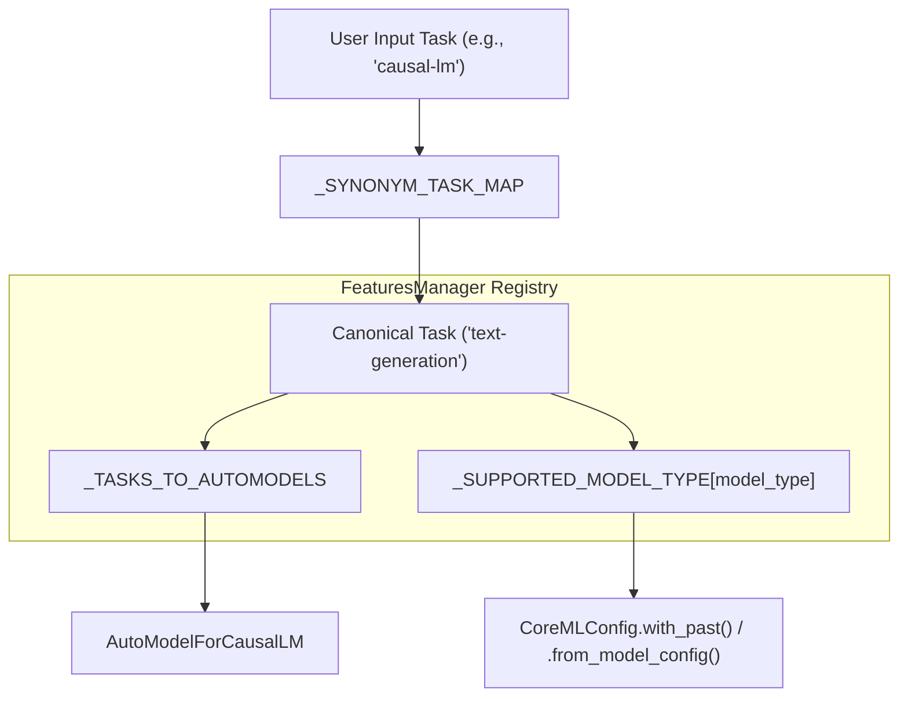
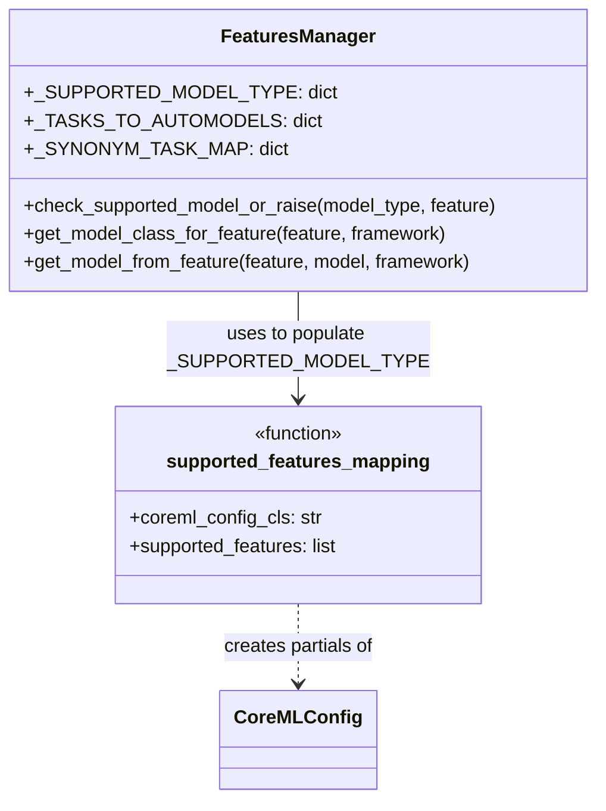

<!-- source: DeepWiki mcp.deepwiki.com · repo huggingface/exporters · page 2.2 FeaturesManager: The Model Registry · fetched 2026-10-26 -->

# FeaturesManager: The Model Registry

Relevant source files

The following files were used as context for generating this wiki page:

- [src/exporters/__init__.py](src/exporters/__init__.py)
- [src/exporters/coreml/__init__.py](src/exporters/coreml/__init__.py)
- [src/exporters/coreml/features.py](src/exporters/coreml/features.py)

The `FeaturesManager` is a central static class that acts as the registry and factory for the Core ML export pipeline. It manages the mapping between Hugging Face model architectures, their supported tasks (features), and the corresponding `CoreMLConfig` specializations required for conversion.

## Core Registry: `_SUPPORTED_MODEL_TYPE`

The heart of the registry is the `_SUPPORTED_MODEL_TYPE` dictionary [src/exporters/coreml/features.py:149](). This map associates model types (e.g., `"bert"`, `"gpt2"`, `"vit"`) with their supported export features.

Each entry in this registry is populated using the `supported_features_mapping` helper function [src/exporters/coreml/features.py:67-96](). This factory function takes a list of feature strings and a string path to a `CoreMLConfig` subclass, returning a dictionary of `partial` constructors.

### Feature Mapping Logic
When `supported_features_mapping` is invoked:
1. It resolves the `coreml_config_cls` string to an actual class reference within the `exporters.coreml.models` namespace [src/exporters/coreml/features.py:83-87]().
2. For standard features, it creates a partial that calls `from_model_config(task=feature)` [src/exporters/coreml/features.py:94]().
3. For features containing `-with-past`, it creates a partial that calls `with_past(task=task)` to enable Key-Value (KV) cache support [src/exporters/coreml/features.py:90-92]().

**Sources:** [src/exporters/coreml/features.py:67-96](), [src/exporters/coreml/features.py:149-174]()

---

## Task and Framework Management

`FeaturesManager` handles the translation between high-level task names and the specific `AutoModel` classes required to load them in PyTorch or TensorFlow.

### AutoModel Mapping
The class maintains `_TASKS_TO_AUTOMODELS` [src/exporters/coreml/features.py:103-120]() and `_TASKS_TO_TF_AUTOMODELS` [src/exporters/coreml/features.py:122-131]() to ensure that the correct model head is loaded for a given export task. For example, the `text-generation` task is mapped to `AutoModelForCausalLM` [src/exporters/coreml/features.py:105]().

### Task Synonyms
To provide a flexible CLI and API, the `_SYNONYM_TASK_MAP` [src/exporters/coreml/features.py:133-147]() maps common aliases to canonical task names:
| Alias | Canonical Task |
| :--- | :--- |
| `causal-lm` | `text-generation` |
| `masked-lm` | `fill-mask` |
| `seq2seq-lm` | `text2text-generation` |
| `ctc` | `automatic-speech-recognition` |

### Code Entity Relationship: Task Resolution
The following diagram illustrates how a user-provided task string is resolved to a specific model loader and configuration factory.

**Task Resolution Flow**

**Sources:** [src/exporters/coreml/features.py:100-147](), [src/exporters/coreml/features.py:345-360]()

---

## Model Loading and Validation

The `FeaturesManager` provides static methods to instantiate models and their configurations while ensuring framework compatibility.

### `get_model_from_feature`
This method [src/exporters/coreml/features.py:382-423]() is the primary entry point for loading a model for export.
1. **Framework Validation**: It checks if the requested framework (PyTorch/TF) is installed [src/exporters/coreml/features.py:399-405]().
2. **Task Resolution**: It maps synonyms to canonical tasks [src/exporters/coreml/features.py:407]().
3. **Model Instantiation**: It uses the mapped `AutoModel` class to load the model from the Hugging Face Hub or a local path.
4. **TorchScript Mode**: For PyTorch models, it automatically sets `torchscript=True` during loading [src/exporters/coreml/features.py:414]() to ensure the model is compatible with JIT tracing.

### `check_supported_model_or_raise`
This utility [src/exporters/coreml/features.py:341-380]() validates that a specific model architecture and task combination is registered in the `_SUPPORTED_MODEL_TYPE` map. If the model type is known but the task is not supported, it provides a descriptive error message listing the available features for that architecture [src/exporters/coreml/features.py:365-375]().

**Sources:** [src/exporters/coreml/features.py:341-423]()

---

## Implementation Details: Registry Factory

The following diagram bridges the "Natural Language" concept of a registry to the specific code entities in `features.py`.

**Registry Architecture**

### Key Functions
*   **`get_supported_features_for_model_type`** [src/exporters/coreml/features.py:307-339](): Returns the list of features supported for a given model architecture, including both standard and "with-past" variants.
*   **`get_config`** [src/exporters/coreml/features.py:425-450](): A factory method that retrieves the specific `CoreMLConfig` for a model and task, instantiating it with the model's `PretrainedConfig`.

**Sources:** [src/exporters/coreml/features.py:307-450](), [src/exporters/coreml/features.py:67-96]()

---

