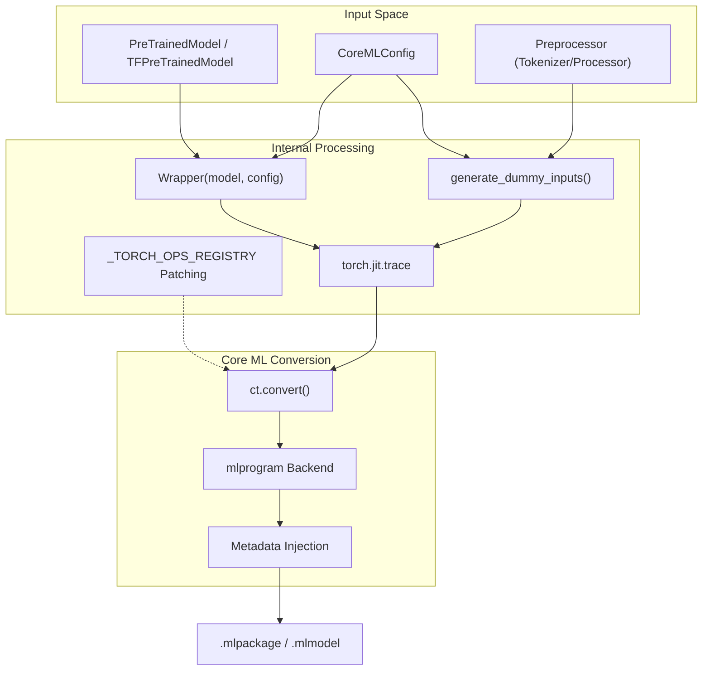
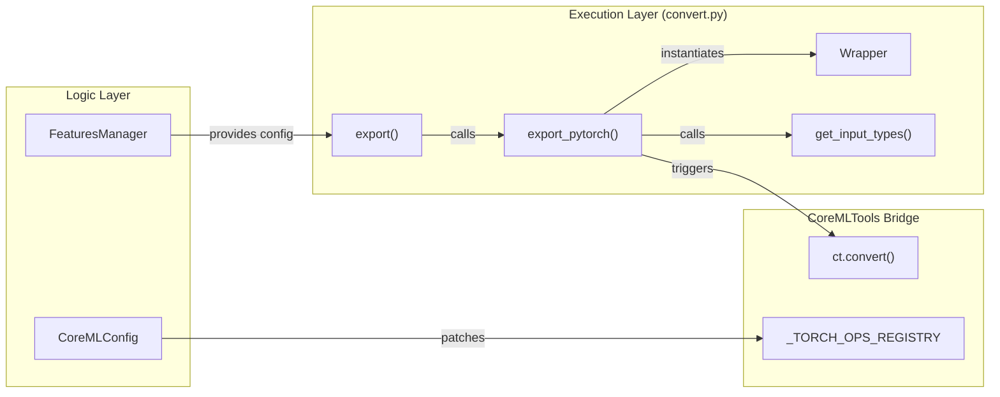

<!-- source: DeepWiki mcp.deepwiki.com · repo huggingface/exporters · page 2.3 Export Pipeline · fetched 2026-10-26 -->

# Export Pipeline

Relevant source files

The following files were used as context for generating this wiki page:

- [src/exporters/coreml/__main__.py](src/exporters/coreml/__main__.py)
- [src/exporters/coreml/convert.py](src/exporters/coreml/convert.py)

The export pipeline is the central orchestration layer of the `huggingface/exporters` repository. It manages the end-to-end transformation of a Hugging Face model (PyTorch or TensorFlow) into a Core ML model package. This process involves wrapping the model for compatibility, resolving input types (Text, Vision, Audio), tracing the graph via JIT, and applying metadata for deployment in Apple ecosystem applications.

## High-Level Conversion Lifecycle

The lifecycle begins with a `CoreMLConfig` object and a loaded model. The pipeline handles the transition from high-level Hugging Face abstractions to the `coremltools` MIL (Model Intermediate Language) representation.

### Data Flow Diagram

The following diagram illustrates the flow from a `PreTrainedModel` to a saved `.mlpackage`.

**Export Pipeline Data Flow**

**Sources:** [src/exporters/coreml/convert.py:1107-1180](), [src/exporters/coreml/convert.py:1210-1280]()

## Core Functions: `export()` and `export_pytorch()`

The entry point for the pipeline is the `export()` function, which acts as a router. It currently delegates almost exclusively to `export_pytorch()` for PyTorch models [src/exporters/coreml/convert.py:1107-1122]().

### `export_pytorch()`
This function executes the heavy lifting of the conversion:
1.  **Wrapper Initialization**: It wraps the model in a `Wrapper` class to ensure output formats match Core ML expectations [src/exporters/coreml/convert.py:1152-1153]().
2.  **Input Resolution**: It calls `get_input_types()` to determine if inputs should be `ct.TensorType` or `ct.ImageType` based on the `CoreMLConfig` [src/exporters/coreml/convert.py:1158-1160]().
3.  **JIT Tracing**: It generates dummy inputs and uses `torch.jit.trace` to create a static graph of the model [src/exporters/coreml/convert.py:1165-1175]().
4.  **Conversion**: It invokes `coremltools.convert()` with the `mlprogram` backend [src/exporters/coreml/convert.py:1181-1193]().

**Sources:** [src/exporters/coreml/convert.py:1107-1200]()

## The Wrapper Class

The `Wrapper` class (defined in `convert.py`) is a `torch.nn.Module` that encapsulates the original model. Its primary roles are:
*   **Input Ordering**: Ensuring inputs are passed to the model in the correct order defined by the config [src/exporters/coreml/convert.py:1010-1030]().
*   **Output Formatting**: Converting model output objects (like `BaseModelOutput`) into flat tuples or dictionaries that Core ML can serialize [src/exporters/coreml/convert.py:1040-1055]().
*   **Task-Specific Logic**: For example, in `question-answering`, it extracts `start_logits` and `end_logits` [src/exporters/coreml/convert.py:1068-1072]().

**Sources:** [src/exporters/coreml/convert.py:985-1104]()

## Input Type Resolution

The `get_input_types()` function inspects the `CoreMLConfig` and the `preprocessor` to define the interface of the generated model.

| Modality | Core ML Type | Logic |
| :--- | :--- | :--- |
| **Text** | `ct.TensorType` | Resolves `input_ids`, `attention_mask` as `Int32` [src/exporters/coreml/convert.py:128-141](). |
| **Vision** | `ct.ImageType` | Resolves normalization (mean/std) and channel ordering (RGB) [src/exporters/coreml/convert.py:230-260](). |
| **Audio** | `ct.TensorType` | Maps `input_values` or `input_features` [src/exporters/coreml/convert.py:270-285](). |

**Sources:** [src/exporters/coreml/convert.py:106-290]()

## Op Patching via `_TORCH_OPS_REGISTRY`

Core ML does not natively support every PyTorch operation. The pipeline uses a global registry to "patch" or override how specific PyTorch ops are translated into MIL.

*   **Registry**: `coremltools.converters.mil.frontend.torch.torch_op_registry._TORCH_OPS_REGISTRY` [src/exporters/coreml/convert.py:20-20]().
*   **Mechanism**: The `CoreMLConfig.patch_pytorch_ops()` method is called before conversion. Specific model configs (like `ErnieCoreMLConfig`) override this to register custom MIL builders for unsupported ops [src/exporters/coreml/config.py:465-467]().

**Sources:** [src/exporters/coreml/convert.py:1178-1179](), [src/exporters/coreml/config.py:461-468]()

## Backends and Post-Processing

### ML Program vs. Neural Network
The exporter defaults to the `mlprogram` backend, which is the modern Core ML format (introduced in iOS 15/macOS 12). This allows for better performance on the Neural Engine and supports typed tensors [src/exporters/coreml/convert.py:1189-1191]().

### Metadata Injection
After the core conversion, the pipeline injects metadata into the `MLModel` object:
*   **Feature Names**: Renames outputs from generic indices to human-readable names like `logits` or `last_hidden_state` [src/exporters/coreml/convert.py:1210-1230]().
*   **Classifier Labels**: If the task is a classification task, it embeds the `id2label` mapping directly into the model's `predicted_feature_name` and `class_labels` [src/exporters/coreml/convert.py:1250-1275]().
*   **Version Info**: Adds the Transformers version and the `CoreMLConfig` class name to the model's metadata [src/exporters/coreml/convert.py:1285-1290]().

**Sources:** [src/exporters/coreml/convert.py:1180-1295]()

## Entity Mapping: Code to System

The following diagram maps the logical stages of the pipeline to the specific code entities responsible for them.

**Code Entity Mapping**

**Sources:** [src/exporters/coreml/convert.py:1107-1180](), [src/exporters/coreml/features.py:460-480](), [src/exporters/coreml/config.py:461-468]()

---

