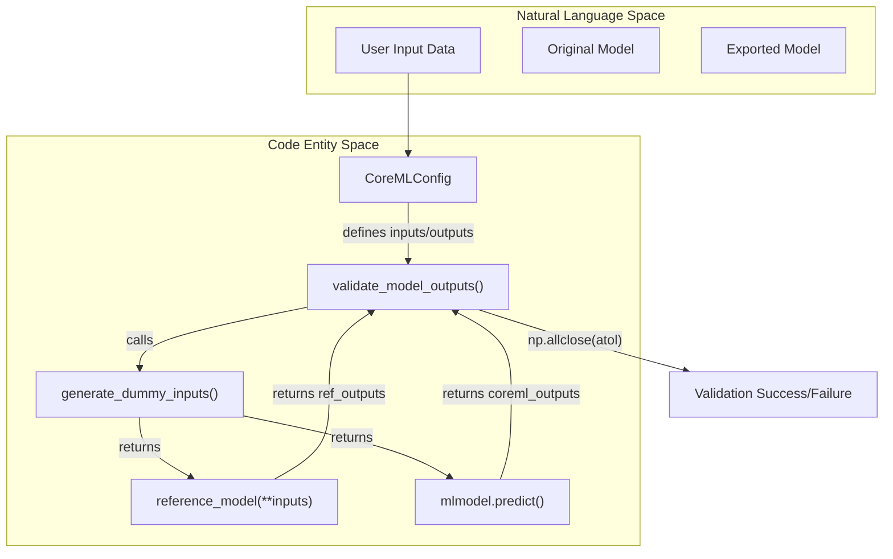
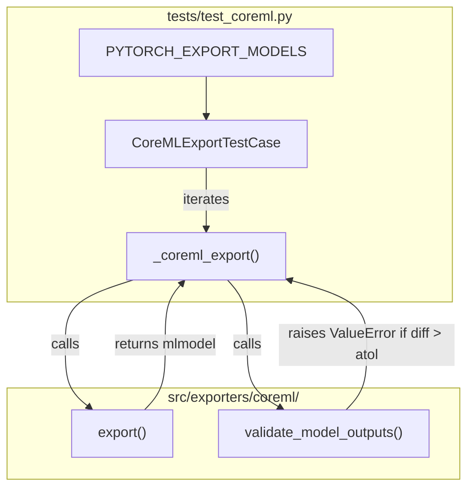

<!-- source: DeepWiki mcp.deepwiki.com · repo huggingface/exporters · page 2.4 Validation Pipeline · fetched 2026-10-26 -->

# Validation Pipeline

Relevant source files

The following files were used as context for generating this wiki page:

- [src/exporters/coreml/validate.py](src/exporters/coreml/validate.py)
- [tests/test_coreml.py](tests/test_coreml.py)

The validation pipeline is a critical component of the `exporters` library that ensures parity between the original Transformers model (PyTorch or TensorFlow) and the exported Core ML model. It performs automated inference comparisons using dummy data to verify that the conversion process has not introduced significant numerical deviations or structural errors.

## The `validate_model_outputs` Function

The entry point for validation is `validate_model_outputs`, defined in `src/exporters/coreml/validate.py`. This function automates the comparison between a reference model and its Core ML counterpart.

### Implementation Flow

1.  **Input Resolution**: It identifies the framework (PyTorch or TensorFlow) of the reference model [src/exporters/coreml/validate.py:64-67]().
2.  **Dummy Data Generation**: It calls `config.generate_dummy_inputs` to create inputs suitable for both the reference model and Core ML [src/exporters/coreml/validate.py:69]().
3.  **Input Mapping**: It reconciles input names, specifically handling `past_key_values` for models with KV-caching by grouping individual Core ML inputs into the tuple structure expected by Transformers [src/exporters/coreml/validate.py:77-92]().
4.  **Reference Inference**: The reference model performs inference. If it is a Seq2Seq model, the encoder is extracted if `config.seq2seq == "encoder"` [src/exporters/coreml/validate.py:94-98]().
5.  **Core ML Inference**: The `mlmodel.predict()` method is invoked using the `coremltools` runtime [src/exporters/coreml/validate.py:108]().
6.  **Comparison**: The outputs are compared using absolute tolerance (`atol`) [src/exporters/coreml/validate.py:162-167]().

### Data Flow and Entity Association

The following diagram illustrates how the validation logic bridges the gap between the Transformers reference model and the exported `MLModel`.

**Validation Data Flow**

Sources: [src/exporters/coreml/validate.py:37-43](), [src/exporters/coreml/validate.py:69-70](), [src/exporters/coreml/validate.py:98-108]()

## Specialized Validation Logic

### Classifier Validation
For classification tasks, Core ML models often utilize specific metadata (`predictedFeatureName` and `predictedProbabilitiesName`) [src/exporters/coreml/validate.py:128-141]().
*   **Label Parity**: The pipeline verifies that the predicted class string from Core ML matches the result of `np.argmax` on the reference logits using the model's `id2label` mapping [src/exporters/coreml/validate.py:131-139]().
*   **Probability Parity**: Reference logits are passed through a local `softmax` implementation [src/exporters/coreml/validate.py:31-34]() and compared against the probability dictionary returned by Core ML [src/exporters/coreml/validate.py:143-169]().

### KV-Cache (Past Key Values) Reconciliation
Core ML does not natively support the recursive tuple structure of PyTorch's `past_key_values`. During validation:
*   **Inputs**: The pipeline flattens `past_key_values` into individual tensors named `past_key_values_N_key/value` for Core ML [src/exporters/coreml/validate.py:79-83]().
*   **Outputs**: The reference model's `past_key_values` output is unpacked into `present_N_key/value` to match the Core ML output dictionary [src/exporters/coreml/validate.py:102-105]().

### Post-processing Handling
For vision tasks, the pipeline handles common post-processing steps:
*   **Upsampling**: If `do_upsample` is set, the reference output is upsampled to match the Core ML output shape [src/exporters/coreml/validate.py:202-205]().
*   **Argmax**: For segmentation tasks, if `do_argmax` is active, the reference logits are converted to class indices before comparison [src/exporters/coreml/validate.py:207-210]().

Sources: [src/exporters/coreml/validate.py:120-171](), [src/exporters/coreml/validate.py:79-92](), [src/exporters/coreml/validate.py:202-210]()

## Integration in Test Suite

The validation pipeline is the core of the library's integration tests. The `CoreMLExportTestCase` class uses `validate_model_outputs` to certify every supported model architecture.

**Test Execution Pipeline**

Sources: [tests/test_coreml.py:67-83](), [tests/test_coreml.py:128-182](), [tests/test_coreml.py:174-180]()

### Environment Gating
Because Core ML inference requires the Apple framework, validation is gated by specific decorators:
*   `@require_coreml`: Ensures `coremltools` is installed [tests/test_coreml.py:121]().
*   `@require_macos`: Ensures the test is running on macOS, as `mlmodel.predict()` is unavailable on other platforms [tests/test_coreml.py:122]().

Sources: [tests/test_coreml.py:121-123](), [src/exporters/coreml/validate.py:108]()

---

