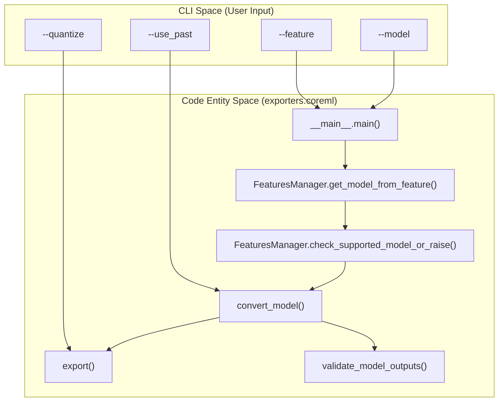
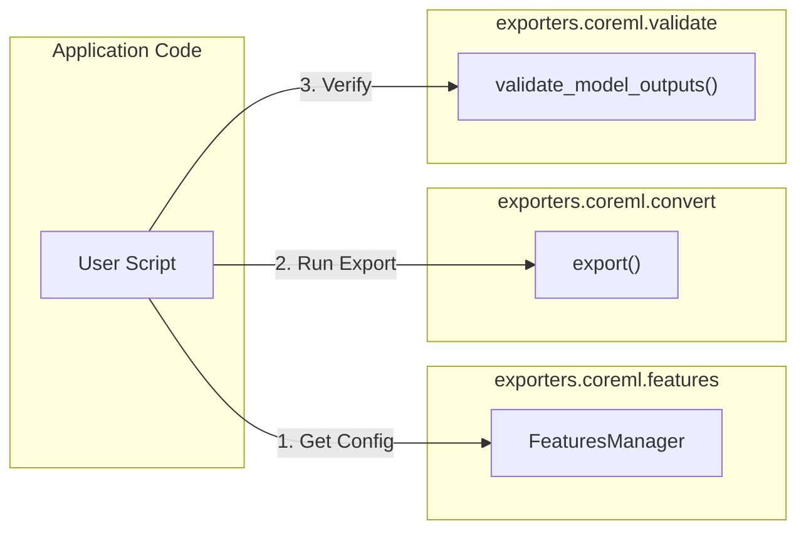

<!-- source: DeepWiki mcp.deepwiki.com · repo huggingface/exporters · page 3 CLI and Programmatic API · fetched 2026-10-26 -->

# CLI and Programmatic API

Relevant source files

The following files were used as context for generating this wiki page:

- [README.md](README.md)
- [src/exporters/coreml/__main__.py](src/exporters/coreml/__main__.py)

The `exporters` library provides two primary interfaces for converting 🤗 Transformers models to Core ML: a high-level **Command-Line Interface (CLI)** for quick conversions and a **Programmatic API** for deeper integration into Python workflows. Both interfaces leverage the `FeaturesManager` to resolve model architectures and the `export()` pipeline to generate `.mlpackage` files.

### Interface Overview

The conversion process is designed to be consistent across both interfaces. The system identifies the model's architecture, selects the appropriate `CoreMLConfig`, performs the export (via JIT tracing for PyTorch), and optionally validates the resulting model on macOS.

#### System Flow: CLI to Code Entities
The following diagram illustrates how CLI arguments map to internal code entities and functions during the execution of `python -m exporters.coreml`.

**CLI Execution Flow**

**Sources:** [src/exporters/coreml/__main__.py:75-178](), [src/exporters/coreml/convert.py:165-170]()

---

### Command-Line Interface (CLI)

The CLI is the most accessible way to use the exporter. It is invoked as a Python module: `python -m exporters.coreml`. It handles preprocessor loading (tokenizers, feature extractors), model instantiation, and file I/O.

Key capabilities include:
*   **Automatic Preprocessor Detection**: Uses `get_preprocessor` to fetch the correct tokenizer or image processor from the Hub [src/exporters/coreml/__main__.py:119-128]().
*   **Quantization**: Supports `float16` and `float32` weight quantization during export [src/exporters/coreml/__main__.py:95-97]().
*   **Compute Unit Optimization**: Allows targeting specific hardware like the Apple Neural Engine (ANE) via `--compute_units` [src/exporters/coreml/__main__.py:98-100]().
*   **Seq2Seq Workflow**: Automatically splits models like T5 or Whisper into separate `encoder_Model.mlpackage` and `decoder_Model.mlpackage` files [src/exporters/coreml/__main__.py:143-164]().

For a full reference of all arguments and example commands, see the [Command-Line Interface](#3.1) child page.

**Sources:** [src/exporters/coreml/__main__.py:75-172](), [README.md:96-104]()

---

### Programmatic API

The programmatic API allows developers to trigger exports directly from Python scripts. This is useful for custom training loops or when working with models that require manual patching before export.

The primary entry point is the `export()` function in `exporters.coreml.convert`.

#### Key API Components
| Entity | Role |
| :--- | :--- |
| `export()` | The core function that converts a PyTorch/TF model to Core ML [src/exporters/coreml/convert.py:165-170](). |
| `FeaturesManager` | A registry used to query supported tasks and retrieve the correct `CoreMLConfig` [src/exporters/coreml/features.py:461-463](). |
| `validate_model_outputs()` | Compares Core ML inference results against the original framework's outputs [src/exporters/coreml/validate.py:108-112](). |

**API Interaction Diagram**

**Sources:** [src/exporters/coreml/convert.py:165-243](), [src/exporters/coreml/features.py:461-518](), [src/exporters/coreml/validate.py:108-175]()

For detailed documentation on function signatures and extending the API for custom architectures, see the [Programmatic API](#3.2) child page.

---

### Seq2Seq Dual-Export Workflow

For sequence-to-sequence models (e.g., `text2text-generation`, `speech-seq2seq`), the library implements a dual-export logic. Because Core ML models are static, the encoder and decoder are exported as distinct artifacts. The CLI and `convert_model` function handle this by calling the export pipeline twice:
1.  **Encoder**: Exported with `seq2seq="encoder"` [src/exporters/coreml/__main__.py:146-153]().
2.  **Decoder**: Exported with `seq2seq="decoder"` and optional `use_past=True` for KV-cache support [src/exporters/coreml/__main__.py:157-164]().

**Sources:** [src/exporters/coreml/__main__.py:34-72](), [src/exporters/coreml/__main__.py:143-164]()

---

