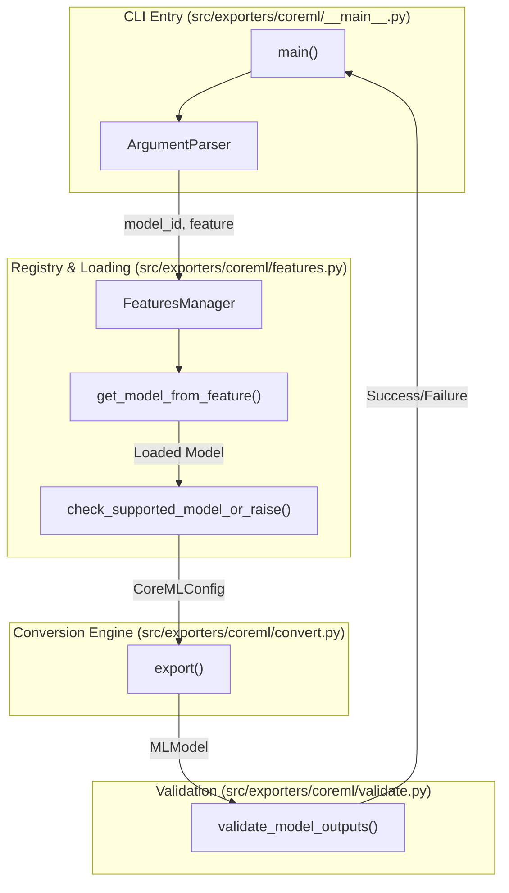
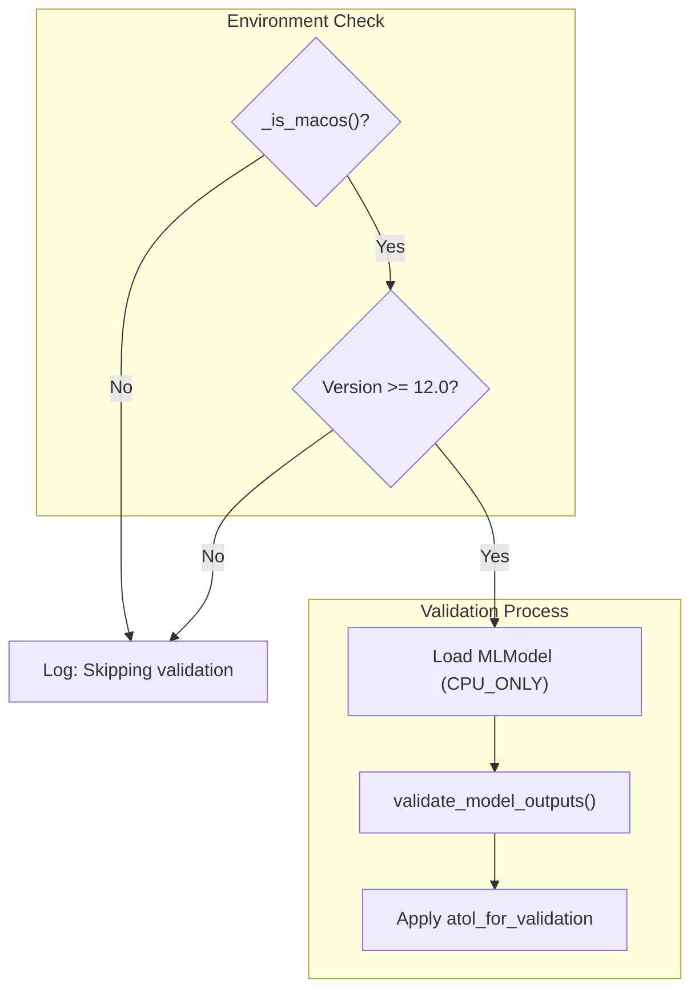

<!-- source: DeepWiki mcp.deepwiki.com · repo huggingface/exporters · page 3.1 Command-Line Interface · fetched 2026-10-26 -->

# Command-Line Interface

<details>
<summary>Relevant source files</summary>

The following files were used as context for generating this wiki page:

- [README.md](README.md)
- [src/exporters/coreml/__main__.py](src/exporters/coreml/__main__.py)

</details>


The `exporters.coreml` package provides a robust command-line interface (CLI) for converting Hugging Face Transformers models to the Core ML format. It abstracts the complexities of `coremltools` by leveraging a registry of pre-defined configurations, automated preprocessor detection, and a built-in validation suite.

### CLI Entry Point and Argument Reference

The CLI is invoked as a Python module: `python -m exporters.coreml`. The entry point is defined in the `main()` function of `src/exporters/coreml/__main__.py`.

| Argument | Type | Default | Description |
| :--- | :--- | :--- | :--- |
| `-m`, `--model` | `str` | **Required** | Model ID on the Hub or a local path to a checkpoint directory. |
| `--feature` | `str` | `feature-extraction` | The task/topology to export (e.g., `text-classification`, `causal-lm`). |
| `--quantize` | `str` | `float16` | Weight precision. Options: `float32`, `float16`. |
| `--compute_units` | `str` | `all` | Hardware optimization target. Options: `all`, `cpu_and_gpu`, `cpu_only`, `cpu_and_ne`. |
| `--use_past` | `flag` | `False` | Enables KV-cache support for autoregressive models. |
| `--preprocessor` | `str` | `auto` | Type of preprocessor to load. Options: `auto`, `tokenizer`, `feature_extractor`, `processor`. |
| `--framework` | `str` | `pt` | The source framework to load the model from (`pt` for PyTorch, `tf` for TensorFlow). |
| `--atol` | `float` | Config default | Absolute tolerance for numerical validation against the reference model. |
| `output` | `Path` | **Required** | Destination path for the `.mlpackage`. |

**Sources:**
- `src/exporters/coreml/__main__.py:75-111` (Argument definitions)
- `src/exporters/coreml/__main__.py:37-43` (Compute unit mapping)

---

### Data Flow: From CLI to MLPackage

The following diagram illustrates how CLI arguments are processed and passed through the `FeaturesManager` and `convert` modules to produce a validated Core ML model.

#### System Architecture and Code Entity Mapping


**Sources:**
- `src/exporters/coreml/__main__.py:119-141` (Model and preprocessor resolution)
- `src/exporters/coreml/__main__.py:45-51` (Calling the export engine)
- `src/exporters/coreml/__main__.py:70-70` (Calling validation)

---

### Implementation Details

#### Output Path Handling
The CLI automatically ensures the output path is valid. If the provided path does not end in `.mlpackage` or `.mlmodel`, it appends `Model.mlpackage` by default. It also creates parent directories if they do not exist.

**Sources:**
- `src/exporters/coreml/__main__.py:113-116` (Path sanitization)

#### Preprocessor Resolution
The `--preprocessor` argument determines which Hugging Face class is used to prepare dummy inputs for JIT tracing and validation. By default (`auto`), it uses `transformers.onnx.utils.get_preprocessor` to infer the correct type from the model configuration.

**Sources:**
- `src/exporters/coreml/__main__.py:119-128` (Preprocessor factory logic)

#### Seq2Seq Split Export
For Sequence-to-Sequence models (e.g., T5, Whisper), the CLI performs a dual-export workflow. If the feature is `text2text-generation` or `speech-seq2seq`, the `main()` function triggers two separate calls to `convert_model()`:
1. **Encoder**: Exported without `use_past`. Output is prefixed with `encoder_`.
2. **Decoder**: Exported with the requested `use_past` setting. Output is prefixed with `decoder_`.

**Sources:**
- `src/exporters/coreml/__main__.py:143-164` (Seq2Seq branching logic)
- `src/exporters/coreml/__main__.py:54-58` (Filename prefixing for splits)

---

### Validation Gating

Validation is a critical step that compares Core ML inference results against the original PyTorch/TensorFlow outputs. However, this process is gated by environment requirements:
- **OS Check**: Validation requires `coremltools` to execute the model, which is only possible on macOS.
- **Version Check**: The exported `mlpackage` (ML Program) requires macOS 12.0 or later.
- **Compute Unit**: Validation is explicitly run on `ComputeUnit.CPU_ONLY` to ensure maximum compatibility during the check.

#### Logic Flow for Validation


**Sources:**
- `src/exporters/coreml/__main__.py:65-70` (Validation gating logic)
- `src/exporters/coreml/convert.py:455-460` (Default `atol` resolution)

---

### Example Invocations

**Standard Text Classification Export:**
```bash
python -m exporters.coreml \
    --model distilbert-base-uncased-finetuned-sst-2-english \
    --feature text-classification \
    --quantize float16 \
    exported/
```

**Causal LM with KV-Cache (use_past):**
```bash
python -m exporters.coreml \
    --model gpt2 \
    --feature causal-lm \
    --use_past \
    gpt2_coreml/
```

**Vision Transformer with specific Compute Units:**
```bash
python -m exporters.coreml \
    --model google/vit-base-patch16-224 \
    --feature image-classification \
    --compute_units cpu_and_ne \
    vit_export/
```

**Sources:**
- `README.md:98-100` (Basic example)
- `README.md:126-126` (TensorFlow checkpoint example)
- `README.md:145-145` (Local checkpoint example)

---

