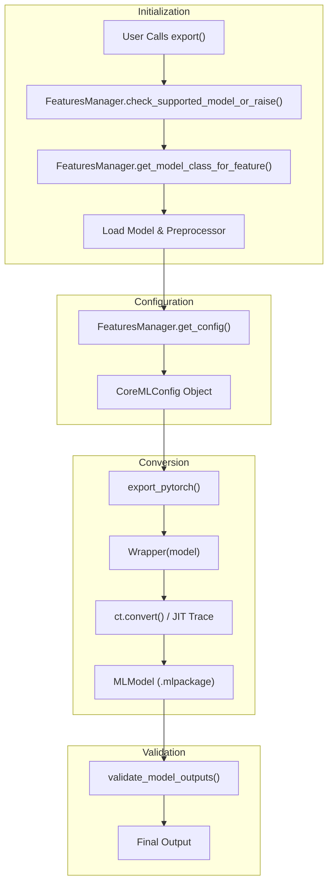
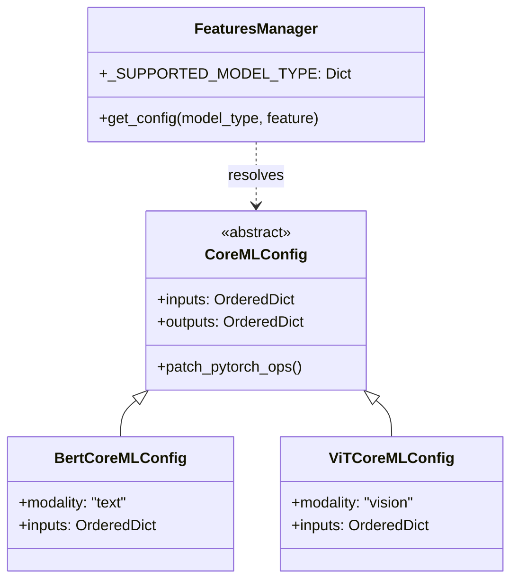

<!-- source: DeepWiki mcp.deepwiki.com · repo huggingface/exporters · page 3.2 Programmatic API · fetched 2026-10-26 -->

# Programmatic API

Relevant source files

The following files were used as context for generating this wiki page:

- [README.md](README.md)
- [src/exporters/coreml/config.py](src/exporters/coreml/config.py)
- [src/exporters/coreml/features.py](src/exporters/coreml/features.py)
- [src/exporters/coreml/validate.py](src/exporters/coreml/validate.py)

The `exporters` library provides a high-level Python API to programmatically convert 🤗 Transformers models to Core ML. This interface allows for fine-grained control over the export process, including custom task selection, sequence length constraints, and validation against reference PyTorch or TensorFlow implementations.

## Export Pipeline

The primary entry point for programmatic export is the `exporters.coreml.export()` function. This function orchestrates the loading of the model, the resolution of its configuration, and the conversion using `coremltools`.

### Key Functions

| Function | Purpose |
| :--- | :--- |
| `export()` | Main entry point for exporting a pre-trained model to Core ML [src/exporters/coreml/__init__.py:22-24](). |
| `export_pytorch()` | Handles the specific logic for tracing and converting PyTorch models [src/exporters/coreml/convert.py:270-272](). |
| `validate_model_outputs()` | Compares Core ML inference results against the reference framework to ensure parity [src/exporters/coreml/validate.py:37-43](). |

### Export Data Flow

The following diagram illustrates the data flow when calling `export()`.

**Model Export Logic Flow**

**Sources:** [src/exporters/coreml/convert.py:539-650](), [src/exporters/coreml/features.py:99-234]().

---

## FeaturesManager: Registry and Queries

The `FeaturesManager` class serves as the central registry for all supported architectures and tasks. It maps model types (e.g., `bert`, `gpt2`) to their corresponding `CoreMLConfig` classes and the appropriate `AutoModel` classes for specific tasks [src/exporters/coreml/features.py:99-149]().

### Useful Methods
- `check_supported_model_or_raise(model_type, feature)`: Validates if a model architecture supports a specific export task [src/exporters/coreml/features.py:236-258]().
- `get_config(model_type, feature)`: Returns the `CoreMLConfig` constructor for the model/task pair [src/exporters/coreml/features.py:306-324]().
- `get_model_class_for_feature(feature, framework)`: Returns the correct `AutoModel` (PyTorch) or `TFAutoModel` class [src/exporters/coreml/features.py:260-282]().

**Sources:** [src/exporters/coreml/features.py:99-324]().

---

## CoreMLConfig API

The `CoreMLConfig` class defines how a Transformers model's inputs and outputs are mapped to Core ML.

### Input and Output Descriptions
- **`InputDescription`**: Defines name, optionality, and shape constraints (e.g., `sequence_length`) [src/exporters/coreml/config.py:44-68]().
- **`OutputDescription`**: Defines name and post-processing steps like `do_softmax` or `do_argmax` [src/exporters/coreml/config.py:71-93]().

### Key Methods
- `with_past()`: A class method to instantiate a config with KV-cache support enabled (`use_past=True`) [src/exporters/coreml/config.py:151-169]().
- `patch_pytorch_ops()`: A hook used by subclasses to override or register custom PyTorch operators during JIT tracing to bypass `coremltools` limitations [src/exporters/coreml/config.py:273-281]().

**Sources:** [src/exporters/coreml/config.py:44-281]().

---

## Validation Pipeline

After conversion, `validate_model_outputs()` ensures the exported model behaves identically to the original.

1.  **Dummy Input Generation**: Uses `config.generate_dummy_inputs()` to create framework-specific tensors [src/exporters/coreml/validate.py:69]().
2.  **Reference Inference**: Runs the model using PyTorch or TensorFlow [src/exporters/coreml/validate.py:94-98]().
3.  **Core ML Inference**: Runs the `.predict()` method on the generated `MLModel` [src/exporters/coreml/validate.py:108]().
4.  **Comparison**: Compares outputs using an absolute tolerance (`atol`). For classifiers, it validates the predicted class labels and probabilities [src/exporters/coreml/validate.py:120-170]().

**Sources:** [src/exporters/coreml/validate.py:37-171]().

---

## Adding Support for Custom Architectures

To support a model architecture not currently in the registry, you must subclass `CoreMLConfig`.

### Implementation Steps

1.  **Define Modality**: Specify if the model is `text`, `vision`, or `audio` [src/exporters/coreml/config.py:189-193]().
2.  **Define Inputs**: Implement the `inputs` property to return an `OrderedDict` of `InputDescription` objects [src/exporters/coreml/config.py:171-181]().
3.  **Define Outputs**: Implement the `outputs` property to return an `OrderedDict` of `OutputDescription` objects [src/exporters/coreml/config.py:215-223]().
4.  **Register the Model**: Add the new config to `FeaturesManager._SUPPORTED_MODEL_TYPE` using `supported_features_mapping` [src/exporters/coreml/features.py:67-96]().

**Architecture Association Diagram**

**Sources:** [src/exporters/coreml/config.py:96-281](), [src/exporters/coreml/features.py:149-234]().

---

