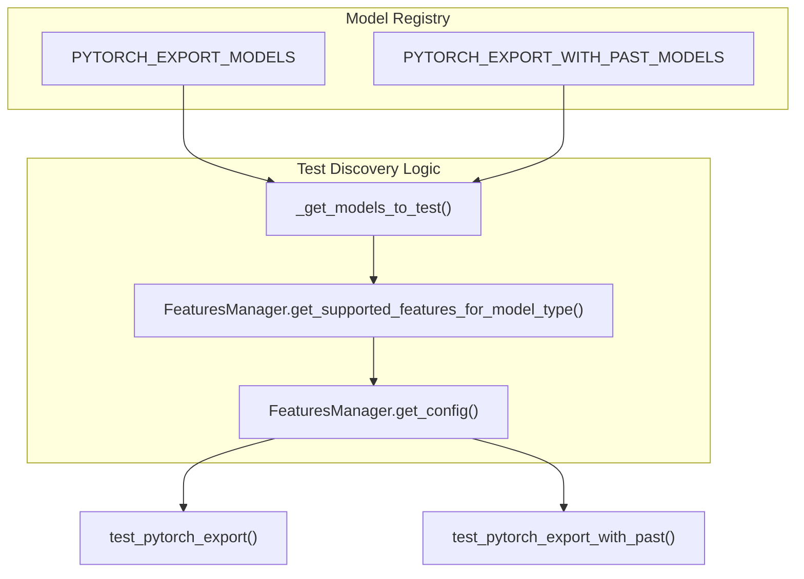
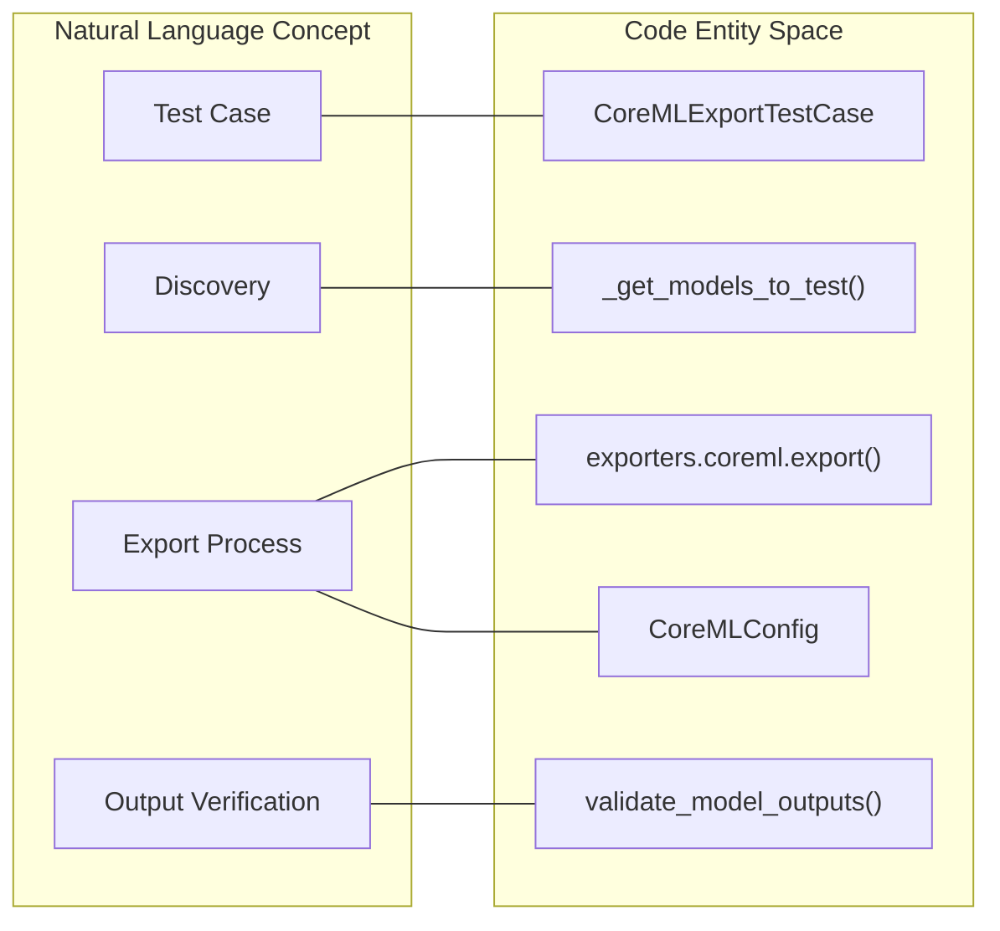

<!-- source: DeepWiki mcp.deepwiki.com · repo huggingface/exporters · page 4.1 Integration Test Suite · fetched 2026-10-26 -->

# Integration Test Suite

<details>
<summary>Relevant source files</summary>

The following files were used as context for generating this wiki page:

- [tests/test_coreml.py](tests/test_coreml.py)
- [tests/testing_utils.py](tests/testing_utils.py)

</details>


The integration test suite in `exporters` ensures that supported Transformers models can be successfully converted to Core ML format and that the resulting `.mlpackage` files produce outputs consistent with the original PyTorch or TensorFlow models. The primary entry point for these tests is `tests/test_coreml.py` [tests/test_coreml.py:1-205]().

## Test Infrastructure Overview

The suite uses `parameterized` to dynamically generate test cases based on lists of model architectures and tasks. It leverages specific decorators to gate execution based on environment capabilities, such as the presence of `coremltools` and a compatible macOS version (required for model validation) [tests/testing_utils.py:21-43]().

### Environment Gating
Tests are wrapped in decorators to prevent failures in environments missing necessary dependencies:
*   `@require_coreml`: Skips tests if `coremltools` is not installed [tests/testing_utils.py:38-39]().
*   `@require_macos`: Skips tests if the OS is not macOS or the version is below 12.0, as Core ML inference for validation requires the native framework [tests/testing_utils.py:41-42]().
*   `@slow`: Marks integration tests that involve full model loading and conversion [tests/test_coreml.py:185]().

### Data-Driven Parameterization
The suite maintains several registries of models to test:
*   `PYTORCH_EXPORT_MODELS`: A set of tuples containing `(model_type, checkpoint_path)` for standard exports (e.g., `beit`, `bert`, `gpt2`, `vit`) [tests/test_coreml.py:67-83]().
*   `PYTORCH_EXPORT_WITH_PAST_MODELS`: Models to be tested with Key-Value (KV) cache support enabled (`use_past=True`) [tests/test_coreml.py:85-88]().
*   `PYTORCH_EXPORT_SEQ2SEQ_WITH_PAST_MODELS`: Models requiring separate encoder/decoder exports [tests/test_coreml.py:90]().

## Test Execution Flow

The core logic resides in `CoreMLExportTestCase._coreml_export`. This method orchestrates the lifecycle from model loading to output validation.

### The `_coreml_export` Lifecycle
1.  **Model Loading**: Uses `FeaturesManager.get_model_class_for_feature` to identify the correct class and `AutoConfig` to initialize the model [tests/test_coreml.py:129-131]().
2.  **Configuration**: Initializes the architecture-specific `CoreMLConfig` using the model's config [tests/test_coreml.py:132]().
3.  **Export**: Calls `exporters.coreml.export` to generate the Core ML model, typically using `float32` quantization for validation stability [tests/test_coreml.py:138-143]().
4.  **Validation**: Calls `validate_model_outputs` to compare Core ML inference results against the reference PyTorch model using `coreml_config.atol_for_validation` [tests/test_coreml.py:144-150]().

### Sequence-to-Sequence (Seq2Seq) Handling
For models like T5 or Speech-to-Text models, the test suite performs a dual-stage export. It toggles the `coreml_config.seq2seq` attribute between `"encoder"` and `"decoder"` to test both components of the architecture independently [tests/test_coreml.py:136-165]().

### Test Suite Logic Flow
The following diagram illustrates how `_get_models_to_test` interacts with `FeaturesManager` to build the test matrix.

**Model Parameterization Flow**

**Sources:** [tests/test_coreml.py:67-113](), [tests/test_coreml.py:184-196]()

## Code Entity Mapping

The following diagram maps the natural language concepts of the test suite to the specific code entities implemented in `tests/test_coreml.py` and `src/exporters/coreml/`.

**Integration Test Entity Map**

**Sources:** [tests/test_coreml.py:100-123](), [exporters/coreml/__init__.py:22-26]()

## Extending the Tests

To add support for a new model or task, follow these steps:

1.  **Register Model**: Add the model type and a representative checkpoint to `PYTORCH_EXPORT_MODELS` [tests/test_coreml.py:67-83]().
2.  **Define Configuration**: Ensure a `CoreMLConfig` subclass exists for the model in `src/exporters/coreml/models.py`.
3.  **Verify Feature Support**: The `_get_models_to_test` function will automatically query `FeaturesManager` to determine which tasks (e.g., `text-classification`, `token-classification`) are supported for that model type and generate a test for each [tests/test_coreml.py:109-112]().
4.  **Run Tests**:
    ```bash
    pytest tests/test_coreml.py
    ```

### Unit Tests for Configuration
The suite also includes `CoreMLConfigTestCase` to verify the base configuration logic, such as:
*   Handling of unknown modalities or tasks [tests/test_coreml.py:41-49]().
*   Calculation of flexible output shapes for sequence lengths [tests/test_coreml.py:50-65]().

**Sources:** [tests/test_coreml.py:36-65](), [tests/test_coreml.py:100-113]()

---

