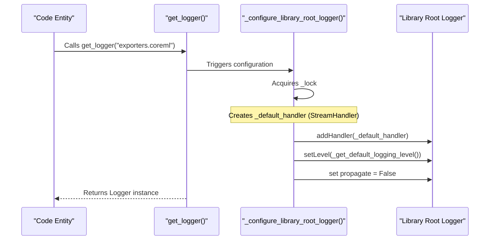
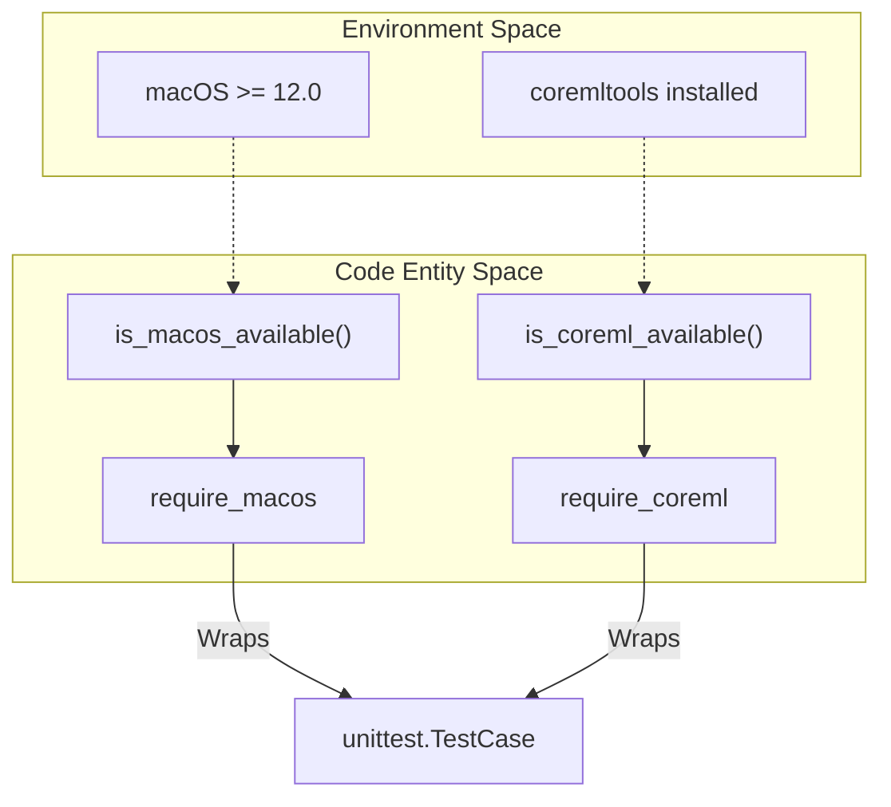

<!-- source: DeepWiki mcp.deepwiki.com · repo huggingface/exporters · page 4.2 Utility Modules · fetched 2026-10-26 -->

# Utility Modules

Relevant source files

The following files were used as context for generating this wiki page:

- [src/exporters/__init__.py](src/exporters/__init__.py)
- [src/exporters/coreml/__init__.py](src/exporters/coreml/__init__.py)
- [src/exporters/utils/__init__.py](src/exporters/utils/__init__.py)
- [src/exporters/utils/logging.py](src/exporters/utils/logging.py)
- [tests/testing_utils.py](tests/testing_utils.py)

The `exporters` library relies on a set of internal utilities to manage logging, environment-specific testing, and package-level exports. These modules ensure consistent behavior across different platforms (macOS vs. Linux) and provide the necessary infrastructure for debugging and verifying Core ML exports.

## Logging System

The logging utility in `src/exporters/utils/logging.py` is a direct adaptation from the `transformers` library [src/exporters/utils/logging.py:2-2](). it provides a centralized way to manage library-wide verbosity and formatting.

### Implementation Details
The system uses a root logger for the library, retrieved via `_get_library_name()` [src/exporters/utils/logging.py:64-66](). It defaults to a `WARNING` level [src/exporters/utils/logging.py:44-44]() unless overridden by the `TRANSFORMERS_VERBOSITY` environment variable [src/exporters/utils/logging.py:52-61]().

| Function | Purpose |
| :--- | :--- |
| `get_logger(name)` | Returns a logger instance, initializing the library root logger if necessary [src/exporters/utils/logging.py:110-121](). |
| `set_verbosity(level)` | Sets the logging level for the library root logger [src/exporters/utils/logging.py:146-162](). |
| `_configure_library_root_logger()` | Thread-safe initialization of the `StreamHandler` pointing to `sys.stderr` [src/exporters/utils/logging.py:74-90](). |

### Logging Flow
The following diagram illustrates how a call to `get_logger` triggers the configuration of the library's logging infrastructure.

**Logging Initialization Sequence**

**Sources:** [src/exporters/utils/logging.py:33-45](), [src/exporters/utils/logging.py:74-90](), [src/exporters/utils/logging.py:110-121]()

---

## Testing Helpers

Because Core ML inference and certain conversion features are platform-dependent, the library provides decorators in `tests/testing_utils.py` to gate tests based on the availability of `coremltools` and macOS environments.

### Environment Detection
The module checks for the presence of `coremltools` using `importlib.util.find_spec` [tests/testing_utils.py:21-21](). macOS availability is determined by checking if the OS is macOS and if the version is at least 12.0, utilizing `coremltools.models.utils` [tests/testing_utils.py:25-26]().

### Decorators
These decorators are used throughout the test suite to prevent failures on non-compatible systems:

*   **`require_coreml`**: Skips the test unless `coremltools` is installed [tests/testing_utils.py:38-39]().
*   **`require_macos`**: Skips the test unless the environment is macOS 12.0 or higher [tests/testing_utils.py:41-42]().

**Environment Dependency Mapping**

**Sources:** [tests/testing_utils.py:21-30](), [tests/testing_utils.py:32-42]()

---

## Package Exports

The library uses `__init__.py` files to expose a clean API surface to users, abstracting the internal directory structure.

### `exporters.coreml` Exports
The `src/exporters/coreml/__init__.py` file serves as the primary entry point for programmatic usage of the Core ML exporter.

| Exported Entity | Source | Purpose |
| :--- | :--- | :--- |
| `CoreMLConfig` | `exporters.coreml.config` | Base class for model-specific export configurations [src/exporters/coreml/__init__.py:17-17](). |
| `export` | `exporters.coreml.convert` | Main function to convert PyTorch models to Core ML [src/exporters/coreml/__init__.py:18-18](). |
| `validate_model_outputs` | `exporters.coreml.validate` | Utility to compare PyTorch and Core ML outputs [src/exporters/coreml/__init__.py:19-19](). |

### Versioning
The top-level `src/exporters/__init__.py` defines the package version, currently set to `0.0.1` [src/exporters/__init__.py:1-1]().

**Sources:** [src/exporters/__init__.py:1-2](), [src/exporters/coreml/__init__.py:17-20]()

---

