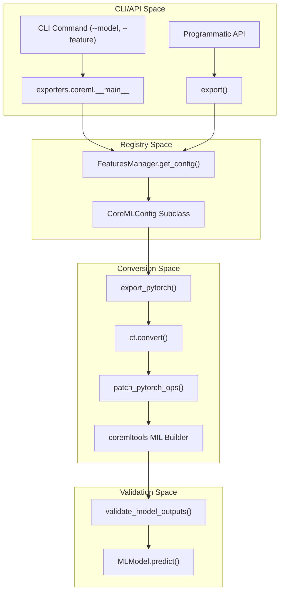
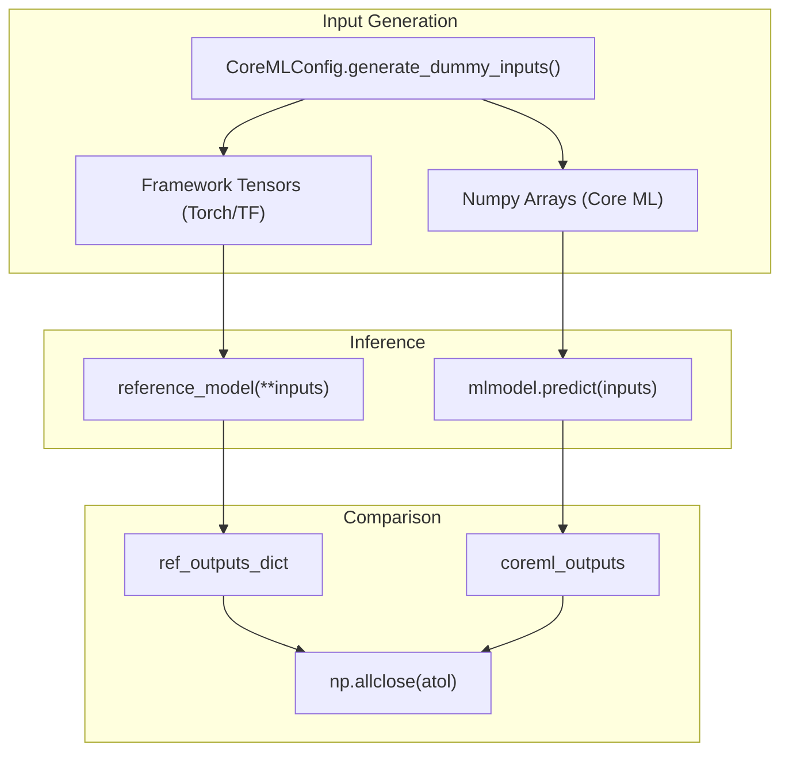

<!-- source: DeepWiki mcp.deepwiki.com · repo huggingface/exporters · page 5 Glossary · fetched 2026-10-26 -->

# Glossary

Relevant source files

The following files were used as context for generating this wiki page:

- [DESIGN_NOTES.md](DESIGN_NOTES.md)
- [MODELS.md](MODELS.md)
- [README.md](README.md)
- [src/exporters/coreml/config.py](src/exporters/coreml/config.py)
- [src/exporters/coreml/convert.py](src/exporters/coreml/convert.py)
- [src/exporters/coreml/features.py](src/exporters/coreml/features.py)
- [src/exporters/coreml/models.py](src/exporters/coreml/models.py)
- [src/exporters/coreml/validate.py](src/exporters/coreml/validate.py)

This glossary defines technical terms, architectural abstractions, and domain-specific concepts used throughout the `huggingface/exporters` codebase. It serves as a reference for engineers onboarding to the Core ML conversion pipeline.

## Core Abstractions

### CoreMLConfig
The base class for all model-specific export configurations. It defines the blueprint for how a 🤗 Transformers model is mapped to a Core ML model, including input/output names, shapes, and modalities.
*   **Implementation**: `CoreMLConfig` [src/exporters/coreml/config.py:96-107]().
*   **Key Methods**: 
    *   `from_model_config`: Factory method to instantiate a config [src/exporters/coreml/config.py:127-148]().
    *   `patch_pytorch_ops`: A hook for subclasses to provide MIL (Model Intermediate Language) overrides for unsupported PyTorch operations [src/exporters/coreml/config.py:355-362]().
*   **Subclasses**: Examples include `BertCoreMLConfig` [src/exporters/coreml/models.py:52]() and `GPT2CoreMLConfig` [src/exporters/coreml/models.py:463]().

### FeaturesManager
A static registry that maps model architectures and tasks (features) to their corresponding `CoreMLConfig` classes. It handles model loading and framework validation (PyTorch vs. TensorFlow).
*   **Implementation**: `FeaturesManager` [src/exporters/coreml/features.py:99]().
*   **Key Data Structures**:
    *   `_SUPPORTED_MODEL_TYPE`: The primary registry mapping model types (e.g., "bert") to supported tasks [src/exporters/coreml/features.py:149]().
    *   `_TASKS_TO_AUTOMODELS`: Maps task strings to Hugging Face `AutoModel` classes [src/exporters/coreml/features.py:103-120]().

### InputDescription / OutputDescription
Data classes used within `CoreMLConfig` to define the metadata for Core ML model interfaces.
*   **InputDescription**: Specifies name, sequence length (fixed or range), and color layout for images [src/exporters/coreml/config.py:44-68]().
*   **OutputDescription**: Specifies name and post-processing flags like `do_softmax` or `do_upsample` [src/exporters/coreml/config.py:71-93]().

---

## Domain Concepts

### Modality
Determines the primary input type of the model. Must be defined in every `CoreMLConfig` subclass.
*   **Text**: Models like BERT or GPT-2 [src/exporters/coreml/models.py:53]().
*   **Vision**: Models like ViT or ConvNeXT [src/exporters/coreml/models.py:39]().
*   **Audio**: Models like Whisper (handled via `automatic-speech-recognition` task).
*   **Source**: [src/exporters/coreml/config.py:115-116]().

### Feature (Task)
A specific topology of a model, often corresponding to a Hugging Face "AutoClass". Examples include `text-classification`, `question-answering`, and `causal-lm`.
*   **Source**: `FeaturesManager._TASKS_TO_AUTOMODELS` [src/exporters/coreml/features.py:103-120]().

### KV-Cache (use_past)
A technique for fast autoregressive decoding where previous hidden states (Keys and Values) are reused. In the exporter, this triggers the generation of additional inputs and outputs prefixed with `past_key_values` and `present`.
*   **Source**: `CoreMLConfig.use_past` [src/exporters/coreml/config.py:103-104]().
*   **Logic**: `fill_inputs_with_past_key_values_` [src/exporters/coreml/config.py:228-251]().

### MIL (Model Intermediate Language)
The internal representation used by `coremltools` during conversion. The `patch_pytorch_ops` method interacts with the MIL `Builder` to define custom operation logic.
*   **Example Usage**: `CvtCoreMLConfig.patch_pytorch_ops` uses `mb.matmul` to override `einsum` [src/exporters/coreml/models.py:139-157]().

---

## Technical Workflows

### The Export Lifecycle
The diagram below bridges the natural language requirements to the specific code entities involved in the export process.

**Diagram: Export Data Flow**

**Sources**: [src/exporters/coreml/__main__.py](), [src/exporters/coreml/convert.py:347](), [src/exporters/coreml/features.py:99](), [src/exporters/coreml/validate.py:37]().

### Validation Pipeline
The validation step ensures parity between the original framework (PyTorch/TF) and the exported Core ML model.

**Diagram: Parity Validation Logic**

**Sources**: [src/exporters/coreml/validate.py:69-108](), [src/exporters/coreml/config.py:279-331]().

---

## Key Class Mapping

| Code Entity | Role | File Reference |
| :--- | :--- | :--- |
| `CoreMLConfig` | Defines model metadata and shapes | [src/exporters/coreml/config.py:96]() |
| `FeaturesManager` | Registry for model/task support | [src/exporters/coreml/features.py:99]() |
| `Wrapper` | Torch module wrapping the model for JIT tracing | [src/exporters/coreml/convert.py:228]() |
| `InputDescription` | Metadata for a single input tensor | [src/exporters/coreml/config.py:45]() |
| `OutputDescription` | Metadata for a single output tensor | [src/exporters/coreml/config.py:72]() |

**Sources**: [src/exporters/coreml/config.py](), [src/exporters/coreml/features.py](), [src/exporters/coreml/convert.py]().