# Page: Overview

# Overview

<details>
<summary>Relevant source files</summary>

The following files were used as context for generating this wiki page:

- [DESIGN_NOTES.md](DESIGN_NOTES.md)
- [README.md](README.md)
- [setup.py](setup.py)

</details>


The `huggingface/exporters` repository provides a specialized toolkit for converting 🤗 Transformers models into the **Core ML** format. This allows for high-performance, on-device inference on Apple hardware (iOS, macOS, tvOS, and watchOS) by leveraging the CPU, GPU, and Apple Neural Engine (ANE).

The library is built as an abstraction layer over `coremltools`, designed to handle the complexities of Transformer architectures—such as dynamic sequence lengths, KV-caching (`use_past`), and modality-specific preprocessing—automatically [DESIGN_NOTES.md:1-13]().

## Key Capabilities

*   **Ready-made Configurations**: Supports a wide array of architectures including BERT, GPT-2, ViT, MobileViT, and Llama out of the box [README.md:62-79]().
*   **Automated Pre/Post-processing**: Automatically injects image normalization (mean/std), softmax layers for classifiers, and argmax/upsampling for segmentation models directly into the Core ML graph [DESIGN_NOTES.md:25-38]().
*   **Validation Pipeline**: Includes a built-in verification system that compares Core ML inference results against the original PyTorch/TensorFlow reference outputs to ensure numerical parity [README.md:109-114]().
*   **Flexible Exports**: Supports the modern `.mlpackage` (ML Program) format and allows for weight quantization during the export process [README.md:121-126]().

## System Architecture

The repository follows a layered design that bridges the gap between high-level Hugging Face `AutoModel` classes and the low-level `coremltools` MIL (Model Intermediate Language) representation.

### Logic Flow: From Transformer to Core ML
The diagram below illustrates how a user request flows through the internal registry and configuration layers to produce a validated model.

**Conversion Pipeline Flow**
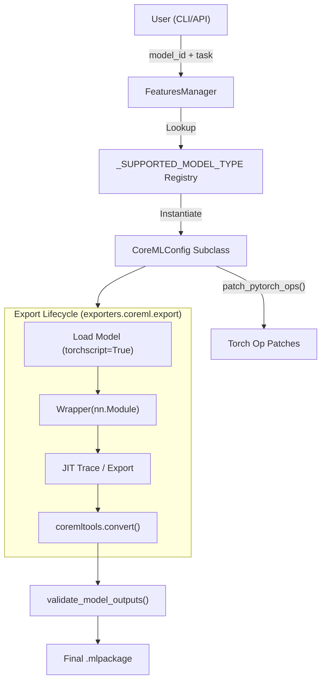
Sources: [src/exporters/coreml/features.py:452-480](), [src/exporters/coreml/convert.py:1120-1160](), [DESIGN_NOTES.md:9-15]()

### Core Components

| Component | Responsibility | Key Entities |
| :--- | :--- | :--- |
| **Configuration** | Defines inputs, outputs, and model-specific logic. | `CoreMLConfig`, `InputDescription` |
| **Registry** | Maps model architectures to their supported tasks. | `FeaturesManager`, `_SUPPORTED_MODEL_TYPE` |
| **Exporter** | Handles the actual conversion and JIT tracing. | `export()`, `export_pytorch()`, `Wrapper` |
| **Validation** | Verifies numerical accuracy on macOS. | `validate_model_outputs()` |

Sources: [src/exporters/coreml/config.py:54-70](), [src/exporters/coreml/features.py:452-460](), [src/exporters/coreml/convert.py:891-910]()

## Code Entity Map

The following diagram maps the high-level functional stages to the specific classes and functions responsible for them in the `exporters.coreml` package.

**Code Entity Relationship**
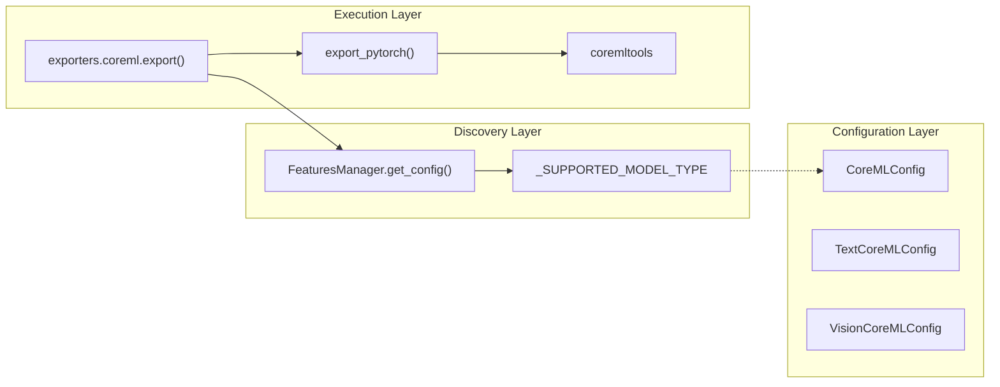
Sources: [src/exporters/coreml/features.py:452-500](), [src/exporters/coreml/convert.py:1120-1150](), [src/exporters/coreml/config.py:54-150]()

## Navigation

For detailed technical information, please refer to the following child pages:

*   **[Getting Started](#1.1)**: Installation requirements (Transformers ≥ 4.30, CoreMLTools ≥ 7) and a quick-start guide for the CLI and Python API.
*   **[Supported Models and Tasks](#1.2)**: A complete list of supported architectures (BERT, ViT, etc.) and tasks (classification, mask-filling, etc.), including known limitations.

---
Sources: [setup.py:15-18](), [README.md:62-82](), [DESIGN_NOTES.md:43-70]()

---

# Page: Getting Started

# Getting Started

<details>
<summary>Relevant source files</summary>

The following files were used as context for generating this wiki page:

- [README.md](README.md)
- [setup.py](setup.py)
- [src/exporters/coreml/__main__.py](src/exporters/coreml/__main__.py)

</details>


The `huggingface/exporters` package provides a streamlined workflow for converting 🤗 Transformers models to Apple's Core ML format. It abstracts the complexity of `coremltools` by using pre-defined configuration objects tailored for specific model architectures and tasks.

## Installation and Requirements

To ensure compatibility with the latest Transformer architectures and Core ML features (such as ML Programs), the environment must meet specific dependency versions.

### Dependencies
*   **Python**: `>= 3.8.0` [setup.py:14-14]()
*   **Transformers**: `>= 4.30.0` [setup.py:16-16]()
*   **coremltools**: `>= 7` [setup.py:17-17]()

### Environment Setup
While conversion can be performed on Linux, **macOS 12.0+** is required to run the validation step, as it depends on the proprietary Core ML framework to execute the generated `.mlpackage` [README.md:52-52](), [src/exporters/coreml/__main__.py:65-65]().

```bash
# Clone the repository
git clone https://github.com/huggingface/exporters.git
cd exporters

# Install in editable mode
pip install -e .
```
Sources: [README.md:37-48](), [setup.py:14-18]()

---

## Quick-Start: Command Line Interface (CLI)

The easiest way to export a model is via the `exporters.coreml` module. The CLI automatically handles preprocessor loading, model instantiation, and validation.

### Exporting from the Hub
To export a model like `distilbert-base-uncased` to the current directory:

```bash
python -m exporters.coreml --model=distilbert-base-uncased exported/
```
[README.md:99-99]()

### Exporting Local Checkpoints
If you have a local directory containing `pytorch_model.bin` (or `tf_model.h5`) and the associated tokenizer/processor files, point the `--model` argument to that path:

```bash
python -m exporters.coreml --model=./local-checkpoint-dir/ exported/
```
[README.md:145-145]()

### Data Flow: CLI Execution
The diagram below illustrates how the CLI translates a model ID into a serialized Core ML file.

**CLI Export Pipeline**
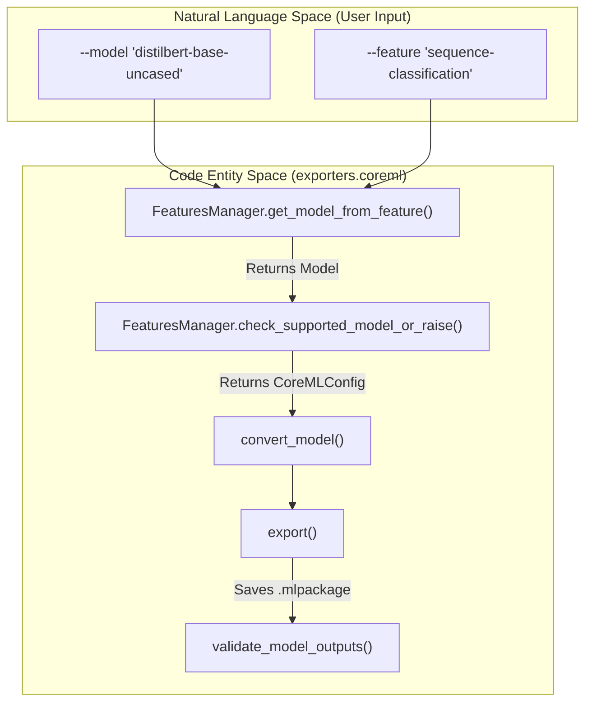
Sources: [src/exporters/coreml/__main__.py:138-141](), [src/exporters/coreml/__main__.py:45-51](), [src/exporters/coreml/__main__.py:70-70]()

---

## Programmatic API

For integration into existing Python pipelines, you can use the `FeaturesManager` and `export` functions directly.

### Basic Export Script
This approach allows for more control over the model loading and configuration.

```python
from exporters.coreml import export, FeaturesManager
from transformers import AutoTokenizer, AutoModelForSequenceClassification

model_id = "distilbert-base-uncased"
feature = "sequence-classification"

# 1. Load preprocessor and model
tokenizer = AutoTokenizer.from_pretrained(model_id)
model = AutoModelForSequenceClassification.from_pretrained(model_id)

# 2. Retrieve the appropriate CoreMLConfig
model_kind, model_config_class = FeaturesManager.check_supported_model_or_raise(model, feature=feature)
config = model_config_class(model.config)

# 3. Export to Core ML
mlmodel = export(preprocessor=tokenizer, model=model, config=config)
mlmodel.save("DistilBert.mlpackage")
```
Sources: [src/exporters/coreml/__main__.py:119-141](), [src/exporters/coreml/__main__.py:45-60]()

---

## Core Components and Implementation

The export process relies on a mapping between Transformers architectures and specialized Core ML configurations.

### The FeaturesManager
The `FeaturesManager` acts as the central registry. It maps a "feature" (e.g., `text-classification`, `token-classification`) to the correct `AutoModel` class and identifies the `CoreMLConfig` required for that specific architecture.
[src/exporters/coreml/features.py]()

### The Export Workflow
When `export()` is called, the system performs the following steps:
1.  **Wrapper Initialization**: The PyTorch model is wrapped in a `Wrapper` class to standardize inputs/outputs.
2.  **JIT Tracing**: The model is traced using `torch.jit.trace` with dummy inputs generated by the `CoreMLConfig`.
3.  **Conversion**: `coremltools.convert` is called, using the traced model and the input/output descriptions defined in the `CoreMLConfig`.
4.  **Metadata**: The resulting `MLModel` is populated with metadata and saved as an `mlpackage`.

**Component Interaction Diagram**
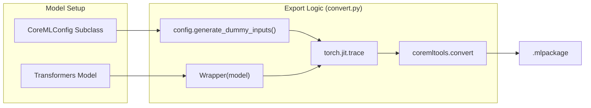
Sources: [src/exporters/coreml/__main__.py:35-51](), [README.md:119-121]()

### Output and Validation
Upon successful export, the tool validates the model by comparing the Core ML inference results against the original PyTorch/TensorFlow reference. It checks:
*   **Output Names**: Ensuring keys in the output dictionary match [README.md:110-110]().
*   **Output Shapes**: Ensuring tensor dimensions are identical [README.md:112-112]().
*   **Precision**: Ensuring values are within the absolute tolerance (`atol`) [README.md:113-113]().

Sources: [src/exporters/coreml/validate.py:30-30](), [src/exporters/coreml/__main__.py:62-72]()

---

# Page: Supported Models and Tasks

# Supported Models and Tasks

<details>
<summary>Relevant source files</summary>

The following files were used as context for generating this wiki page:

- [MODELS.md](MODELS.md)
- [README.md](README.md)
- [src/exporters/coreml/features.py](src/exporters/coreml/features.py)

</details>


The `exporters` library provides a structured framework for converting Hugging Face Transformers models to Apple's Core ML format. Support is determined by the availability of a `CoreMLConfig` object for a specific architecture, which defines the inputs, outputs, and necessary graph patches for a successful export [MODELS.md:19-21]().

## Supported Architectures and Tasks

The `FeaturesManager` class maintains the registry of supported models and their associated tasks (features). Each entry in the `_SUPPORTED_MODEL_TYPE` registry maps a model architecture to a set of features and its corresponding `CoreMLConfig` implementation [src/exporters/coreml/features.py:149-155]().

### Natural Language Processing (NLP)

| Architecture | Supported Features | Key Limitations |
| :--- | :--- | :--- |
| **BERT** | `feature-extraction`, `fill-mask`, `text-generation`, `multiple-choice`, `question-answering`, `text-classification`, `token-classification` | `BertLMHeadModel` depends on specific `coremltools` versions [MODELS.md:44-54]() |
| **GPT-2** | `feature-extraction`, `text-generation`, `text-classification`, `token-classification` | No `use_past` support due to fixed sequence lengths [MODELS.md:114-123]() |
| **Llama / Mistral** | `text-generation` | Optimized for Causal LM tasks [MODELS.md:124-126, 139-141]() |
| **BART / T5** | `feature-extraction`, `text2text-generation` | Seq2Seq models often only support `use_past=False` currently [MODELS.md:36-40, 210-214]() |

### Computer Vision (CV)

| Architecture | Supported Features | Implementation Notes |
| :--- | :--- | :--- |
| **ViT** | `feature-extraction`, `image-classification`, `masked-im` | Standard vision transformer support [src/exporters/coreml/features.py:330-335]() |
| **MobileViT** | `feature-extraction`, `image-classification`, `semantic-segmentation` | Highly optimized for mobile deployment [MODELS.md:241-245]() |
| **ConvNeXT** | `feature-extraction`, `image-classification` | CNN-based architecture support [MODELS.md:225-228]() |
| **YOLOS** | `object-detection` | Supports object detection task with bounding box outputs [src/exporters/coreml/features.py:343-346]() |

### Audio and Multimodal

| Architecture | Supported Features |
| :--- | :--- |
| **Whisper** | `automatic-speech-recognition` [src/exporters/coreml/features.py:337-341]() |
| **Wav2Vec2** | `automatic-speech-recognition` [src/exporters/coreml/features.py:324-328]() |

**Sources:** [src/exporters/coreml/features.py:99-350](), [MODELS.md:34-270]()

---

## Task-to-Code Mapping

The following diagram illustrates how high-level task strings (Features) map to specific `transformers` AutoModel classes and the internal `CoreMLConfig` hierarchy.

### Entity Mapping: Tasks to AutoModels
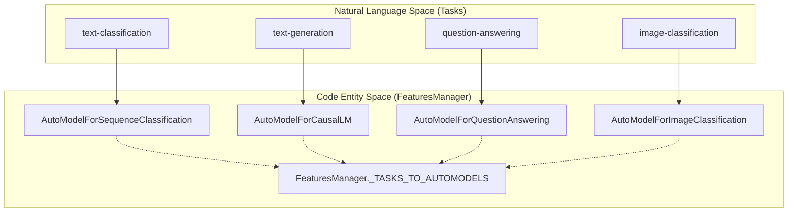
**Sources:** [src/exporters/coreml/features.py:99-120](), [src/exporters/coreml/features.py:133-147]()

---

## Known Limitations and Failure Modes

### Conversion Failures
Some models may appear to convert successfully but fail during runtime or consume excessive resources:
*   **RoFormer / Splinter:** These models trigger a known failure mode where Core ML attempts to allocate massive amounts of RAM (100+ GB) during model loading, eventually crashing the process [MODELS.md:186-199]().

### Feature Limitations
*   **Flexible Shapes:** Many architectures (like GPT-2) do not support flexible sequence lengths in their current Core ML implementation, which precludes the use of Key-Value (KV) caching (`use_past`) [MODELS.md:116-117]().
*   **Version Sensitivity:** Certain models like `BertLMHeadModel` or `ErnieForCausalLM` are sensitive to the `coremltools` version and may break on versions newer than specific commits (e.g., `50c5569`) [MODELS.md:54, 106]().

### Framework Support
*   **TensorFlow:** While the infrastructure exists, many TF-based AutoModels are currently commented out or not yet fully implemented in the registry [src/exporters/coreml/features.py:121-131]().

**Sources:** [MODELS.md:17-32](), [src/exporters/coreml/features.py:121-131]()

---

## Feature Resolution Logic

The `FeaturesManager` handles the resolution of tasks, including synonyms and "with-past" variants.

### Logic Flow: Task Resolution
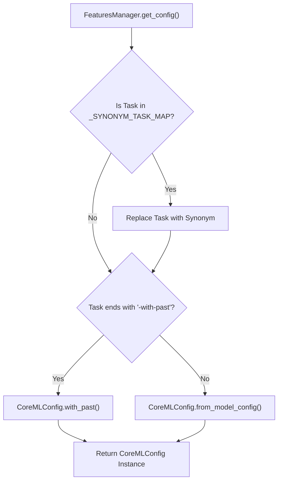
**Sources:** [src/exporters/coreml/features.py:67-96](), [src/exporters/coreml/features.py:133-147]()

---

# Page: Core Architecture

# Core Architecture

<details>
<summary>Relevant source files</summary>

The following files were used as context for generating this wiki page:

- [DESIGN_NOTES.md](DESIGN_NOTES.md)
- [src/exporters/coreml/config.py](src/exporters/coreml/config.py)
- [src/exporters/coreml/convert.py](src/exporters/coreml/convert.py)

</details>


The `exporters` library follows a layered design intended to bridge the gap between Hugging Face Transformers and Apple's Core ML framework. It automates the complex process of model tracing, tensor type conversion, and metadata injection, ensuring that exported models are "plug-and-play" for iOS and macOS developers.

The architecture is built around four primary pillars:
1.  **Configuration (`CoreMLConfig`)**: Defines the "contract" for the export, including input/output shapes and modalities.
2.  **Registry (`FeaturesManager`)**: Maps model architectures to specific tasks and their corresponding configuration classes.
3.  **Pipeline (`export`)**: Executes the transformation from PyTorch/TensorFlow to Core ML MIL (Model Intermediate Language) and finally `.mlpackage`.
4.  **Validation (`validate_model_outputs`)**: Ensures parity between the original framework's output and the exported Core ML model.

### System Overview Diagram

The following diagram illustrates how a user request flows through the internal code entities to produce a Core ML artifact.

"System Flow: From AutoModel to Core ML"
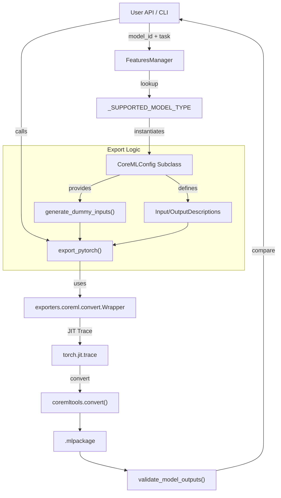
**Sources:** [src/exporters/coreml/features.py:449-480](), [src/exporters/coreml/convert.py:596-645](), [src/exporters/coreml/config.py:108-124]()

---

### CoreMLConfig: The Configuration Layer
The `CoreMLConfig` class acts as the central blueprint for the export process. It abstracts away the differences between text, vision, and audio models by requiring a `modality` property in every subclass [src/exporters/coreml/config.py:115-116]().

Key responsibilities include:
*   **Input/Output Mapping**: Using `InputDescription` and `OutputDescription` to define how internal tensors map to user-friendly Core ML names [src/exporters/coreml/config.py:44-93]().
*   **Dynamic Shapes**: Managing flexible sequence lengths via `ct.RangeDim` for text models [src/exporters/coreml/convert.py:97-101]().
*   **Operator Patching**: Providing a `patch_pytorch_ops` hook to override or fix PyTorch operations that `coremltools` cannot natively convert [src/exporters/coreml/config.py:277-283]().

For details on implementing custom configurations, see [CoreMLConfig: The Configuration Layer](#2.1).

**Sources:** [src/exporters/coreml/config.py:96-124](), [src/exporters/coreml/config.py:172-181]()

---

### FeaturesManager: The Model Registry
The `FeaturesManager` is a static discovery engine. It maintains the `_SUPPORTED_MODEL_TYPE` registry, which associates Transformers model types (e.g., `bert`, `gpt2`, `vit`) with their supported tasks (e.g., `sequence-classification`, `image-segmentation`) [src/exporters/coreml/features.py:449-455]().

It handles:
*   **Model Loading**: Automatically selecting the correct `AutoModel` class for a given task [src/exporters/coreml/features.py:562-570]().
*   **Task Synonyms**: Resolving aliases like `sentiment-analysis` to the canonical `text-classification` task [src/exporters/coreml/features.py:441-447]().

For details on the registry and supported architectures, see [FeaturesManager: The Model Registry](#2.2).

**Sources:** [src/exporters/coreml/features.py:482-508](), [src/exporters/coreml/features.py:592-610]()

---

### Export Pipeline
The export pipeline transforms a live model instance into a serialized Core ML file. The process typically uses `export_pytorch()`, which wraps the model in a `Wrapper` class to handle dictionary-to-tuple output conversions required by `torch.jit.trace` [src/exporters/coreml/convert.py:503-520]().

"Data Transformation Pipeline"
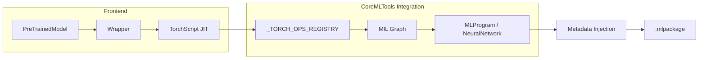

Key features of the pipeline:
*   **Modality Handling**: Automatically configures `ct.ImageType` for vision models to enable native camera integration on iOS [src/exporters/coreml/convert.py:202-215]().
*   **Quantization**: Supports post-training quantization via `coremltools.optimize.torch` [src/exporters/coreml/convert.py:706-715]().

For details on the conversion lifecycle, see [Export Pipeline](#2.3).

**Sources:** [src/exporters/coreml/convert.py:596-650](), [src/exporters/coreml/convert.py:756-780]()

---

### Validation Pipeline
After export, the system verifies the integrity of the model using `validate_model_outputs`. This step generates dummy inputs for both the original framework (PyTorch/TF) and the Core ML runtime [src/exporters/coreml/convert.py:829-845]().

Validation includes:
*   **Precision Check**: Comparing output tensors using absolute tolerance (`atol`) [src/exporters/coreml/convert.py:908-912]().
*   **Classifier Parity**: Verifying that class labels in the Core ML metadata match the `id2label` mapping in the Transformers config [src/exporters/coreml/convert.py:890-900]().
*   **Hardware Gating**: Automatically skipping Core ML inference if the host system is not running macOS [src/exporters/coreml/convert.py:867-870]().

For details on validation logic and error thresholds, see [Validation Pipeline](#2.4).

**Sources:** [src/exporters/coreml/convert.py:804-827](), [src/exporters/coreml/convert.py:920-935]()

---

# Page: CoreMLConfig: The Configuration Layer

# CoreMLConfig: The Configuration Layer

<details>
<summary>Relevant source files</summary>

The following files were used as context for generating this wiki page:

- [src/exporters/coreml/config.py](src/exporters/coreml/config.py)
- [src/exporters/coreml/models.py](src/exporters/coreml/models.py)

</details>


The `CoreMLConfig` class serves as the architectural blueprint for the export process. It defines how a Hugging Face Transformers model is mapped to a Core ML model, managing the translation of input/output specifications, task-specific behaviors, and hardware-specific optimizations. By subclassing `CoreMLConfig`, the library provides tailored export logic for different model architectures while maintaining a consistent interface for the export pipeline.

### Core Entities and Relationship

The following diagram illustrates how the `CoreMLConfig` orchestrates the relationship between the Transformers model configuration and the requirements of the Core ML format.

**Configuration Entity Mapping**
```mermaid
graph TD
    subgraph "Natural Language & Task Space"
        Task["Task (e.g., 'text-classification')"]
        Modality["Modality (e.g., 'text', 'vision')"]
    end

    subgraph "Code Entity Space: src/exporters/coreml/config.py"
        ConfigBase["CoreMLConfig"]
        InDesc["InputDescription"]
        OutDesc["OutputDescription"]
        
        ConfigBase -->|defines| InDesc
        ConfigBase -->|defines| OutDesc
        ConfigBase -->|uses| Task
        ConfigBase -->|has| Modality
    end

    subgraph "Model Specializations: src/exporters/coreml/models.py"
        BertConfig["BertCoreMLConfig"]
        GPT2Config["GPT2CoreMLConfig"]
        LlamaConfig["LlamaCoreMLConfig"]
        
        BertConfig --|> ConfigBase
        GPT2Config --|> ConfigBase
        LlamaConfig --|> ConfigBase
    end
```
Sources: [src/exporters/coreml/config.py:96-107](), [src/exporters/coreml/models.py:52-53](), [src/exporters/coreml/models.py:270-271]()

---

### Input and Output Descriptions

The conversion process relies on two primary data classes to describe the interface of the generated Core ML model:

*   **`InputDescription`**: Defines properties such as the input name, optionality, and shape constraints. For text models, it handles `sequence_length` (fixed or flexible ranges), and for vision models, it specifies `color_layout` (RGB/BGR) [src/exporters/coreml/config.py:45-69]().
*   **`OutputDescription`**: Defines the model outputs, including post-processing flags like `do_softmax` for classifiers or `do_upsample` and `do_argmax` for semantic segmentation tasks [src/exporters/coreml/config.py:72-94]().

### Modality and Task Handling

Every `CoreMLConfig` must define a `modality` (e.g., `"text"`, `"vision"`, `"audio"`) [src/exporters/coreml/config.py:115-116](). The configuration uses the `task` attribute to determine which inputs and outputs are required. For example, a `vision` model in a `semantic-segmentation` task will automatically include logic for resizing outputs to match input dimensions if `do_upsample` is set [src/exporters/coreml/config.py:84-86]().

Sources: [src/exporters/coreml/config.py:108-125](), [src/exporters/coreml/models.py:35-39]()

---

### Sequence Length and Flexible Shapes

Core ML supports both fixed and flexible input shapes. `CoreMLConfig` manages this through:
*   **`input_ids_sequence_length`**: Determines the size of text inputs [src/exporters/coreml/config.py:207-219]().
*   **Flexible Shapes**: If `sequence_length` is provided as a tuple `(min, max)` in `InputDescription`, the exporter configures Core ML to accept variable-length inputs within that range [src/exporters/coreml/config.py:57-60]().

### KV-Cache (use_past) Support

For autoregressive models (like GPT-2 or Llama), `CoreMLConfig` supports the `use_past` flag. When enabled, the configuration:
1.  Appends `past_key_values` to the model inputs [src/exporters/coreml/config.py:178-180]().
2.  Adds `present_key_values` to the model outputs [src/exporters/coreml/config.py:313-315]().
3.  Automatically calculates the shapes for these tensors based on the model's hidden size and number of layers [src/exporters/coreml/config.py:461-487]().

Sources: [src/exporters/coreml/config.py:151-169](), [src/exporters/coreml/config.py:461-487]()

---

### Dummy Input Generation

To trace the PyTorch model during export, `CoreMLConfig` provides a `generate_dummy_inputs` method. This creates representative tensors (e.g., `input_ids`, `attention_mask`, `pixel_values`) that match the expected shapes and types defined in the configuration [src/exporters/coreml/config.py:642-658]().

**Input Generation Flow**
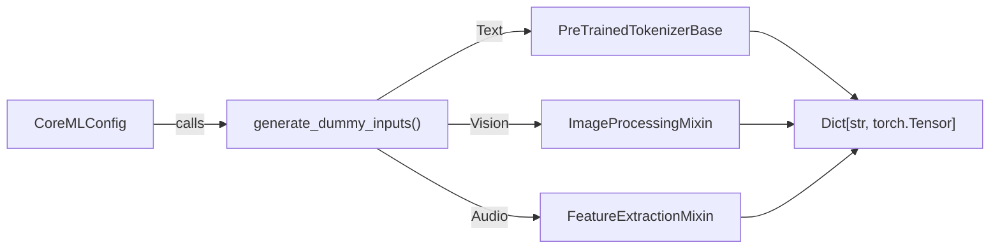
Sources: [src/exporters/coreml/config.py:642-658](), [src/exporters/coreml/config.py:706-724](), [src/exporters/coreml/config.py:767-785]()

---

### The patch_pytorch_ops Hook

One of the most critical features for supporting diverse architectures is the `patch_pytorch_ops` method. This hook allows specific model configurations to provide custom implementations for PyTorch operations that are either unsupported or incorrectly handled by the default `coremltools` converter [src/exporters/coreml/models.py:99-109]().

For example:
*   **`CvtCoreMLConfig`** patches `einsum` for specific equations [src/exporters/coreml/models.py:142-157]().
*   **`FalconCoreMLConfig`** patches the `to` operator to handle `bfloat16` fallbacks [src/exporters/coreml/models.py:207-226]().

For a detailed breakdown of how each model architecture utilizes these features, see [Model-Specific Config Specializations](#2.1.1).

Sources: [src/exporters/coreml/models.py:99-109](), [src/exporters/coreml/models.py:142-157](), [src/exporters/coreml/models.py:207-226]()

---

# Page: Model-Specific Config Specializations

# Model-Specific Config Specializations

<details>
<summary>Relevant source files</summary>

The following files were used as context for generating this wiki page:

- [MODELS.md](MODELS.md)
- [src/exporters/coreml/models.py](src/exporters/coreml/models.py)

</details>


This page provides a detailed technical reference for the architecture-specific subclasses of `CoreMLConfig`. While the base `CoreMLConfig` handles the general logic for input/output descriptions and flexible shapes, specific model architectures often require specialized handling. This includes overriding default outputs (e.g., adding pooler states), adjusting numerical tolerances for validation, and implementing `patch_pytorch_ops` to bypass limitations in the `coremltools` conversion engine.

## Architectural Specialization Overview

The specialization layer bridges the gap between generic Hugging Face Transformers architectures and the requirements of the Core ML Model Intermediate Language (MIL).

### Logic Flow for Specialized Configurations

The following diagram illustrates how specialized configurations interact with the `FeaturesManager` and the Core ML conversion process.

**Diagram: Configuration Resolution and Patching**
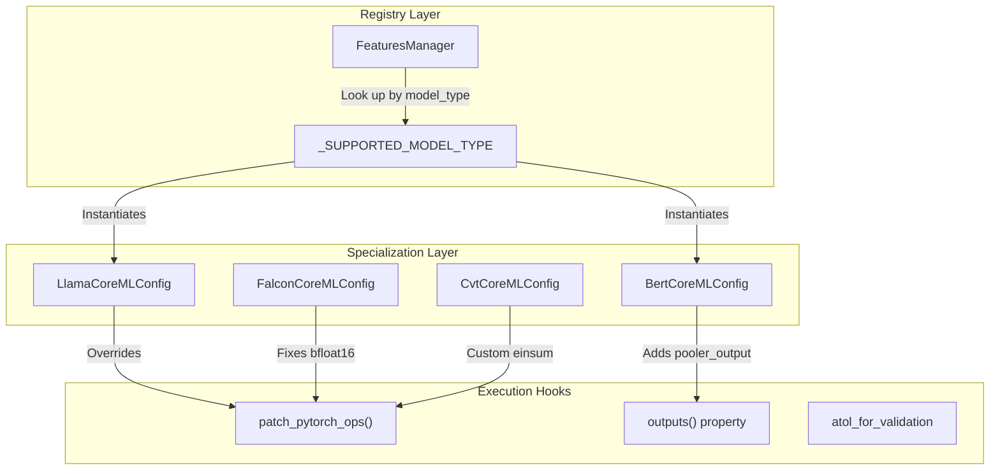
**Sources:** [src/exporters/coreml/models.py:34-230](), [src/exporters/coreml/config.py:18-22]()

---

## Text Model Specializations

### BERT and Variants
Models like BERT, BEiT, and ConvNeXT often require the inclusion of a "pooler output" which is not always present in the default hidden states.

*   **Implementation:** `BertCoreMLConfig` [src/exporters/coreml/models.py:52-60]() overrides the `outputs` property to call `self._add_pooler_output(output_descs)`.
*   **Affected Models:** BERT, BEiT [src/exporters/coreml/models.py:38-50](), ConvNeXT [src/exporters/coreml/models.py:82-94](), and MobileBERT [src/exporters/coreml/models.py:255-263]().

### GPT-2 and Sequence Length Limitations
GPT-2 is noted for having issues with flexible sequence lengths in certain Core ML versions, which impacts its ability to support Key-Value (KV) caching (`use_past`).
*   **Status:** Currently supports fixed sequence lengths; `use_past` is disabled [MODELS.md:114-122]().

### Llama and Mistral
These architectures utilize advanced RoPE (Rotary Positional Embeddings) and complex slicing operations that require specific MIL patches.

*   **Llama Specialization:** `LlamaCoreMLConfig` [src/exporters/coreml/models.py:220-230]()
*   **Mistral Specialization:** `MistralCoreMLConfig` [src/exporters/coreml/models.py:245-253]()
*   **Key Workaround:** Both architectures override `patch_pytorch_ops` to handle the `scaled_dot_product_attention` operator, which may not be natively supported or optimized in all `coremltools` versions.

### Falcon
`FalconCoreMLConfig` [src/exporters/coreml/models.py:201-218]() implements a critical patch for the `to` operator.
*   **The Issue:** `coremltools` sometimes fails when encountering `bfloat16` types during conversion.
*   **The Patch:** The `patch_pytorch_ops` implementation in Falcon redefines the `to` op to provide a fallback from `bfloat16` to `float32` [src/exporters/coreml/models.py:205-207]().

---

## Vision Model Specializations

### MobileViT and MobileViTv2
These models are optimized for mobile but require specific output handling for tasks like semantic segmentation.
*   **MobileViT:** Overrides `atol_for_validation` to `1e-2` to account for accumulation differences in lightweight convolutions [src/exporters/coreml/models.py:265-273]().
*   **MobileViTv2:** Similar specialization for vision tasks [src/exporters/coreml/models.py:275-283]().

### CvT (Convolutional vision Transformer)
`CvtCoreMLConfig` [src/exporters/coreml/models.py:112-162]() contains one of the most complex operator patches in the repository.

*   **Einsum Patching:** Core ML's `einsum` implementation has limitations with specific equations. CvT requires the equation `bhlt,bhtv->bhlv`.
*   **Logic:** If the `einsum` equation matches this specific string, the patch converts the operation into a standard `mb.matmul` [src/exporters/coreml/models.py:150-151](). Otherwise, it falls back to the default `build_einsum_mil` [src/exporters/coreml/models.py:153]().

---

## Op Patching Mechanism (`patch_pytorch_ops`)

The `patch_pytorch_ops` method is a hook called during the export process. It returns a dictionary mapping Torch operation names to custom MIL builder functions.

**Diagram: Op Patching Data Flow**
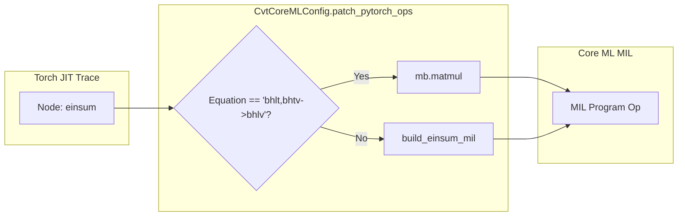
**Sources:** [src/exporters/coreml/models.py:139-157](), [src/exporters/coreml/config.py:284-290]()

### Common Patch Patterns

| Model | Op Patched | Reason |
| :--- | :--- | :--- |
| **CTRL** | `lift_fresh` | Implemented as a no-op to prevent conversion failure on newer Torch versions [src/exporters/coreml/models.py:99-109](). |
| **Falcon** | `to` | Fallback for `bfloat16` to `float32` [src/exporters/coreml/models.py:204-218](). |
| **CvT** | `einsum` | Replaces specific 4D tensor contractions with `matmul` for better compatibility [src/exporters/coreml/models.py:142-157](). |
| **Llama** | `scaled_dot_product_attention` | Manual implementation for efficient attention on Apple Silicon [src/exporters/coreml/models.py:223-228](). |

---

## Validation Tolerances (`atol_for_validation`)

Different architectures exhibit varying degrees of numerical drift when converted from PyTorch (Float32) to Core ML (often Float16 or specialized hardware paths). Specialized configs override `atol_for_validation` to ensure the validation pipeline passes for expected variances.

*   **Default:** `1e-4` [src/exporters/coreml/config.py:292-294]()
*   **BEiT:** `1e-2` [src/exporters/coreml/models.py:48-49]()
*   **ConvNeXT:** `1e-3` [src/exporters/coreml/models.py:92-93]()
*   **CvT:** `1e-2` [src/exporters/coreml/models.py:160-161]()
*   **ViT:** `2e-3` [src/exporters/coreml/models.py:382-383]()

**Sources:**
- `src/exporters/coreml/models.py`: Entire file defines these specializations.
- `src/exporters/coreml/config.py`: Defines the base class hooks.
- `MODELS.md`: Documents the support status and known issues for these architectures.

---

# Page: FeaturesManager: The Model Registry

# FeaturesManager: The Model Registry

<details>
<summary>Relevant source files</summary>

The following files were used as context for generating this wiki page:

- [src/exporters/__init__.py](src/exporters/__init__.py)
- [src/exporters/coreml/__init__.py](src/exporters/coreml/__init__.py)
- [src/exporters/coreml/features.py](src/exporters/coreml/features.py)

</details>


The `FeaturesManager` is a central static class that acts as the registry and factory for the Core ML export pipeline. It manages the mapping between Hugging Face model architectures, their supported tasks (features), and the corresponding `CoreMLConfig` specializations required for conversion.

## Core Registry: `_SUPPORTED_MODEL_TYPE`

The heart of the registry is the `_SUPPORTED_MODEL_TYPE` dictionary [src/exporters/coreml/features.py:149](). This map associates model types (e.g., `"bert"`, `"gpt2"`, `"vit"`) with their supported export features.

Each entry in this registry is populated using the `supported_features_mapping` helper function [src/exporters/coreml/features.py:67-96](). This factory function takes a list of feature strings and a string path to a `CoreMLConfig` subclass, returning a dictionary of `partial` constructors.

### Feature Mapping Logic
When `supported_features_mapping` is invoked:
1. It resolves the `coreml_config_cls` string to an actual class reference within the `exporters.coreml.models` namespace [src/exporters/coreml/features.py:83-87]().
2. For standard features, it creates a partial that calls `from_model_config(task=feature)` [src/exporters/coreml/features.py:94]().
3. For features containing `-with-past`, it creates a partial that calls `with_past(task=task)` to enable Key-Value (KV) cache support [src/exporters/coreml/features.py:90-92]().

**Sources:** [src/exporters/coreml/features.py:67-96](), [src/exporters/coreml/features.py:149-174]()

---

## Task and Framework Management

`FeaturesManager` handles the translation between high-level task names and the specific `AutoModel` classes required to load them in PyTorch or TensorFlow.

### AutoModel Mapping
The class maintains `_TASKS_TO_AUTOMODELS` [src/exporters/coreml/features.py:103-120]() and `_TASKS_TO_TF_AUTOMODELS` [src/exporters/coreml/features.py:122-131]() to ensure that the correct model head is loaded for a given export task. For example, the `text-generation` task is mapped to `AutoModelForCausalLM` [src/exporters/coreml/features.py:105]().

### Task Synonyms
To provide a flexible CLI and API, the `_SYNONYM_TASK_MAP` [src/exporters/coreml/features.py:133-147]() maps common aliases to canonical task names:
| Alias | Canonical Task |
| :--- | :--- |
| `causal-lm` | `text-generation` |
| `masked-lm` | `fill-mask` |
| `seq2seq-lm` | `text2text-generation` |
| `ctc` | `automatic-speech-recognition` |

### Code Entity Relationship: Task Resolution
The following diagram illustrates how a user-provided task string is resolved to a specific model loader and configuration factory.

**Task Resolution Flow**
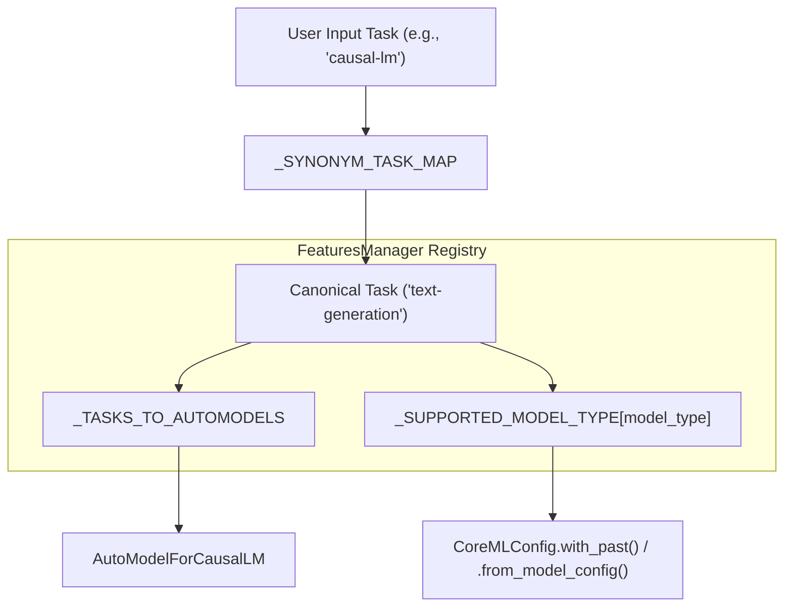
**Sources:** [src/exporters/coreml/features.py:100-147](), [src/exporters/coreml/features.py:345-360]()

---

## Model Loading and Validation

The `FeaturesManager` provides static methods to instantiate models and their configurations while ensuring framework compatibility.

### `get_model_from_feature`
This method [src/exporters/coreml/features.py:382-423]() is the primary entry point for loading a model for export.
1. **Framework Validation**: It checks if the requested framework (PyTorch/TF) is installed [src/exporters/coreml/features.py:399-405]().
2. **Task Resolution**: It maps synonyms to canonical tasks [src/exporters/coreml/features.py:407]().
3. **Model Instantiation**: It uses the mapped `AutoModel` class to load the model from the Hugging Face Hub or a local path.
4. **TorchScript Mode**: For PyTorch models, it automatically sets `torchscript=True` during loading [src/exporters/coreml/features.py:414]() to ensure the model is compatible with JIT tracing.

### `check_supported_model_or_raise`
This utility [src/exporters/coreml/features.py:341-380]() validates that a specific model architecture and task combination is registered in the `_SUPPORTED_MODEL_TYPE` map. If the model type is known but the task is not supported, it provides a descriptive error message listing the available features for that architecture [src/exporters/coreml/features.py:365-375]().

**Sources:** [src/exporters/coreml/features.py:341-423]()

---

## Implementation Details: Registry Factory

The following diagram bridges the "Natural Language" concept of a registry to the specific code entities in `features.py`.

**Registry Architecture**
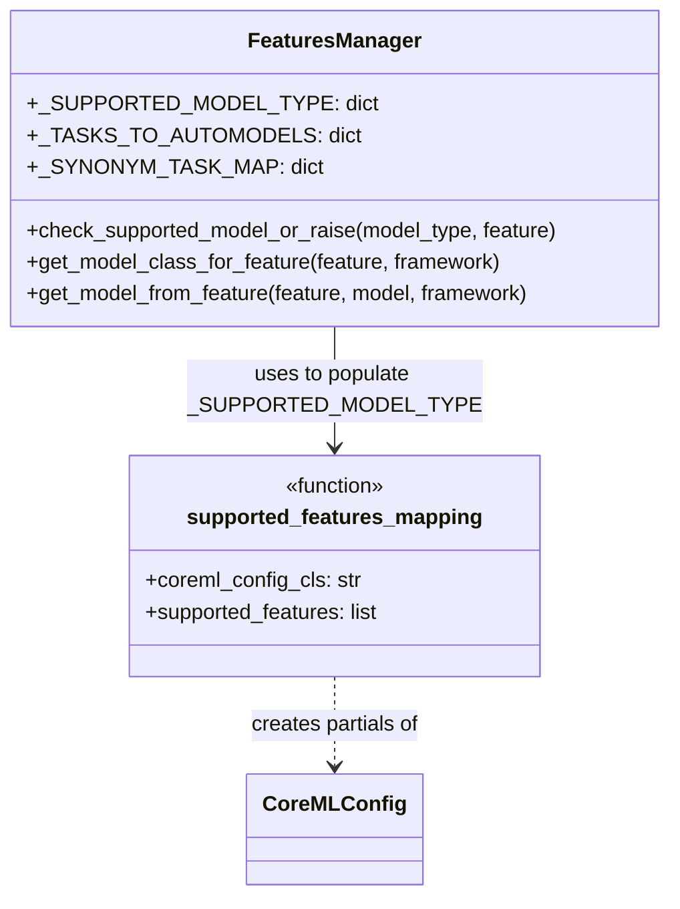

### Key Functions
*   **`get_supported_features_for_model_type`** [src/exporters/coreml/features.py:307-339](): Returns the list of features supported for a given model architecture, including both standard and "with-past" variants.
*   **`get_config`** [src/exporters/coreml/features.py:425-450](): A factory method that retrieves the specific `CoreMLConfig` for a model and task, instantiating it with the model's `PretrainedConfig`.

**Sources:** [src/exporters/coreml/features.py:307-450](), [src/exporters/coreml/features.py:67-96]()

---

# Page: Export Pipeline

# Export Pipeline

<details>
<summary>Relevant source files</summary>

The following files were used as context for generating this wiki page:

- [src/exporters/coreml/__main__.py](src/exporters/coreml/__main__.py)
- [src/exporters/coreml/convert.py](src/exporters/coreml/convert.py)

</details>


The export pipeline is the central orchestration layer of the `huggingface/exporters` repository. It manages the end-to-end transformation of a Hugging Face model (PyTorch or TensorFlow) into a Core ML model package. This process involves wrapping the model for compatibility, resolving input types (Text, Vision, Audio), tracing the graph via JIT, and applying metadata for deployment in Apple ecosystem applications.

## High-Level Conversion Lifecycle

The lifecycle begins with a `CoreMLConfig` object and a loaded model. The pipeline handles the transition from high-level Hugging Face abstractions to the `coremltools` MIL (Model Intermediate Language) representation.

### Data Flow Diagram

The following diagram illustrates the flow from a `PreTrainedModel` to a saved `.mlpackage`.

**Export Pipeline Data Flow**
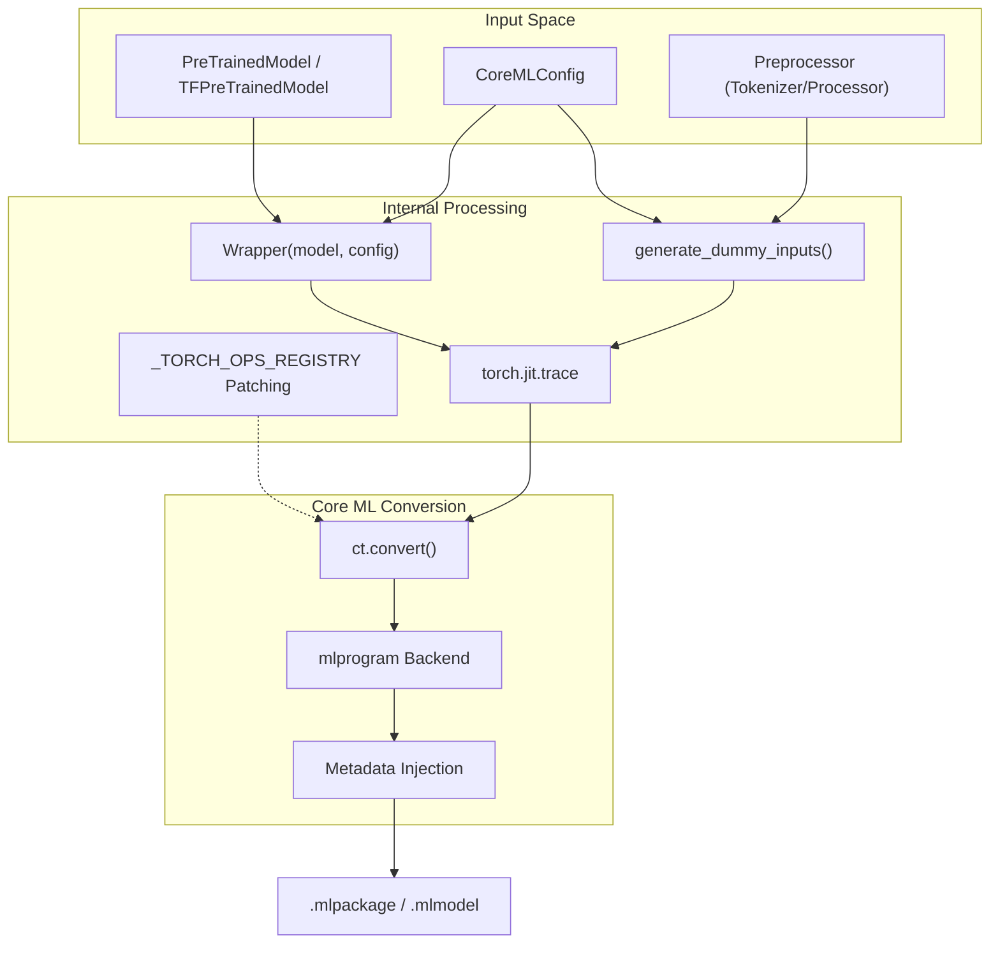
**Sources:** [src/exporters/coreml/convert.py:1107-1180](), [src/exporters/coreml/convert.py:1210-1280]()

## Core Functions: `export()` and `export_pytorch()`

The entry point for the pipeline is the `export()` function, which acts as a router. It currently delegates almost exclusively to `export_pytorch()` for PyTorch models [src/exporters/coreml/convert.py:1107-1122]().

### `export_pytorch()`
This function executes the heavy lifting of the conversion:
1.  **Wrapper Initialization**: It wraps the model in a `Wrapper` class to ensure output formats match Core ML expectations [src/exporters/coreml/convert.py:1152-1153]().
2.  **Input Resolution**: It calls `get_input_types()` to determine if inputs should be `ct.TensorType` or `ct.ImageType` based on the `CoreMLConfig` [src/exporters/coreml/convert.py:1158-1160]().
3.  **JIT Tracing**: It generates dummy inputs and uses `torch.jit.trace` to create a static graph of the model [src/exporters/coreml/convert.py:1165-1175]().
4.  **Conversion**: It invokes `coremltools.convert()` with the `mlprogram` backend [src/exporters/coreml/convert.py:1181-1193]().

**Sources:** [src/exporters/coreml/convert.py:1107-1200]()

## The Wrapper Class

The `Wrapper` class (defined in `convert.py`) is a `torch.nn.Module` that encapsulates the original model. Its primary roles are:
*   **Input Ordering**: Ensuring inputs are passed to the model in the correct order defined by the config [src/exporters/coreml/convert.py:1010-1030]().
*   **Output Formatting**: Converting model output objects (like `BaseModelOutput`) into flat tuples or dictionaries that Core ML can serialize [src/exporters/coreml/convert.py:1040-1055]().
*   **Task-Specific Logic**: For example, in `question-answering`, it extracts `start_logits` and `end_logits` [src/exporters/coreml/convert.py:1068-1072]().

**Sources:** [src/exporters/coreml/convert.py:985-1104]()

## Input Type Resolution

The `get_input_types()` function inspects the `CoreMLConfig` and the `preprocessor` to define the interface of the generated model.

| Modality | Core ML Type | Logic |
| :--- | :--- | :--- |
| **Text** | `ct.TensorType` | Resolves `input_ids`, `attention_mask` as `Int32` [src/exporters/coreml/convert.py:128-141](). |
| **Vision** | `ct.ImageType` | Resolves normalization (mean/std) and channel ordering (RGB) [src/exporters/coreml/convert.py:230-260](). |
| **Audio** | `ct.TensorType` | Maps `input_values` or `input_features` [src/exporters/coreml/convert.py:270-285](). |

**Sources:** [src/exporters/coreml/convert.py:106-290]()

## Op Patching via `_TORCH_OPS_REGISTRY`

Core ML does not natively support every PyTorch operation. The pipeline uses a global registry to "patch" or override how specific PyTorch ops are translated into MIL.

*   **Registry**: `coremltools.converters.mil.frontend.torch.torch_op_registry._TORCH_OPS_REGISTRY` [src/exporters/coreml/convert.py:20-20]().
*   **Mechanism**: The `CoreMLConfig.patch_pytorch_ops()` method is called before conversion. Specific model configs (like `ErnieCoreMLConfig`) override this to register custom MIL builders for unsupported ops [src/exporters/coreml/config.py:465-467]().

**Sources:** [src/exporters/coreml/convert.py:1178-1179](), [src/exporters/coreml/config.py:461-468]()

## Backends and Post-Processing

### ML Program vs. Neural Network
The exporter defaults to the `mlprogram` backend, which is the modern Core ML format (introduced in iOS 15/macOS 12). This allows for better performance on the Neural Engine and supports typed tensors [src/exporters/coreml/convert.py:1189-1191]().

### Metadata Injection
After the core conversion, the pipeline injects metadata into the `MLModel` object:
*   **Feature Names**: Renames outputs from generic indices to human-readable names like `logits` or `last_hidden_state` [src/exporters/coreml/convert.py:1210-1230]().
*   **Classifier Labels**: If the task is a classification task, it embeds the `id2label` mapping directly into the model's `predicted_feature_name` and `class_labels` [src/exporters/coreml/convert.py:1250-1275]().
*   **Version Info**: Adds the Transformers version and the `CoreMLConfig` class name to the model's metadata [src/exporters/coreml/convert.py:1285-1290]().

**Sources:** [src/exporters/coreml/convert.py:1180-1295]()

## Entity Mapping: Code to System

The following diagram maps the logical stages of the pipeline to the specific code entities responsible for them.

**Code Entity Mapping**
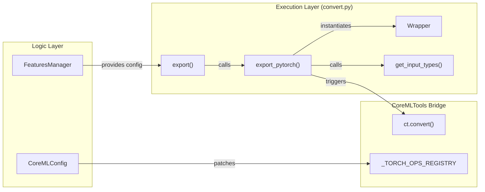
**Sources:** [src/exporters/coreml/convert.py:1107-1180](), [src/exporters/coreml/features.py:460-480](), [src/exporters/coreml/config.py:461-468]()

---

# Page: Validation Pipeline

# Validation Pipeline

<details>
<summary>Relevant source files</summary>

The following files were used as context for generating this wiki page:

- [src/exporters/coreml/validate.py](src/exporters/coreml/validate.py)
- [tests/test_coreml.py](tests/test_coreml.py)

</details>


The validation pipeline is a critical component of the `exporters` library that ensures parity between the original Transformers model (PyTorch or TensorFlow) and the exported Core ML model. It performs automated inference comparisons using dummy data to verify that the conversion process has not introduced significant numerical deviations or structural errors.

## The `validate_model_outputs` Function

The entry point for validation is `validate_model_outputs`, defined in `src/exporters/coreml/validate.py`. This function automates the comparison between a reference model and its Core ML counterpart.

### Implementation Flow

1.  **Input Resolution**: It identifies the framework (PyTorch or TensorFlow) of the reference model [src/exporters/coreml/validate.py:64-67]().
2.  **Dummy Data Generation**: It calls `config.generate_dummy_inputs` to create inputs suitable for both the reference model and Core ML [src/exporters/coreml/validate.py:69]().
3.  **Input Mapping**: It reconciles input names, specifically handling `past_key_values` for models with KV-caching by grouping individual Core ML inputs into the tuple structure expected by Transformers [src/exporters/coreml/validate.py:77-92]().
4.  **Reference Inference**: The reference model performs inference. If it is a Seq2Seq model, the encoder is extracted if `config.seq2seq == "encoder"` [src/exporters/coreml/validate.py:94-98]().
5.  **Core ML Inference**: The `mlmodel.predict()` method is invoked using the `coremltools` runtime [src/exporters/coreml/validate.py:108]().
6.  **Comparison**: The outputs are compared using absolute tolerance (`atol`) [src/exporters/coreml/validate.py:162-167]().

### Data Flow and Entity Association

The following diagram illustrates how the validation logic bridges the gap between the Transformers reference model and the exported `MLModel`.

**Validation Data Flow**
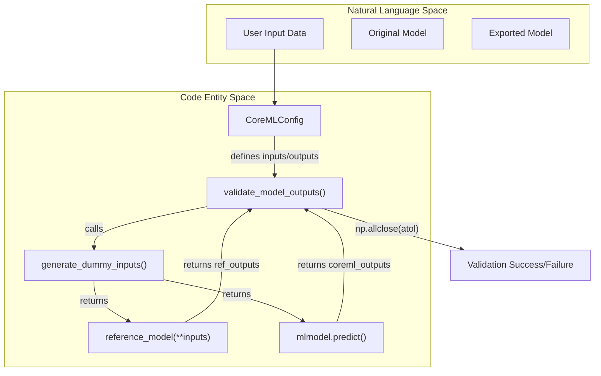
Sources: [src/exporters/coreml/validate.py:37-43](), [src/exporters/coreml/validate.py:69-70](), [src/exporters/coreml/validate.py:98-108]()

## Specialized Validation Logic

### Classifier Validation
For classification tasks, Core ML models often utilize specific metadata (`predictedFeatureName` and `predictedProbabilitiesName`) [src/exporters/coreml/validate.py:128-141]().
*   **Label Parity**: The pipeline verifies that the predicted class string from Core ML matches the result of `np.argmax` on the reference logits using the model's `id2label` mapping [src/exporters/coreml/validate.py:131-139]().
*   **Probability Parity**: Reference logits are passed through a local `softmax` implementation [src/exporters/coreml/validate.py:31-34]() and compared against the probability dictionary returned by Core ML [src/exporters/coreml/validate.py:143-169]().

### KV-Cache (Past Key Values) Reconciliation
Core ML does not natively support the recursive tuple structure of PyTorch's `past_key_values`. During validation:
*   **Inputs**: The pipeline flattens `past_key_values` into individual tensors named `past_key_values_N_key/value` for Core ML [src/exporters/coreml/validate.py:79-83]().
*   **Outputs**: The reference model's `past_key_values` output is unpacked into `present_N_key/value` to match the Core ML output dictionary [src/exporters/coreml/validate.py:102-105]().

### Post-processing Handling
For vision tasks, the pipeline handles common post-processing steps:
*   **Upsampling**: If `do_upsample` is set, the reference output is upsampled to match the Core ML output shape [src/exporters/coreml/validate.py:202-205]().
*   **Argmax**: For segmentation tasks, if `do_argmax` is active, the reference logits are converted to class indices before comparison [src/exporters/coreml/validate.py:207-210]().

Sources: [src/exporters/coreml/validate.py:120-171](), [src/exporters/coreml/validate.py:79-92](), [src/exporters/coreml/validate.py:202-210]()

## Integration in Test Suite

The validation pipeline is the core of the library's integration tests. The `CoreMLExportTestCase` class uses `validate_model_outputs` to certify every supported model architecture.

**Test Execution Pipeline**
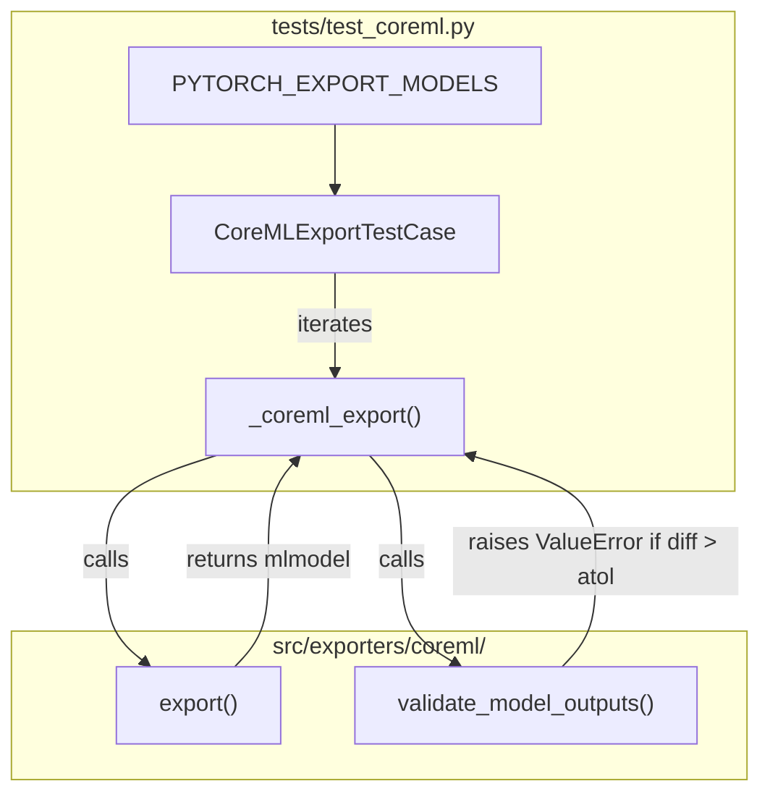
Sources: [tests/test_coreml.py:67-83](), [tests/test_coreml.py:128-182](), [tests/test_coreml.py:174-180]()

### Environment Gating
Because Core ML inference requires the Apple framework, validation is gated by specific decorators:
*   `@require_coreml`: Ensures `coremltools` is installed [tests/test_coreml.py:121]().
*   `@require_macos`: Ensures the test is running on macOS, as `mlmodel.predict()` is unavailable on other platforms [tests/test_coreml.py:122]().

Sources: [tests/test_coreml.py:121-123](), [src/exporters/coreml/validate.py:108]()

---

# Page: CLI and Programmatic API

# CLI and Programmatic API

<details>
<summary>Relevant source files</summary>

The following files were used as context for generating this wiki page:

- [README.md](README.md)
- [src/exporters/coreml/__main__.py](src/exporters/coreml/__main__.py)

</details>


The `exporters` library provides two primary interfaces for converting 🤗 Transformers models to Core ML: a high-level **Command-Line Interface (CLI)** for quick conversions and a **Programmatic API** for deeper integration into Python workflows. Both interfaces leverage the `FeaturesManager` to resolve model architectures and the `export()` pipeline to generate `.mlpackage` files.

### Interface Overview

The conversion process is designed to be consistent across both interfaces. The system identifies the model's architecture, selects the appropriate `CoreMLConfig`, performs the export (via JIT tracing for PyTorch), and optionally validates the resulting model on macOS.

#### System Flow: CLI to Code Entities
The following diagram illustrates how CLI arguments map to internal code entities and functions during the execution of `python -m exporters.coreml`.

**CLI Execution Flow**
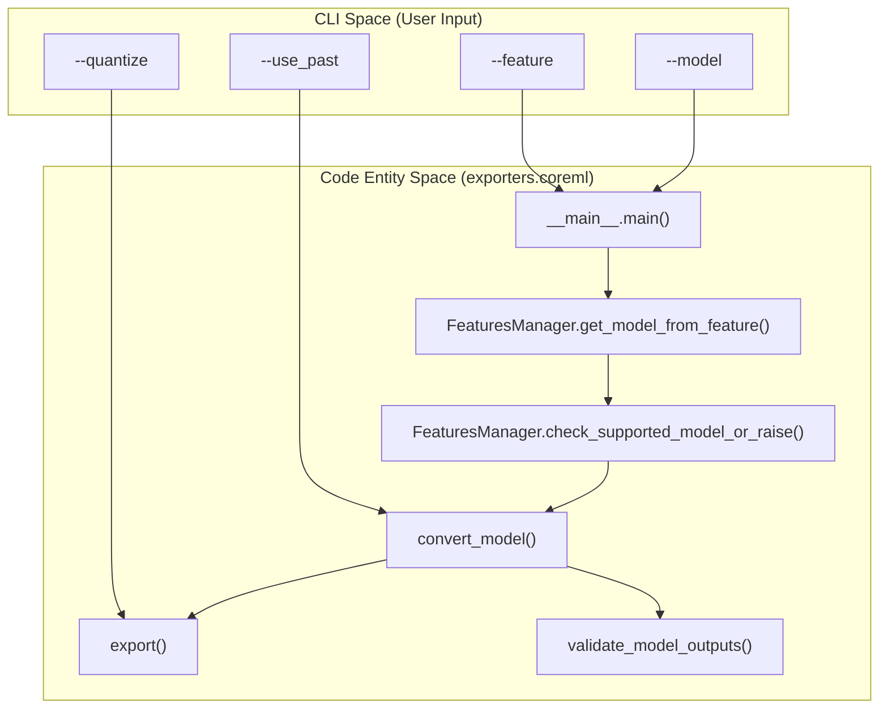
**Sources:** [src/exporters/coreml/__main__.py:75-178](), [src/exporters/coreml/convert.py:165-170]()

---

### Command-Line Interface (CLI)

The CLI is the most accessible way to use the exporter. It is invoked as a Python module: `python -m exporters.coreml`. It handles preprocessor loading (tokenizers, feature extractors), model instantiation, and file I/O.

Key capabilities include:
*   **Automatic Preprocessor Detection**: Uses `get_preprocessor` to fetch the correct tokenizer or image processor from the Hub [src/exporters/coreml/__main__.py:119-128]().
*   **Quantization**: Supports `float16` and `float32` weight quantization during export [src/exporters/coreml/__main__.py:95-97]().
*   **Compute Unit Optimization**: Allows targeting specific hardware like the Apple Neural Engine (ANE) via `--compute_units` [src/exporters/coreml/__main__.py:98-100]().
*   **Seq2Seq Workflow**: Automatically splits models like T5 or Whisper into separate `encoder_Model.mlpackage` and `decoder_Model.mlpackage` files [src/exporters/coreml/__main__.py:143-164]().

For a full reference of all arguments and example commands, see the [Command-Line Interface](#3.1) child page.

**Sources:** [src/exporters/coreml/__main__.py:75-172](), [README.md:96-104]()

---

### Programmatic API

The programmatic API allows developers to trigger exports directly from Python scripts. This is useful for custom training loops or when working with models that require manual patching before export.

The primary entry point is the `export()` function in `exporters.coreml.convert`.

#### Key API Components
| Entity | Role |
| :--- | :--- |
| `export()` | The core function that converts a PyTorch/TF model to Core ML [src/exporters/coreml/convert.py:165-170](). |
| `FeaturesManager` | A registry used to query supported tasks and retrieve the correct `CoreMLConfig` [src/exporters/coreml/features.py:461-463](). |
| `validate_model_outputs()` | Compares Core ML inference results against the original framework's outputs [src/exporters/coreml/validate.py:108-112](). |

**API Interaction Diagram**
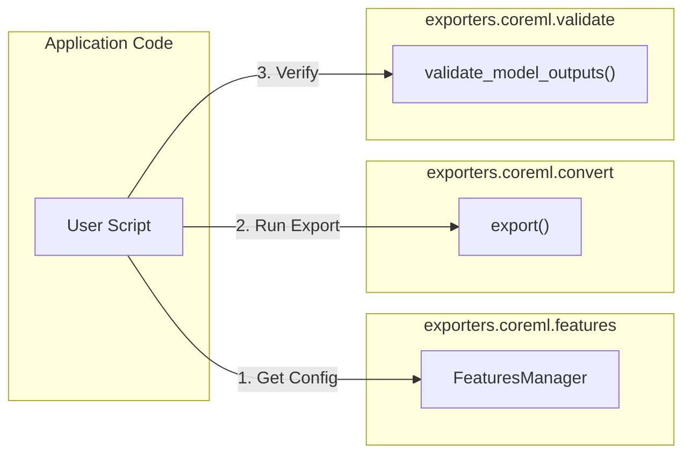
**Sources:** [src/exporters/coreml/convert.py:165-243](), [src/exporters/coreml/features.py:461-518](), [src/exporters/coreml/validate.py:108-175]()

For detailed documentation on function signatures and extending the API for custom architectures, see the [Programmatic API](#3.2) child page.

---

### Seq2Seq Dual-Export Workflow

For sequence-to-sequence models (e.g., `text2text-generation`, `speech-seq2seq`), the library implements a dual-export logic. Because Core ML models are static, the encoder and decoder are exported as distinct artifacts. The CLI and `convert_model` function handle this by calling the export pipeline twice:
1.  **Encoder**: Exported with `seq2seq="encoder"` [src/exporters/coreml/__main__.py:146-153]().
2.  **Decoder**: Exported with `seq2seq="decoder"` and optional `use_past=True` for KV-cache support [src/exporters/coreml/__main__.py:157-164]().

**Sources:** [src/exporters/coreml/__main__.py:34-72](), [src/exporters/coreml/__main__.py:143-164]()

---

# Page: Command-Line Interface

# Command-Line Interface

<details>
<summary>Relevant source files</summary>

The following files were used as context for generating this wiki page:

- [README.md](README.md)
- [src/exporters/coreml/__main__.py](src/exporters/coreml/__main__.py)

</details>


The `exporters.coreml` package provides a robust command-line interface (CLI) for converting Hugging Face Transformers models to the Core ML format. It abstracts the complexities of `coremltools` by leveraging a registry of pre-defined configurations, automated preprocessor detection, and a built-in validation suite.

### CLI Entry Point and Argument Reference

The CLI is invoked as a Python module: `python -m exporters.coreml`. The entry point is defined in the `main()` function of `src/exporters/coreml/__main__.py`.

| Argument | Type | Default | Description |
| :--- | :--- | :--- | :--- |
| `-m`, `--model` | `str` | **Required** | Model ID on the Hub or a local path to a checkpoint directory. |
| `--feature` | `str` | `feature-extraction` | The task/topology to export (e.g., `text-classification`, `causal-lm`). |
| `--quantize` | `str` | `float16` | Weight precision. Options: `float32`, `float16`. |
| `--compute_units` | `str` | `all` | Hardware optimization target. Options: `all`, `cpu_and_gpu`, `cpu_only`, `cpu_and_ne`. |
| `--use_past` | `flag` | `False` | Enables KV-cache support for autoregressive models. |
| `--preprocessor` | `str` | `auto` | Type of preprocessor to load. Options: `auto`, `tokenizer`, `feature_extractor`, `processor`. |
| `--framework` | `str` | `pt` | The source framework to load the model from (`pt` for PyTorch, `tf` for TensorFlow). |
| `--atol` | `float` | Config default | Absolute tolerance for numerical validation against the reference model. |
| `output` | `Path` | **Required** | Destination path for the `.mlpackage`. |

**Sources:**
- `src/exporters/coreml/__main__.py:75-111` (Argument definitions)
- `src/exporters/coreml/__main__.py:37-43` (Compute unit mapping)

---

### Data Flow: From CLI to MLPackage

The following diagram illustrates how CLI arguments are processed and passed through the `FeaturesManager` and `convert` modules to produce a validated Core ML model.

#### System Architecture and Code Entity Mapping
```mermaid
graph TD
    subgraph "CLI Entry (src/exporters/coreml/__main__.py)"
        CLI["main()"]
        ARGS["ArgumentParser"]
    end

    subgraph "Registry & Loading (src/exporters/coreml/features.py)"
        FM["FeaturesManager"]
        GMFF["get_model_from_feature()"]
        CSM["check_supported_model_or_raise()"]
    end

    subgraph "Conversion Engine (src/exporters/coreml/convert.py)"
        EXP["export()"]
    end

    subgraph "Validation (src/exporters/coreml/validate.py)"
        VAL["validate_model_outputs()"]
    end

    CLI --> ARGS
    ARGS -->|"model_id, feature"| FM
    FM --> GMFF
    GMFF -->|"Loaded Model"| CSM
    CSM -->|"CoreMLConfig"| EXP
    EXP -->|"MLModel"| VAL
    VAL -->|"Success/Failure"| CLI
```

**Sources:**
- `src/exporters/coreml/__main__.py:119-141` (Model and preprocessor resolution)
- `src/exporters/coreml/__main__.py:45-51` (Calling the export engine)
- `src/exporters/coreml/__main__.py:70-70` (Calling validation)

---

### Implementation Details

#### Output Path Handling
The CLI automatically ensures the output path is valid. If the provided path does not end in `.mlpackage` or `.mlmodel`, it appends `Model.mlpackage` by default. It also creates parent directories if they do not exist.

**Sources:**
- `src/exporters/coreml/__main__.py:113-116` (Path sanitization)

#### Preprocessor Resolution
The `--preprocessor` argument determines which Hugging Face class is used to prepare dummy inputs for JIT tracing and validation. By default (`auto`), it uses `transformers.onnx.utils.get_preprocessor` to infer the correct type from the model configuration.

**Sources:**
- `src/exporters/coreml/__main__.py:119-128` (Preprocessor factory logic)

#### Seq2Seq Split Export
For Sequence-to-Sequence models (e.g., T5, Whisper), the CLI performs a dual-export workflow. If the feature is `text2text-generation` or `speech-seq2seq`, the `main()` function triggers two separate calls to `convert_model()`:
1. **Encoder**: Exported without `use_past`. Output is prefixed with `encoder_`.
2. **Decoder**: Exported with the requested `use_past` setting. Output is prefixed with `decoder_`.

**Sources:**
- `src/exporters/coreml/__main__.py:143-164` (Seq2Seq branching logic)
- `src/exporters/coreml/__main__.py:54-58` (Filename prefixing for splits)

---

### Validation Gating

Validation is a critical step that compares Core ML inference results against the original PyTorch/TensorFlow outputs. However, this process is gated by environment requirements:
- **OS Check**: Validation requires `coremltools` to execute the model, which is only possible on macOS.
- **Version Check**: The exported `mlpackage` (ML Program) requires macOS 12.0 or later.
- **Compute Unit**: Validation is explicitly run on `ComputeUnit.CPU_ONLY` to ensure maximum compatibility during the check.

#### Logic Flow for Validation
```mermaid
graph TD
    subgraph "Environment Check"
        MACOS{"_is_macos()?"}
        VER{"Version >= 12.0?"}
    end

    subgraph "Validation Process"
        LOAD["Load MLModel (CPU_ONLY)"]
        COMP["validate_model_outputs()"]
        ATOL["Apply atol_for_validation"]
    end

    MACOS -- "No" --> SKIP["Log: Skipping validation"]
    MACOS -- "Yes" --> VER
    VER -- "No" --> SKIP
    VER -- "Yes" --> LOAD
    LOAD --> COMP
    COMP --> ATOL
```

**Sources:**
- `src/exporters/coreml/__main__.py:65-70` (Validation gating logic)
- `src/exporters/coreml/convert.py:455-460` (Default `atol` resolution)

---

### Example Invocations

**Standard Text Classification Export:**
```bash
python -m exporters.coreml \
    --model distilbert-base-uncased-finetuned-sst-2-english \
    --feature text-classification \
    --quantize float16 \
    exported/
```

**Causal LM with KV-Cache (use_past):**
```bash
python -m exporters.coreml \
    --model gpt2 \
    --feature causal-lm \
    --use_past \
    gpt2_coreml/
```

**Vision Transformer with specific Compute Units:**
```bash
python -m exporters.coreml \
    --model google/vit-base-patch16-224 \
    --feature image-classification \
    --compute_units cpu_and_ne \
    vit_export/
```

**Sources:**
- `README.md:98-100` (Basic example)
- `README.md:126-126` (TensorFlow checkpoint example)
- `README.md:145-145` (Local checkpoint example)

---

# Page: Programmatic API

# Programmatic API

<details>
<summary>Relevant source files</summary>

The following files were used as context for generating this wiki page:

- [README.md](README.md)
- [src/exporters/coreml/config.py](src/exporters/coreml/config.py)
- [src/exporters/coreml/features.py](src/exporters/coreml/features.py)
- [src/exporters/coreml/validate.py](src/exporters/coreml/validate.py)

</details>


The `exporters` library provides a high-level Python API to programmatically convert 🤗 Transformers models to Core ML. This interface allows for fine-grained control over the export process, including custom task selection, sequence length constraints, and validation against reference PyTorch or TensorFlow implementations.

## Export Pipeline

The primary entry point for programmatic export is the `exporters.coreml.export()` function. This function orchestrates the loading of the model, the resolution of its configuration, and the conversion using `coremltools`.

### Key Functions

| Function | Purpose |
| :--- | :--- |
| `export()` | Main entry point for exporting a pre-trained model to Core ML [src/exporters/coreml/__init__.py:22-24](). |
| `export_pytorch()` | Handles the specific logic for tracing and converting PyTorch models [src/exporters/coreml/convert.py:270-272](). |
| `validate_model_outputs()` | Compares Core ML inference results against the reference framework to ensure parity [src/exporters/coreml/validate.py:37-43](). |

### Export Data Flow

The following diagram illustrates the data flow when calling `export()`.

**Model Export Logic Flow**
```mermaid
graph TD
    subgraph "Initialization"
        A["User Calls export()"] --> B["FeaturesManager.check_supported_model_or_raise()"]
        B --> C["FeaturesManager.get_model_class_for_feature()"]
        C --> D["Load Model & Preprocessor"]
    end

    subgraph "Configuration"
        D --> E["FeaturesManager.get_config()"]
        E --> F["CoreMLConfig Object"]
    end

    subgraph "Conversion"
        F --> G["export_pytorch()"]
        G --> H["Wrapper(model)"]
        H --> I["ct.convert() / JIT Trace"]
        I --> J["MLModel (.mlpackage)"]
    end

    subgraph "Validation"
        J --> K["validate_model_outputs()"]
        K --> L["Final Output"]
    end
```
**Sources:** [src/exporters/coreml/convert.py:539-650](), [src/exporters/coreml/features.py:99-234]().

---

## FeaturesManager: Registry and Queries

The `FeaturesManager` class serves as the central registry for all supported architectures and tasks. It maps model types (e.g., `bert`, `gpt2`) to their corresponding `CoreMLConfig` classes and the appropriate `AutoModel` classes for specific tasks [src/exporters/coreml/features.py:99-149]().

### Useful Methods
- `check_supported_model_or_raise(model_type, feature)`: Validates if a model architecture supports a specific export task [src/exporters/coreml/features.py:236-258]().
- `get_config(model_type, feature)`: Returns the `CoreMLConfig` constructor for the model/task pair [src/exporters/coreml/features.py:306-324]().
- `get_model_class_for_feature(feature, framework)`: Returns the correct `AutoModel` (PyTorch) or `TFAutoModel` class [src/exporters/coreml/features.py:260-282]().

**Sources:** [src/exporters/coreml/features.py:99-324]().

---

## CoreMLConfig API

The `CoreMLConfig` class defines how a Transformers model's inputs and outputs are mapped to Core ML.

### Input and Output Descriptions
- **`InputDescription`**: Defines name, optionality, and shape constraints (e.g., `sequence_length`) [src/exporters/coreml/config.py:44-68]().
- **`OutputDescription`**: Defines name and post-processing steps like `do_softmax` or `do_argmax` [src/exporters/coreml/config.py:71-93]().

### Key Methods
- `with_past()`: A class method to instantiate a config with KV-cache support enabled (`use_past=True`) [src/exporters/coreml/config.py:151-169]().
- `patch_pytorch_ops()`: A hook used by subclasses to override or register custom PyTorch operators during JIT tracing to bypass `coremltools` limitations [src/exporters/coreml/config.py:273-281]().

**Sources:** [src/exporters/coreml/config.py:44-281]().

---

## Validation Pipeline

After conversion, `validate_model_outputs()` ensures the exported model behaves identically to the original.

1.  **Dummy Input Generation**: Uses `config.generate_dummy_inputs()` to create framework-specific tensors [src/exporters/coreml/validate.py:69]().
2.  **Reference Inference**: Runs the model using PyTorch or TensorFlow [src/exporters/coreml/validate.py:94-98]().
3.  **Core ML Inference**: Runs the `.predict()` method on the generated `MLModel` [src/exporters/coreml/validate.py:108]().
4.  **Comparison**: Compares outputs using an absolute tolerance (`atol`). For classifiers, it validates the predicted class labels and probabilities [src/exporters/coreml/validate.py:120-170]().

**Sources:** [src/exporters/coreml/validate.py:37-171]().

---

## Adding Support for Custom Architectures

To support a model architecture not currently in the registry, you must subclass `CoreMLConfig`.

### Implementation Steps

1.  **Define Modality**: Specify if the model is `text`, `vision`, or `audio` [src/exporters/coreml/config.py:189-193]().
2.  **Define Inputs**: Implement the `inputs` property to return an `OrderedDict` of `InputDescription` objects [src/exporters/coreml/config.py:171-181]().
3.  **Define Outputs**: Implement the `outputs` property to return an `OrderedDict` of `OutputDescription` objects [src/exporters/coreml/config.py:215-223]().
4.  **Register the Model**: Add the new config to `FeaturesManager._SUPPORTED_MODEL_TYPE` using `supported_features_mapping` [src/exporters/coreml/features.py:67-96]().

**Architecture Association Diagram**
```mermaid
classDiagram
    class FeaturesManager {
        +_SUPPORTED_MODEL_TYPE: Dict
        +get_config(model_type, feature)
    }
    class CoreMLConfig {
        <<abstract>>
        +inputs: OrderedDict
        +outputs: OrderedDict
        +patch_pytorch_ops()
    }
    class BertCoreMLConfig {
        +modality: "text"
        +inputs: OrderedDict
    }
    class ViTCoreMLConfig {
        +modality: "vision"
        +inputs: OrderedDict
    }

    FeaturesManager ..> CoreMLConfig : resolves
    CoreMLConfig <|-- BertCoreMLConfig
    CoreMLConfig <|-- ViTCoreMLConfig
```
**Sources:** [src/exporters/coreml/config.py:96-281](), [src/exporters/coreml/features.py:149-234]().

---

# Page: Testing and Utilities

# Testing and Utilities

<details>
<summary>Relevant source files</summary>

The following files were used as context for generating this wiki page:

- [src/exporters/utils/logging.py](src/exporters/utils/logging.py)
- [tests/test_coreml.py](tests/test_coreml.py)
- [tests/testing_utils.py](tests/testing_utils.py)

</details>


This section provides an overview of the verification mechanisms and shared infrastructure within the `exporters` repository. The codebase relies on a comprehensive integration test suite to ensure model parity between PyTorch and Core ML, supported by utility modules for logging and environment-specific test gating.

## Integration Test Suite

The primary testing logic resides in `tests/test_coreml.py`, which validates the end-to-end export pipeline. It utilizes a centralized registry of models, such as `PYTORCH_EXPORT_MODELS`, to parameterize tests across various architectures and tasks [tests/test_coreml.py:67-83]().

The suite manages complex lifecycles, including:
*   **Model Parameterization**: The `_get_models_to_test` function dynamically generates test cases based on supported features registered in the `FeaturesManager` [tests/test_coreml.py:100-113]().
*   **Export Lifecycle**: The `_coreml_export` method handles the full flow from model loading to `validate_model_outputs`, including specialized handling for Seq2Seq architectures where encoder and decoder are exported separately [tests/test_coreml.py:128-180]().
*   **Configuration Validation**: Dedicated unit tests verify that `CoreMLConfig` correctly calculates flexible shapes and sequence length constraints [tests/test_coreml.py:40-65]().

For a deep dive into how to run, extend, and interpret these tests, see [Integration Test Suite](#4.1).

### Test Suite Relationship
The diagram below illustrates how the test suite interacts with the core library entities to perform validation.

Model Validation Flow
```mermaid
graph TD
    subgraph "Test Space"
        ["test_pytorch_export"] --> ["_coreml_export"]
        ["PYTORCH_EXPORT_MODELS"] --> ["_get_models_to_test"]
        ["_get_models_to_test"] -- "parameterizes" --> ["test_pytorch_export"]
    end

    subgraph "Code Entity Space"
        ["_coreml_export"] -- "calls" --> ["FeaturesManager.get_model_class_for_feature"]
        ["_coreml_export"] -- "calls" --> ["exporters.coreml.export"]
        ["_coreml_export"] -- "calls" --> ["validate_model_outputs"]
    end
```
**Sources:** [tests/test_coreml.py:100-189]()

## Utility Modules

The repository includes shared utilities to maintain consistency with the Hugging Face ecosystem and handle hardware-specific requirements of Core ML.

*   **Logging**: A dedicated logging module in `src/exporters/utils/logging.py` provides standardized verbosity control (e.g., `set_verbosity_info`, `get_logger`), adapted from the `transformers` library to ensure a familiar developer experience [src/exporters/utils/logging.py:110-180]().
*   **Testing Helpers**: Because Core ML validation requires specific environments, `tests/testing_utils.py` provides decorators like `@require_coreml` and `@require_macos` [tests/testing_utils.py:38-43](). These utilities check for the presence of `coremltools` and verify that the host OS is macOS 12.0 or higher [tests/testing_utils.py:21-30]().

For detailed documentation on these modules, see [Utility Modules](#4.2).

### Environment Gating Utilities
The following diagram maps the natural language requirement of "Environment Gating" to the specific code entities responsible for enforcement.

Hardware and Software Requirements Mapping
```mermaid
graph TD
    subgraph "Natural Language Space"
        "Check CoreML Installation"
        "Verify macOS Version"
        "Skip Incompatible Tests"
    end

    subgraph "Code Entity Space"
        "Check CoreML Installation" --> ["is_coreml_available"]
        "Verify macOS Version" --> ["is_macos_available"]
        "Skip Incompatible Tests" --> ["require_coreml"]
        "Skip Incompatible Tests" --> ["require_macos"]
    end

    ["is_coreml_available"] --> ["importlib.util.find_spec"]
    ["is_macos_available"] --> ["coremltools.models.utils._is_macos"]
```
**Sources:** [tests/testing_utils.py:21-43]()

## Summary Table of Key Utilities

| Component | File Path | Primary Responsibility |
| :--- | :--- | :--- |
| **Test Suite** | `tests/test_coreml.py` | Integration tests for all supported model types and tasks [tests/test_coreml.py:1-190](). |
| **Logging** | `src/exporters/utils/logging.py` | Library-wide logging configuration and verbosity levels [src/exporters/utils/logging.py:16-42](). |
| **Environment Check** | `tests/testing_utils.py` | Detection of `coremltools` and macOS system version [tests/testing_utils.py:21-36](). |
| **Test Decorators** | `tests/testing_utils.py` | `unittest` skip decorators for hardware-dependent tests [tests/testing_utils.py:38-43](). |

**Sources:** [tests/test_coreml.py:1-190](), [src/exporters/utils/logging.py:16-42](), [tests/testing_utils.py:21-43]()

---

# Page: Integration Test Suite

# Integration Test Suite

<details>
<summary>Relevant source files</summary>

The following files were used as context for generating this wiki page:

- [tests/test_coreml.py](tests/test_coreml.py)
- [tests/testing_utils.py](tests/testing_utils.py)

</details>


The integration test suite in `exporters` ensures that supported Transformers models can be successfully converted to Core ML format and that the resulting `.mlpackage` files produce outputs consistent with the original PyTorch or TensorFlow models. The primary entry point for these tests is `tests/test_coreml.py` [tests/test_coreml.py:1-205]().

## Test Infrastructure Overview

The suite uses `parameterized` to dynamically generate test cases based on lists of model architectures and tasks. It leverages specific decorators to gate execution based on environment capabilities, such as the presence of `coremltools` and a compatible macOS version (required for model validation) [tests/testing_utils.py:21-43]().

### Environment Gating
Tests are wrapped in decorators to prevent failures in environments missing necessary dependencies:
*   `@require_coreml`: Skips tests if `coremltools` is not installed [tests/testing_utils.py:38-39]().
*   `@require_macos`: Skips tests if the OS is not macOS or the version is below 12.0, as Core ML inference for validation requires the native framework [tests/testing_utils.py:41-42]().
*   `@slow`: Marks integration tests that involve full model loading and conversion [tests/test_coreml.py:185]().

### Data-Driven Parameterization
The suite maintains several registries of models to test:
*   `PYTORCH_EXPORT_MODELS`: A set of tuples containing `(model_type, checkpoint_path)` for standard exports (e.g., `beit`, `bert`, `gpt2`, `vit`) [tests/test_coreml.py:67-83]().
*   `PYTORCH_EXPORT_WITH_PAST_MODELS`: Models to be tested with Key-Value (KV) cache support enabled (`use_past=True`) [tests/test_coreml.py:85-88]().
*   `PYTORCH_EXPORT_SEQ2SEQ_WITH_PAST_MODELS`: Models requiring separate encoder/decoder exports [tests/test_coreml.py:90]().

## Test Execution Flow

The core logic resides in `CoreMLExportTestCase._coreml_export`. This method orchestrates the lifecycle from model loading to output validation.

### The `_coreml_export` Lifecycle
1.  **Model Loading**: Uses `FeaturesManager.get_model_class_for_feature` to identify the correct class and `AutoConfig` to initialize the model [tests/test_coreml.py:129-131]().
2.  **Configuration**: Initializes the architecture-specific `CoreMLConfig` using the model's config [tests/test_coreml.py:132]().
3.  **Export**: Calls `exporters.coreml.export` to generate the Core ML model, typically using `float32` quantization for validation stability [tests/test_coreml.py:138-143]().
4.  **Validation**: Calls `validate_model_outputs` to compare Core ML inference results against the reference PyTorch model using `coreml_config.atol_for_validation` [tests/test_coreml.py:144-150]().

### Sequence-to-Sequence (Seq2Seq) Handling
For models like T5 or Speech-to-Text models, the test suite performs a dual-stage export. It toggles the `coreml_config.seq2seq` attribute between `"encoder"` and `"decoder"` to test both components of the architecture independently [tests/test_coreml.py:136-165]().

### Test Suite Logic Flow
The following diagram illustrates how `_get_models_to_test` interacts with `FeaturesManager` to build the test matrix.

**Model Parameterization Flow**
```mermaid
graph TD
    subgraph Registry ["Model Registry"]
        PEM["PYTORCH_EXPORT_MODELS"]
        PEWP["PYTORCH_EXPORT_WITH_PAST_MODELS"]
    end

    subgraph Logic ["Test Discovery Logic"]
        GM["_get_models_to_test()"]
        FM_SF["FeaturesManager.get_supported_features_for_model_type()"]
        FM_GC["FeaturesManager.get_config()"]
    end

    PEM --> GM
    PEWP --> GM
    GM --> FM_SF
    FM_SF --> FM_GC
    FM_GC --> PEXP["test_pytorch_export()"]
    FM_GC --> PEXPP["test_pytorch_export_with_past()"]
```
**Sources:** [tests/test_coreml.py:67-113](), [tests/test_coreml.py:184-196]()

## Code Entity Mapping

The following diagram maps the natural language concepts of the test suite to the specific code entities implemented in `tests/test_coreml.py` and `src/exporters/coreml/`.

**Integration Test Entity Map**
```mermaid
graph LR
    subgraph "Natural Language Concept"
        TC["Test Case"]
        DS["Discovery"]
        EX["Export Process"]
        VAL["Output Verification"]
    end

    subgraph "Code Entity Space"
        TC_CLS["CoreMLExportTestCase"]
        GM_FUNC["_get_models_to_test()"]
        EXP_FUNC["exporters.coreml.export()"]
        VAL_FUNC["validate_model_outputs()"]
        CFG_BASE["CoreMLConfig"]
    end

    TC --- TC_CLS
    DS --- GM_FUNC
    EX --- EXP_FUNC
    VAL --- VAL_FUNC
    EX --- CFG_BASE
```
**Sources:** [tests/test_coreml.py:100-123](), [exporters/coreml/__init__.py:22-26]()

## Extending the Tests

To add support for a new model or task, follow these steps:

1.  **Register Model**: Add the model type and a representative checkpoint to `PYTORCH_EXPORT_MODELS` [tests/test_coreml.py:67-83]().
2.  **Define Configuration**: Ensure a `CoreMLConfig` subclass exists for the model in `src/exporters/coreml/models.py`.
3.  **Verify Feature Support**: The `_get_models_to_test` function will automatically query `FeaturesManager` to determine which tasks (e.g., `text-classification`, `token-classification`) are supported for that model type and generate a test for each [tests/test_coreml.py:109-112]().
4.  **Run Tests**:
    ```bash
    pytest tests/test_coreml.py
    ```

### Unit Tests for Configuration
The suite also includes `CoreMLConfigTestCase` to verify the base configuration logic, such as:
*   Handling of unknown modalities or tasks [tests/test_coreml.py:41-49]().
*   Calculation of flexible output shapes for sequence lengths [tests/test_coreml.py:50-65]().

**Sources:** [tests/test_coreml.py:36-65](), [tests/test_coreml.py:100-113]()

---

# Page: Utility Modules

# Utility Modules

<details>
<summary>Relevant source files</summary>

The following files were used as context for generating this wiki page:

- [src/exporters/__init__.py](src/exporters/__init__.py)
- [src/exporters/coreml/__init__.py](src/exporters/coreml/__init__.py)
- [src/exporters/utils/__init__.py](src/exporters/utils/__init__.py)
- [src/exporters/utils/logging.py](src/exporters/utils/logging.py)
- [tests/testing_utils.py](tests/testing_utils.py)

</details>


The `exporters` library relies on a set of internal utilities to manage logging, environment-specific testing, and package-level exports. These modules ensure consistent behavior across different platforms (macOS vs. Linux) and provide the necessary infrastructure for debugging and verifying Core ML exports.

## Logging System

The logging utility in `src/exporters/utils/logging.py` is a direct adaptation from the `transformers` library [src/exporters/utils/logging.py:2-2](). it provides a centralized way to manage library-wide verbosity and formatting.

### Implementation Details
The system uses a root logger for the library, retrieved via `_get_library_name()` [src/exporters/utils/logging.py:64-66](). It defaults to a `WARNING` level [src/exporters/utils/logging.py:44-44]() unless overridden by the `TRANSFORMERS_VERBOSITY` environment variable [src/exporters/utils/logging.py:52-61]().

| Function | Purpose |
| :--- | :--- |
| `get_logger(name)` | Returns a logger instance, initializing the library root logger if necessary [src/exporters/utils/logging.py:110-121](). |
| `set_verbosity(level)` | Sets the logging level for the library root logger [src/exporters/utils/logging.py:146-162](). |
| `_configure_library_root_logger()` | Thread-safe initialization of the `StreamHandler` pointing to `sys.stderr` [src/exporters/utils/logging.py:74-90](). |

### Logging Flow
The following diagram illustrates how a call to `get_logger` triggers the configuration of the library's logging infrastructure.

**Logging Initialization Sequence**
```mermaid
sequenceDiagram
    participant User as "Code Entity"
    participant GL as "get_logger()"
    participant CLRL as "_configure_library_root_logger()"
    participant RL as "Library Root Logger"

    User->>GL: Calls get_logger("exporters.coreml")
    GL->>CLRL: Triggers configuration
    CLRL->>CLRL: Acquires _lock
    Note over CLRL: Creates _default_handler (StreamHandler)
    CLRL->>RL: addHandler(_default_handler)
    CLRL->>RL: setLevel(_get_default_logging_level())
    CLRL->>RL: set propagate = False
    GL-->>User: Returns Logger instance
```
**Sources:** [src/exporters/utils/logging.py:33-45](), [src/exporters/utils/logging.py:74-90](), [src/exporters/utils/logging.py:110-121]()

---

## Testing Helpers

Because Core ML inference and certain conversion features are platform-dependent, the library provides decorators in `tests/testing_utils.py` to gate tests based on the availability of `coremltools` and macOS environments.

### Environment Detection
The module checks for the presence of `coremltools` using `importlib.util.find_spec` [tests/testing_utils.py:21-21](). macOS availability is determined by checking if the OS is macOS and if the version is at least 12.0, utilizing `coremltools.models.utils` [tests/testing_utils.py:25-26]().

### Decorators
These decorators are used throughout the test suite to prevent failures on non-compatible systems:

*   **`require_coreml`**: Skips the test unless `coremltools` is installed [tests/testing_utils.py:38-39]().
*   **`require_macos`**: Skips the test unless the environment is macOS 12.0 or higher [tests/testing_utils.py:41-42]().

**Environment Dependency Mapping**
```mermaid
graph TD
    subgraph "Environment Space"
        MACOS["macOS >= 12.0"]
        CML_INSTALLED["coremltools installed"]
    end

    subgraph "Code Entity Space"
        ISM["is_macos_available()"]
        ISC["is_coreml_available()"]
        RM["require_macos"]
        RC["require_coreml"]
    end

    MACOS -.-> ISM
    CML_INSTALLED -.-> ISC
    ISM --> RM
    ISC --> RC
    
    RM -- "Wraps" --> TEST_SUITE["unittest.TestCase"]
    RC -- "Wraps" --> TEST_SUITE
```
**Sources:** [tests/testing_utils.py:21-30](), [tests/testing_utils.py:32-42]()

---

## Package Exports

The library uses `__init__.py` files to expose a clean API surface to users, abstracting the internal directory structure.

### `exporters.coreml` Exports
The `src/exporters/coreml/__init__.py` file serves as the primary entry point for programmatic usage of the Core ML exporter.

| Exported Entity | Source | Purpose |
| :--- | :--- | :--- |
| `CoreMLConfig` | `exporters.coreml.config` | Base class for model-specific export configurations [src/exporters/coreml/__init__.py:17-17](). |
| `export` | `exporters.coreml.convert` | Main function to convert PyTorch models to Core ML [src/exporters/coreml/__init__.py:18-18](). |
| `validate_model_outputs` | `exporters.coreml.validate` | Utility to compare PyTorch and Core ML outputs [src/exporters/coreml/__init__.py:19-19](). |

### Versioning
The top-level `src/exporters/__init__.py` defines the package version, currently set to `0.0.1` [src/exporters/__init__.py:1-1]().

**Sources:** [src/exporters/__init__.py:1-2](), [src/exporters/coreml/__init__.py:17-20]()

---

# Page: Glossary

# Glossary

<details>
<summary>Relevant source files</summary>

The following files were used as context for generating this wiki page:

- [DESIGN_NOTES.md](DESIGN_NOTES.md)
- [MODELS.md](MODELS.md)
- [README.md](README.md)
- [src/exporters/coreml/config.py](src/exporters/coreml/config.py)
- [src/exporters/coreml/convert.py](src/exporters/coreml/convert.py)
- [src/exporters/coreml/features.py](src/exporters/coreml/features.py)
- [src/exporters/coreml/models.py](src/exporters/coreml/models.py)
- [src/exporters/coreml/validate.py](src/exporters/coreml/validate.py)

</details>


This glossary defines technical terms, architectural abstractions, and domain-specific concepts used throughout the `huggingface/exporters` codebase. It serves as a reference for engineers onboarding to the Core ML conversion pipeline.

## Core Abstractions

### CoreMLConfig
The base class for all model-specific export configurations. It defines the blueprint for how a 🤗 Transformers model is mapped to a Core ML model, including input/output names, shapes, and modalities.
*   **Implementation**: `CoreMLConfig` [src/exporters/coreml/config.py:96-107]().
*   **Key Methods**: 
    *   `from_model_config`: Factory method to instantiate a config [src/exporters/coreml/config.py:127-148]().
    *   `patch_pytorch_ops`: A hook for subclasses to provide MIL (Model Intermediate Language) overrides for unsupported PyTorch operations [src/exporters/coreml/config.py:355-362]().
*   **Subclasses**: Examples include `BertCoreMLConfig` [src/exporters/coreml/models.py:52]() and `GPT2CoreMLConfig` [src/exporters/coreml/models.py:463]().

### FeaturesManager
A static registry that maps model architectures and tasks (features) to their corresponding `CoreMLConfig` classes. It handles model loading and framework validation (PyTorch vs. TensorFlow).
*   **Implementation**: `FeaturesManager` [src/exporters/coreml/features.py:99]().
*   **Key Data Structures**:
    *   `_SUPPORTED_MODEL_TYPE`: The primary registry mapping model types (e.g., "bert") to supported tasks [src/exporters/coreml/features.py:149]().
    *   `_TASKS_TO_AUTOMODELS`: Maps task strings to Hugging Face `AutoModel` classes [src/exporters/coreml/features.py:103-120]().

### InputDescription / OutputDescription
Data classes used within `CoreMLConfig` to define the metadata for Core ML model interfaces.
*   **InputDescription**: Specifies name, sequence length (fixed or range), and color layout for images [src/exporters/coreml/config.py:44-68]().
*   **OutputDescription**: Specifies name and post-processing flags like `do_softmax` or `do_upsample` [src/exporters/coreml/config.py:71-93]().

---

## Domain Concepts

### Modality
Determines the primary input type of the model. Must be defined in every `CoreMLConfig` subclass.
*   **Text**: Models like BERT or GPT-2 [src/exporters/coreml/models.py:53]().
*   **Vision**: Models like ViT or ConvNeXT [src/exporters/coreml/models.py:39]().
*   **Audio**: Models like Whisper (handled via `automatic-speech-recognition` task).
*   **Source**: [src/exporters/coreml/config.py:115-116]().

### Feature (Task)
A specific topology of a model, often corresponding to a Hugging Face "AutoClass". Examples include `text-classification`, `question-answering`, and `causal-lm`.
*   **Source**: `FeaturesManager._TASKS_TO_AUTOMODELS` [src/exporters/coreml/features.py:103-120]().

### KV-Cache (use_past)
A technique for fast autoregressive decoding where previous hidden states (Keys and Values) are reused. In the exporter, this triggers the generation of additional inputs and outputs prefixed with `past_key_values` and `present`.
*   **Source**: `CoreMLConfig.use_past` [src/exporters/coreml/config.py:103-104]().
*   **Logic**: `fill_inputs_with_past_key_values_` [src/exporters/coreml/config.py:228-251]().

### MIL (Model Intermediate Language)
The internal representation used by `coremltools` during conversion. The `patch_pytorch_ops` method interacts with the MIL `Builder` to define custom operation logic.
*   **Example Usage**: `CvtCoreMLConfig.patch_pytorch_ops` uses `mb.matmul` to override `einsum` [src/exporters/coreml/models.py:139-157]().

---

## Technical Workflows

### The Export Lifecycle
The diagram below bridges the natural language requirements to the specific code entities involved in the export process.

**Diagram: Export Data Flow**
```mermaid
graph TD
    subgraph "CLI/API Space"
        A["CLI Command (--model, --feature)"] --> B["exporters.coreml.__main__"]
        C["Programmatic API"] --> D["export()"]
    end

    subgraph "Registry Space"
        B --> E["FeaturesManager.get_config()"]
        D --> E
        E --> F["CoreMLConfig Subclass"]
    end

    subgraph "Conversion Space"
        F --> G["export_pytorch()"]
        G --> H["ct.convert()"]
        H --> I["patch_pytorch_ops()"]
        I --> J["coremltools MIL Builder"]
    end

    subgraph "Validation Space"
        J --> K["validate_model_outputs()"]
        K --> L["MLModel.predict()"]
    end
```
**Sources**: [src/exporters/coreml/__main__.py](), [src/exporters/coreml/convert.py:347](), [src/exporters/coreml/features.py:99](), [src/exporters/coreml/validate.py:37]().

### Validation Pipeline
The validation step ensures parity between the original framework (PyTorch/TF) and the exported Core ML model.

**Diagram: Parity Validation Logic**
```mermaid
graph TD
    subgraph "Input Generation"
        V1["CoreMLConfig.generate_dummy_inputs()"] --> V2["Framework Tensors (Torch/TF)"]
        V1 --> V3["Numpy Arrays (Core ML)"]
    end

    subgraph "Inference"
        V2 --> V4["reference_model(**inputs)"]
        V3 --> V5["mlmodel.predict(inputs)"]
    end

    subgraph "Comparison"
        V4 --> V6["ref_outputs_dict"]
        V5 --> V7["coreml_outputs"]
        V6 --> V8["np.allclose(atol)"]
        V7 --> V8
    end
```
**Sources**: [src/exporters/coreml/validate.py:69-108](), [src/exporters/coreml/config.py:279-331]().

---

## Key Class Mapping

| Code Entity | Role | File Reference |
| :--- | :--- | :--- |
| `CoreMLConfig` | Defines model metadata and shapes | [src/exporters/coreml/config.py:96]() |
| `FeaturesManager` | Registry for model/task support | [src/exporters/coreml/features.py:99]() |
| `Wrapper` | Torch module wrapping the model for JIT tracing | [src/exporters/coreml/convert.py:228]() |
| `InputDescription` | Metadata for a single input tensor | [src/exporters/coreml/config.py:45]() |
| `OutputDescription` | Metadata for a single output tensor | [src/exporters/coreml/config.py:72]() |

**Sources**: [src/exporters/coreml/config.py](), [src/exporters/coreml/features.py](), [src/exporters/coreml/convert.py]().