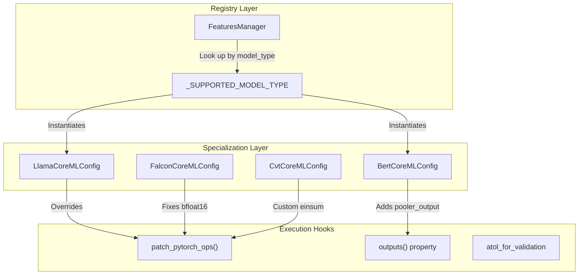
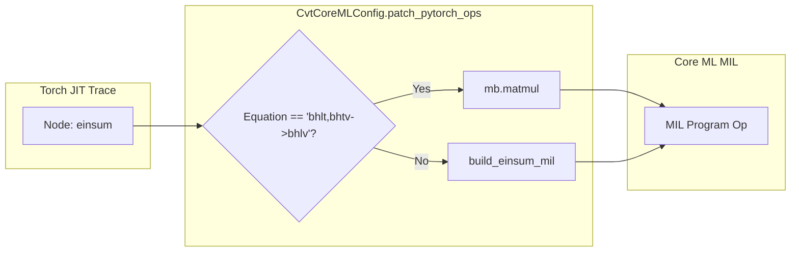

<!-- source: DeepWiki mcp.deepwiki.com · repo huggingface/exporters · extra page Model-Specific Config Specializations · fetched 2026-10-26 -->

# Model-Specific Config Specializations

Relevant source files

The following files were used as context for generating this wiki page:

- [MODELS.md](MODELS.md)
- [src/exporters/coreml/models.py](src/exporters/coreml/models.py)

This page provides a detailed technical reference for the architecture-specific subclasses of `CoreMLConfig`. While the base `CoreMLConfig` handles the general logic for input/output descriptions and flexible shapes, specific model architectures often require specialized handling. This includes overriding default outputs (e.g., adding pooler states), adjusting numerical tolerances for validation, and implementing `patch_pytorch_ops` to bypass limitations in the `coremltools` conversion engine.

## Architectural Specialization Overview

The specialization layer bridges the gap between generic Hugging Face Transformers architectures and the requirements of the Core ML Model Intermediate Language (MIL).

### Logic Flow for Specialized Configurations

The following diagram illustrates how specialized configurations interact with the `FeaturesManager` and the Core ML conversion process.

**Diagram: Configuration Resolution and Patching**

**Sources:** [src/exporters/coreml/models.py:34-230](), [src/exporters/coreml/config.py:18-22]()

---

## Text Model Specializations

### BERT and Variants
Models like BERT, BEiT, and ConvNeXT often require the inclusion of a "pooler output" which is not always present in the default hidden states.

*   **Implementation:** `BertCoreMLConfig` [src/exporters/coreml/models.py:52-60]() overrides the `outputs` property to call `self._add_pooler_output(output_descs)`.
*   **Affected Models:** BERT, BEiT [src/exporters/coreml/models.py:38-50](), ConvNeXT [src/exporters/coreml/models.py:82-94](), and MobileBERT [src/exporters/coreml/models.py:255-263]().

### GPT-2 and Sequence Length Limitations
GPT-2 is noted for having issues with flexible sequence lengths in certain Core ML versions, which impacts its ability to support Key-Value (KV) caching (`use_past`).
*   **Status:** Currently supports fixed sequence lengths; `use_past` is disabled [MODELS.md:114-122]().

### Llama and Mistral
These architectures utilize advanced RoPE (Rotary Positional Embeddings) and complex slicing operations that require specific MIL patches.

*   **Llama Specialization:** `LlamaCoreMLConfig` [src/exporters/coreml/models.py:220-230]()
*   **Mistral Specialization:** `MistralCoreMLConfig` [src/exporters/coreml/models.py:245-253]()
*   **Key Workaround:** Both architectures override `patch_pytorch_ops` to handle the `scaled_dot_product_attention` operator, which may not be natively supported or optimized in all `coremltools` versions.

### Falcon
`FalconCoreMLConfig` [src/exporters/coreml/models.py:201-218]() implements a critical patch for the `to` operator.
*   **The Issue:** `coremltools` sometimes fails when encountering `bfloat16` types during conversion.
*   **The Patch:** The `patch_pytorch_ops` implementation in Falcon redefines the `to` op to provide a fallback from `bfloat16` to `float32` [src/exporters/coreml/models.py:205-207]().

---

## Vision Model Specializations

### MobileViT and MobileViTv2
These models are optimized for mobile but require specific output handling for tasks like semantic segmentation.
*   **MobileViT:** Overrides `atol_for_validation` to `1e-2` to account for accumulation differences in lightweight convolutions [src/exporters/coreml/models.py:265-273]().
*   **MobileViTv2:** Similar specialization for vision tasks [src/exporters/coreml/models.py:275-283]().

### CvT (Convolutional vision Transformer)
`CvtCoreMLConfig` [src/exporters/coreml/models.py:112-162]() contains one of the most complex operator patches in the repository.

*   **Einsum Patching:** Core ML's `einsum` implementation has limitations with specific equations. CvT requires the equation `bhlt,bhtv->bhlv`.
*   **Logic:** If the `einsum` equation matches this specific string, the patch converts the operation into a standard `mb.matmul` [src/exporters/coreml/models.py:150-151](). Otherwise, it falls back to the default `build_einsum_mil` [src/exporters/coreml/models.py:153]().

---

## Op Patching Mechanism (`patch_pytorch_ops`)

The `patch_pytorch_ops` method is a hook called during the export process. It returns a dictionary mapping Torch operation names to custom MIL builder functions.

**Diagram: Op Patching Data Flow**

**Sources:** [src/exporters/coreml/models.py:139-157](), [src/exporters/coreml/config.py:284-290]()

### Common Patch Patterns

| Model | Op Patched | Reason |
| :--- | :--- | :--- |
| **CTRL** | `lift_fresh` | Implemented as a no-op to prevent conversion failure on newer Torch versions [src/exporters/coreml/models.py:99-109](). |
| **Falcon** | `to` | Fallback for `bfloat16` to `float32` [src/exporters/coreml/models.py:204-218](). |
| **CvT** | `einsum` | Replaces specific 4D tensor contractions with `matmul` for better compatibility [src/exporters/coreml/models.py:142-157](). |
| **Llama** | `scaled_dot_product_attention` | Manual implementation for efficient attention on Apple Silicon [src/exporters/coreml/models.py:223-228](). |

---

## Validation Tolerances (`atol_for_validation`)

Different architectures exhibit varying degrees of numerical drift when converted from PyTorch (Float32) to Core ML (often Float16 or specialized hardware paths). Specialized configs override `atol_for_validation` to ensure the validation pipeline passes for expected variances.

*   **Default:** `1e-4` [src/exporters/coreml/config.py:292-294]()
*   **BEiT:** `1e-2` [src/exporters/coreml/models.py:48-49]()
*   **ConvNeXT:** `1e-3` [src/exporters/coreml/models.py:92-93]()
*   **CvT:** `1e-2` [src/exporters/coreml/models.py:160-161]()
*   **ViT:** `2e-3` [src/exporters/coreml/models.py:382-383]()

**Sources:**
- `src/exporters/coreml/models.py`: Entire file defines these specializations.
- `src/exporters/coreml/config.py`: Defines the base class hooks.
- `MODELS.md`: Documents the support status and known issues for these architectures.

---

