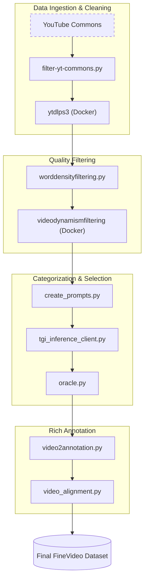
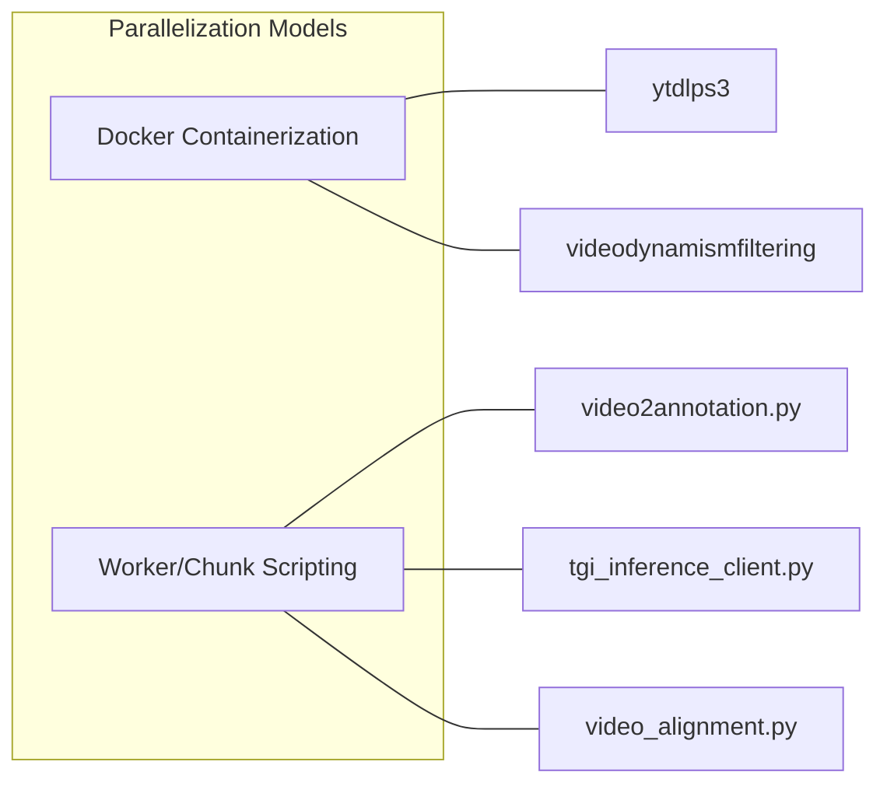

<!-- source: DeepWiki mcp.deepwiki.com · repo huggingface/fineVideo · page 1 FineVideo: Project Overview · fetched 2026-10-26 -->

# FineVideo: Project Overview

Relevant source files

The following files were used as context for generating this wiki page:

- [dataset-creation.png](dataset-creation.png)
- [finevideo.gif](finevideo.gif)
- [logo.png](logo.png)
- [readme.md](readme.md)

FineVideo is a comprehensive video dataset featuring over 43,000 videos (approximately 3,400 hours) annotated with rich metadata, including narrative descriptions, scene splits, and question-answering (QA) pairs [readme.md:5-7](). This project provides a complete end-to-end pipeline for sourcing, filtering, selecting, and annotating high-quality video content from the web.

## System Architecture

The FineVideo pipeline is structured as a series of modular subsystems, each responsible for a specific stage of data refinement. The architecture transitions from broad data ingestion to highly specific, LLM-driven multimodal annotation.

### Pipeline Stage Connectivity
The following diagram illustrates the functional flow from the raw data source to the final aligned dataset, mapping high-level stages to their respective code implementations.

**FineVideo Functional Flow**

Sources: [readme.md:15-47](), [readme.md:51-54]()

## Core Subsystems

The project is organized into five primary functional areas:

### 1. Raw Dataset Ingestion
This stage identifies candidate videos from the [YouTube Commons](https://huggingface.co/datasets/PleiAs/YouTube-Commons) dataset. It filters for English-language content and utilizes a Dockerized service to download video assets (MP4, VTT, and JSON metadata) directly to S3 storage.
*   **Key Entities:** `filter-yt-commons.py`, `ytdlps3/download_and_upload.py`.
*   **For details, see [Pipeline Architecture & Data Flow](#1.1).**

### 2. Dynamic Filters
To ensure the dataset contains information-rich content, surviving videos pass through two quality checks:
*   **Word Density:** Drops videos with low speech-to-duration ratios (≤ 0.5 words/sec).
*   **Video Dynamism:** Uses `ffmpeg`'s `freezedetect` to identify and remove static or low-motion videos.
*   **Key Entities:** `worddensityfiltering.py`, `check_static.py`.

### 3. Video Categorization & Selection
Surviving videos are categorized using a three-tier content taxonomy. A Llama-3.1-70B-Instruct model (served via TGI) assigns categories based on titles and captions. Finally, the **Oracle** algorithm performs diversity-aware sampling to select the final subset for expensive annotation.
*   **Key Entities:** `create_prompts.py`, `tgi_inference_client.py`, `oracle.py`.

### 4. Content Annotation
This is the most compute-intensive phase. Selected videos are processed by Gemini 1.5 Pro for multimodal analysis, with GPT-4o acting as a schema enforcer to produce structured JSON containing scenes, storylines, and character details.
*   **Key Entities:** `video2annotation.py`, `gemini_prompt.txt`.

### 5. Fine Alignment
The final stage reconciles the LLM-generated timestamps with actual video frame boundaries. It uses `PySceneDetect` to snap annotations to precise scene changes, ensuring technical consistency across the dataset.
*   **Key Entities:** `video_alignment.py`.

## Scalability & Parallelization

The pipeline is designed to handle large-scale processing through two primary patterns:
1.  **Dockerized Services:** Compute-heavy tasks like downloading and dynamism filtering are packaged as containers for distributed deployment [readme.md:49-52]().
2.  **Worker/Chunk Pattern:** API-bound or data-heavy scripts (categorization, annotation, alignment) support a `worker_number` and `size_chunk` CLI interface, allowing multiple instances to process independent segments of a work queue in parallel [readme.md:49-54]().

**Distributed Execution Mapping**

Sources: [readme.md:49-54]()

For details on how these scaling patterns are implemented across the cluster, see [Scalability & Distributed Execution Model](#1.2).

---

