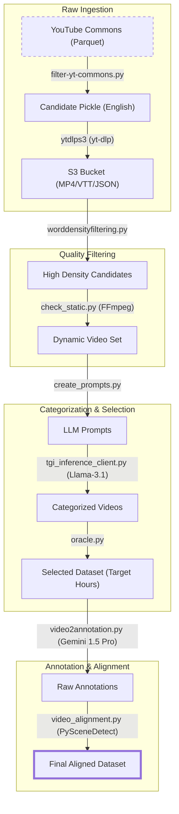
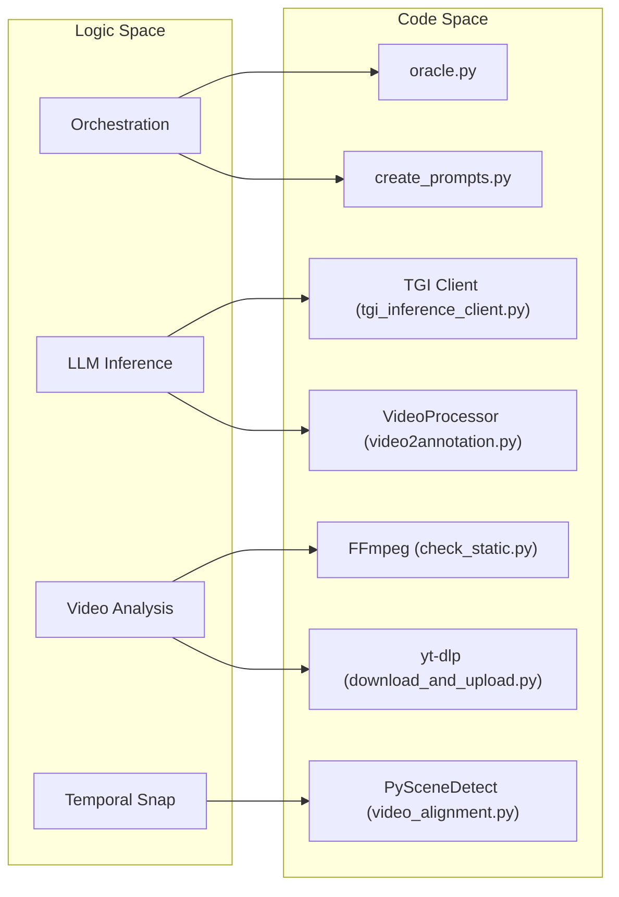

<!-- source: DeepWiki mcp.deepwiki.com · repo huggingface/fineVideo · page 1.1 Pipeline Architecture & Data Flow · fetched 2026-10-26 -->

# Pipeline Architecture & Data Flow

Relevant source files

The following files were used as context for generating this wiki page:

- [dataset-creation.png](dataset-creation.png)
- [readme.md](readme.md)

This page provides a technical walkthrough of the end-to-end FineVideo data pipeline. The architecture is designed as a directed graph of processing stages, moving from massive-scale raw metadata ingestion to high-fidelity multimodal annotation and temporal alignment.

## End-to-End Pipeline Overview

The pipeline transforms raw YouTube metadata into a curated, annotated dataset of ~3.4k hours of high-quality video content [readme.md:5-7](). The process is divided into six major functional blocks, each responsible for increasing the information density and quality of the data.

### Data Flow Diagram

The following diagram illustrates the transition of data from the initial YouTube Commons source through the various filtering, selection, and annotation stages.

**FineVideo Data Flow & Stage Transitions**

Sources: [readme.md:22-47](), [readme.md:18-18]()

---

## Scalability & Execution Model

The pipeline employs two primary scaling patterns to handle the computational load of processing thousands of hours of video [readme.md:49-54]().

### 1. Dockerized Compute Services
For tasks requiring heavy system dependencies (like `ffmpeg` or `yt-dlp`), the pipeline uses Docker containers. These are deployed as independent workers that interact with S3.
*   **`ytdlps3`**: Handles video and metadata downloads [readme.md:25-27]().
*   **`videodynamismfiltering`**: Executes frame-level analysis to detect static content [readme.md:29-31]().

### 2. Queue Chunking Pattern
For API-bound or Python-heavy tasks, scripts implement a worker/chunk CLI pattern. This allows multiple instances of the same script to run in parallel by processing specific segments of a shared work list [readme.md:49-50]().

| Script | Scaling Mechanism | Key Arguments |
| :--- | :--- | :--- |
| `video2annotation.py` | Chunking | `worker_number`, `size_chunk` |
| `tgi_inference_client.py` | Block Partitioning | Directory partitioning (4 blocks) |
| `video_alignment.py` | Chunking | `worker_number`, `size_chunk` |

Sources: [readme.md:49-54](), [videocategorization/tgi_inference_client.py:1-37](), [contentannotation/video2annotation.py:1-43]()

---

## Detailed Stage Walkthrough

### Stage 1: Ingestion & Metadata Filtering
The pipeline starts with `filter-yt-commons.py`, which parses the PleIAs/YouTube-Commons dataset. It applies initial heuristics: language must be English and word count must exceed 50 [readme.md:24-24](). Surviving IDs are passed to `ytdlps3` for S3 upload.

### Stage 2: Dynamic Quality Filtering
Two filters remove "low-information" videos:
1.  **Word Density**: `worddensityfiltering.py` calculates words-per-second. Videos with $\le 0.5$ WPS are dropped [readme.md:32-32]().
2.  **Visual Dynamism**: `check_static.py` uses FFmpeg's `freezedetect` filter. It segments videos into 60s chunks and marks them as `static/` or `dynamic/` based on the percentage of frozen frames [readme.md:31-31]().

### Stage 3: Semantic Categorization
Surviving videos are mapped to a three-tier taxonomy (Domain → Subject → Format).
*   **Prompt Creation**: `create_prompts.py` generates LLM prompts using the video title, channel, and the first 5000 characters of closed captions [readme.md:35-35]().
*   **Inference**: `tgi_inference_client.py` sends these to a Llama-3.1-70B-Instruct model hosted via Text Generation Inference (TGI) on a Slurm cluster [readme.md:36-37]().

### Stage 4: Content Selection (The Oracle)
The `oracle.py` script performs diversity-aware sampling [readme.md:40-40](). It normalizes engagement metrics (views, likes, comments) and uses a recursive DFS over the taxonomy to ensure category-quota allocation while penalizing over-represented channels.

### Stage 5: Multimodal Annotation
This is the most compute-intensive phase. `video2annotation.py` uses the `VideoProcessor` class to:
1.  Upload video to Gemini 1.5 Pro for multimodal analysis [readme.md:43-43]().
2.  Use the `instructor` library to enforce a strict GPT-4o schema (Scenes, Storylines, Moods) [readme.md:43-43]().
3.  Generate Q&A pairs and trimming suggestions [readme.md:42-42]().

### Stage 6: Fine Alignment
The final stage, `video_alignment.py`, reconciles LLM-generated timestamps with physical frame boundaries. It uses `PySceneDetect` (ContentDetector) to snap scene starts/ends to actual visual cuts, ensuring the final dataset is frame-accurate [readme.md:45-45]().

---

## Code Entity Map

The following diagram maps the conceptual pipeline stages to the specific classes and scripts that implement them.

**System Logic to Code Entity Mapping**

Sources: [readme.md:22-47](), [contentannotation/video2annotation.py:1-43](), [finealignment/video_alignment.py:1-45]()

---

