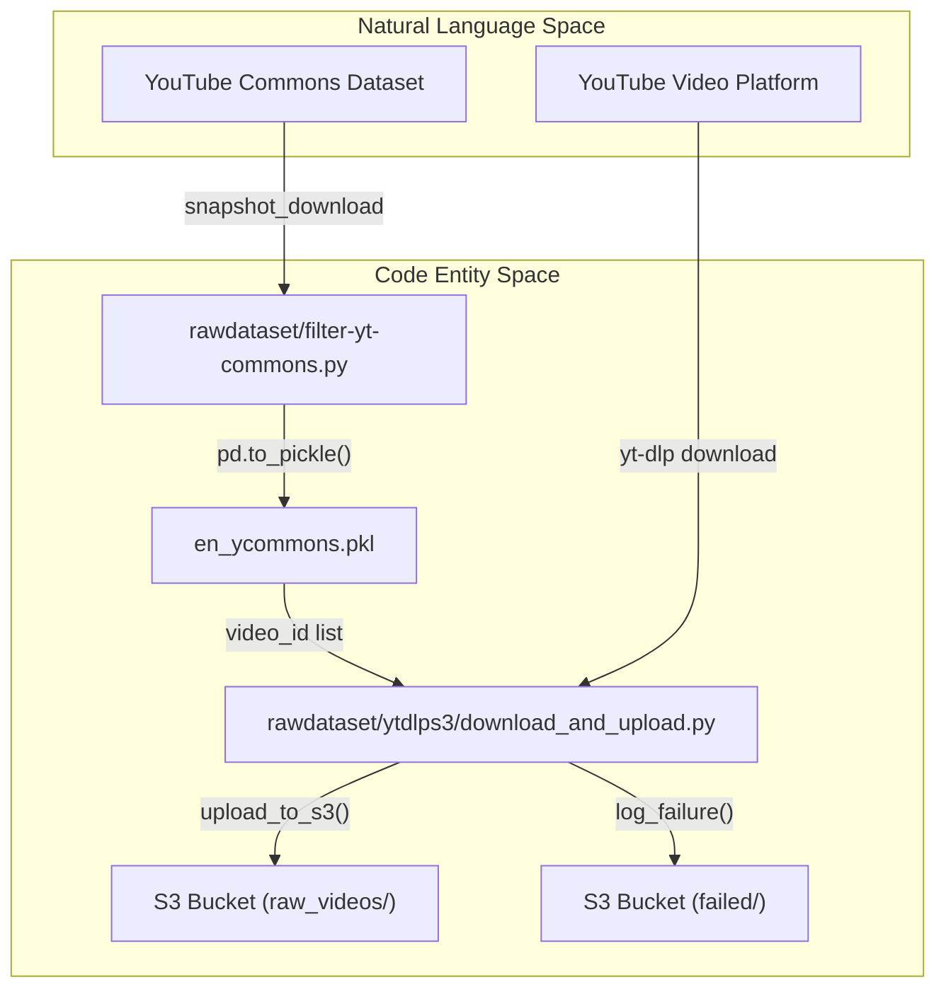
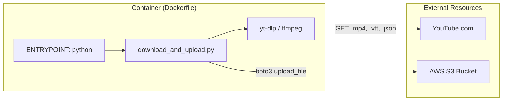

<!-- source: DeepWiki mcp.deepwiki.com · repo huggingface/fineVideo · page 2 Raw Dataset Ingestion · fetched 2026-10-26 -->

# Raw Dataset Ingestion

Relevant source files

The following files were used as context for generating this wiki page:

- [rawdataset/filter-yt-commons.py](rawdataset/filter-yt-commons.py)
- [rawdataset/ytdlps3/Dockerfile](rawdataset/ytdlps3/Dockerfile)
- [rawdataset/ytdlps3/download_and_upload.py](rawdataset/ytdlps3/download_and_upload.py)

The **Raw Dataset Ingestion** stage is the entry point of the FineVideo pipeline. Its primary purpose is to identify high-quality video candidates from the massive YouTube Commons dataset and transfer the physical media assets (video, subtitles, and metadata) into a managed S3 environment for subsequent processing.

This subsystem operates in two distinct phases:
1.  **Metadata Filtering**: Sifting through the `PleIAs/YouTube-Commons` dataset to find English-language videos with sufficient textual content.
2.  **Asset Acquisition**: A distributed downloading service that fetches the actual video files and auxiliary data from YouTube using `yt-dlp`.

### Ingestion Data Flow

The following diagram illustrates the transition from the "Natural Language Space" (user-facing datasets and video platforms) to the "Code Entity Space" (specific scripts and storage locations).

**Natural Language to Code Entity Mapping: Ingestion Flow**

Sources: [rawdataset/filter-yt-commons.py:12-14](), [rawdataset/filter-yt-commons.py:80-82](), [rawdataset/ytdlps3/download_and_upload.py:55-60](), [rawdataset/ytdlps3/download_and_upload.py:32-39]()

---

## 2.1 YouTube Commons Filter (`filter-yt-commons.py`)

The pipeline begins by processing the `PleIAs/YouTube-Commons` dataset hosted on Hugging Face. The script `filter-yt-commons.py` performs a `snapshot_download` of the dataset [rawdataset/filter-yt-commons.py:80-82]() and iterates through the Parquet files to extract a subset of videos meeting specific criteria.

**Key Operations:**
*   **Language Filtering**: It restricts candidates to those where both `original_language` and `transcription_language` are set to `'en'` [rawdataset/filter-yt-commons.py:78]().
*   **Content Density**: It enforces a minimum `word_count` of 50 to ensure the video has enough spoken content for meaningful annotation [rawdataset/filter-yt-commons.py:55-56]().
*   **Metadata Extraction**: It selects 26 specific fields, including engagement metrics (`view_count`, `like_count`), technical specs (`resolution`), and textual data (`description`, `text`) [rawdataset/filter-yt-commons.py:77]().

The resulting filtered DataFrame is serialized to a pickle file (`en_ycommons.pkl`) [rawdataset/filter-yt-commons.py:89](), which serves as the manifest for the downloader.

For details, see [YouTube Commons Filter (`filter-yt-commons.py`)](#2.1).

Sources: [rawdataset/filter-yt-commons.py:19-74]()

---

## 2.2 Video Downloader Service (`ytdlps3`)

The downloader service is a containerized application designed to scale across a cluster. It consumes `video_id`s from the manifest and uses `yt-dlp` to retrieve the assets.

**System Architecture: Downloader Service**

Sources: [rawdataset/ytdlps3/Dockerfile:1-22](), [rawdataset/ytdlps3/download_and_upload.py:6-26]()

**Key Components:**
*   **Environment**: The service runs in a `python:3.9-slim` environment with `ffmpeg` installed for media handling [rawdataset/ytdlps3/Dockerfile:1-10]().
*   **Asset Retrieval**: For every video, it attempts to download the best quality MP4, English VTT subtitles, and the video metadata JSON [rawdataset/ytdlps3/download_and_upload.py:7-15]().
*   **S3 Integration**: Successfully downloaded files are uploaded to a target S3 bucket [rawdataset/ytdlps3/download_and_upload.py:55-60]().
*   **Error Handling**: If a download fails, the script captures the traceback and uploads an error log to a `failed/` prefix in S3, allowing for easy auditing of unavailable or restricted videos [rawdataset/ytdlps3/download_and_upload.py:32-39]().

For details, see [Video Downloader Service (`ytdlps3`)](#2.2).

Sources: [rawdataset/ytdlps3/download_and_upload.py:41-69]()

---

