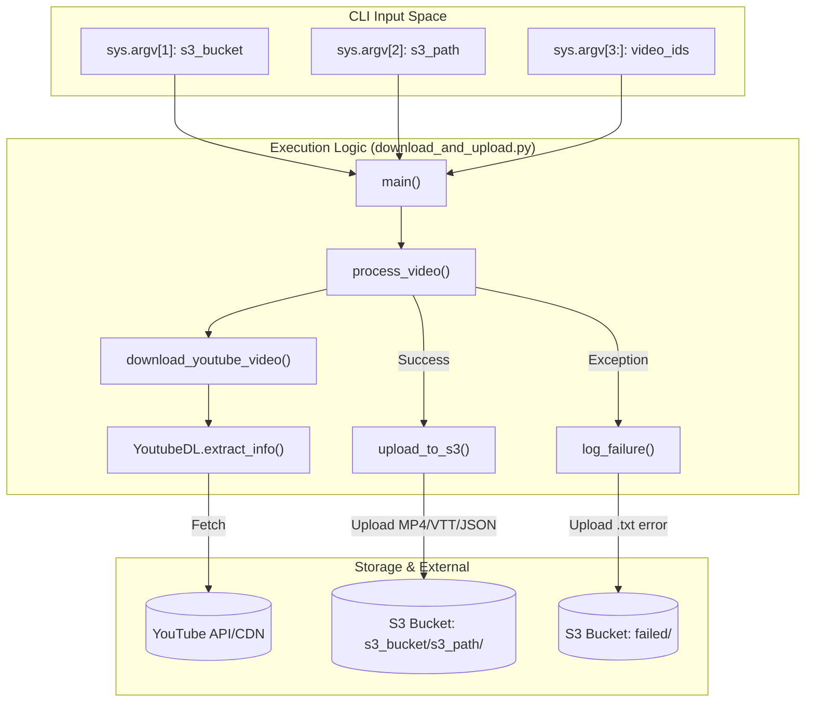
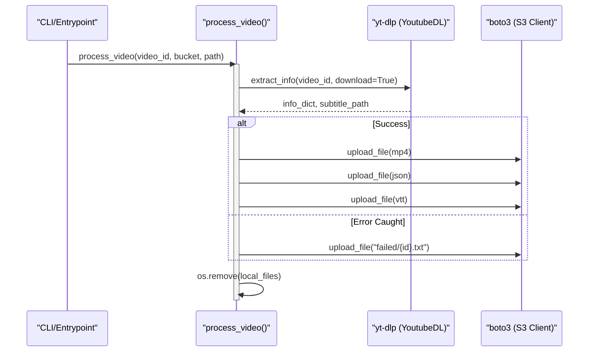

<!-- source: DeepWiki mcp.deepwiki.com · repo huggingface/fineVideo · page 2.2 Video Downloader Service (`ytdlps3`) · fetched 2026-10-26 -->

# Video Downloader Service (`ytdlps3`)

<details>
<summary>Relevant source files</summary>

The following files were used as context for generating this wiki page:

- [rawdataset/ytdlps3/Dockerfile](rawdataset/ytdlps3/Dockerfile)
- [rawdataset/ytdlps3/download_and_upload.py](rawdataset/ytdlps3/download_and_upload.py)

</details>


The Video Downloader Service is a containerized utility designed to ingest video content from YouTube into the FineVideo pipeline's S3 storage. It encapsulates `yt-dlp` and `ffmpeg` to ensure reliable retrieval of high-quality video files, English subtitles, and comprehensive metadata.

## Overview and Purpose

The service operates as a standalone Docker container that processes a list of YouTube video IDs. For each ID, it fetches:
1.  The best available MP4 video stream.
2.  English subtitles in VTT format (if available).
3.  The `info.json` metadata file generated by `yt-dlp`.

All successfully retrieved assets are uploaded to a specified S3 bucket and path. In the event of a failure (e.g., video removed, regional restrictions), the service logs the error to a dedicated `failed/` prefix in S3 for auditing.

### System Architecture and Data Flow

The following diagram illustrates the relationship between the CLI arguments, the internal processing logic, and the external storage services.

**Downloader Data Flow and Code Entities**

**Sources:** [rawdataset/ytdlps3/download_and_upload.py:70-83](), [rawdataset/ytdlps3/download_and_upload.py:41-68]()

---

## Implementation Details

### Docker Environment
The service is built on `python:3.9-slim` to minimize image size while providing the necessary system dependencies.

| Dependency | Purpose |
| :--- | :--- |
| `ffmpeg` | Required by `yt-dlp` for post-processing and format merging. |
| `yt-dlp` | The core engine for downloading YouTube content and metadata. |
| `boto3` | AWS SDK for Python used to interact with S3. |
| `python:3.9-slim` | Base OS and runtime. |

**Sources:** [rawdataset/ytdlps3/Dockerfile:1-13]()

### Core Logic: `download_and_upload.py`

The script follows a sequential execution pattern for each video ID provided in the command line arguments.

#### 1. Video Retrieval (`download_youtube_video`)
The function `download_youtube_video` configures `YoutubeDL` with specific options to ensure consistency across the dataset:
*   **Format**: Set to `best` to retrieve the highest quality merged stream [rawdataset/ytdlps3/download_and_upload.py:8]().
*   **Subtitles**: Specifically requests English (`en`) subtitles in `vtt` format [rawdataset/ytdlps3/download_and_upload.py:9-11]().
*   **Metadata**: `writeinfojson` is enabled to capture the full YouTube metadata block [rawdataset/ytdlps3/download_and_upload.py:12]().

#### 2. Processing and Cleanup (`process_video`)
The `process_video` function manages the lifecycle of a single download:
*   Creates a temporary directory at `/tmp/youtube_downloads` [rawdataset/ytdlps3/download_and_upload.py:44-45]().
*   Calls `download_youtube_video` and maps the resulting local files to their intended S3 keys [rawdataset/ytdlps3/download_and_upload.py:48-52]().
*   Uploads the `.mp4`, `.json` (metadata), and `.en.vtt` (subtitles) files to S3 [rawdataset/ytdlps3/download_and_upload.py:55-60]().
*   **Cleanup**: Iterates through the temporary directory and deletes all local files after upload to prevent disk exhaustion in the container [rawdataset/ytdlps3/download_and_upload.py:63-64]().

#### 3. Error Handling (`log_failure`)
If any part of the download or upload process fails, the exception is caught. The `log_failure` function writes the traceback or error message to a local `.txt` file named after the `video_id` and uploads it to the `failed/` prefix in the target S3 bucket [rawdataset/ytdlps3/download_and_upload.py:32-39]().

**Component Interaction Diagram**

**Sources:** [rawdataset/ytdlps3/download_and_upload.py:6-26](), [rawdataset/ytdlps3/download_and_upload.py:41-68]()

---

## CLI Interface

The service is invoked via the command line, typically as the `ENTRYPOINT` of the Docker container.

### Usage
```bash
python download_and_upload.py <s3_bucket_name> <s3_path> <youtube_video_id_1> [<youtube_video_id_2> ...]
```

### Arguments
*   `s3_bucket_name`: The name of the destination S3 bucket.
*   `s3_path`: The prefix (folder) within the bucket where files should be stored.
*   `youtube_video_id_N`: One or more 11-character YouTube video identifiers.

**Sources:** [rawdataset/ytdlps3/download_and_upload.py:75-81]()

---

