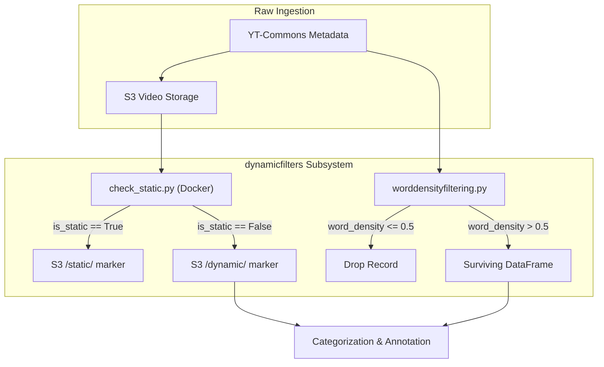
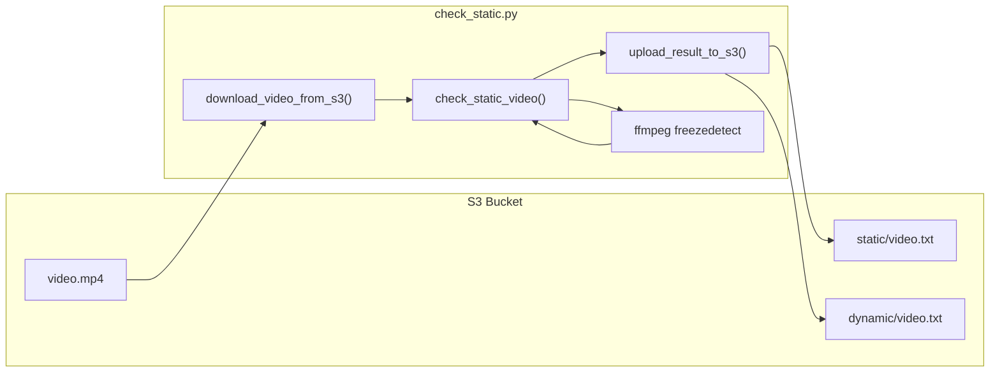
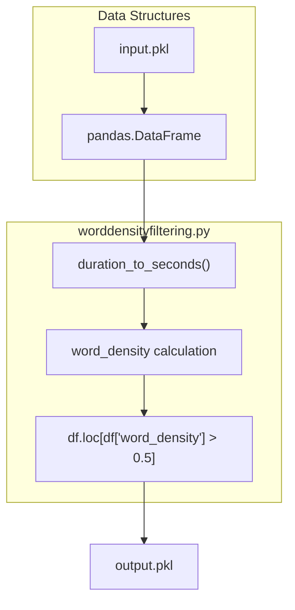

<!-- source: DeepWiki mcp.deepwiki.com · repo huggingface/fineVideo · page 3 Dynamic Filters · fetched 2026-10-26 -->

# Dynamic Filters

Relevant source files

The following files were used as context for generating this wiki page:

- [dynamicfilters/videodynamismfiltering/Dockerfile](dynamicfilters/videodynamismfiltering/Dockerfile)
- [dynamicfilters/videodynamismfiltering/check_static.py](dynamicfilters/videodynamismfiltering/check_static.py)
- [dynamicfilters/worddensityfiltering.py](dynamicfilters/worddensityfiltering.py)

The `dynamicfilters` subsystem serves as a two-pass quality-control layer designed to remove low-information videos early in the pipeline. By filtering out content with minimal visual movement or low verbal information density, the system avoids wasting expensive compute and API credits during the subsequent categorization and annotation stages.

### Subsystem Overview

The filtering process is split into two distinct methodologies:
1.  **Visual Dynamism**: Analyzing the video stream to detect "static" content (e.g., slideshows, static images with audio).
2.  **Information Density**: Analyzing metadata to ensure the video contains a sufficient rate of spoken words relative to its duration.

The following diagram illustrates the position of these filters within the broader ingestion pipeline:

**Dynamic Filter Data Flow**

Sources: [dynamicfilters/videodynamismfiltering/check_static.py:75-97](), [dynamicfilters/worddensityfiltering.py:4-7]()

---

### Video Dynamism Filter (`check_static.py`)

The dynamism filter identifies videos that lack significant visual change. This is critical for multimodal datasets where the relationship between visual cues and audio is paramount.

*   **Execution**: This filter runs as a Dockerized service, typically deployed via AWS Batch. It uses `ffmpeg`'s `freezedetect` filter to scan video segments for lack of motion.
*   **Logic**: The script `check_static.py` calculates a `freeze_percentage` by dividing the number of segments containing "frozen" frames by the total number of segments. If this percentage exceeds a predefined `threshold` (defaulting to 0.4), the video is marked as static.
*   **Output**: Instead of deleting files, the system writes empty marker files to S3 under `static/` or `dynamic/` prefixes to inform downstream selection logic.

For details on the Docker environment and the `freezedetect` parameters, see [Video Dynamism Filter (`check_static.py`)](#3.1).

**System to Code Entity Mapping: Dynamism Filtering**

Sources: [dynamicfilters/videodynamismfiltering/check_static.py:9-20](), [dynamicfilters/videodynamismfiltering/check_static.py:22-64](), [dynamicfilters/videodynamismfiltering/check_static.py:66-74]()

---

### Word Density Filter (`worddensityfiltering.py`)

The word density filter targets videos that may have high visual dynamism but lack sufficient verbal content to justify detailed textual annotation or Q&A generation.

*   **Metric**: It calculates `word_density`, defined as `word_count / duration_seconds`.
*   **Threshold**: The script enforces a strict cutoff at `0.5` words per second. Any video falling below this threshold is dropped from the processing DataFrame.
*   **Implementation**: It processes the pickle files generated during the ingestion phase, converting `duration_string` (e.g., "HH:MM:SS") into raw seconds to perform the calculation.

For details on the visualization tools for borderline cases and the duration parsing logic, see [Word Density Filter (`worddensityfiltering.py`)](#3.2).

**System to Code Entity Mapping: Word Density**

Sources: [dynamicfilters/worddensityfiltering.py:20-35](), [dynamicfilters/worddensityfiltering.py:39-40](), [dynamicfilters/worddensityfiltering.py:72-75]()

---

### Integration with Pipeline

The dynamic filters act as the final gatekeepers of the "Raw Dataset Ingestion" phase. Only videos that are both **dynamic** (confirmed by `check_static.py`) and **informative** (confirmed by `worddensityfiltering.py`) proceed to the [Video Categorization](#4) stage.

| Filter Type | Primary Tool | Input | Output Criterion |
| :--- | :--- | :--- | :--- |
| **Visual** | `ffmpeg` | MP4 Video | `freeze_percentage < 0.4` |
| **Verbal** | `pandas` | Metadata (word count) | `word_density > 0.5` |

Sources: [dynamicfilters/videodynamismfiltering/check_static.py:64](), [dynamicfilters/worddensityfiltering.py:73]()

---

