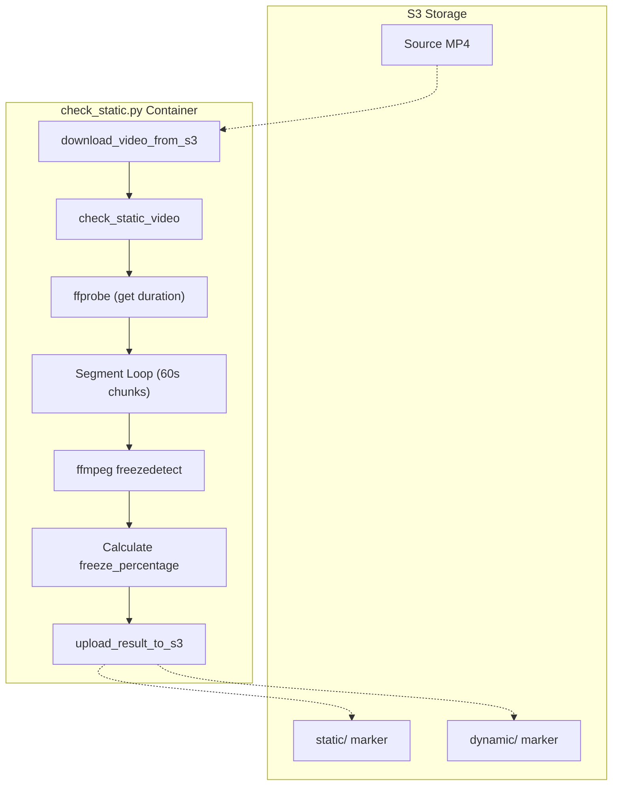
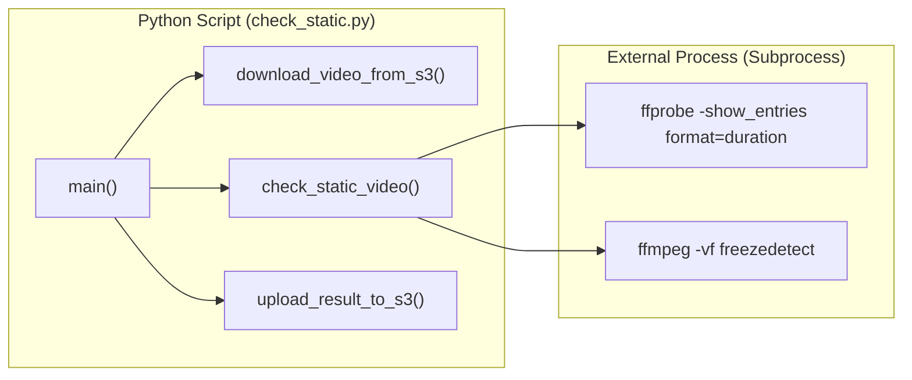

<!-- source: DeepWiki mcp.deepwiki.com · repo huggingface/fineVideo · page 3.1 Video Dynamism Filter (`check_static.py`) · fetched 2026-10-26 -->

# Video Dynamism Filter (`check_static.py`)

Relevant source files

The following files were used as context for generating this wiki page:

- [dynamicfilters/videodynamismfiltering/Dockerfile](dynamicfilters/videodynamismfiltering/Dockerfile)
- [dynamicfilters/videodynamismfiltering/check_static.py](dynamicfilters/videodynamismfiltering/check_static.py)

The **Video Dynamism Filter** is a specialized preprocessing service designed to identify and flag videos with low visual information (static content). By filtering out videos that resemble slideshows, static images with audio, or frozen frames, the pipeline ensures that compute-heavy downstream stages—such as LLM-based video annotation—are only performed on visually dynamic content.

## Overview and Purpose

The service is implemented as a Dockerized Python application that leverages `ffmpeg` to detect "freeze" patterns in video streams. It processes videos in 60-second segments to compute a global "freeze percentage," which is then compared against a configurable threshold to classify the video as either `static/` or `dynamic/`.

### Key Capabilities
*   **Segmented Analysis**: Breaks long videos into chunks to avoid memory overhead and handle varying levels of dynamism throughout a single file [dynamicfilters/videodynamismfiltering/check_static.py:42-47]().
*   **Threshold-Based Filtering**: Uses the `freezedetect` filter to measure visual stagnation [dynamicfilters/videodynamismfiltering/check_static.py:22-32]().
*   **S3-Driven Workflow**: Downloads source MP4s and uploads empty marker files to specific S3 prefixes to signal status to subsequent pipeline stages [dynamicfilters/videodynamismfiltering/check_static.py:66-73]().

---

## Technical Implementation

### System Architecture & Data Flow

The following diagram illustrates the relationship between the `check_static.py` script and the external tools (`ffprobe`, `ffmpeg`) and storage (S3).

**Video Dynamism Logic Flow**

*Sources: [dynamicfilters/videodynamismfiltering/check_static.py:9-93]()*

### The `check_static_video` Logic
The core logic resides in `check_static_video` [dynamicfilters/videodynamismfiltering/check_static.py:22](). The function executes the following steps:

1.  **Duration Extraction**: Uses `ffprobe` to determine the total length of the video in seconds [dynamicfilters/videodynamismfiltering/check_static.py:27-32]().
2.  **Segmentation**: Calculates `num_segments` by dividing total duration by `segment_duration` (default: 60s) [dynamicfilters/videodynamismfiltering/check_static.py:38-42]().
3.  **Freeze Detection**: For each segment, it runs an `ffmpeg` command using the `freezedetect` filter [dynamicfilters/videodynamismfiltering/check_static.py:44-47]().
    *   `n=0.05`: Noise tolerance for freeze detection.
    *   `d=50`: Duration (in frames or seconds depending on context, here configured for significant stillness) required to trigger a freeze event.
4.  **Classification**: If the string `"freezedetect"` appears in the `ffmpeg` stderr output, that segment is marked as frozen [dynamicfilters/videodynamismfiltering/check_static.py:51-53]().
5.  **Scoring**: The final `freeze_percentage` is `freeze_count / num_segments` [dynamicfilters/videodynamismfiltering/check_static.py:59](). If this value is $\ge$ `threshold` (default: 0.4), the video is classified as static [dynamicfilters/videodynamismfiltering/check_static.py:64]().

---

## Deployment and Environment

### Docker Configuration
The service is packaged in a lightweight container based on `python:3.9-slim` [dynamicfilters/videodynamismfiltering/Dockerfile:2]().

| Layer | Purpose |
| :--- | :--- |
| **Base Image** | `python:3.9-slim` [dynamicfilters/videodynamismfiltering/Dockerfile:2]() |
| **System Deps** | `ffmpeg` [dynamicfilters/videodynamismfiltering/Dockerfile:6]() |
| **Python Deps** | `boto3`, `ffmpeg-python` [dynamicfilters/videodynamismfiltering/Dockerfile:17]() |
| **Entrypoint** | `python check_static.py` [dynamicfilters/videodynamismfiltering/Dockerfile:20]() |

### Environment Variables
The script expects specific environment variables, typically provided by AWS Batch or a similar orchestrator [dynamicfilters/videodynamismfiltering/check_static.py:76-79]():

*   `VIDEO_BUCKET`: The S3 bucket containing source videos.
*   `VIDEO_IDS`: A comma-separated list of video IDs to process in the current job.
*   `BUCKET_VIDEO_FOLDER_PATH`: The prefix within the bucket where MP4 files are stored.

---

## Code Entity Map

The following diagram maps the logical operations of the dynamism filter to the specific functions and external commands used in the codebase.

**Code Entity Interaction Map**

*Sources: [dynamicfilters/videodynamismfiltering/check_static.py:22-93]()*

### Classification Logic Summary

| Metric | Variable Name | Default Value | Description |
| :--- | :--- | :--- | :--- |
| Segment Duration | `segment_duration` | 60 | Length of each analysis window in seconds. |
| Noise Tolerance | `freeze_n` | 0.05 | `freezedetect` noise parameter. |
| Freeze Duration | `freeze_d` | 50 | Minimum duration to flag a segment as static. |
| Pass/Fail Threshold | `threshold` | 0.4 | Ratio of frozen segments allowed before being marked `static`. |

*Sources: [dynamicfilters/videodynamismfiltering/check_static.py:22]()*

---

