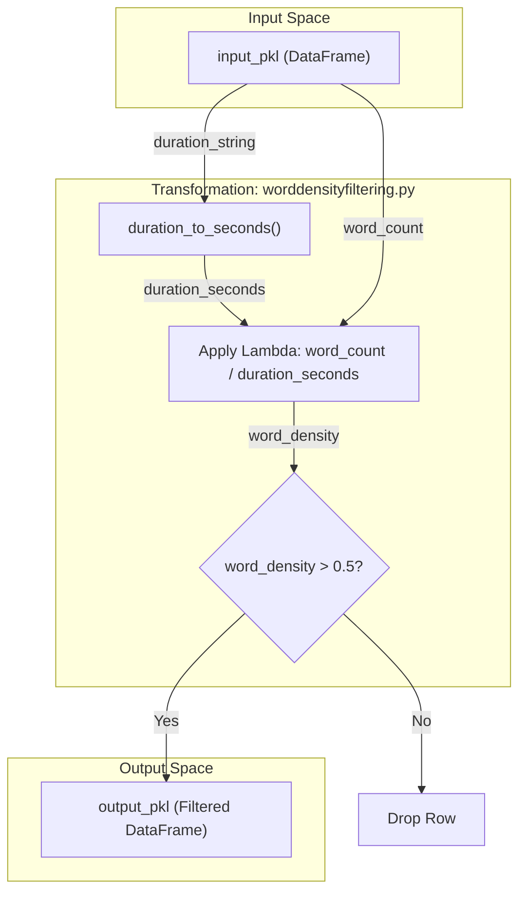
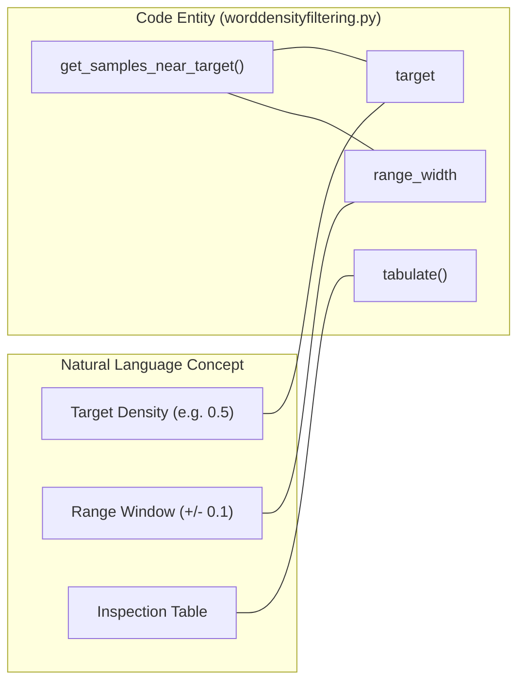

<!-- source: DeepWiki mcp.deepwiki.com · repo huggingface/fineVideo · page 3.2 Word Density Filter (`worddensityfiltering.py`) · fetched 2026-10-26 -->

# Word Density Filter (`worddensityfiltering.py`)

Relevant source files

The following files were used as context for generating this wiki page:

- [dynamicfilters/worddensityfiltering.py](dynamicfilters/worddensityfiltering.py)

The `worddensityfiltering.py` script serves as a quality-control heuristic within the `dynamicfilters` subsystem. Its primary purpose is to prune the dataset of videos that lack sufficient verbal information relative to their runtime. By calculating a "words per second" metric, the pipeline can filter out content that is primarily visual or musical without significant educational or conversational value, which is critical for downstream multimodal annotation tasks.

### Core Logic and Metrics

The filter operates on metadata previously extracted from the YouTube Commons dataset. It introduces two primary calculated columns to the working DataFrame: `duration_seconds` and `word_density`.

#### Duration Normalization
The script first converts the human-readable `duration_string` (e.g., "01:05:30") into a raw integer representing total seconds. This conversion is handled by the `duration_to_seconds` function [dynamicfilters/worddensityfiltering.py:20-32]().

| Format | Example | Calculation |
| :--- | :--- | :--- |
| `hh:mm:ss` | `01:02:03` | $(1 \times 3600) + (2 \times 60) + 3 = 3723s$ |
| `mm:ss` | `05:20` | $(5 \times 60) + 20 = 320s$ |
| `ss` | `45` | $45s$ |

#### Word Density Calculation
Word density is defined as the number of words in the transcript divided by the total duration of the video in seconds [dynamicfilters/worddensityfiltering.py:38-40]().
- **Formula**: $Word Density = \frac{word\_count}{duration\_seconds}$
- **Threshold**: The script enforces a strict lower bound of **0.5 words per second** [dynamicfilters/worddensityfiltering.py:73](). Videos failing to meet this density are dropped from the pipeline.

### Implementation Flow

The script follows a linear pickle-in/pickle-out pattern, transforming the metadata before persisting it for the next stage (Categorization).

#### Data Transformation Pipeline
The diagram below illustrates the transition from raw YT-Commons metadata fields to the filtered dataset.

"Word Density Data Flow"

Sources: [dynamicfilters/worddensityfiltering.py:17-40](), [dynamicfilters/worddensityfiltering.py:73-75]()

### Visualization and Inspection Mode

To validate the 0.5 threshold, the script includes a visualization toggle (`visualize = True`). This mode uses the `tabulate` library to print samples of videos that fall near specific density benchmarks (1.0 and 0.5).

The helper function `get_samples_near_target` allows developers to inspect "borderline" cases to ensure that the threshold is not inadvertently removing high-quality content or retaining too much "dead air" [dynamicfilters/worddensityfiltering.py:47-63]().

"Code Entity Mapping: Visualization Logic"

Sources: [dynamicfilters/worddensityfiltering.py:12](), [dynamicfilters/worddensityfiltering.py:47-69]()

### Interface and Configuration

The script is configured via hardcoded variables at the top of the file, intended to be modified per run or integrated into a larger orchestration script.

| Variable | Role | Source |
| :--- | :--- | :--- |
| `input_pkl` | Path to the `.pkl` file generated by the YT-Commons filter. | [dynamicfilters/worddensityfiltering.py:10]() |
| `output_pkl` | Destination path for the filtered results. | [dynamicfilters/worddensityfiltering.py:11]() |
| `visualize` | Boolean flag to enable/disable console output of borderline samples. | [dynamicfilters/worddensityfiltering.py:12]() |

Sources: [dynamicfilters/worddensityfiltering.py:9-13]()

---

