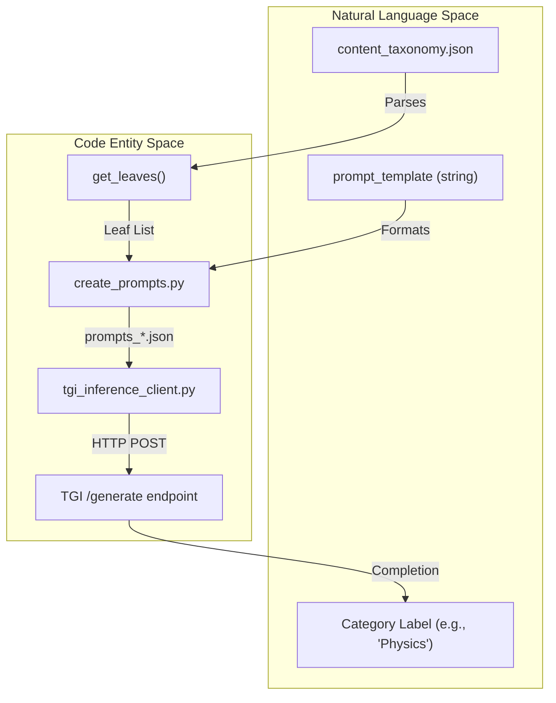
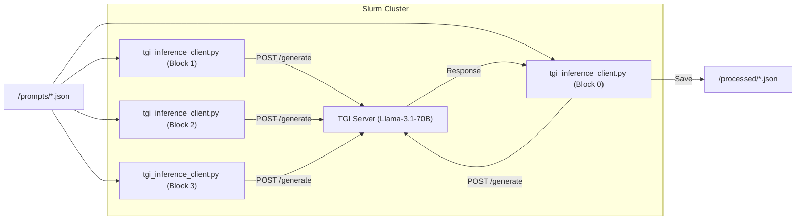

<!-- source: DeepWiki mcp.deepwiki.com · repo huggingface/fineVideo · page 4 Video Categorization · fetched 2026-10-26 -->

# Video Categorization

Relevant source files

The following files were used as context for generating this wiki page:

- [videocategorization/content_taxonomy.json](videocategorization/content_taxonomy.json)
- [videocategorization/create_prompts.py](videocategorization/create_prompts.py)
- [videocategorization/launchTGI-Slurm.sh](videocategorization/launchTGI-Slurm.sh)
- [videocategorization/tgi_inference_client.py](videocategorization/tgi_inference_client.py)

The **Video Categorization** subsystem is responsible for assigning semantic labels to videos that have passed initial quality filters. By leveraging a structured content taxonomy and a Large Language Model (LLM) served via Text Generation Inference (TGI), the pipeline transforms raw metadata and transcripts into categorized data points. This classification is critical for the subsequent [Oracle Selection Algorithm (`oracle.py`)](#5.1), which uses these categories to ensure dataset diversity.

### System Overview

The categorization process is split into two distinct phases:
1.  **Prompt Generation**: A local script extracts leaf nodes from a JSON taxonomy and prepares video-specific prompts.
2.  **Inference**: A distributed client sends these prompts to a Llama-3.1-70B-Instruct model hosted on a Slurm cluster.

#### Logical Flow: Taxonomy to Label
The following diagram illustrates how the `content_taxonomy.json` is processed by the system to generate a final classification.

**Diagram: Taxonomy Data Flow**

Sources: [videocategorization/create_prompts.py:37-45](), [videocategorization/tgi_inference_client.py:73-81]()

---

### Content Taxonomy & Prompt Generation

The foundation of the categorization subsystem is the `content_taxonomy.json` file. This file defines a three-tier hierarchy (Domain → Subject → Format/Genre) across approximately 10 top-level domains such as "Education", "Science & Technology", and "Lifestyle" [videocategorization/content_taxonomy.json:1-232]().

The `create_prompts.py` script performs the following tasks:
*   **Leaf Extraction**: Uses the `get_leaves()` function to recursively traverse the taxonomy and identify terminal categories [videocategorization/create_prompts.py:37-45]().
*   **Prompt Construction**: Merges video metadata (title, channel, tags) and the first 5000 characters of the closed captions into a structured prompt [videocategorization/create_prompts.py:47-56]().
*   **Parallel Serialization**: Utilizes a `ThreadPoolExecutor` to process video rows in chunks and save them as JSON files in the `prompts/` directory [videocategorization/create_prompts.py:85-105]().

For details, see [Content Taxonomy & Prompt Generation](#4.1).

Sources: [videocategorization/content_taxonomy.json:1-232](), [videocategorization/create_prompts.py:37-45](), [videocategorization/create_prompts.py:47-56]()

---

### TGI Inference & Slurm Deployment

Once prompts are generated, the pipeline moves to high-throughput inference using Hugging Face's Text Generation Inference (TGI) framework. 

The deployment is handled by `launchTGI-Slurm.sh`, which requests 8 GPUs on a Slurm cluster to host the `Llama-3.1-70B-Instruct` model [videocategorization/launchTGI-Slurm.sh:1-19](). The `tgi_inference_client.py` then connects to this server.

**Key Inference Features:**
*   **Data Partitioning**: The client automatically divides the `prompts/` directory into 4 blocks, allowing multiple instances of the script to run in parallel across different servers [videocategorization/tgi_inference_client.py:116-122]().
*   **Chat Templating**: It uses the `transformers` library's `apply_chat_template` to format the raw prompt for the Llama-3.1 model [videocategorization/tgi_inference_client.py:56-62]().
*   **Result Persistence**: Categorization results are saved to the `processed/` directory for use by the [Oracle Selection Algorithm (`oracle.py`)](#5.1) [videocategorization/tgi_inference_client.py:83-86]().

**Diagram: Distributed Inference Architecture**

Sources: [videocategorization/tgi_inference_client.py:14-18](), [videocategorization/tgi_inference_client.py:116-122](), [videocategorization/launchTGI-Slurm.sh:12-19]()

For details, see [TGI Inference Client & Slurm Deployment](#4.2).

Sources: [videocategorization/tgi_inference_client.py:14-18](), [videocategorization/tgi_inference_client.py:56-62](), [videocategorization/launchTGI-Slurm.sh:1-19]()

---

