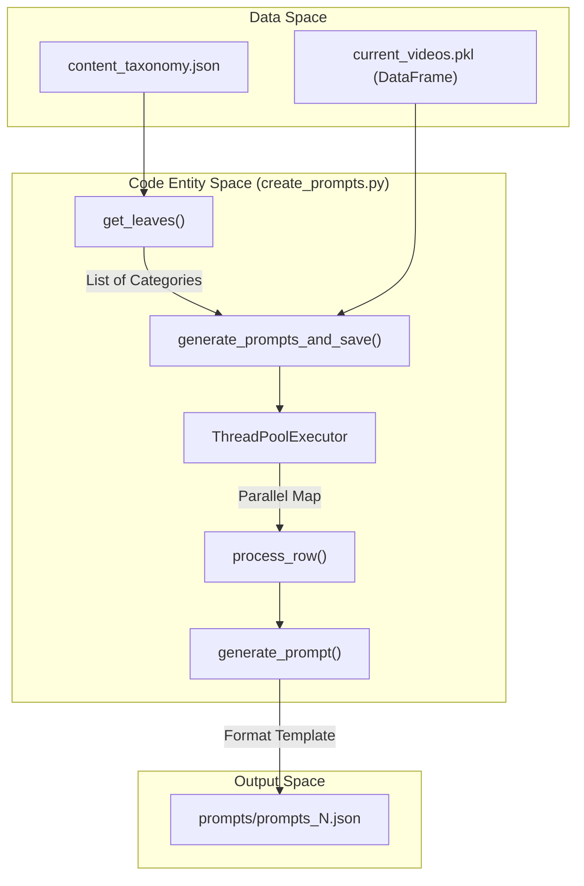
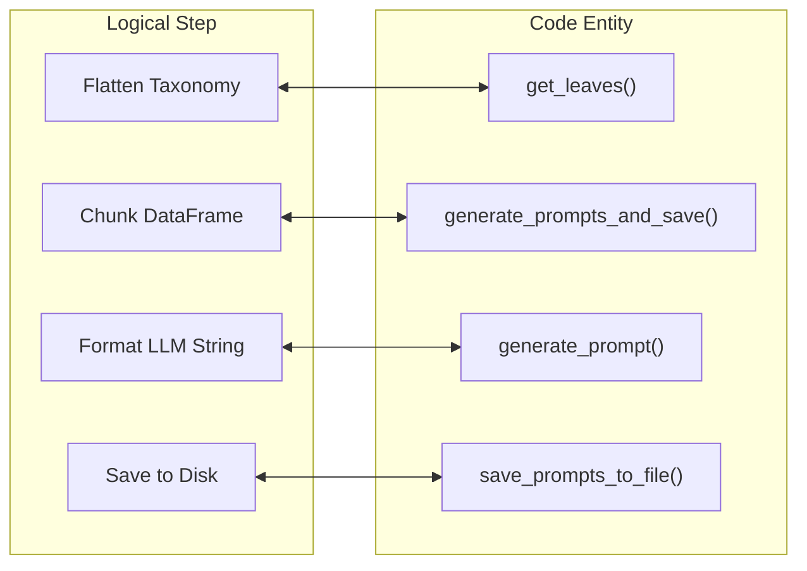

<!-- source: DeepWiki mcp.deepwiki.com · repo huggingface/fineVideo · page 4.1 Content Taxonomy & Prompt Generation · fetched 2026-10-26 -->

# Content Taxonomy & Prompt Generation

Relevant source files

The following files were used as context for generating this wiki page:

- [contentselection/content_taxonomy.json](contentselection/content_taxonomy.json)
- [videocategorization/content_taxonomy.json](videocategorization/content_taxonomy.json)
- [videocategorization/create_prompts.py](videocategorization/create_prompts.py)

The **Content Taxonomy & Prompt Generation** stage is the first phase of the `videocategorization` subsystem. Its purpose is to prepare the raw video metadata and transcripts for classification by a Large Language Model (LLM). This stage defines a structured three-tier hierarchy of video content and implements a high-throughput pipeline to transform raw video records into LLM-ready prompts.

## Content Taxonomy Schema

The system utilizes a structured JSON-based taxonomy to categorize videos. This taxonomy is used both for prompting the LLM and later for diversity-aware sampling in the `contentselection` stage.

### Hierarchy Structure
The taxonomy is organized into a three-tier hierarchy:
1.  **Domain**: The broadest category (e.g., "Entertainment", "Education", "Science & Technology"). There are approximately 10 top-level domains [videocategorization/content_taxonomy.json:1-232]().
2.  **Subject**: A sub-classification within a domain (e.g., "Gaming" under "Entertainment").
3.  **Format/Genre**: The leaf nodes representing specific content types (e.g., "Let's Plays" under "Gaming").

### Implementation Details
*   **Leaf Nodes**: Represented as empty objects `{}` in the JSON structure [videocategorization/content_taxonomy.json:4-6]().
*   **Redundancy**: Some categories appear in multiple domains to capture different contexts (e.g., "Science & Technology" exists as both a top-level domain and a subject under "Education") [videocategorization/content_taxonomy.json:47, 160]().

**Sources:** [videocategorization/content_taxonomy.json:1-233]()

---

## Prompt Generation Pipeline (`create_prompts.py`)

The `create_prompts.py` script transforms filtered video metadata into a series of JSON files containing prompts for the LLM. It uses a multi-threaded approach to handle large datasets efficiently.

### Data Flow and Logic

The script follows a linear transformation path from the raw pickle file to chunked JSON outputs:

1.  **Taxonomy Extraction**: The script recursively traverses `content_taxonomy.json` using `get_leaves()` to extract all terminal nodes. These leaf categories are provided to the LLM as the valid label space [videocategorization/create_prompts.py:37-45, 78]().
2.  **Metadata Formatting**: For each video, the `generate_prompt()` function populates a template with the video's title, channel, tags, and a trimmed version of the closed captions (limited to the first 5000 characters) [videocategorization/create_prompts.py:47-56]().
3.  **Parallel Processing**: The script uses a `ThreadPoolExecutor` within the `generate_prompts_and_save()` function to map the `process_row` operation across video records [videocategorization/create_prompts.py:90-95]().
4.  **Chunked Persistence**: To prevent memory overflow and facilitate parallel downstream inference, prompts are saved in chunks (default 1000 per file) to the `prompts/` directory [videocategorization/create_prompts.py:100-105]().

### Prompt Generation Process Map

The following diagram illustrates how the Python script bridges the raw data storage and the LLM's natural language input space.

**Diagram: Prompt Generation Data Flow**

**Sources:** [videocategorization/create_prompts.py:37-110]()

---

## Technical Implementation Details

### Taxonomy Leaf Extraction
The `get_leaves` function is a recursive utility that identifies terminal nodes in the nested dictionary. It defines a leaf as any key whose value is an empty dictionary [videocategorization/create_prompts.py:42-43]().

### Prompt Construction
The prompt template is designed for zero-shot classification. It explicitly instructs the model to "RETURN ONLY the selected category and nothing else!" to simplify post-inference parsing [videocategorization/create_prompts.py:28-35]().

| Variable | Source Field | Transformation |
| :--- | :--- | :--- |
| `{leaves}` | Taxonomy JSON | Flattened list of all leaf keys |
| `{title}` | `row['title']` | Raw string |
| `{channel}` | `row['channel']` | Raw string |
| `{closed_caption}` | `row['text']` | Trimmed to first 5000 chars |

### Entity Mapping: Code to Logic
This diagram maps specific code functions to their logical roles in the transformation pipeline.

**Diagram: Logic to Code Entity Mapping**

**Sources:** [videocategorization/create_prompts.py:37-45](), [videocategorization/create_prompts.py:47-56](), [videocategorization/create_prompts.py:58-61](), [videocategorization/create_prompts.py:70-107]()

---

