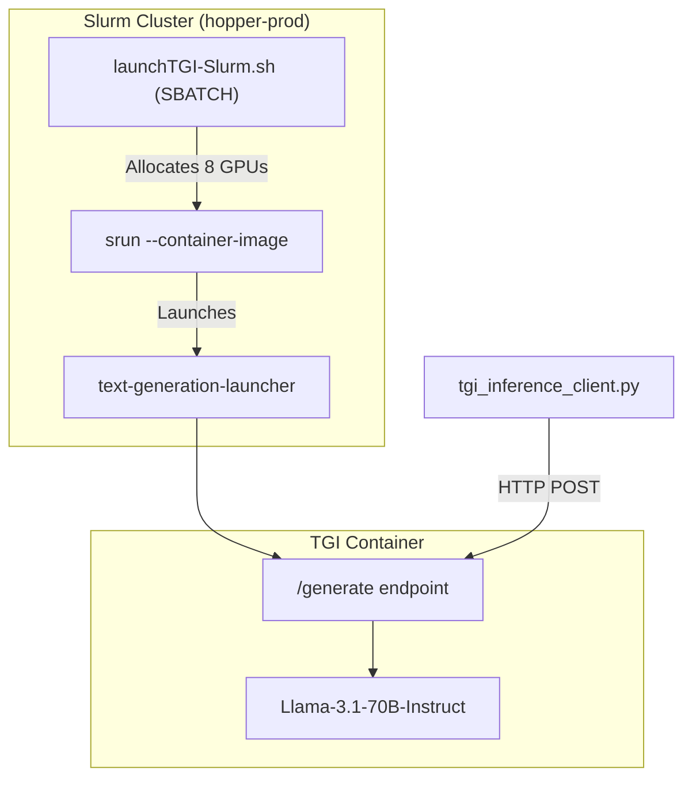
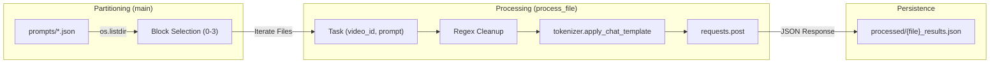

<!-- source: DeepWiki mcp.deepwiki.com · repo huggingface/fineVideo · page 4.2 TGI Inference Client & Slurm Deployment · fetched 2026-10-26 -->

# TGI Inference Client & Slurm Deployment

Relevant source files

The following files were used as context for generating this wiki page:

- [videocategorization/launchTGI-Slurm.sh](videocategorization/launchTGI-Slurm.sh)
- [videocategorization/tgi_inference_client.py](videocategorization/tgi_inference_client.py)

This section details the large-scale inference infrastructure used to categorize videos. The system leverages **Text Generation Inference (TGI)** hosted on a Slurm-managed GPU cluster to process thousands of video prompts using the **Llama-3.1-70B-Instruct** model. The implementation is split into a server-side deployment script and a client-side partitioning script that manages request distribution and prompt formatting.

## TGI Server Deployment on Slurm

The TGI server is deployed using a Slurm batch script, `launchTGI-Slurm.sh`, which requests high-performance compute resources and launches the inference engine within a Docker container.

### Cluster Configuration
The deployment utilizes the following SBATCH directives to ensure sufficient throughput for the 70B parameter model:
*   **Partition & QoS**: Runs on the `hopper-prod` partition with `high` Quality of Service (QoS) [videocategorization/launchTGI-Slurm.sh:3-8]().
*   **GPU Resources**: Allocates 8 GPUs to accommodate the model weights and KV cache [videocategorization/launchTGI-Slurm.sh:4]().
*   **Memory & CPU**: Requests 12 CPUs per task and 11G of memory per CPU [videocategorization/launchTGI-Slurm.sh:5-6]().

### Containerized Execution
The server is launched via `srun` using the official Hugging Face TGI image:
*   **Image**: `ghcr.io#huggingface/text-generation-inference` [videocategorization/launchTGI-Slurm.sh:12]().
*   **Model**: `meta-llama/Meta-Llama-3.1-70B-Instruct` [videocategorization/launchTGI-Slurm.sh:19]().
*   **Data Mounting**: The `/scratch` directory is mounted to `/data` inside the container for model weight caching [videocategorization/launchTGI-Slurm.sh:14]().
*   **Endpoint**: The server listens on a configurable port (defaulting to 1456) and exposes a `/generate` endpoint [videocategorization/launchTGI-Slurm.sh:11](), [videocategorization/tgi_inference_client.py:105]().

**Sources:**
* `videocategorization/launchTGI-Slurm.sh`
* `videocategorization/tgi_inference_client.py`

## Inference Client Implementation

The `tgi_inference_client.py` script acts as the orchestrator for sending batches of prompts to the TGI server. It is designed to be run in parallel by partitioning the input data into blocks.

### Data Partitioning Logic
The script divides the JSON files found in the `prompts/` directory into four distinct blocks [videocategorization/tgi_inference_client.py:111-118]().
*   **Input**: Takes `server_address`, `port`, and `block_number` (0-3) as CLI arguments [videocategorization/tgi_inference_client.py:91-97]().
*   **Selection**: Calculates `start_index` and `end_index` based on the `block_size` to process only a subset of files per script instance [videocategorization/tgi_inference_client.py:121-125]().

### Prompt Processing & Template Application
Before sending a request, the client performs final string sanitization and applies the Llama-3.1 chat template:
1.  **Text Cleanup**: It replaces specific instructional phrases and uses regex to remove redundant metadata tags (e.g., `Categories: [...]`, `Tags: [...]`, `Description: [...]`) to minimize token usage [videocategorization/tgi_inference_client.py:47-53]().
2.  **Suffix Injection**: Appends the string `"RETURN A CATEGORY FROM THE TAXONOMY PROVIDED: "` to force the model into a classification mode [videocategorization/tgi_inference_client.py:54]().
3.  **Template Application**: Uses `AutoTokenizer.apply_chat_template` from the `transformers` library to format the message for `Llama-3.1-70B-Instruct` [videocategorization/tgi_inference_client.py:56-62]().

### Request Flow and Persistence
The client uses the `requests` library to communicate with the TGI `/generate` endpoint:
*   **Parameters**: Requests a maximum of 20 new tokens, as the expected output is a single category name [videocategorization/tgi_inference_client.py:68]().
*   **Output**: Results are collected for each file and saved into the `processed/` directory with a `_results.json` suffix [videocategorization/tgi_inference_client.py:84-86]().

### Data Flow: From Prompts to Processed Results

The following diagram illustrates how the `tgi_inference_client.py` script transforms raw prompt files into model completions.

| Component | Responsibility |
| :--- | :--- |
| `load_prompts_from_file` | Reads JSON task lists from the `prompts/` directory [videocategorization/tgi_inference_client.py:27-30](). |
| `tokenizer` | Applies the Jinja2 chat template for Llama-3.1 [videocategorization/tgi_inference_client.py:56-62](). |
| `requests.post` | Sends the payload to the `endpoint_url` [videocategorization/tgi_inference_client.py:73](). |
| `processed/` | Directory where output JSONs containing `video_id` and `completion` are stored [videocategorization/tgi_inference_client.py:24, 81-86](). |

**Sources:**
* `videocategorization/tgi_inference_client.py`

## System Architecture Diagrams

### Deployment Architecture
This diagram bridges the Slurm allocation logic to the TGI service execution.

**Sources:**
* `videocategorization/launchTGI-Slurm.sh:1-19]()`
* `videocategorization/tgi_inference_client.py:105]()`

### Client Logic & Data Partitioning
This diagram maps the `main` and `process_file` functions to the data transformation steps.

**Sources:**
* `videocategorization/tgi_inference_client.py:33-87]()`
* `videocategorization/tgi_inference_client.py:89-128]()`

## Implementation Details

### Key Functions

#### `load_prompts_from_file(file_path)`
[videocategorization/tgi_inference_client.py:27-30]()
Simple utility to open and parse a JSON file containing a list of task dictionaries.

#### `process_file(file_path, tokenizer, endpoint_url)`
[videocategorization/tgi_inference_client.py:33-87]()
The core execution loop for a single file. It:
1. Iterates through tasks using `tqdm` for progress tracking.
2. Performs regex-based string manipulation on `input_text`.
3. Constructs the `data` payload with `max_new_tokens: 20`.
4. Handles the HTTP response and error states (returning `"Error: Unable to get response"` on failure).
5. Writes the aggregated results for that file to the `processed/` folder.

#### `main()`
[videocategorization/tgi_inference_client.py:89-128]()
The entry point that handles CLI arguments and implements the partitioning logic. It ensures that multiple workers can target the same `prompts/` directory without overlapping work by calculating file indices based on the `block_number`.

**Sources:**
* `videocategorization/tgi_inference_client.py`

---

