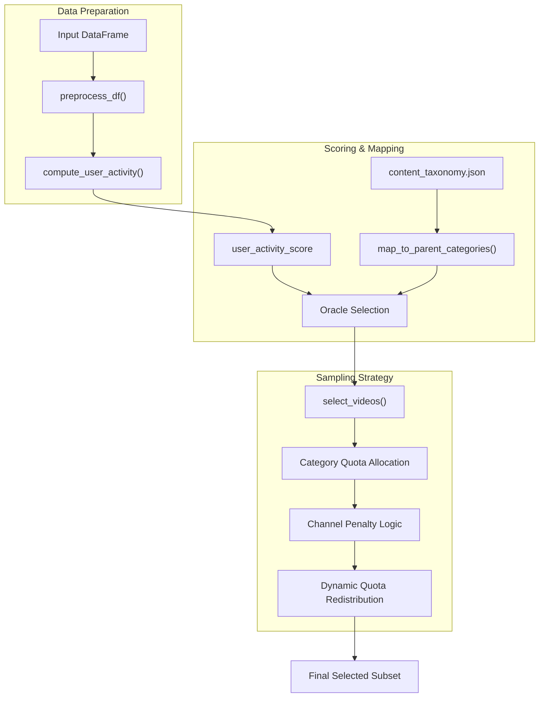
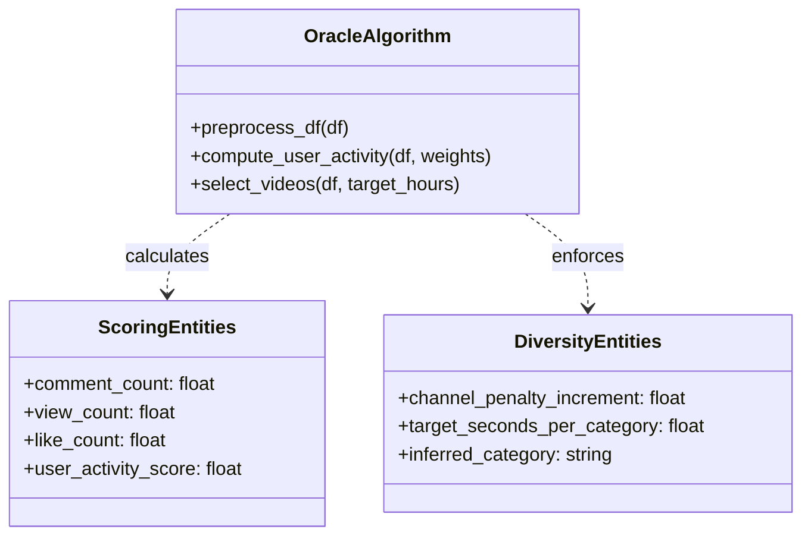

<!-- source: DeepWiki mcp.deepwiki.com · repo huggingface/fineVideo · page 5 Content Selection · fetched 2026-10-26 -->

# Content Selection

Relevant source files

The following files were used as context for generating this wiki page:

- [contentselection/content_taxonomy.json](contentselection/content_taxonomy.json)
- [contentselection/oracle.py](contentselection/oracle.py)

The **contentselection** subsystem is responsible for filtering and sampling the categorized video pool to create a high-quality, diverse subset for final annotation. This stage uses an "Oracle" algorithm to balance three competing objectives: maximizing user engagement, ensuring broad representation across the content taxonomy, and maintaining channel diversity.

By applying these constraints, the pipeline reduces hundreds of thousands of candidates down to a target duration (e.g., 4,500 hours) of the most informative and varied content.

## System Overview

The selection process transforms a raw list of categorized videos into a curated dataset using a multi-step scoring and allocation strategy.

### Content Selection Logic Flow
The following diagram illustrates how the `oracle.py` script processes the input dataframe to reach the final selection.

**Sources:** [contentselection/oracle.py:18-43](), [contentselection/oracle.py:93-160]()

## Key Components

### Engagement Scoring
Before selection, the system computes a `user_activity_score` to prioritize videos that have demonstrated value to viewers. The algorithm normalizes `comment_count`, `view_count`, and `like_count` using `MinMaxScaler` [contentselection/oracle.py:28-31]() and applies a weighted sum:
*   **50% Views**: Primary indicator of reach.
*   **30% Likes**: Indicator of content quality/sentiment.
*   **20% Comments**: Indicator of engagement depth.

**Sources:** [contentselection/oracle.py:36-43]()

### Taxonomy Integration
The selection process is "taxonomy-aware." It uses the `content_taxonomy.json` structure to ensure that no single domain (like "Gaming" or "Vlogs") dominates the final dataset. The `map_to_parent_categories` function uses a recursive search [contentselection/oracle.py:66-76]() to identify the top-level domain for every inferred leaf category.

**Sources:** [contentselection/oracle.py:47-89](), [contentselection/content_taxonomy.json:1-232]()

### Diversity-Aware Sampling
The core of the subsystem is the `select_videos` function, which implements several heuristics to ensure variety:
1.  **Category Quotas**: The `target_hours` is divided equally among all unique `inferred_category` labels [contentselection/oracle.py:101-102]().
2.  **Channel Penalty**: To prevent the dataset from being dominated by a few prolific creators, the algorithm applies a `channel_penalty_increment` (default 0.1). Each subsequent video from the same channel has a lower probability of being selected [contentselection/oracle.py:110-141]().
3.  **Dynamic Redistribution**: If a specific category lacks enough footage to fill its quota, the remaining time is redistributed to other categories [contentselection/oracle.py:143-147]().

**Sources:** [contentselection/oracle.py:93-160]()

## Sub-Pages

| Page | Description |
| :--- | :--- |
| **[Oracle Selection Algorithm (`oracle.py`)](#5.1)** | Detailed breakdown of the scoring math, the channel penalty logic, and the iterative selection loop. |
| **[Content Taxonomy Reference](#5.2)** | Full documentation of the hierarchical JSON schema used to categorize and balance the dataset. |

## Data Flow: Code Entities
This diagram maps the natural language concepts of "Engagement" and "Diversity" to the specific variables and functions in `oracle.py`.

**Sources:** [contentselection/oracle.py:19-43](), [contentselection/oracle.py:93-112]()

---

