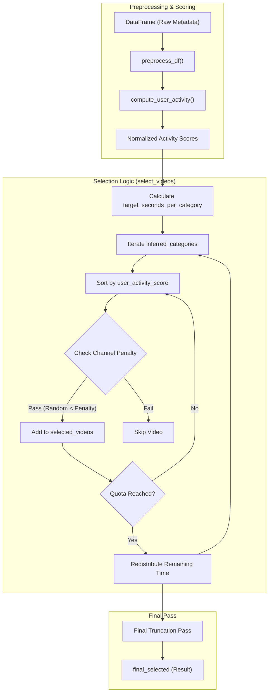
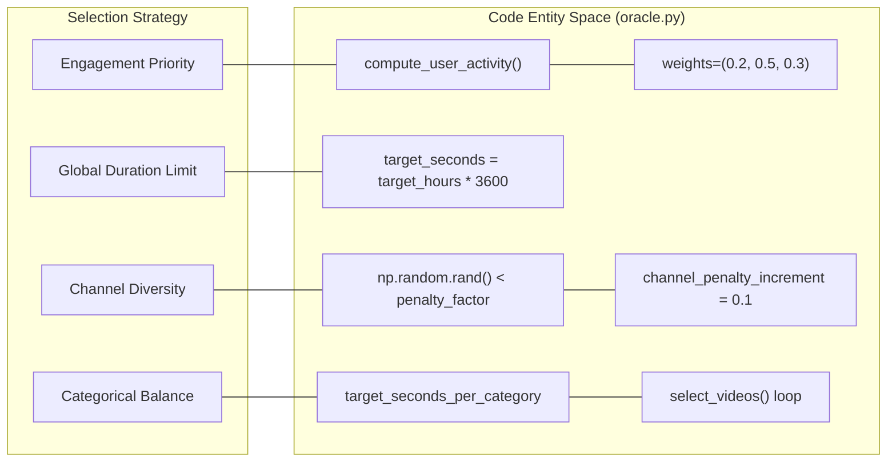

<!-- source: DeepWiki mcp.deepwiki.com · repo huggingface/fineVideo · page 5.1 Oracle Selection Algorithm (`oracle.py`) · fetched 2026-10-26 -->

# Oracle Selection Algorithm (`oracle.py`)

Relevant source files

The following files were used as context for generating this wiki page:

- [contentselection/oracle.py](contentselection/oracle.py)

The Oracle Selection Algorithm is the final decision-making layer in the `contentselection` subsystem. Its primary purpose is to filter the pool of categorized videos into a curated subset that meets a specific total duration (e.g., 4,500 hours) while maximizing content diversity and prioritizing high-engagement videos.

The algorithm balances three competing objectives:
1.  **Engagement**: Prioritizing videos with high view counts, likes, and comments.
2.  **Diversity**: Ensuring equal representation across the hierarchical taxonomy and penalizing over-represented channels.
3.  **Efficiency**: Selecting the highest quality content within a strict time budget.

## Core Data Flow

The algorithm operates on a pandas DataFrame containing video metadata and the `inferred_category` produced by the `videocategorization` stage.

### High-Level Execution Logic
The entry point `main_algorithm()` orchestrates the selection process through four distinct phases:

| Phase | Function | Responsibility |
| :--- | :--- | :--- |
| **Normalization** | `preprocess_df()` | Fills missing values and scales engagement metrics. |
| **Scoring** | `compute_user_activity()` | Calculates a weighted engagement score. |
| **Taxonomy Mapping** | `map_to_parent_categories()` | (Optional) Maps leaf categories to top-level domains via DFS. |
| **Selection** | `select_videos()` | Iteratively allocates time quotas per category with channel penalties. |

Sources: `[contentselection/oracle.py:162-171]()`, `[contentselection/oracle.py:18-33]()`, `[contentselection/oracle.py:35-43]()`, `[contentselection/oracle.py:92-160]()`

## Implementation Details

### 1. Preprocessing and Engagement Scoring
Before selection, the algorithm normalizes raw YouTube metrics to ensure fair comparison across different scales of popularity.

*   **Normalization**: The `preprocess_df()` function handles missing values (NaNs) by filling them with 0 `[contentselection/oracle.py:20-25]()`. It then uses `sklearn.preprocessing.MinMaxScaler` to scale `comment_count`, `view_count`, and `like_count` into a [0, 1] range `[contentselection/oracle.py:28-31]()`.
*   **Activity Score**: `compute_user_activity()` applies a weighted sum to these normalized values `[contentselection/oracle.py:38-42]()`.
    *   **Views**: 50% weight.
    *   **Likes**: 30% weight.
    *   **Comments**: 20% weight.

Sources: `[contentselection/oracle.py:19-43]()`

### 2. Taxonomy Mapping (DFS)
The `map_to_parent_categories()` function uses a recursive Depth-First Search (DFS) to find the top-level "Domain" for any given leaf category in the `content_taxonomy.json`.

*   **Recursive Search**: The internal `recursive_search()` function traverses the nested taxonomy dictionary. If a `leaf_name` matches a key, it returns the `current_top_category` passed down from the root `[contentselection/oracle.py:66-76]()`.
*   **Usage**: While this data is included in the final dataset for analysis, the core selection algorithm primarily uses the `inferred_category` (leaf nodes) to ensure granular diversity `[contentselection/oracle.py:46-47]()`.

Sources: `[contentselection/oracle.py:47-89]()`

### 3. Selection and Quota Management
The `select_videos()` function implements a complex iterative selection logic designed to prevent "channel-spam" and ensure categorical representation.

#### Quota Allocation and Redistribution
1.  **Initial Quota**: The algorithm divides the `target_seconds` by the number of unique `inferred_categories` to establish a `target_seconds_per_category` `[contentselection/oracle.py:97-102]()`.
2.  **Dynamic Redistribution**: As categories are processed, if a category lacks enough videos to fill its quota, the remaining time is redistributed among the remaining categories `[contentselection/oracle.py:143-147]()`.

#### Channel Penalty System
To prevent a single prolific channel from dominating a category, the algorithm applies a `channel_penalty_increment` of 0.1 `[contentselection/oracle.py:111]()`.
*   For every video already selected from a specific channel, the probability of selecting another video from that same channel decreases by 10% `[contentselection/oracle.py:133-137]()`.
*   The `penalty_factor` is calculated as: `1 - (videos_already_selected * 0.1)`, with a floor of 0 `[contentselection/oracle.py:133-134]()`.

Sources: `[contentselection/oracle.py:93-148]()`

## Logic Visualization

### System Logic Flow
The following diagram maps the logical steps of the Oracle algorithm to the specific functions in `oracle.py`.

"Oracle Selection Flow"

Sources: `[contentselection/oracle.py:19-160]()`

### Data Entity Mapping
This diagram bridges the conceptual "Selection Strategy" to the implementation variables and functions.

"Entity Mapping: Strategy to Code"

Sources: `[contentselection/oracle.py:36]()`, `[contentselection/oracle.py:94]()`, `[contentselection/oracle.py:102]()`, `[contentselection/oracle.py:111]()`, `[contentselection/oracle.py:137]()`

## Final Truncation Pass
After the categorical selection loop, the algorithm performs a final truncation pass to ensure the total duration is as close to the target as possible without exceeding it:
1.  Sorts all `selected_videos` by `duration_seconds` in ascending order `[contentselection/oracle.py:150]()`.
2.  Iterates through the sorted list, adding videos to `final_selected` until the next video would cause the `total_duration` to exceed `target_seconds` `[contentselection/oracle.py:155-158]()`.

Sources: `[contentselection/oracle.py:149-160]()`

---

