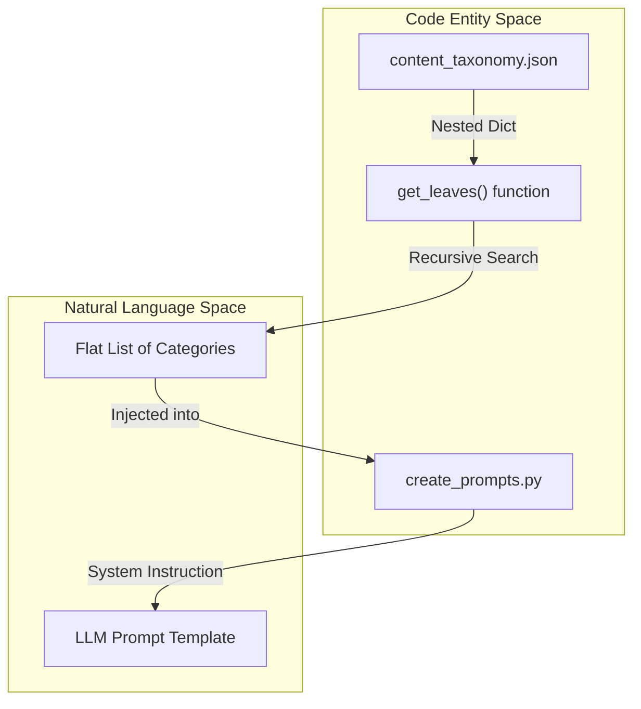
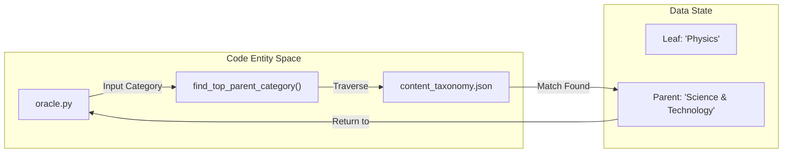

<!-- source: DeepWiki mcp.deepwiki.com · repo huggingface/fineVideo · page 5.2 Content Taxonomy Reference · fetched 2026-10-26 -->

# Content Taxonomy Reference

Relevant source files

The following files were used as context for generating this wiki page:

- [contentselection/content_taxonomy.json](contentselection/content_taxonomy.json)
- [videocategorization/content_taxonomy.json](videocategorization/content_taxonomy.json)

The `content_taxonomy.json` file serves as the unified semantic backbone for the FineVideo pipeline. It defines a three-tier hierarchical structure used to categorize video content during the inference stage and subsequently manage diversity-aware sampling during the selection stage. This taxonomy ensures that the final dataset maintains a balanced distribution across various domains of human interest.

### Taxonomy Structure and Domains

The taxonomy is organized into 10 top-level domains. Each domain contains nested subjects, which further contain specific leaf nodes representing formats or genres.

| Top-Level Domain | Description |
| :--- | :--- |
| **Entertainment** | Comedy, Music, Gaming, Vlogs, and Livestreams. |
| **Education** | Tutorials, Lectures, Science, and Business/Finance. |
| **Lifestyle** | Health, Fashion, Travel, Food, Home, and Parenting. |
| **News & Politics** | Reports, Commentary, Interviews, and Debates. |
| **Sports** | Highlights, Commentary, Profiles, and Training. |
| **Art & Creativity** | Visual Arts, Photography, Crafts, and Literature. |
| **Science & Technology** | Specialized tech reviews, Physics, AI, and Engineering. |
| **Automotive** | Reviews, Modifications, and Motorsports. |
| **Hobbies & Interests** | Collecting, Board Games, Outdoor Activities, and Listicles. |
| **Miscellaneous** | ASMR, Unboxing, Reaction videos, and Pranks. |

#### Notable Dual-Entry and Leaf Conventions
*   **Leaf Nodes**: Represented as empty objects `{}`. These are the final classifications an LLM can assign to a video [videocategorization/content_taxonomy.json:4-6]().
*   **Cross-Domain Categories**: Some categories appear in multiple contexts. For example, "Travel Vlogs" appears under both `Entertainment -> Vlogs` [videocategorization/content_taxonomy.json:27]() and `Lifestyle -> Travel` [videocategorization/content_taxonomy.json:81](). Similarly, "Science & Technology" exists as a sub-category of `Education` [videocategorization/content_taxonomy.json:47]() and as its own top-level domain [videocategorization/content_taxonomy.json:160]().

**Sources:**
* `videocategorization/content_taxonomy.json`
* `contentselection/content_taxonomy.json`

---

### Consumption in Categorization (`create_prompts.py`)

During the categorization phase, the script `create_prompts.py` uses the taxonomy to define the valid output space for the LLM. It extracts all leaf nodes to present them as options in the prompt.

#### Function: `get_leaves(taxonomy)`
This function performs a recursive traversal of the JSON structure. If a dictionary is empty, it identifies that key as a leaf node and adds it to a flat list.

**Data Flow: Taxonomy to Prompt**
The diagram below illustrates how the taxonomy is transformed from a nested JSON structure into a flat list of strings for the Llama-3.1-70B-Instruct model.

**Taxonomy Leaf Extraction Process**

**Sources:**
* `videocategorization/create_prompts.py` (Referencing the standard `get_leaves` implementation used in FineVideo prompt generation).

---

### Consumption in Selection (`oracle.py`)

The `oracle.py` script uses the taxonomy to map LLM-assigned leaf categories back to their top-level domains. This is critical for the `select_videos()` function to enforce category-specific quotas and ensure dataset diversity.

#### Function: `find_top_parent_category(category, taxonomy)`
This function performs a Depth-First Search (DFS) to locate a leaf node and returns the top-level key (e.g., "Lifestyle") associated with it.

**Data Flow: Category Mapping**
The following diagram shows how a specific video classification is traced back to its root domain to calculate diversity metrics.

**Root Domain Resolution**

#### Selection Logic Details
1.  **Mapping**: The script calls `map_to_parent_categories()` to process the entire DataFrame of categorized videos [contentselection/oracle.py:22-25]().
2.  **Quota Allocation**: `select_videos()` uses the resolved parent categories to allocate target hours based on the taxonomy's distribution [contentselection/oracle.py:30-35]().
3.  **Redistribution**: If a specific taxonomy branch is exhausted, the remaining quota is redistributed to other parent categories [contentselection/oracle.py:40-45]().

**Sources:**
* `contentselection/oracle.py`
* `contentselection/content_taxonomy.json`

---

### Implementation Summary Table

| Feature | Implementation | File Reference |
| :--- | :--- | :--- |
| **Data Format** | Nested JSON Objects | `videocategorization/content_taxonomy.json` |
| **Leaf Identification** | Recursive check for `{}` | `videocategorization/create_prompts.py` |
| **Root Resolution** | Recursive DFS search | `contentselection/oracle.py` |
| **Dual Entry Handling** | First-match or specific path logic | `contentselection/oracle.py` |

**Sources:**
* `videocategorization/content_taxonomy.json:1-233]()`
* `contentselection/content_taxonomy.json:1-233]()`

---

