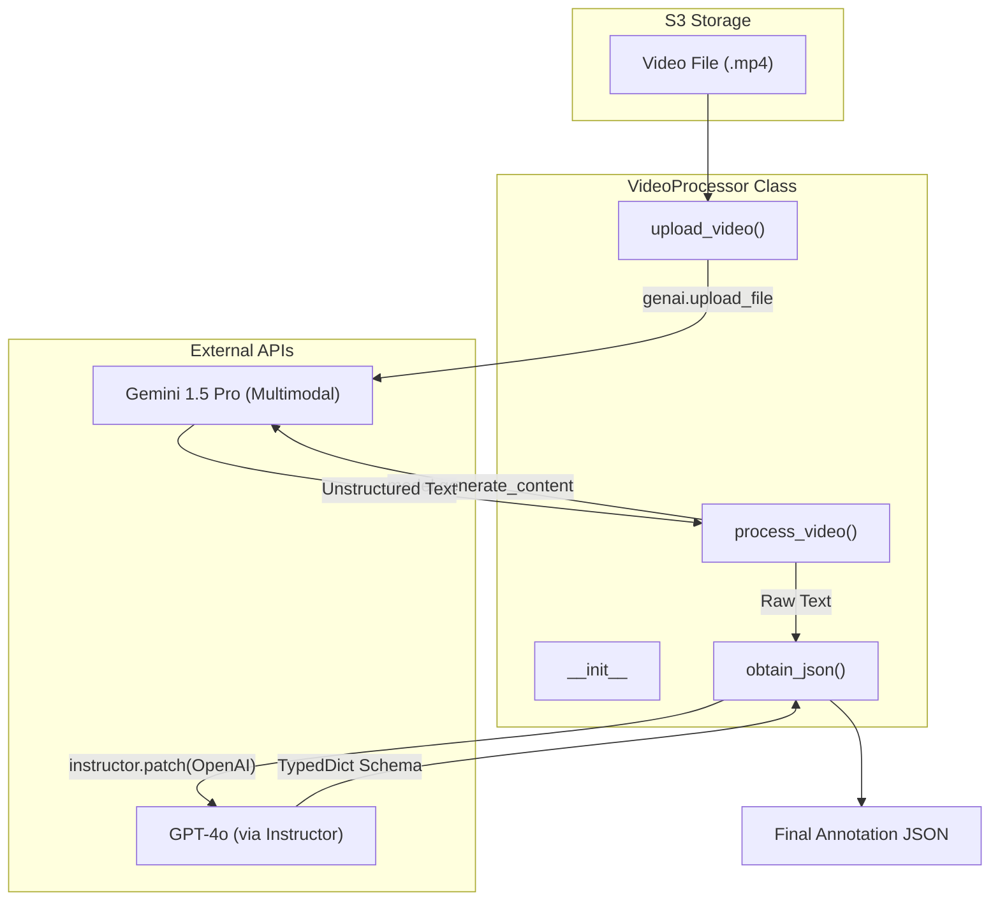
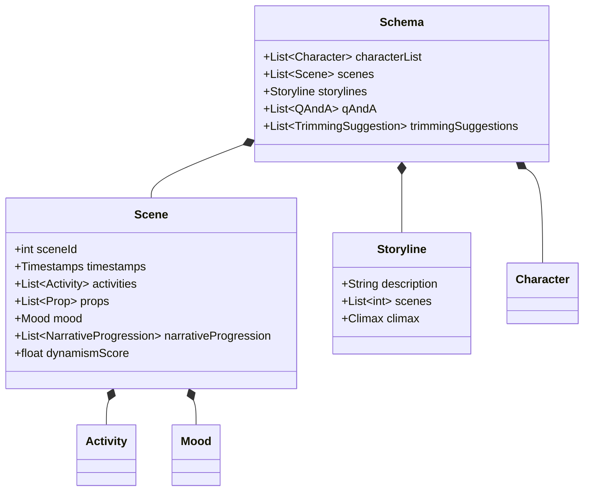

<!-- source: DeepWiki mcp.deepwiki.com · repo huggingface/fineVideo · page 6.1 Video Annotation Pipeline (`video2annotation.py`) · fetched 2026-10-26 -->

# Video Annotation Pipeline (`video2annotation.py`)

Relevant source files

The following files were used as context for generating this wiki page:

- [contentannotation/video2annotation.py](contentannotation/video2annotation.py)

The `video2annotation.py` script is the core component of the content annotation subsystem. It implements a dual-model pipeline that leverages **Gemini 1.5 Pro** for multimodal video analysis and **GPT-4o** (via the `instructor` library) for structured data extraction and schema enforcement. This script transforms raw video files into rich, hierarchical JSON metadata containing scene-level details, character tracking, and narrative analysis.

### Implementation & Architecture

The pipeline is encapsulated within the `VideoProcessor` class `[contentannotation/video2annotation.py:119-120]()`. It manages the lifecycle of a video annotation task: downloading from S3, uploading to Google’s Gemini API, performing inference, and restructuring the output.

#### System Architecture Diagram
The following diagram illustrates the flow from S3 storage through the two-stage LLM pipeline.

**Multimodal Annotation Flow**

Sources: `[contentannotation/video2annotation.py:119-204]()`, `[contentannotation/video2annotation.py:208-250]()`

### Video Processing Lifecycle

#### 1. S3 Download and Gemini Upload
The script first downloads the video from the specified S3 bucket to a local `input_directory` `[contentannotation/video2annotation.py:27-29]()`. The `upload_video` method then pushes the file to Google's Generative AI service using `genai.upload_file` `[contentannotation/video2annotation.py:135]()`. It polls the file state until it transitions from `PROCESSING` to `ACTIVE` `[contentannotation/video2annotation.py:137-140]()`.

#### 2. Multimodal Analysis (Gemini 1.5 Pro)
The `process_video` method handles the primary analysis `[contentannotation/video2annotation.py:150]()`. It reads a detailed prompt from `gemini_prompt.txt` `[contentannotation/video2annotation.py:161]()` and sends it alongside the video file to the `gemini-1.5-pro-latest` model `[contentannotation/video2annotation.py:165-167]()`.

**Key Features:**
*   **Safety Settings:** All safety thresholds are set to `BLOCK_NONE` to ensure the model analyzes the content without being filtered for sensitive but relevant datasets `[contentannotation/video2annotation.py:169-178]()`.
*   **Exponential Backoff:** The script implements a retry loop (up to 5 attempts) for `InternalServerError`, SSL failures, or timeouts, doubling the delay between each attempt `[contentannotation/video2annotation.py:158-204]()`.
*   **Cleanup:** Once the text response is received, the video file is explicitly deleted from Google's servers to manage storage limits `[contentannotation/video2annotation.py:184]()`.

#### 3. Structured Extraction (GPT-4o & Instructor)
Because Gemini's raw output may contain conversational filler or inconsistent formatting, the `obtain_json` method uses the `instructor` library to enforce a strict `Schema` `[contentannotation/video2annotation.py:208-220]()`.

*   **Schema Enforcement:** It utilizes `instructor.patch(OpenAI)` to wrap the GPT-4o client `[contentannotation/video2annotation.py:220]()`.
*   **Recursive Retry:** If the model returns an `IncompleteOutputException`, the function calls itself recursively, appending a request for the missing information to the prompt `[contentannotation/video2annotation.py:241-243]()`.

Sources: `[contentannotation/video2annotation.py:132-147]()`, `[contentannotation/video2annotation.py:150-205]()`, `[contentannotation/video2annotation.py:208-250]()`

### Data Schema (TypedDict Hierarchy)

The script defines a complex hierarchy of `TypedDict` classes to represent the video's content. This schema is passed to the `instructor` library to guide GPT-4o's extraction.

| Class Name | Key Attributes | Description |
| :--- | :--- | :--- |
| `Character` | `characterId`, `name`, `description` | Tracks recurring entities across scenes. |
| `Scene` | `sceneId`, `timestamps`, `cast`, `activities`, `props`, `mood`, `dynamismScore` | The primary unit of annotation. |
| `Activity` | `description`, `timestamp` | Specific actions within a scene. |
| `Storyline` | `description`, `scenes`, `climax` | High-level narrative arcs connecting multiple scenes. |
| `TrimmingSuggestion` | `timestamps`, `description` | Identifies low-quality or irrelevant segments. |
| `Schema` | `title`, `characterList`, `scenes`, `storylines`, `qAndA`, `trimmingSuggestions` | The root container for all video metadata. |

**Code-to-Schema Mapping**

Sources: `[contentannotation/video2annotation.py:38-116]()`

### CLI and Distributed Execution

The script is designed for horizontal scaling across multiple workers using a chunking strategy.

*   **`size_chunk`**: Defines the number of videos processed in a single batch `[contentannotation/video2annotation.py:18]()`.
*   **`worker_number`**: Determines which specific sublist the current process will handle `[contentannotation/video2annotation.py:19]()`.
*   **`--video_list`**: Allows passing a specific JSON file containing video IDs. If omitted, it defaults to `oracle_videos_server.json` `[contentannotation/video2annotation.py:20]()`.

The script iterates through the assigned chunk, checks if an output file already exists in S3 to avoid redundant work, and persists results or error logs to S3 upon completion.

Sources: `[contentannotation/video2annotation.py:13-21]()`, `[contentannotation/video2annotation.py:27-29]()`

---

