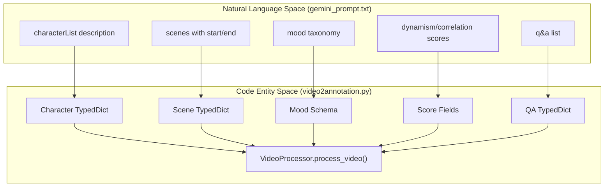
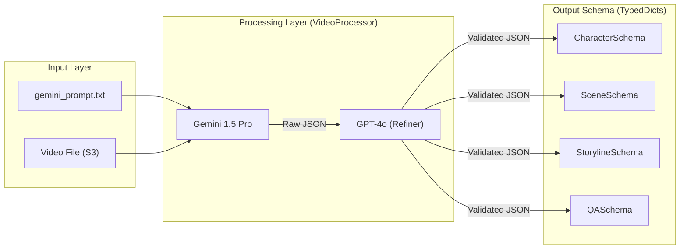

<!-- source: DeepWiki mcp.deepwiki.com · repo huggingface/fineVideo · page 6.2 Gemini Annotation Prompt & Output Schema · fetched 2026-10-26 -->

# Gemini Annotation Prompt & Output Schema

Relevant source files

The following files were used as context for generating this wiki page:

- [contentannotation/gemini_prompt.txt](contentannotation/gemini_prompt.txt)

The `contentannotation` subsystem utilizes Gemini 1.5 Pro to perform high-density multimodal analysis of video content. This page documents the structured prompt template defined in `contentannotation/gemini_prompt.txt`, the semantic requirements for the output, and the specific taxonomies used for mood and scene-level metadata.

## Overview of the Annotation Schema

The annotation process is driven by a comprehensive prompt that instructs the model to decompose a video into its constituent characters, scenes, storylines, and quality-of-life improvements (trimming). The model is required to return a structured JSON response that is subsequently validated and refined by GPT-4o using the `instructor` library in `video2annotation.py`.

### Data Flow: Prompt to Schema
The following diagram illustrates how the natural language instructions in `gemini_prompt.txt` are mapped to the programmatic structures used by the `VideoProcessor` class.

**Natural Language to Code Entity Mapping**

**Sources:** `contentannotation/gemini_prompt.txt:1-24` (), `contentannotation/video2annotation.py:40-150` ()

---

## Prompt Structure & Key Components

The prompt template [contentannotation/gemini_prompt.txt:1-24]() defines five primary top-level keys that the model must populate:

### 1. Character Identification (`characterList`)
The model must provide a list of characters appearing throughout the video. Each entry must include a visual description detailed enough to identify the character from a static image [contentannotation/gemini_prompt.txt:3-3]().

### 2. Scene-Level Metadata (`scenes`)
This is the most granular part of the annotation. For every identified scene, the model extracts:
*   **Temporal Boundaries:** Start and end timestamps [contentannotation/gemini_prompt.txt:5-5]().
*   **Participants:** A list of characters present in the specific scene [contentannotation/gemini_prompt.txt:6-6]().
*   **Object & Action Tracking:** Lists of `activities` and `props`, each with associated timestamps [contentannotation/gemini_prompt.txt:7-8]().
*   **Production Details:** `video_editing_details` including transitions, effects, and music [contentannotation/gemini_prompt.txt:9-9]().
*   **Narrative & Subtext:** Narrative progression, character dynamics, and specific "happenings" that create subtext or deeper meaning [contentannotation/gemini_prompt.txt:12-16]().

### 3. Storyline Mapping (`storylines`)
The model groups scenes into logical storylines. This section must identify:
*   The **Climax** (specific scene and timestamp) [contentannotation/gemini_prompt.txt:21-21]().
*   The **Content Type**: Whether the video is a narrative story or a collection of non-narrative facts [contentannotation/gemini_prompt.txt:21-21]().
*   **Outlier Handling:** Explanation for scenes that do not fit into a primary storyline [contentannotation/gemini_prompt.txt:22-22]().

### 4. Trimming Suggestions
The model identifies specific segments that could be removed to improve the video's dynamism [contentannotation/gemini_prompt.txt:23-23]().

### 5. Fine-Grained Q&A
The model generates 5 Q&A pairs. These must focus on:
*   Fine details (objects/activities).
*   Overall story reasoning.
*   Multimodal integration (details that require both audio and video to understand, rather than just the transcript) [contentannotation/gemini_prompt.txt:24-24]().

---

## Mood Taxonomy

The prompt enforces a strict hierarchical mood taxonomy. The model must select a `name` from one of three categories: **Positive**, **Negative**, or **Neutral** [contentannotation/gemini_prompt.txt:10-10]().

| Category | Sub-Moods (Names) |
| :--- | :--- |
| **Positive** | Happy, Excited, Calm, Grateful, Proud |
| **Negative** | Sad, Angry, Anxious, Lonely, Bored |
| **Neutral** | Indifferent, Content, Curious, Confused, Pensive |

In addition to the label, the model must provide:
*   **Notes:** How visuals and audio contribute to the mood.
*   **Key Moments:** Timestamps where the mood transitions or changes [contentannotation/gemini_prompt.txt:11-11]().

**Sources:** `contentannotation/gemini_prompt.txt:10-11` ()

---

## Quantitative Scoring

Two numerical scores are required for every scene to assist in downstream filtering and quality assessment:

| Metric | Range | Definition |
| :--- | :--- | :--- |
| **Dynamism Score** | 0.0 - 1.0 | 1.0 indicates a highly dynamic scene with significant movement or rapid changes [contentannotation/gemini_prompt.txt:17-17](). |
| **Audio-Visual Correlation** | 0.0 - 1.0 | 0.0 indicates no correlation between speech and visuals; 1.0 indicates high correlation [contentannotation/gemini_prompt.txt:18-18](). |

---

## Output Schema Implementation

While `gemini_prompt.txt` provides the instructions, the `video2annotation.py` script enforces the structure using Pydantic models (via `instructor`).

**System Component Interaction**

### Schema Enforcement Details
The script defines several `TypedDict` and `List` structures to ensure the Gemini output matches the expected format before being saved to S3:
*   **SceneSchema:** Includes `start_timestamp`, `end_timestamp`, `characters`, `activities`, `props`, `video_editing_details`, `mood`, `narrative_progression`, `character_interaction`, `thematic_elements`, `subtexts`, `dynamism_score`, and `audio_visual_correlation_score` [contentannotation/video2annotation.py:56-80]().
*   **StorylineSchema:** Includes `scenes`, `climax`, and `content_presentation` [contentannotation/video2annotation.py:100-104]().
*   **Full Schema:** The root object containing `characterList`, `scenes`, `storylines`, `trimmingSuggestions`, and `qa` [contentannotation/video2annotation.py:114-120]().

**Sources:** `contentannotation/video2annotation.py:40-120` (), `contentannotation/gemini_prompt.txt:1-24` ()

---

