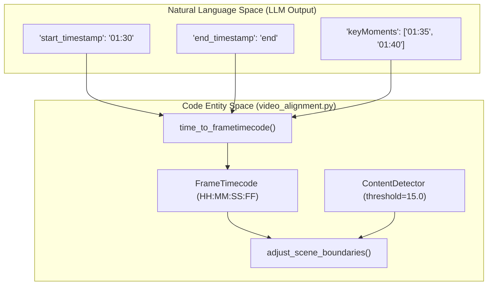
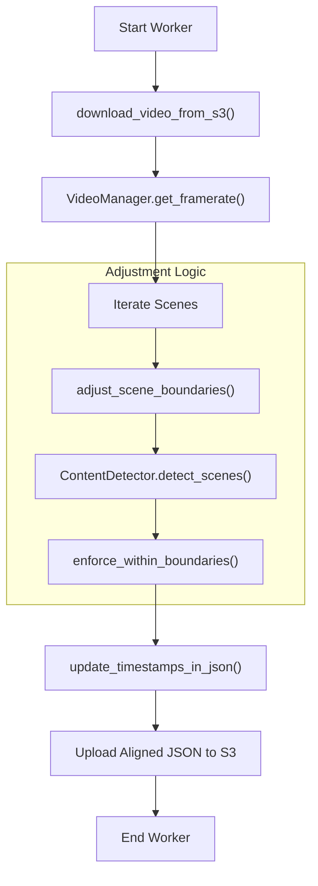

<!-- source: DeepWiki mcp.deepwiki.com · repo huggingface/fineVideo · page 7 Fine Alignment · fetched 2026-10-26 -->

# Fine Alignment

Relevant source files

The following files were used as context for generating this wiki page:

- [finealignment/video_alignment.py](finealignment/video_alignment.py)

The **Fine Alignment** stage is the final step in the video processing pipeline. Its primary purpose is to reconcile the high-level, natural language timestamps generated by Large Language Models (LLMs) during the [Content Annotation](#6) stage with the physical reality of the video file. By using computer vision techniques via `PySceneDetect`, this stage snaps LLM-suggested scene boundaries to the nearest actual shot transitions, enforces temporal continuity between scenes, and normalizes all time references into a standard `FrameTimecode` format.

## Overview of the Alignment Pipeline

The alignment process operates on the JSON output produced by the annotation stage. It downloads the corresponding video from S3, analyzes its frame rate and visual transitions, and adjusts the metadata to ensure mathematical consistency and frame-level accuracy.

### Natural Language to Code Entity Mapping

The following diagram illustrates how the abstract concepts of "Scenes" and "Timestamps" described in natural language are transformed into specific code entities and data structures within `video_alignment.py`.

**Entity Relationship: Annotation to Alignment**

**Sources:** [finealignment/video_alignment.py:64-121](), [finealignment/video_alignment.py:124-129]()

## Core Logic and Component Interaction

The script `video_alignment.py` functions as a standalone worker that processes chunks of videos. It performs three primary tasks: boundary snapping, timestamp normalization, and sub-element clamping.

### Alignment Workflow

The workflow ensures that every scene starts exactly one frame after the previous scene ends, preventing gaps or overlaps in the final dataset.

**Alignment Execution Flow**

**Sources:** [finealignment/video_alignment.py:35-42](), [finealignment/video_alignment.py:124-165](), [finealignment/video_alignment.py:255-266]()

### Key Functions and Parameters

| Component | Description | Reference |
| :--- | :--- | :--- |
| `ContentDetector` | Uses a threshold of `15.0` to detect visual cuts in the video stream. | [finealignment/video_alignment.py:129]() |
| `time_to_frametimecode` | A robust parser that converts strings like `"1m 30s"`, `"around 5"`, or `"end"` into `HH:MM:SS:FF`. | [finealignment/video_alignment.py:64-121]() |
| `update_timestamps_in_json` | Recursively traverses the JSON to update timestamps for props, activities, and storylines. | [finealignment/video_alignment.py:204-252]() |
| `±2-fps Window` | The search range used to find the nearest shot transition relative to the LLM timestamp. | [finealignment/video_alignment.py:155-156]() |

## Sub-Pages

### [Scene Boundary Adjustment (`video_alignment.py`)](#7.1)
Detailed technical coverage of the `adjust_scene_boundaries` function. This section explains the use of `PySceneDetect`, the logic for snapping boundaries within a small frame window, and the error handling thresholds (e.g., rejecting adjustments larger than 5 seconds or 125 frames to maintain semantic integrity). It also covers the CLI pattern for distributed execution.

### [Timestamp Normalization & Continuity Enforcement](#7.2)
Focuses on the mathematical sanitization of the dataset. This includes the logic within `time_to_frametimecode` for handling malformed LLM strings and the `enforce_within_boundaries` logic which ensures that sub-elements (like a specific "prop" mention) do not exist outside the time bounds of their parent scene. It also details the "N+1" frame rule for scene continuity.

**Sources:** [finealignment/video_alignment.py:64-121](), [finealignment/video_alignment.py:124-150](), [finealignment/video_alignment.py:255-266]()

---

