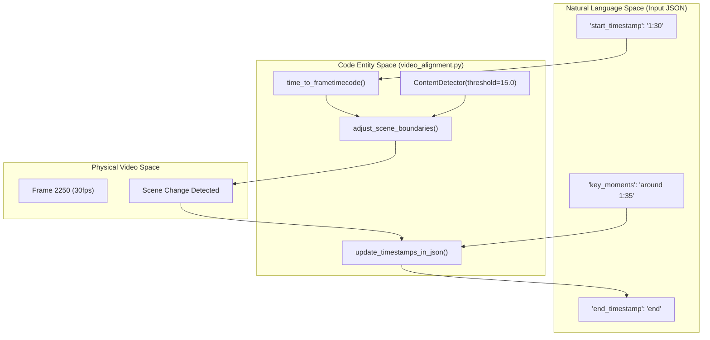
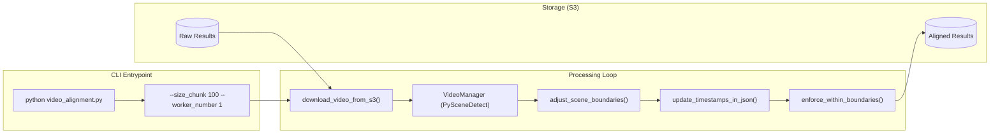

<!-- source: DeepWiki mcp.deepwiki.com · repo huggingface/fineVideo · page 7.1 Scene Boundary Adjustment (`video_alignment.py`) · fetched 2026-10-26 -->

# Scene Boundary Adjustment (`video_alignment.py`)

Relevant source files

The following files were used as context for generating this wiki page:

- [finealignment/video_alignment.py](finealignment/video_alignment.py)

The final stage of the FineVideo pipeline reconciles high-level semantic timestamps generated by Large Language Models (LLMs) with the actual physical shot changes in the video. Using **PySceneDetect**, this module snaps LLM-suggested scene boundaries to the nearest visual cut, ensures temporal continuity between segments, and normalizes all timestamp formats into a standardized `FrameTimecode` (HH:MM:SS:FF).

## Overview and Purpose

LLMs often provide approximate timestamps (e.g., "around 01:20" or "1:30-1:45") that do not align precisely with video frames. `video_alignment.py` performs "boundary snapping" to ensure that metadata like activities, props, and storylines are anchored to exact visual transitions.

The script operates using a worker/chunk CLI pattern, allowing for parallel processing of video batches. It downloads videos and their corresponding JSON metadata from S3, processes them locally, and uploads the refined results to a new S3 prefix.

### Key Functional Blocks
1.  **Boundary Snapping**: Uses `PySceneDetect` to find visual cuts within a $\pm$2-second window of the LLM timestamp [finealignment/video_alignment.py:155-163]().
2.  **Timestamp Normalization**: Converts diverse natural language strings into standard `FrameTimecode` objects [finealignment/video_alignment.py:64-121]().
3.  **Recursive JSON Update**: Propagates adjusted timestamps down through nested metadata objects (props, activities, storylines) [finealignment/video_alignment.py:214-257]().
4.  **Continuity Enforcement**: Ensures that scene $N$ ends exactly one frame before scene $N+1$ begins, preventing overlaps or gaps [finealignment/video_alignment.py:302-310]().

Sources: [finealignment/video_alignment.py:14-20](), [finealignment/video_alignment.py:124-130]()

## Data Flow: From Natural Language to Frame Alignment

The following diagram illustrates how the system translates loose LLM descriptions into frame-accurate boundaries.

### Alignment Logic Flow
"Natural Language Space" (LLM) $\rightarrow$ "Code Entity Space" (Alignment Logic)

Sources: [finealignment/video_alignment.py:64-65](), [finealignment/video_alignment.py:124-129](), [finealignment/video_alignment.py:214-215]()

## Implementation Details

### Scene Boundary Snapping (`adjust_scene_boundaries`)
The function `adjust_scene_boundaries` utilizes the `ContentDetector` from `PySceneDetect` with a `threshold=15.0` to identify visual transitions [finealignment/video_alignment.py:129](). 

For every scene defined by the LLM:
1.  It calculates a search window of $\pm$2 seconds around the proposed start and end frames [finealignment/video_alignment.py:155-156]().
2.  It performs a `video_manager.seek()` to the start of this window and runs detection [finealignment/video_alignment.py:162-163]().
3.  It selects the detected boundary closest to the original LLM timestamp [finealignment/video_alignment.py:172-173]().
4.  **Error Thresholds**: If the adjustment exceeds 5 seconds (125 frames at standard rates), the script flags a potential misalignment [finealignment/video_alignment.py:183-184]().

### Timestamp Normalization (`time_to_frametimecode`)
This function handles the "dirty" strings returned by LLMs. It includes logic for:
*   **Special Keywords**: "end", "n/a", "varies", "throughout scene", and "not present" are caught and either mapped to the video end or ignored [finealignment/video_alignment.py:67-76]().
*   **Fuzzy Prefixes**: Removes strings like "around ", "~", or "+" [finealignment/video_alignment.py:81-86]().
*   **Format Parsing**: Supports `HH:MM:SS`, `MM:SS`, and raw seconds [finealignment/video_alignment.py:91-121]().

### Recursive Metadata Update
Once scene boundaries are adjusted, the `update_timestamps_in_json` function recursively traverses the JSON structure to update timestamps for the following keys:
*   `activities`
*   `props`
*   `videoEditingDetails`
*   `mood` (specifically `keyMoments`)
*   `narrativeProgression`
*   `storylines`
*   `trimmingSuggestions`

[finealignment/video_alignment.py:214-257]()

## System Architecture

The alignment process is designed for horizontal scaling across multiple workers.

### Worker/Chunk Execution Model

Sources: [finealignment/video_alignment.py:16-20](), [finealignment/video_alignment.py:35-37](), [finealignment/video_alignment.py:328-345]()

## Constraints and Error Handling

| Feature | Implementation |
| :--- | :--- |
| **Search Window** | $\pm$ 2 seconds around the LLM timestamp [finealignment/video_alignment.py:155-156]() |
| **Max Adjustment** | 5 seconds or 125 frames; triggers a warning/error if exceeded [finealignment/video_alignment.py:183-184]() |
| **Scene Continuity** | Scene $N$ Start = Scene $N-1$ End + 1 frame [finealignment/video_alignment.py:302-310]() |
| **Scene Sensitivity** | `ContentDetector(threshold=15.0)` [finealignment/video_alignment.py:129]() |
| **Failure Logging** | Errors are written to `errors_{video_id}.json` and a local `status_alignment_{worker}.txt` [finealignment/video_alignment.py:45-61]() |

Sources: [finealignment/video_alignment.py:45-61](), [finealignment/video_alignment.py:129](), [finealignment/video_alignment.py:155-184](), [finealignment/video_alignment.py:302-310]()

---

