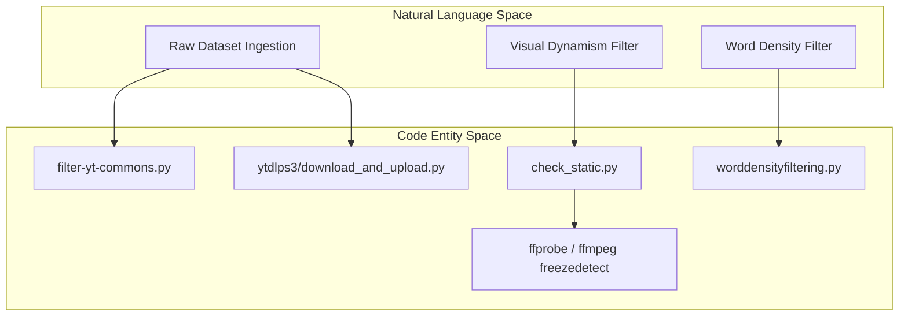
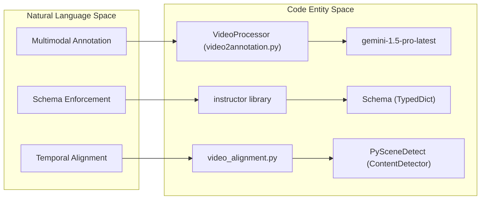

<!-- source: DeepWiki mcp.deepwiki.com · repo huggingface/fineVideo · page 8 Glossary · fetched 2026-10-26 -->

# Glossary

Relevant source files

The following files were used as context for generating this wiki page:

- [contentannotation/gemini_prompt.txt](contentannotation/gemini_prompt.txt)
- [contentannotation/video2annotation.py](contentannotation/video2annotation.py)
- [contentselection/oracle.py](contentselection/oracle.py)
- [dynamicfilters/videodynamismfiltering/check_static.py](dynamicfilters/videodynamismfiltering/check_static.py)
- [finealignment/video_alignment.py](finealignment/video_alignment.py)
- [readme.md](readme.md)
- [videocategorization/launchTGI-Slurm.sh](videocategorization/launchTGI-Slurm.sh)
- [videocategorization/tgi_inference_client.py](videocategorization/tgi_inference_client.py)

This page provides technical definitions and implementation details for terms, abbreviations, and domain concepts specific to the FineVideo pipeline. It serves as a reference for understanding how conceptual labels in the documentation map to specific entities and logic in the codebase.

## System-to-Code Mapping

The following diagrams bridge the gap between high-level pipeline concepts and the actual code entities that implement them.

### Data Ingestion and Filtering Logic
This diagram shows the relationship between the conceptual "Raw Dataset" stage and the scripts and services that handle the data.

**Sources:** [readme.md:23-32](), [dynamicfilters/videodynamismfiltering/check_static.py:22-53]()

### Annotation and Alignment Pipeline
This diagram maps the semantic annotation process to the specific classes and libraries used to enforce structure and temporal accuracy.

**Sources:** [contentannotation/video2annotation.py:119-125](), [contentannotation/video2annotation.py:38-116](), [finealignment/video_alignment.py:4-5](), [finealignment/video_alignment.py:124-129]()

---

## Terms and Definitions

### A
*   **Audio-Visual Correlation Score**: A metric (0 to 1) generated by the `VideoProcessor` using Gemini 1.5 Pro to quantify how well the visual content matches the spoken audio or transcript [contentannotation/gemini_prompt.txt:18](), [contentannotation/video2annotation.py:89]().

### B
*   **Block Number**: A CLI parameter (0-3) used in `tgi_inference_client.py` to partition the `prompts/` directory into four subsets, allowing for parallelized LLM inference across multiple GPU nodes [videocategorization/tgi_inference_client.py:14-17]().

### C
*   **Channel Penalty**: A logic in the `oracle.py` selection algorithm that reduces the probability of selecting a video if several videos from the same channel have already been picked, ensuring creator diversity [contentselection/oracle.py:110-112](), [contentselection/oracle.py:132-137]().
*   **ContentDetector**: A class from `PySceneDetect` used in `video_alignment.py` with a threshold of `15.0` to find precise frame boundaries for LLM-suggested scene splits [finealignment/video_alignment.py:5](), [finealignment/video_alignment.py:129]().

### D
*   **Dynamism Score**: A value (0 to 1) representing the visual activity level of a scene. Highly dynamic scenes receive a score of 1 [contentannotation/gemini_prompt.txt:17](), [contentannotation/video2annotation.py:88]().

### F
*   **FrameTimecode**: A specific time format (`HH:MM:SS:FF`) used in `video_alignment.py` to ensure sub-second precision when snapping LLM timestamps to actual video frames [finealignment/video_alignment.py:6](), [finealignment/video_alignment.py:121]().
*   **Freezedetect**: An `ffmpeg` filter used by `check_static.py` to identify static or "frozen" segments in a video. It uses parameters `n` (noise) and `d` (duration) to flag lack of motion [dynamicfilters/videodynamismfiltering/check_static.py:46-51]().

### I
*   **Inferred Category**: The specific leaf-node category assigned to a video by the Llama-3.1-70B model during the categorization stage [videocategorization/tgi_inference_client.py:54-55](), [contentselection/oracle.py:87]().
*   **Instructor**: A Python library used in `video2annotation.py` to wrap OpenAI/GPT-4o calls, ensuring the unstructured output from Gemini is validated against a strictly typed `Schema` [contentannotation/video2annotation.py:8](), [contentannotation/video2annotation.py:15]() (Note: implicit usage via the `Schema` TypedDict and GPT-4o refinement).

### O
*   **Oracle**: The `contentselection/oracle.py` script that performs the final filtering of the dataset to reach a `target_hours` goal (e.g., 4500 hours) while balancing taxonomy distribution and user engagement [contentselection/oracle.py:15](), [contentselection/oracle.py:162]().

### S
*   **Size Chunk / Worker Number**: A common CLI pattern across `video2annotation.py` and `video_alignment.py` used to divide a large list of videos into manageable segments for distributed processing [contentannotation/video2annotation.py:18-20](), [finealignment/video_alignment.py:17-19]().

### T
*   **TGI (Text Generation Inference)**: A toolkit for deploying LLMs. In this pipeline, it serves Llama-3.1-70B-Instruct to categorize videos based on their metadata [videocategorization/launchTGI-Slurm.sh:12](), [videocategorization/tgi_inference_client.py:108]().

### U
*   **User Activity Score**: A weighted metric calculated in `oracle.py` combining `view_count` (50%), `like_count` (30%), and `comment_count` (20%) to prioritize high-quality community content [contentselection/oracle.py:36-43]().

### W
*   **Word Density**: A filter metric calculated as `word_count / duration_seconds`. Videos with a density $\le 0.5$ are typically discarded as they lack sufficient verbal information [dynamicfilters/worddensityfiltering.py]() (Note: implementation details in 3.2).

**Sources:** [readme.md:49-54](), [contentannotation/video2annotation.py:18-20](), [contentselection/oracle.py:110-141](), [finealignment/video_alignment.py:124-129](), [videocategorization/tgi_inference_client.py:14-17]()