# Page: FineVideo: Project Overview

# FineVideo: Project Overview

<details>
<summary>Relevant source files</summary>

The following files were used as context for generating this wiki page:

- [dataset-creation.png](dataset-creation.png)
- [finevideo.gif](finevideo.gif)
- [logo.png](logo.png)
- [readme.md](readme.md)

</details>


FineVideo is a comprehensive video dataset featuring over 43,000 videos (approximately 3,400 hours) annotated with rich metadata, including narrative descriptions, scene splits, and question-answering (QA) pairs [readme.md:5-7](). This project provides a complete end-to-end pipeline for sourcing, filtering, selecting, and annotating high-quality video content from the web.

## System Architecture

The FineVideo pipeline is structured as a series of modular subsystems, each responsible for a specific stage of data refinement. The architecture transitions from broad data ingestion to highly specific, LLM-driven multimodal annotation.

### Pipeline Stage Connectivity
The following diagram illustrates the functional flow from the raw data source to the final aligned dataset, mapping high-level stages to their respective code implementations.

**FineVideo Functional Flow**
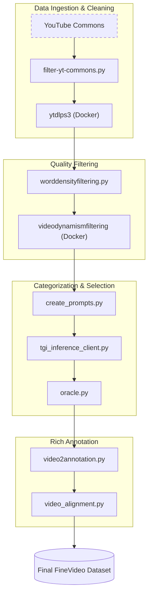
Sources: [readme.md:15-47](), [readme.md:51-54]()

## Core Subsystems

The project is organized into five primary functional areas:

### 1. Raw Dataset Ingestion
This stage identifies candidate videos from the [YouTube Commons](https://huggingface.co/datasets/PleiAs/YouTube-Commons) dataset. It filters for English-language content and utilizes a Dockerized service to download video assets (MP4, VTT, and JSON metadata) directly to S3 storage.
*   **Key Entities:** `filter-yt-commons.py`, `ytdlps3/download_and_upload.py`.
*   **For details, see [Pipeline Architecture & Data Flow](#1.1).**

### 2. Dynamic Filters
To ensure the dataset contains information-rich content, surviving videos pass through two quality checks:
*   **Word Density:** Drops videos with low speech-to-duration ratios (≤ 0.5 words/sec).
*   **Video Dynamism:** Uses `ffmpeg`'s `freezedetect` to identify and remove static or low-motion videos.
*   **Key Entities:** `worddensityfiltering.py`, `check_static.py`.

### 3. Video Categorization & Selection
Surviving videos are categorized using a three-tier content taxonomy. A Llama-3.1-70B-Instruct model (served via TGI) assigns categories based on titles and captions. Finally, the **Oracle** algorithm performs diversity-aware sampling to select the final subset for expensive annotation.
*   **Key Entities:** `create_prompts.py`, `tgi_inference_client.py`, `oracle.py`.

### 4. Content Annotation
This is the most compute-intensive phase. Selected videos are processed by Gemini 1.5 Pro for multimodal analysis, with GPT-4o acting as a schema enforcer to produce structured JSON containing scenes, storylines, and character details.
*   **Key Entities:** `video2annotation.py`, `gemini_prompt.txt`.

### 5. Fine Alignment
The final stage reconciles the LLM-generated timestamps with actual video frame boundaries. It uses `PySceneDetect` to snap annotations to precise scene changes, ensuring technical consistency across the dataset.
*   **Key Entities:** `video_alignment.py`.

## Scalability & Parallelization

The pipeline is designed to handle large-scale processing through two primary patterns:
1.  **Dockerized Services:** Compute-heavy tasks like downloading and dynamism filtering are packaged as containers for distributed deployment [readme.md:49-52]().
2.  **Worker/Chunk Pattern:** API-bound or data-heavy scripts (categorization, annotation, alignment) support a `worker_number` and `size_chunk` CLI interface, allowing multiple instances to process independent segments of a work queue in parallel [readme.md:49-54]().

**Distributed Execution Mapping**
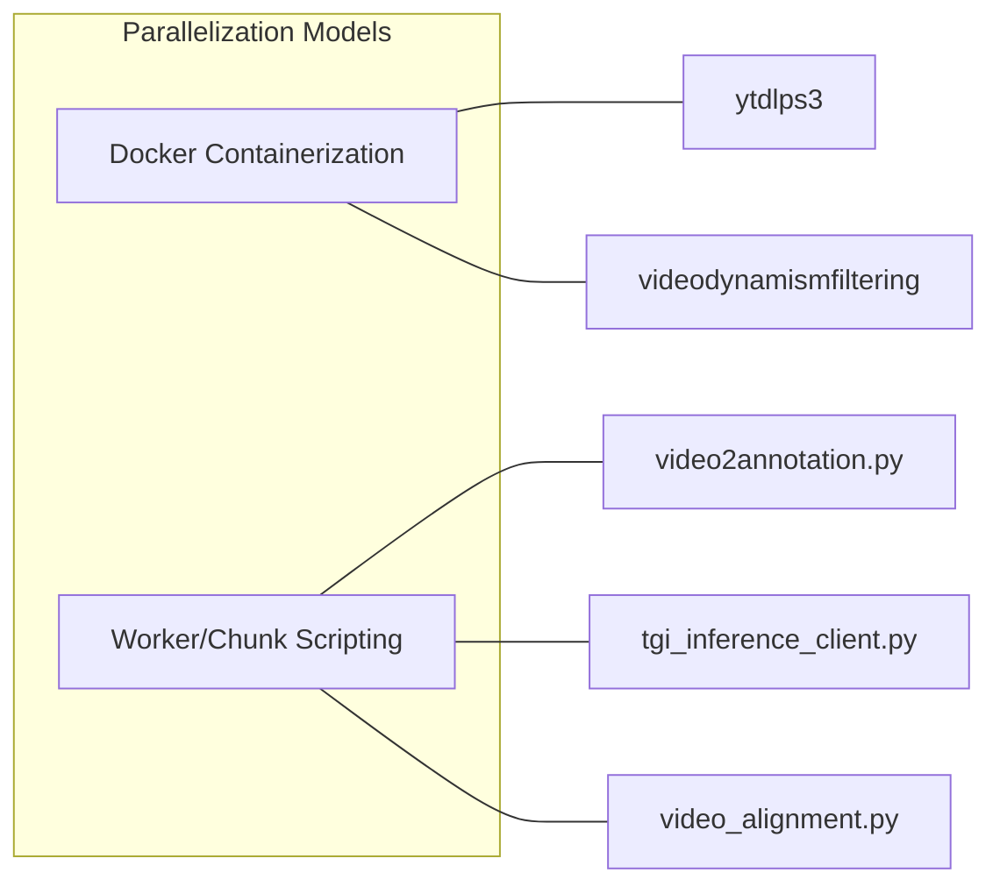
Sources: [readme.md:49-54]()

For details on how these scaling patterns are implemented across the cluster, see [Scalability & Distributed Execution Model](#1.2).

---

# Page: Pipeline Architecture & Data Flow

# Pipeline Architecture & Data Flow

<details>
<summary>Relevant source files</summary>

The following files were used as context for generating this wiki page:

- [dataset-creation.png](dataset-creation.png)
- [readme.md](readme.md)

</details>


This page provides a technical walkthrough of the end-to-end FineVideo data pipeline. The architecture is designed as a directed graph of processing stages, moving from massive-scale raw metadata ingestion to high-fidelity multimodal annotation and temporal alignment.

## End-to-End Pipeline Overview

The pipeline transforms raw YouTube metadata into a curated, annotated dataset of ~3.4k hours of high-quality video content [readme.md:5-7](). The process is divided into six major functional blocks, each responsible for increasing the information density and quality of the data.

### Data Flow Diagram

The following diagram illustrates the transition of data from the initial YouTube Commons source through the various filtering, selection, and annotation stages.

**FineVideo Data Flow & Stage Transitions**
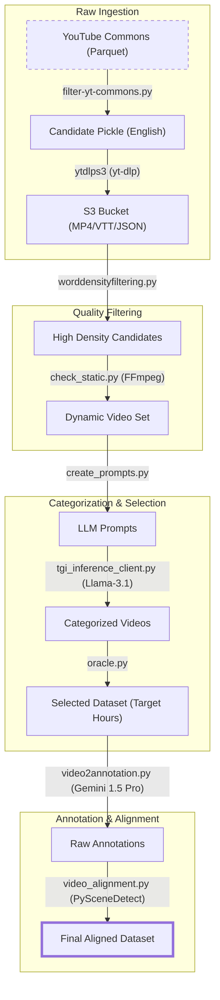
Sources: [readme.md:22-47](), [readme.md:18-18]()

---

## Scalability & Execution Model

The pipeline employs two primary scaling patterns to handle the computational load of processing thousands of hours of video [readme.md:49-54]().

### 1. Dockerized Compute Services
For tasks requiring heavy system dependencies (like `ffmpeg` or `yt-dlp`), the pipeline uses Docker containers. These are deployed as independent workers that interact with S3.
*   **`ytdlps3`**: Handles video and metadata downloads [readme.md:25-27]().
*   **`videodynamismfiltering`**: Executes frame-level analysis to detect static content [readme.md:29-31]().

### 2. Queue Chunking Pattern
For API-bound or Python-heavy tasks, scripts implement a worker/chunk CLI pattern. This allows multiple instances of the same script to run in parallel by processing specific segments of a shared work list [readme.md:49-50]().

| Script | Scaling Mechanism | Key Arguments |
| :--- | :--- | :--- |
| `video2annotation.py` | Chunking | `worker_number`, `size_chunk` |
| `tgi_inference_client.py` | Block Partitioning | Directory partitioning (4 blocks) |
| `video_alignment.py` | Chunking | `worker_number`, `size_chunk` |

Sources: [readme.md:49-54](), [videocategorization/tgi_inference_client.py:1-37](), [contentannotation/video2annotation.py:1-43]()

---

## Detailed Stage Walkthrough

### Stage 1: Ingestion & Metadata Filtering
The pipeline starts with `filter-yt-commons.py`, which parses the PleIAs/YouTube-Commons dataset. It applies initial heuristics: language must be English and word count must exceed 50 [readme.md:24-24](). Surviving IDs are passed to `ytdlps3` for S3 upload.

### Stage 2: Dynamic Quality Filtering
Two filters remove "low-information" videos:
1.  **Word Density**: `worddensityfiltering.py` calculates words-per-second. Videos with $\le 0.5$ WPS are dropped [readme.md:32-32]().
2.  **Visual Dynamism**: `check_static.py` uses FFmpeg's `freezedetect` filter. It segments videos into 60s chunks and marks them as `static/` or `dynamic/` based on the percentage of frozen frames [readme.md:31-31]().

### Stage 3: Semantic Categorization
Surviving videos are mapped to a three-tier taxonomy (Domain → Subject → Format).
*   **Prompt Creation**: `create_prompts.py` generates LLM prompts using the video title, channel, and the first 5000 characters of closed captions [readme.md:35-35]().
*   **Inference**: `tgi_inference_client.py` sends these to a Llama-3.1-70B-Instruct model hosted via Text Generation Inference (TGI) on a Slurm cluster [readme.md:36-37]().

### Stage 4: Content Selection (The Oracle)
The `oracle.py` script performs diversity-aware sampling [readme.md:40-40](). It normalizes engagement metrics (views, likes, comments) and uses a recursive DFS over the taxonomy to ensure category-quota allocation while penalizing over-represented channels.

### Stage 5: Multimodal Annotation
This is the most compute-intensive phase. `video2annotation.py` uses the `VideoProcessor` class to:
1.  Upload video to Gemini 1.5 Pro for multimodal analysis [readme.md:43-43]().
2.  Use the `instructor` library to enforce a strict GPT-4o schema (Scenes, Storylines, Moods) [readme.md:43-43]().
3.  Generate Q&A pairs and trimming suggestions [readme.md:42-42]().

### Stage 6: Fine Alignment
The final stage, `video_alignment.py`, reconciles LLM-generated timestamps with physical frame boundaries. It uses `PySceneDetect` (ContentDetector) to snap scene starts/ends to actual visual cuts, ensuring the final dataset is frame-accurate [readme.md:45-45]().

---

## Code Entity Map

The following diagram maps the conceptual pipeline stages to the specific classes and scripts that implement them.

**System Logic to Code Entity Mapping**
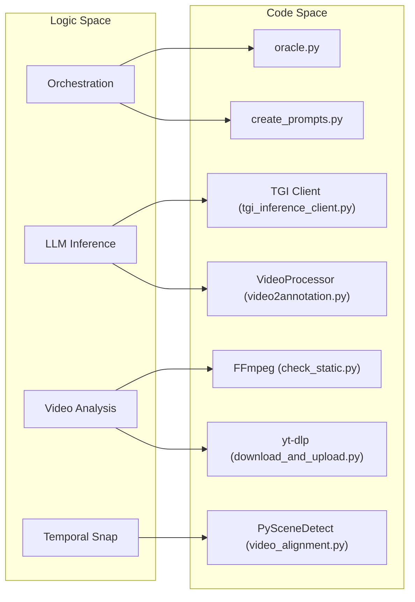
Sources: [readme.md:22-47](), [contentannotation/video2annotation.py:1-43](), [finealignment/video_alignment.py:1-45]()

---

# Page: Scalability & Distributed Execution Model

# Scalability & Distributed Execution Model

<details>
<summary>Relevant source files</summary>

The following files were used as context for generating this wiki page:

- [contentannotation/video2annotation.py](contentannotation/video2annotation.py)
- [readme.md](readme.md)
- [videocategorization/tgi_inference_client.py](videocategorization/tgi_inference_client.py)

</details>


The FineVideo pipeline is designed to handle thousands of hours of video data by employing two distinct scaling patterns. High-throughput, compute-intensive tasks are encapsulated in Docker containers for deployment on cloud clusters, while API-bound and metadata-heavy tasks utilize a "worker/chunk" CLI pattern to allow horizontal scaling across multiple script instances [readme.md:49-54]().

## Distributed Execution Patterns

The pipeline differentiates between scripts that process the entire dataset in a single pass and those that require parallelization to meet time constraints.

### 1. Docker Containerization (Compute-Heavy)
Tasks involving heavy video processing, such as downloading and visual analysis, are packaged as Docker containers. This allows them to be deployed across heterogeneous environments (local, Slurm, or cloud) with consistent dependencies like `ffmpeg` and `yt-dlp` [readme.md:49-52]().

*   **`ytdlps3`**: Handles video and subtitle downloads from YouTube to S3 [readme.md:52]().
*   **`videodynamismfiltering`**: Uses `ffprobe` and `ffmpeg` to detect static content and classify video dynamism [readme.md:52]().

### 2. Worker/Chunk Pattern (API & Metadata)
For stages involving LLM inference (Gemini, GPT-4o, Llama-3) or frame-accurate alignment, the codebase implements a chunking mechanism. Users can launch multiple instances of the same script, each targeting a specific subset of the workload [readme.md:49-54]().

*   **`video2annotation.py`**: Divides a video list into sublists based on a `size_chunk` and `worker_number` [contentannotation/video2annotation.py:17-21]().
*   **`tgi_inference_client.py`**: Partitions prompt files into four blocks to parallelize inference across multiple TGI servers [videocategorization/tgi_inference_client.py:11-17]().
*   **`video_alignment.py`**: Processes specific chunks of the queue to reconcile timestamps with scene boundaries [readme.md:54]().

---

## Parallel Inference & Annotation Flow

The following diagram illustrates how the `tgi_inference_client.py` and `video2annotation.py` scripts bridge the gap between a centralized data store (S3/Local Files) and distributed execution.

### Diagram: Distributed Worker Mapping
This diagram shows how CLI arguments translate into workload partitioning for the `tgi_inference_client.py` and `video2annotation.py` entities.

```mermaid
graph TD
    subgraph "Data Storage"
        [prompts_dir] --> |"JSON Files"| [File_System]
        [video_list_json] --> |"Video IDs"| [Memory]
    end

    subgraph "tgi_inference_client.py Logic"
        [main_tgi] --> |"sys.argv[3]"| [block_number]
        [block_number] --> |"Partitioning"| [load_prompts_from_file]
        [load_prompts_from_file] --> |"HTTP POST"| [TGI_Endpoint_generate]
    end

    subgraph "video2annotation.py Logic"
        [VideoProcessor] --> |"size_chunk"| [Workload_Split]
        [Workload_Split] --> |"worker_number"| [Sublist_Selection]
        [Sublist_Selection] --> |"upload_video"| [Gemini_API]
        [Sublist_Selection] --> |"obtain_json"| [Instructor_GPT4o]
    end

    [File_System] -.-> [main_tgi]
    [Memory] -.-> [VideoProcessor]
```
**Sources:** [videocategorization/tgi_inference_client.py:14-18](), [videocategorization/tgi_inference_client.py:89-127](), [contentannotation/video2annotation.py:17-21](), [contentannotation/video2annotation.py:119-126]().

---

## Implementation Details

### API-Bound Parallelization (`video2annotation.py`)
The `video2annotation.py` script is designed to run as a standalone application that can be scaled horizontally. It uses the `VideoProcessor` class to manage interactions with external APIs.

| Parameter | Function |
| :--- | :--- |
| `size_chunk` | Determines the number of videos each worker handles per batch [contentannotation/video2annotation.py:18](). |
| `worker_number` | Identifies which specific sublist the current execution instance will process [contentannotation/video2annotation.py:19](). |
| `--video-list` | Path to the JSON file containing video IDs to be processed [contentannotation/video2annotation.py:20](). |

The script manages rate limits and failures through an exponential backoff strategy within the `process_video` function [contentannotation/video2annotation.py:154-160]().

### TGI Block Partitioning (`tgi_inference_client.py`)
The categorization stage uses Text Generation Inference (TGI) for high-speed LLM serving. The client script partitions the `prompts/` directory into exactly four blocks.

1.  **File Discovery**: The script lists all `.json` files in the `prompts` directory and sorts them alphabetically to ensure consistent indexing across workers [videocategorization/tgi_inference_client.py:110-114]().
2.  **Indexing**: Using `ceil(total_files / 4)`, it calculates the `start_index` and `end_index` for the block assigned via the CLI `block_number` argument [videocategorization/tgi_inference_client.py:117-122]().
3.  **Request Construction**: For each task, it applies the Llama-3.1-70B-Instruct chat template via `tokenizer.apply_chat_template` before sending a POST request to the `/generate` endpoint [videocategorization/tgi_inference_client.py:56-73]().

### Diagram: Chunking and Persistence Flow
This diagram maps the data flow from raw prompt files to the `processed/` results directory, highlighting the `process_file` function.

```mermaid
graph LR
    [prompts_folder] -- "files.sort()" --> [Sorted_Files_List]
    [Sorted_Files_List] -- "block_number" --> [Current_Block]
    
    subgraph "process_file function"
        [Current_Block] --> [load_prompts_from_file]
        [load_prompts_from_file] --> [apply_chat_template]
        [apply_chat_template] --> [requests.post_generate]
        [requests.post_generate] --> [results_list]
    end
    
    [results_list] -- "json.dump()" --> [processed_results_json]
```
**Sources:** [videocategorization/tgi_inference_client.py:27-30](), [videocategorization/tgi_inference_client.py:33-44](), [videocategorization/tgi_inference_client.py:84-86](), [videocategorization/tgi_inference_client.py:110-127]().

---

## Summary of Execution Models

| Pipeline Stage | Scaling Pattern | Code Entity |
| :--- | :--- | :--- |
| **Video Download** | Docker | `rawdataset/ytdlps3` [readme.md:52]() |
| **Dynamism Filter** | Docker | `dynamicfilters/videodynamismfiltering` [readme.md:52]() |
| **Categorization** | Worker/Chunk (TGI) | `videocategorization/tgi_inference_client.py` [readme.md:54]() |
| **Annotation** | Worker/Chunk (API) | `contentannotation/video2annotation.py` [readme.md:54]() |
| **Alignment** | Worker/Chunk | `finealignment/video_alignment.py` [readme.md:54]() |

**Sources:** [readme.md:49-54](), [contentannotation/video2annotation.py:17-21](), [videocategorization/tgi_inference_client.py:14-18]().

---

# Page: Raw Dataset Ingestion

# Raw Dataset Ingestion

<details>
<summary>Relevant source files</summary>

The following files were used as context for generating this wiki page:

- [rawdataset/filter-yt-commons.py](rawdataset/filter-yt-commons.py)
- [rawdataset/ytdlps3/Dockerfile](rawdataset/ytdlps3/Dockerfile)
- [rawdataset/ytdlps3/download_and_upload.py](rawdataset/ytdlps3/download_and_upload.py)

</details>


The **Raw Dataset Ingestion** stage is the entry point of the FineVideo pipeline. Its primary purpose is to identify high-quality video candidates from the massive YouTube Commons dataset and transfer the physical media assets (video, subtitles, and metadata) into a managed S3 environment for subsequent processing.

This subsystem operates in two distinct phases:
1.  **Metadata Filtering**: Sifting through the `PleIAs/YouTube-Commons` dataset to find English-language videos with sufficient textual content.
2.  **Asset Acquisition**: A distributed downloading service that fetches the actual video files and auxiliary data from YouTube using `yt-dlp`.

### Ingestion Data Flow

The following diagram illustrates the transition from the "Natural Language Space" (user-facing datasets and video platforms) to the "Code Entity Space" (specific scripts and storage locations).

**Natural Language to Code Entity Mapping: Ingestion Flow**
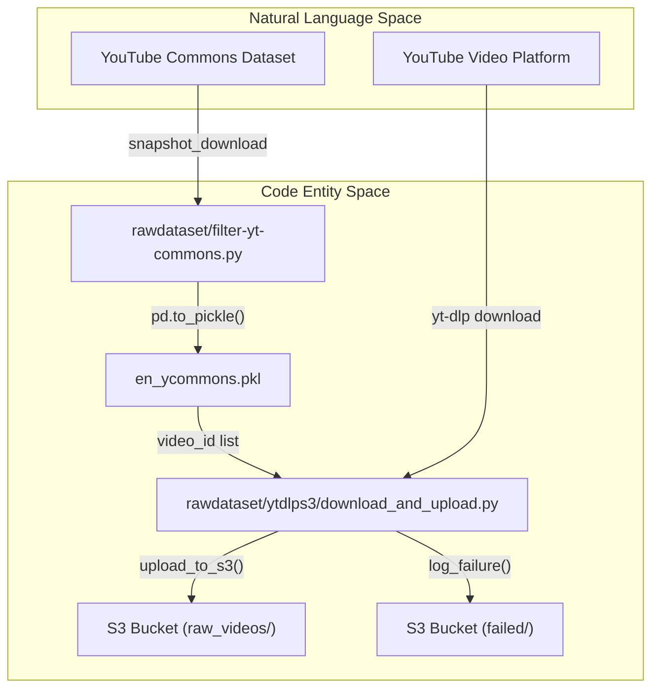
Sources: [rawdataset/filter-yt-commons.py:12-14](), [rawdataset/filter-yt-commons.py:80-82](), [rawdataset/ytdlps3/download_and_upload.py:55-60](), [rawdataset/ytdlps3/download_and_upload.py:32-39]()

---

## 2.1 YouTube Commons Filter (`filter-yt-commons.py`)

The pipeline begins by processing the `PleIAs/YouTube-Commons` dataset hosted on Hugging Face. The script `filter-yt-commons.py` performs a `snapshot_download` of the dataset [rawdataset/filter-yt-commons.py:80-82]() and iterates through the Parquet files to extract a subset of videos meeting specific criteria.

**Key Operations:**
*   **Language Filtering**: It restricts candidates to those where both `original_language` and `transcription_language` are set to `'en'` [rawdataset/filter-yt-commons.py:78]().
*   **Content Density**: It enforces a minimum `word_count` of 50 to ensure the video has enough spoken content for meaningful annotation [rawdataset/filter-yt-commons.py:55-56]().
*   **Metadata Extraction**: It selects 26 specific fields, including engagement metrics (`view_count`, `like_count`), technical specs (`resolution`), and textual data (`description`, `text`) [rawdataset/filter-yt-commons.py:77]().

The resulting filtered DataFrame is serialized to a pickle file (`en_ycommons.pkl`) [rawdataset/filter-yt-commons.py:89](), which serves as the manifest for the downloader.

For details, see [YouTube Commons Filter (`filter-yt-commons.py`)](#2.1).

Sources: [rawdataset/filter-yt-commons.py:19-74]()

---

## 2.2 Video Downloader Service (`ytdlps3`)

The downloader service is a containerized application designed to scale across a cluster. It consumes `video_id`s from the manifest and uses `yt-dlp` to retrieve the assets.

**System Architecture: Downloader Service**
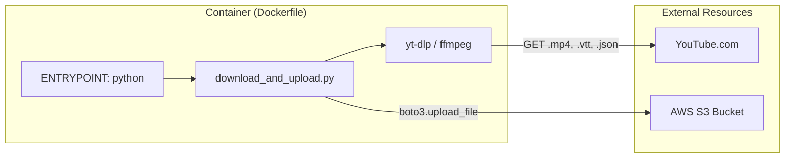
Sources: [rawdataset/ytdlps3/Dockerfile:1-22](), [rawdataset/ytdlps3/download_and_upload.py:6-26]()

**Key Components:**
*   **Environment**: The service runs in a `python:3.9-slim` environment with `ffmpeg` installed for media handling [rawdataset/ytdlps3/Dockerfile:1-10]().
*   **Asset Retrieval**: For every video, it attempts to download the best quality MP4, English VTT subtitles, and the video metadata JSON [rawdataset/ytdlps3/download_and_upload.py:7-15]().
*   **S3 Integration**: Successfully downloaded files are uploaded to a target S3 bucket [rawdataset/ytdlps3/download_and_upload.py:55-60]().
*   **Error Handling**: If a download fails, the script captures the traceback and uploads an error log to a `failed/` prefix in S3, allowing for easy auditing of unavailable or restricted videos [rawdataset/ytdlps3/download_and_upload.py:32-39]().

For details, see [Video Downloader Service (`ytdlps3`)](#2.2).

Sources: [rawdataset/ytdlps3/download_and_upload.py:41-69]()

---

# Page: YouTube Commons Filter (`filter-yt-commons.py`)

# YouTube Commons Filter (`filter-yt-commons.py`)

<details>
<summary>Relevant source files</summary>

The following files were used as context for generating this wiki page:

- [rawdataset/filter-yt-commons.py](rawdataset/filter-yt-commons.py)

</details>


The `filter-yt-commons.py` script serves as the entry point for the FineVideo data ingestion pipeline. Its primary responsibility is to fetch the raw **YouTube Commons** dataset from Hugging Face, apply strict linguistic and density filters to ensure data quality, and extract a subset of metadata fields required for downstream stages like categorization and annotation.

## Purpose and Scope

The script acts as a preprocessing gatekeeper. It specifically targets high-quality English-language videos with sufficient textual information (closed captions/transcriptions) to support multimodal analysis. By filtering at this stage, the pipeline avoids downloading or processing videos that lack the semantic depth needed for the FineVideo dataset.

- **Source Dataset**: `PleIAs/YouTube-Commons` [rawdataset/filter-yt-commons.py:80-82]().
- **Output**: A serialized pandas DataFrame (`.pkl`) containing filtered video metadata [rawdataset/filter-yt-commons.py:14-14]().

## Implementation Details

### Dataset Acquisition
The script uses `snapshot_download` from `huggingface_hub` to download the entire `PleIAs/YouTube-Commons` dataset to a local directory defined by `dataset_path` [rawdataset/filter-yt-commons.py:80-82](). This dataset consists of multiple Parquet files containing metadata for millions of Creative Commons-licensed YouTube videos.

### Filtering Logic
The core logic resides in the `read_filtered_parquet_files` function [rawdataset/filter-yt-commons.py:19-74](). It iterates through all Parquet files in the downloaded folder and applies the following criteria:

1.  **Language Consistency**: The script filters for videos where both `original_language` and `transcription_language` are explicitly set to `'en'` (English) [rawdataset/filter-yt-commons.py:78-78]().
2.  **Word Count Threshold**: Only videos with a `word_count` greater than 50 are retained [rawdataset/filter-yt-commons.py:55-56](). This ensures that the video has enough spoken content for meaningful transcription analysis.
3.  **Language Metadata Normalization**: The script handles inconsistencies in the source dataset schema by mapping `language_id_method` to `source_language` if the latter is missing [rawdataset/filter-yt-commons.py:59-60]().

### Metadata Extraction
The script selects 26 specific fields required for subsequent pipeline stages, including engagement metrics (`view_count`, `like_count`), technical metadata (`resolution`, `duration_string`), and content identifiers (`video_id`, `channel_id`) [rawdataset/filter-yt-commons.py:77-77]().

| Field Category | Key Fields |
| :--- | :--- |
| **Identifiers** | `video_id`, `video_link`, `channel_id`, `channel` |
| **Engagement** | `view_count`, `like_count`, `comment_count`, `channel_follower_count` |
| **Content** | `title`, `description`, `text` (transcription), `tags`, `categories` |
| **Technical** | `duration_string`, `resolution`, `vcodec`, `acodec` |

Sources: [rawdataset/filter-yt-commons.py:19-74](), [rawdataset/filter-yt-commons.py:77-78]()

## Data Flow and Entity Mapping

The following diagrams illustrate how the script transforms raw dataset files into a structured format used by the rest of the FineVideo pipeline.

### Metadata Extraction Flow
This diagram shows the transition from raw Parquet files on Hugging Face to the filtered Pickle file.

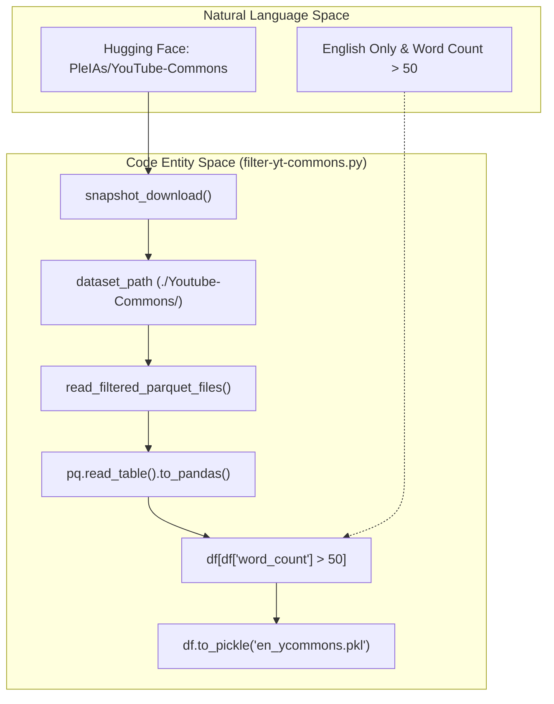
Sources: [rawdataset/filter-yt-commons.py:13-14](), [rawdataset/filter-yt-commons.py:41-41](), [rawdataset/filter-yt-commons.py:56-56](), [rawdataset/filter-yt-commons.py:80-82](), [rawdataset/filter-yt-commons.py:89-89]()

### Logic Flow of `read_filtered_parquet_files`
This diagram details the internal iteration and filtering logic applied to every Parquet file.

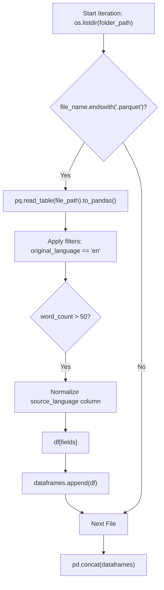
Sources: [rawdataset/filter-yt-commons.py:35-37](), [rawdataset/filter-yt-commons.py:41-41](), [rawdataset/filter-yt-commons.py:44-51](), [rawdataset/filter-yt-commons.py:55-56](), [rawdataset/filter-yt-commons.py:59-66](), [rawdataset/filter-yt-commons.py:73-73]()

## Technical Requirements
- **Memory**: The script requires significant RAM because it loads entire Parquet files into memory via `to_pandas()` before filtering [rawdataset/filter-yt-commons.py:8-8](), [rawdataset/filter-yt-commons.py:41-41]().
- **Storage**: Sufficient disk space is needed to house the `snapshot_download` of the YouTube-Commons dataset [rawdataset/filter-yt-commons.py:80-82]().

Sources: [rawdataset/filter-yt-commons.py:8-14]()

---

# Page: Video Downloader Service (`ytdlps3`)

# Video Downloader Service (`ytdlps3`)

<details>
<summary>Relevant source files</summary>

The following files were used as context for generating this wiki page:

- [rawdataset/ytdlps3/Dockerfile](rawdataset/ytdlps3/Dockerfile)
- [rawdataset/ytdlps3/download_and_upload.py](rawdataset/ytdlps3/download_and_upload.py)

</details>


The Video Downloader Service is a containerized utility designed to ingest video content from YouTube into the FineVideo pipeline's S3 storage. It encapsulates `yt-dlp` and `ffmpeg` to ensure reliable retrieval of high-quality video files, English subtitles, and comprehensive metadata.

## Overview and Purpose

The service operates as a standalone Docker container that processes a list of YouTube video IDs. For each ID, it fetches:
1.  The best available MP4 video stream.
2.  English subtitles in VTT format (if available).
3.  The `info.json` metadata file generated by `yt-dlp`.

All successfully retrieved assets are uploaded to a specified S3 bucket and path. In the event of a failure (e.g., video removed, regional restrictions), the service logs the error to a dedicated `failed/` prefix in S3 for auditing.

### System Architecture and Data Flow

The following diagram illustrates the relationship between the CLI arguments, the internal processing logic, and the external storage services.

**Downloader Data Flow and Code Entities**
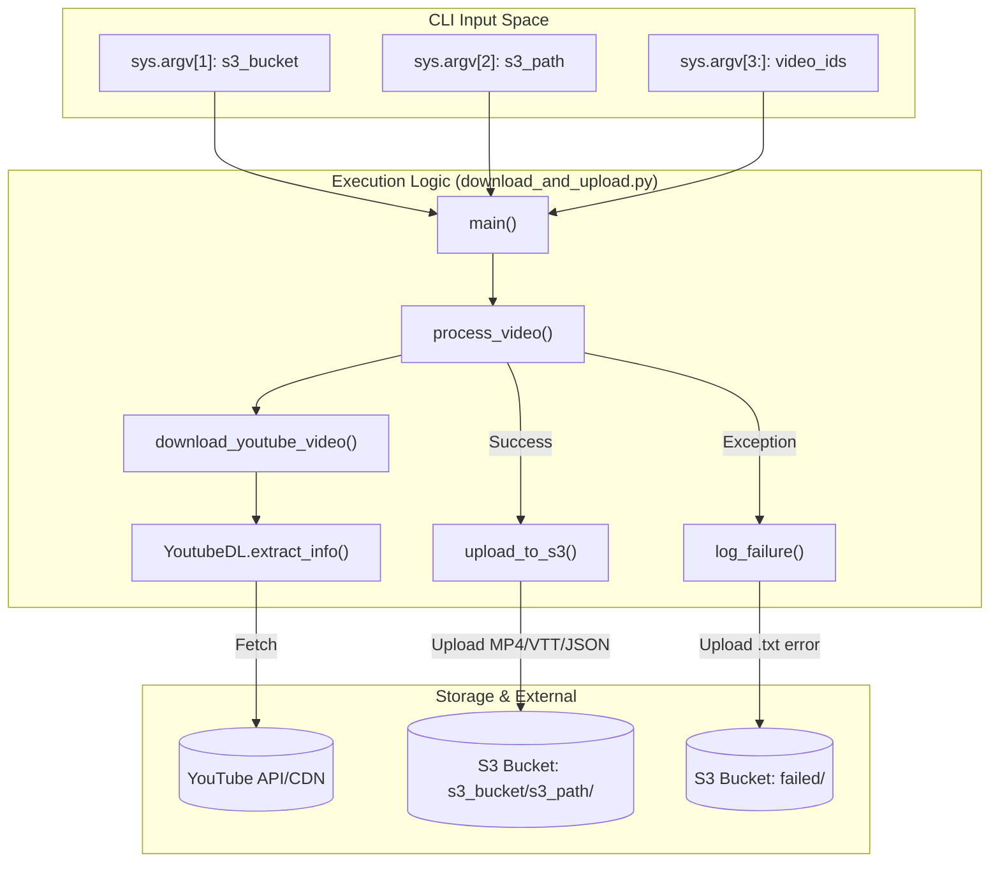
**Sources:** [rawdataset/ytdlps3/download_and_upload.py:70-83](), [rawdataset/ytdlps3/download_and_upload.py:41-68]()

---

## Implementation Details

### Docker Environment
The service is built on `python:3.9-slim` to minimize image size while providing the necessary system dependencies.

| Dependency | Purpose |
| :--- | :--- |
| `ffmpeg` | Required by `yt-dlp` for post-processing and format merging. |
| `yt-dlp` | The core engine for downloading YouTube content and metadata. |
| `boto3` | AWS SDK for Python used to interact with S3. |
| `python:3.9-slim` | Base OS and runtime. |

**Sources:** [rawdataset/ytdlps3/Dockerfile:1-13]()

### Core Logic: `download_and_upload.py`

The script follows a sequential execution pattern for each video ID provided in the command line arguments.

#### 1. Video Retrieval (`download_youtube_video`)
The function `download_youtube_video` configures `YoutubeDL` with specific options to ensure consistency across the dataset:
*   **Format**: Set to `best` to retrieve the highest quality merged stream [rawdataset/ytdlps3/download_and_upload.py:8]().
*   **Subtitles**: Specifically requests English (`en`) subtitles in `vtt` format [rawdataset/ytdlps3/download_and_upload.py:9-11]().
*   **Metadata**: `writeinfojson` is enabled to capture the full YouTube metadata block [rawdataset/ytdlps3/download_and_upload.py:12]().

#### 2. Processing and Cleanup (`process_video`)
The `process_video` function manages the lifecycle of a single download:
*   Creates a temporary directory at `/tmp/youtube_downloads` [rawdataset/ytdlps3/download_and_upload.py:44-45]().
*   Calls `download_youtube_video` and maps the resulting local files to their intended S3 keys [rawdataset/ytdlps3/download_and_upload.py:48-52]().
*   Uploads the `.mp4`, `.json` (metadata), and `.en.vtt` (subtitles) files to S3 [rawdataset/ytdlps3/download_and_upload.py:55-60]().
*   **Cleanup**: Iterates through the temporary directory and deletes all local files after upload to prevent disk exhaustion in the container [rawdataset/ytdlps3/download_and_upload.py:63-64]().

#### 3. Error Handling (`log_failure`)
If any part of the download or upload process fails, the exception is caught. The `log_failure` function writes the traceback or error message to a local `.txt` file named after the `video_id` and uploads it to the `failed/` prefix in the target S3 bucket [rawdataset/ytdlps3/download_and_upload.py:32-39]().

**Component Interaction Diagram**
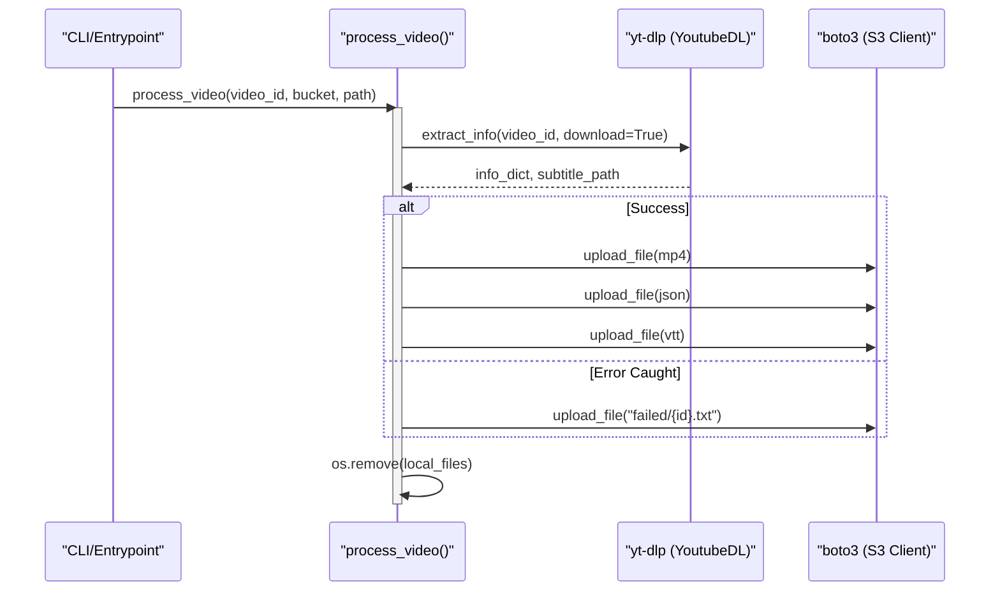
**Sources:** [rawdataset/ytdlps3/download_and_upload.py:6-26](), [rawdataset/ytdlps3/download_and_upload.py:41-68]()

---

## CLI Interface

The service is invoked via the command line, typically as the `ENTRYPOINT` of the Docker container.

### Usage
```bash
python download_and_upload.py <s3_bucket_name> <s3_path> <youtube_video_id_1> [<youtube_video_id_2> ...]
```

### Arguments
*   `s3_bucket_name`: The name of the destination S3 bucket.
*   `s3_path`: The prefix (folder) within the bucket where files should be stored.
*   `youtube_video_id_N`: One or more 11-character YouTube video identifiers.

**Sources:** [rawdataset/ytdlps3/download_and_upload.py:75-81]()

---

# Page: Dynamic Filters

# Dynamic Filters

<details>
<summary>Relevant source files</summary>

The following files were used as context for generating this wiki page:

- [dynamicfilters/videodynamismfiltering/Dockerfile](dynamicfilters/videodynamismfiltering/Dockerfile)
- [dynamicfilters/videodynamismfiltering/check_static.py](dynamicfilters/videodynamismfiltering/check_static.py)
- [dynamicfilters/worddensityfiltering.py](dynamicfilters/worddensityfiltering.py)

</details>


The `dynamicfilters` subsystem serves as a two-pass quality-control layer designed to remove low-information videos early in the pipeline. By filtering out content with minimal visual movement or low verbal information density, the system avoids wasting expensive compute and API credits during the subsequent categorization and annotation stages.

### Subsystem Overview

The filtering process is split into two distinct methodologies:
1.  **Visual Dynamism**: Analyzing the video stream to detect "static" content (e.g., slideshows, static images with audio).
2.  **Information Density**: Analyzing metadata to ensure the video contains a sufficient rate of spoken words relative to its duration.

The following diagram illustrates the position of these filters within the broader ingestion pipeline:

**Dynamic Filter Data Flow**
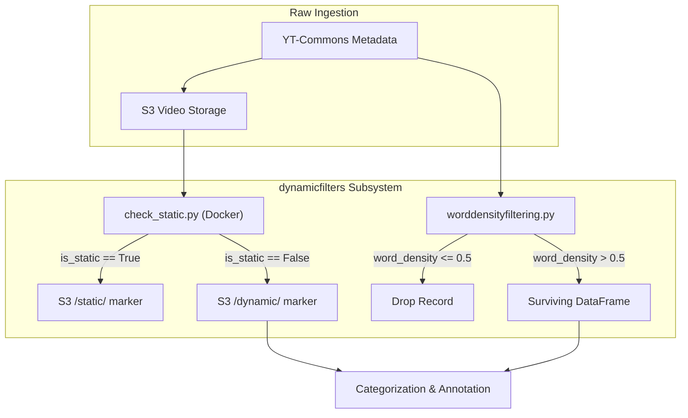
Sources: [dynamicfilters/videodynamismfiltering/check_static.py:75-97](), [dynamicfilters/worddensityfiltering.py:4-7]()

---

### Video Dynamism Filter (`check_static.py`)

The dynamism filter identifies videos that lack significant visual change. This is critical for multimodal datasets where the relationship between visual cues and audio is paramount.

*   **Execution**: This filter runs as a Dockerized service, typically deployed via AWS Batch. It uses `ffmpeg`'s `freezedetect` filter to scan video segments for lack of motion.
*   **Logic**: The script `check_static.py` calculates a `freeze_percentage` by dividing the number of segments containing "frozen" frames by the total number of segments. If this percentage exceeds a predefined `threshold` (defaulting to 0.4), the video is marked as static.
*   **Output**: Instead of deleting files, the system writes empty marker files to S3 under `static/` or `dynamic/` prefixes to inform downstream selection logic.

For details on the Docker environment and the `freezedetect` parameters, see [Video Dynamism Filter (`check_static.py`)](#3.1).

**System to Code Entity Mapping: Dynamism Filtering**
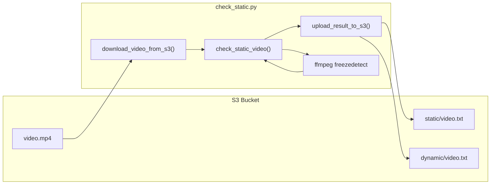
Sources: [dynamicfilters/videodynamismfiltering/check_static.py:9-20](), [dynamicfilters/videodynamismfiltering/check_static.py:22-64](), [dynamicfilters/videodynamismfiltering/check_static.py:66-74]()

---

### Word Density Filter (`worddensityfiltering.py`)

The word density filter targets videos that may have high visual dynamism but lack sufficient verbal content to justify detailed textual annotation or Q&A generation.

*   **Metric**: It calculates `word_density`, defined as `word_count / duration_seconds`.
*   **Threshold**: The script enforces a strict cutoff at `0.5` words per second. Any video falling below this threshold is dropped from the processing DataFrame.
*   **Implementation**: It processes the pickle files generated during the ingestion phase, converting `duration_string` (e.g., "HH:MM:SS") into raw seconds to perform the calculation.

For details on the visualization tools for borderline cases and the duration parsing logic, see [Word Density Filter (`worddensityfiltering.py`)](#3.2).

**System to Code Entity Mapping: Word Density**
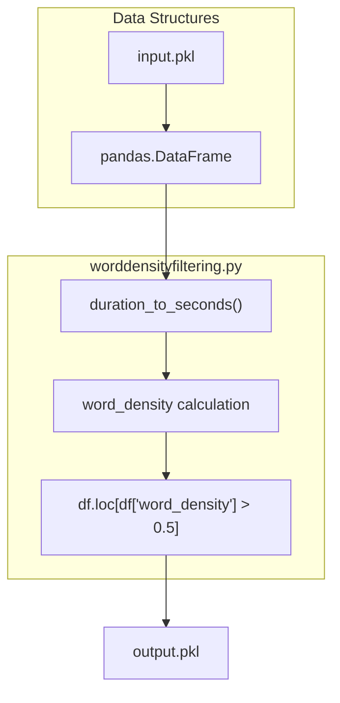
Sources: [dynamicfilters/worddensityfiltering.py:20-35](), [dynamicfilters/worddensityfiltering.py:39-40](), [dynamicfilters/worddensityfiltering.py:72-75]()

---

### Integration with Pipeline

The dynamic filters act as the final gatekeepers of the "Raw Dataset Ingestion" phase. Only videos that are both **dynamic** (confirmed by `check_static.py`) and **informative** (confirmed by `worddensityfiltering.py`) proceed to the [Video Categorization](#4) stage.

| Filter Type | Primary Tool | Input | Output Criterion |
| :--- | :--- | :--- | :--- |
| **Visual** | `ffmpeg` | MP4 Video | `freeze_percentage < 0.4` |
| **Verbal** | `pandas` | Metadata (word count) | `word_density > 0.5` |

Sources: [dynamicfilters/videodynamismfiltering/check_static.py:64](), [dynamicfilters/worddensityfiltering.py:73]()

---

# Page: Video Dynamism Filter (`check_static.py`)

# Video Dynamism Filter (`check_static.py`)

<details>
<summary>Relevant source files</summary>

The following files were used as context for generating this wiki page:

- [dynamicfilters/videodynamismfiltering/Dockerfile](dynamicfilters/videodynamismfiltering/Dockerfile)
- [dynamicfilters/videodynamismfiltering/check_static.py](dynamicfilters/videodynamismfiltering/check_static.py)

</details>


The **Video Dynamism Filter** is a specialized preprocessing service designed to identify and flag videos with low visual information (static content). By filtering out videos that resemble slideshows, static images with audio, or frozen frames, the pipeline ensures that compute-heavy downstream stages—such as LLM-based video annotation—are only performed on visually dynamic content.

## Overview and Purpose

The service is implemented as a Dockerized Python application that leverages `ffmpeg` to detect "freeze" patterns in video streams. It processes videos in 60-second segments to compute a global "freeze percentage," which is then compared against a configurable threshold to classify the video as either `static/` or `dynamic/`.

### Key Capabilities
*   **Segmented Analysis**: Breaks long videos into chunks to avoid memory overhead and handle varying levels of dynamism throughout a single file [dynamicfilters/videodynamismfiltering/check_static.py:42-47]().
*   **Threshold-Based Filtering**: Uses the `freezedetect` filter to measure visual stagnation [dynamicfilters/videodynamismfiltering/check_static.py:22-32]().
*   **S3-Driven Workflow**: Downloads source MP4s and uploads empty marker files to specific S3 prefixes to signal status to subsequent pipeline stages [dynamicfilters/videodynamismfiltering/check_static.py:66-73]().

---

## Technical Implementation

### System Architecture & Data Flow

The following diagram illustrates the relationship between the `check_static.py` script and the external tools (`ffprobe`, `ffmpeg`) and storage (S3).

**Video Dynamism Logic Flow**
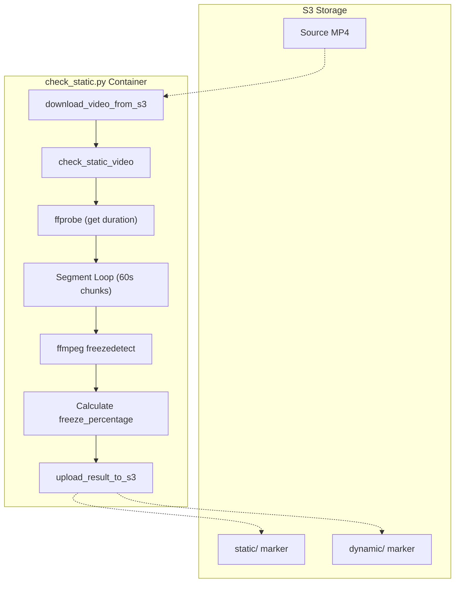
*Sources: [dynamicfilters/videodynamismfiltering/check_static.py:9-93]()*

### The `check_static_video` Logic
The core logic resides in `check_static_video` [dynamicfilters/videodynamismfiltering/check_static.py:22](). The function executes the following steps:

1.  **Duration Extraction**: Uses `ffprobe` to determine the total length of the video in seconds [dynamicfilters/videodynamismfiltering/check_static.py:27-32]().
2.  **Segmentation**: Calculates `num_segments` by dividing total duration by `segment_duration` (default: 60s) [dynamicfilters/videodynamismfiltering/check_static.py:38-42]().
3.  **Freeze Detection**: For each segment, it runs an `ffmpeg` command using the `freezedetect` filter [dynamicfilters/videodynamismfiltering/check_static.py:44-47]().
    *   `n=0.05`: Noise tolerance for freeze detection.
    *   `d=50`: Duration (in frames or seconds depending on context, here configured for significant stillness) required to trigger a freeze event.
4.  **Classification**: If the string `"freezedetect"` appears in the `ffmpeg` stderr output, that segment is marked as frozen [dynamicfilters/videodynamismfiltering/check_static.py:51-53]().
5.  **Scoring**: The final `freeze_percentage` is `freeze_count / num_segments` [dynamicfilters/videodynamismfiltering/check_static.py:59](). If this value is $\ge$ `threshold` (default: 0.4), the video is classified as static [dynamicfilters/videodynamismfiltering/check_static.py:64]().

---

## Deployment and Environment

### Docker Configuration
The service is packaged in a lightweight container based on `python:3.9-slim` [dynamicfilters/videodynamismfiltering/Dockerfile:2]().

| Layer | Purpose |
| :--- | :--- |
| **Base Image** | `python:3.9-slim` [dynamicfilters/videodynamismfiltering/Dockerfile:2]() |
| **System Deps** | `ffmpeg` [dynamicfilters/videodynamismfiltering/Dockerfile:6]() |
| **Python Deps** | `boto3`, `ffmpeg-python` [dynamicfilters/videodynamismfiltering/Dockerfile:17]() |
| **Entrypoint** | `python check_static.py` [dynamicfilters/videodynamismfiltering/Dockerfile:20]() |

### Environment Variables
The script expects specific environment variables, typically provided by AWS Batch or a similar orchestrator [dynamicfilters/videodynamismfiltering/check_static.py:76-79]():

*   `VIDEO_BUCKET`: The S3 bucket containing source videos.
*   `VIDEO_IDS`: A comma-separated list of video IDs to process in the current job.
*   `BUCKET_VIDEO_FOLDER_PATH`: The prefix within the bucket where MP4 files are stored.

---

## Code Entity Map

The following diagram maps the logical operations of the dynamism filter to the specific functions and external commands used in the codebase.

**Code Entity Interaction Map**
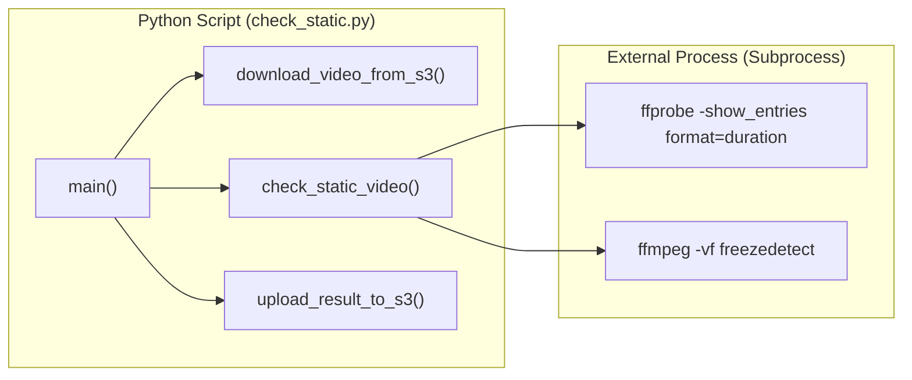
*Sources: [dynamicfilters/videodynamismfiltering/check_static.py:22-93]()*

### Classification Logic Summary

| Metric | Variable Name | Default Value | Description |
| :--- | :--- | :--- | :--- |
| Segment Duration | `segment_duration` | 60 | Length of each analysis window in seconds. |
| Noise Tolerance | `freeze_n` | 0.05 | `freezedetect` noise parameter. |
| Freeze Duration | `freeze_d` | 50 | Minimum duration to flag a segment as static. |
| Pass/Fail Threshold | `threshold` | 0.4 | Ratio of frozen segments allowed before being marked `static`. |

*Sources: [dynamicfilters/videodynamismfiltering/check_static.py:22]()*

---

# Page: Word Density Filter (`worddensityfiltering.py`)

# Word Density Filter (`worddensityfiltering.py`)

<details>
<summary>Relevant source files</summary>

The following files were used as context for generating this wiki page:

- [dynamicfilters/worddensityfiltering.py](dynamicfilters/worddensityfiltering.py)

</details>


The `worddensityfiltering.py` script serves as a quality-control heuristic within the `dynamicfilters` subsystem. Its primary purpose is to prune the dataset of videos that lack sufficient verbal information relative to their runtime. By calculating a "words per second" metric, the pipeline can filter out content that is primarily visual or musical without significant educational or conversational value, which is critical for downstream multimodal annotation tasks.

### Core Logic and Metrics

The filter operates on metadata previously extracted from the YouTube Commons dataset. It introduces two primary calculated columns to the working DataFrame: `duration_seconds` and `word_density`.

#### Duration Normalization
The script first converts the human-readable `duration_string` (e.g., "01:05:30") into a raw integer representing total seconds. This conversion is handled by the `duration_to_seconds` function [dynamicfilters/worddensityfiltering.py:20-32]().

| Format | Example | Calculation |
| :--- | :--- | :--- |
| `hh:mm:ss` | `01:02:03` | $(1 \times 3600) + (2 \times 60) + 3 = 3723s$ |
| `mm:ss` | `05:20` | $(5 \times 60) + 20 = 320s$ |
| `ss` | `45` | $45s$ |

#### Word Density Calculation
Word density is defined as the number of words in the transcript divided by the total duration of the video in seconds [dynamicfilters/worddensityfiltering.py:38-40]().
- **Formula**: $Word Density = \frac{word\_count}{duration\_seconds}$
- **Threshold**: The script enforces a strict lower bound of **0.5 words per second** [dynamicfilters/worddensityfiltering.py:73](). Videos failing to meet this density are dropped from the pipeline.

### Implementation Flow

The script follows a linear pickle-in/pickle-out pattern, transforming the metadata before persisting it for the next stage (Categorization).

#### Data Transformation Pipeline
The diagram below illustrates the transition from raw YT-Commons metadata fields to the filtered dataset.

"Word Density Data Flow"
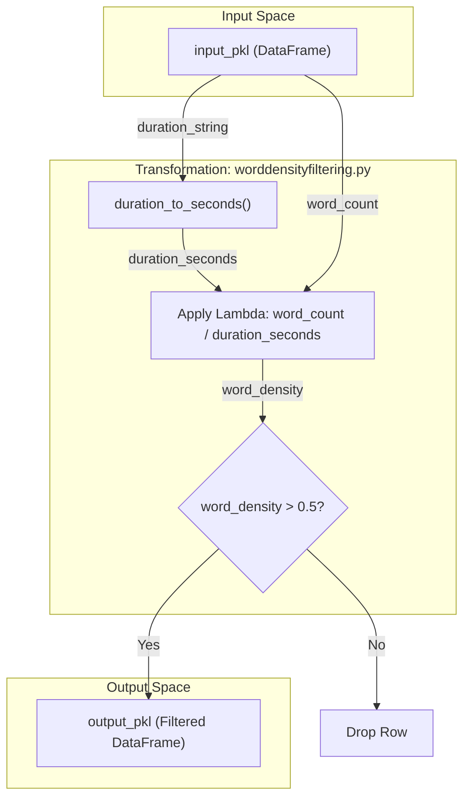
Sources: [dynamicfilters/worddensityfiltering.py:17-40](), [dynamicfilters/worddensityfiltering.py:73-75]()

### Visualization and Inspection Mode

To validate the 0.5 threshold, the script includes a visualization toggle (`visualize = True`). This mode uses the `tabulate` library to print samples of videos that fall near specific density benchmarks (1.0 and 0.5).

The helper function `get_samples_near_target` allows developers to inspect "borderline" cases to ensure that the threshold is not inadvertently removing high-quality content or retaining too much "dead air" [dynamicfilters/worddensityfiltering.py:47-63]().

"Code Entity Mapping: Visualization Logic"
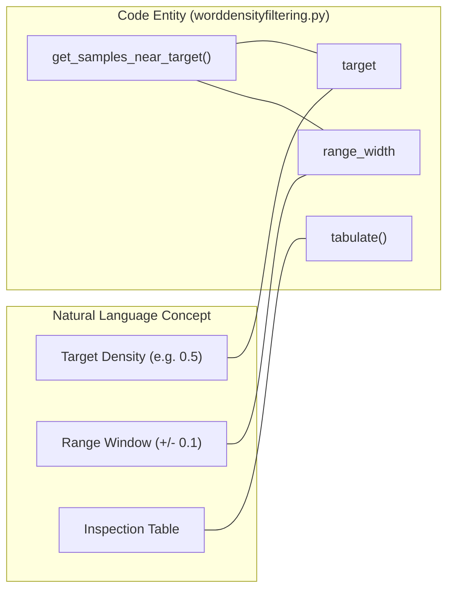
Sources: [dynamicfilters/worddensityfiltering.py:12](), [dynamicfilters/worddensityfiltering.py:47-69]()

### Interface and Configuration

The script is configured via hardcoded variables at the top of the file, intended to be modified per run or integrated into a larger orchestration script.

| Variable | Role | Source |
| :--- | :--- | :--- |
| `input_pkl` | Path to the `.pkl` file generated by the YT-Commons filter. | [dynamicfilters/worddensityfiltering.py:10]() |
| `output_pkl` | Destination path for the filtered results. | [dynamicfilters/worddensityfiltering.py:11]() |
| `visualize` | Boolean flag to enable/disable console output of borderline samples. | [dynamicfilters/worddensityfiltering.py:12]() |

Sources: [dynamicfilters/worddensityfiltering.py:9-13]()

---

# Page: Video Categorization

# Video Categorization

<details>
<summary>Relevant source files</summary>

The following files were used as context for generating this wiki page:

- [videocategorization/content_taxonomy.json](videocategorization/content_taxonomy.json)
- [videocategorization/create_prompts.py](videocategorization/create_prompts.py)
- [videocategorization/launchTGI-Slurm.sh](videocategorization/launchTGI-Slurm.sh)
- [videocategorization/tgi_inference_client.py](videocategorization/tgi_inference_client.py)

</details>


The **Video Categorization** subsystem is responsible for assigning semantic labels to videos that have passed initial quality filters. By leveraging a structured content taxonomy and a Large Language Model (LLM) served via Text Generation Inference (TGI), the pipeline transforms raw metadata and transcripts into categorized data points. This classification is critical for the subsequent [Oracle Selection Algorithm (`oracle.py`)](#5.1), which uses these categories to ensure dataset diversity.

### System Overview

The categorization process is split into two distinct phases:
1.  **Prompt Generation**: A local script extracts leaf nodes from a JSON taxonomy and prepares video-specific prompts.
2.  **Inference**: A distributed client sends these prompts to a Llama-3.1-70B-Instruct model hosted on a Slurm cluster.

#### Logical Flow: Taxonomy to Label
The following diagram illustrates how the `content_taxonomy.json` is processed by the system to generate a final classification.

**Diagram: Taxonomy Data Flow**
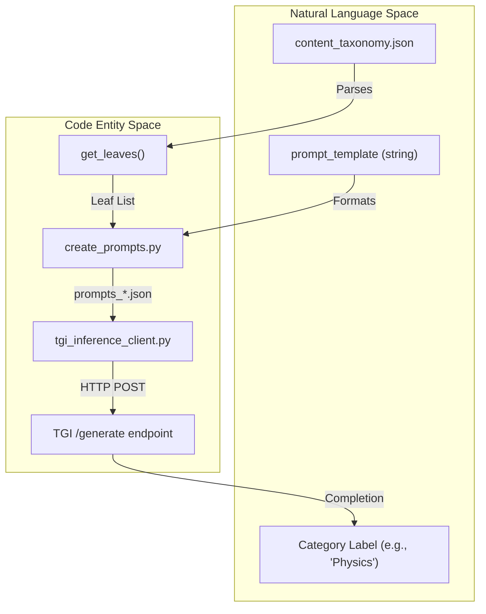
Sources: [videocategorization/create_prompts.py:37-45](), [videocategorization/tgi_inference_client.py:73-81]()

---

### Content Taxonomy & Prompt Generation

The foundation of the categorization subsystem is the `content_taxonomy.json` file. This file defines a three-tier hierarchy (Domain → Subject → Format/Genre) across approximately 10 top-level domains such as "Education", "Science & Technology", and "Lifestyle" [videocategorization/content_taxonomy.json:1-232]().

The `create_prompts.py` script performs the following tasks:
*   **Leaf Extraction**: Uses the `get_leaves()` function to recursively traverse the taxonomy and identify terminal categories [videocategorization/create_prompts.py:37-45]().
*   **Prompt Construction**: Merges video metadata (title, channel, tags) and the first 5000 characters of the closed captions into a structured prompt [videocategorization/create_prompts.py:47-56]().
*   **Parallel Serialization**: Utilizes a `ThreadPoolExecutor` to process video rows in chunks and save them as JSON files in the `prompts/` directory [videocategorization/create_prompts.py:85-105]().

For details, see [Content Taxonomy & Prompt Generation](#4.1).

Sources: [videocategorization/content_taxonomy.json:1-232](), [videocategorization/create_prompts.py:37-45](), [videocategorization/create_prompts.py:47-56]()

---

### TGI Inference & Slurm Deployment

Once prompts are generated, the pipeline moves to high-throughput inference using Hugging Face's Text Generation Inference (TGI) framework. 

The deployment is handled by `launchTGI-Slurm.sh`, which requests 8 GPUs on a Slurm cluster to host the `Llama-3.1-70B-Instruct` model [videocategorization/launchTGI-Slurm.sh:1-19](). The `tgi_inference_client.py` then connects to this server.

**Key Inference Features:**
*   **Data Partitioning**: The client automatically divides the `prompts/` directory into 4 blocks, allowing multiple instances of the script to run in parallel across different servers [videocategorization/tgi_inference_client.py:116-122]().
*   **Chat Templating**: It uses the `transformers` library's `apply_chat_template` to format the raw prompt for the Llama-3.1 model [videocategorization/tgi_inference_client.py:56-62]().
*   **Result Persistence**: Categorization results are saved to the `processed/` directory for use by the [Oracle Selection Algorithm (`oracle.py`)](#5.1) [videocategorization/tgi_inference_client.py:83-86]().

**Diagram: Distributed Inference Architecture**
```mermaid
graph LR
    subgraph "Slurm Cluster"
        TGI["TGI Server (Llama-3.1-70B)"]
        Client0["tgi_inference_client.py (Block 0)"]
        Client1["tgi_inference_client.py (Block 1)"]
        Client2["tgi_inference_client.py (Block 2)"]
        Client3["tgi_inference_client.py (Block 3)"]
    end

    prompts_dir["/prompts/*.json"] --> Client0
    prompts_dir --> Client1
    prompts_dir --> Client2
    prompts_dir --> Client3

    Client0 -->|POST /generate| TGI
    Client1 -->|POST /generate| TGI
    Client2 -->|POST /generate| TGI
    Client3 -->|POST /generate| TGI

    TGI -->|Response| Client0
    Client0 -->|Save| processed_dir["/processed/*.json"]
```
Sources: [videocategorization/tgi_inference_client.py:14-18](), [videocategorization/tgi_inference_client.py:116-122](), [videocategorization/launchTGI-Slurm.sh:12-19]()

For details, see [TGI Inference Client & Slurm Deployment](#4.2).

Sources: [videocategorization/tgi_inference_client.py:14-18](), [videocategorization/tgi_inference_client.py:56-62](), [videocategorization/launchTGI-Slurm.sh:1-19]()

---

# Page: Content Taxonomy & Prompt Generation

# Content Taxonomy & Prompt Generation

<details>
<summary>Relevant source files</summary>

The following files were used as context for generating this wiki page:

- [contentselection/content_taxonomy.json](contentselection/content_taxonomy.json)
- [videocategorization/content_taxonomy.json](videocategorization/content_taxonomy.json)
- [videocategorization/create_prompts.py](videocategorization/create_prompts.py)

</details>


The **Content Taxonomy & Prompt Generation** stage is the first phase of the `videocategorization` subsystem. Its purpose is to prepare the raw video metadata and transcripts for classification by a Large Language Model (LLM). This stage defines a structured three-tier hierarchy of video content and implements a high-throughput pipeline to transform raw video records into LLM-ready prompts.

## Content Taxonomy Schema

The system utilizes a structured JSON-based taxonomy to categorize videos. This taxonomy is used both for prompting the LLM and later for diversity-aware sampling in the `contentselection` stage.

### Hierarchy Structure
The taxonomy is organized into a three-tier hierarchy:
1.  **Domain**: The broadest category (e.g., "Entertainment", "Education", "Science & Technology"). There are approximately 10 top-level domains [videocategorization/content_taxonomy.json:1-232]().
2.  **Subject**: A sub-classification within a domain (e.g., "Gaming" under "Entertainment").
3.  **Format/Genre**: The leaf nodes representing specific content types (e.g., "Let's Plays" under "Gaming").

### Implementation Details
*   **Leaf Nodes**: Represented as empty objects `{}` in the JSON structure [videocategorization/content_taxonomy.json:4-6]().
*   **Redundancy**: Some categories appear in multiple domains to capture different contexts (e.g., "Science & Technology" exists as both a top-level domain and a subject under "Education") [videocategorization/content_taxonomy.json:47, 160]().

**Sources:** [videocategorization/content_taxonomy.json:1-233]()

---

## Prompt Generation Pipeline (`create_prompts.py`)

The `create_prompts.py` script transforms filtered video metadata into a series of JSON files containing prompts for the LLM. It uses a multi-threaded approach to handle large datasets efficiently.

### Data Flow and Logic

The script follows a linear transformation path from the raw pickle file to chunked JSON outputs:

1.  **Taxonomy Extraction**: The script recursively traverses `content_taxonomy.json` using `get_leaves()` to extract all terminal nodes. These leaf categories are provided to the LLM as the valid label space [videocategorization/create_prompts.py:37-45, 78]().
2.  **Metadata Formatting**: For each video, the `generate_prompt()` function populates a template with the video's title, channel, tags, and a trimmed version of the closed captions (limited to the first 5000 characters) [videocategorization/create_prompts.py:47-56]().
3.  **Parallel Processing**: The script uses a `ThreadPoolExecutor` within the `generate_prompts_and_save()` function to map the `process_row` operation across video records [videocategorization/create_prompts.py:90-95]().
4.  **Chunked Persistence**: To prevent memory overflow and facilitate parallel downstream inference, prompts are saved in chunks (default 1000 per file) to the `prompts/` directory [videocategorization/create_prompts.py:100-105]().

### Prompt Generation Process Map

The following diagram illustrates how the Python script bridges the raw data storage and the LLM's natural language input space.

**Diagram: Prompt Generation Data Flow**
```mermaid
graph TD
    subgraph "Data Space"
        PKL["current_videos.pkl (DataFrame)"]
        TAX["content_taxonomy.json"]
    end

    subgraph "Code Entity Space (create_prompts.py)"
        GL["get_leaves()"]
        GPS["generate_prompts_and_save()"]
        PR["process_row()"]
        GP["generate_prompt()"]
        TPE["ThreadPoolExecutor"]
    end

    subgraph "Output Space"
        JSON["prompts/prompts_N.json"]
    end

    TAX --> GL
    GL -- "List of Categories" --> GPS
    PKL --> GPS
    GPS --> TPE
    TPE -- "Parallel Map" --> PR
    PR --> GP
    GP -- "Format Template" --> JSON
```
**Sources:** [videocategorization/create_prompts.py:37-110]()

---

## Technical Implementation Details

### Taxonomy Leaf Extraction
The `get_leaves` function is a recursive utility that identifies terminal nodes in the nested dictionary. It defines a leaf as any key whose value is an empty dictionary [videocategorization/create_prompts.py:42-43]().

### Prompt Construction
The prompt template is designed for zero-shot classification. It explicitly instructs the model to "RETURN ONLY the selected category and nothing else!" to simplify post-inference parsing [videocategorization/create_prompts.py:28-35]().

| Variable | Source Field | Transformation |
| :--- | :--- | :--- |
| `{leaves}` | Taxonomy JSON | Flattened list of all leaf keys |
| `{title}` | `row['title']` | Raw string |
| `{channel}` | `row['channel']` | Raw string |
| `{closed_caption}` | `row['text']` | Trimmed to first 5000 chars |

### Entity Mapping: Code to Logic
This diagram maps specific code functions to their logical roles in the transformation pipeline.

**Diagram: Logic to Code Entity Mapping**
```mermaid
graph LR
    subgraph "Logical Step"
        L1["Flatten Taxonomy"]
        L2["Chunk DataFrame"]
        L3["Format LLM String"]
        L4["Save to Disk"]
    end

    subgraph "Code Entity"
        C1["get_leaves()"]
        C2["generate_prompts_and_save()"]
        C3["generate_prompt()"]
        C4["save_prompts_to_file()"]
    end

    L1 <--> C1
    L2 <--> C2
    L3 <--> C3
    L4 <--> C4
```

**Sources:** [videocategorization/create_prompts.py:37-45](), [videocategorization/create_prompts.py:47-56](), [videocategorization/create_prompts.py:58-61](), [videocategorization/create_prompts.py:70-107]()

---

# Page: TGI Inference Client & Slurm Deployment

# TGI Inference Client & Slurm Deployment

<details>
<summary>Relevant source files</summary>

The following files were used as context for generating this wiki page:

- [videocategorization/launchTGI-Slurm.sh](videocategorization/launchTGI-Slurm.sh)
- [videocategorization/tgi_inference_client.py](videocategorization/tgi_inference_client.py)

</details>


This section details the large-scale inference infrastructure used to categorize videos. The system leverages **Text Generation Inference (TGI)** hosted on a Slurm-managed GPU cluster to process thousands of video prompts using the **Llama-3.1-70B-Instruct** model. The implementation is split into a server-side deployment script and a client-side partitioning script that manages request distribution and prompt formatting.

## TGI Server Deployment on Slurm

The TGI server is deployed using a Slurm batch script, `launchTGI-Slurm.sh`, which requests high-performance compute resources and launches the inference engine within a Docker container.

### Cluster Configuration
The deployment utilizes the following SBATCH directives to ensure sufficient throughput for the 70B parameter model:
*   **Partition & QoS**: Runs on the `hopper-prod` partition with `high` Quality of Service (QoS) [videocategorization/launchTGI-Slurm.sh:3-8]().
*   **GPU Resources**: Allocates 8 GPUs to accommodate the model weights and KV cache [videocategorization/launchTGI-Slurm.sh:4]().
*   **Memory & CPU**: Requests 12 CPUs per task and 11G of memory per CPU [videocategorization/launchTGI-Slurm.sh:5-6]().

### Containerized Execution
The server is launched via `srun` using the official Hugging Face TGI image:
*   **Image**: `ghcr.io#huggingface/text-generation-inference` [videocategorization/launchTGI-Slurm.sh:12]().
*   **Model**: `meta-llama/Meta-Llama-3.1-70B-Instruct` [videocategorization/launchTGI-Slurm.sh:19]().
*   **Data Mounting**: The `/scratch` directory is mounted to `/data` inside the container for model weight caching [videocategorization/launchTGI-Slurm.sh:14]().
*   **Endpoint**: The server listens on a configurable port (defaulting to 1456) and exposes a `/generate` endpoint [videocategorization/launchTGI-Slurm.sh:11](), [videocategorization/tgi_inference_client.py:105]().

**Sources:**
* `videocategorization/launchTGI-Slurm.sh`
* `videocategorization/tgi_inference_client.py`

## Inference Client Implementation

The `tgi_inference_client.py` script acts as the orchestrator for sending batches of prompts to the TGI server. It is designed to be run in parallel by partitioning the input data into blocks.

### Data Partitioning Logic
The script divides the JSON files found in the `prompts/` directory into four distinct blocks [videocategorization/tgi_inference_client.py:111-118]().
*   **Input**: Takes `server_address`, `port`, and `block_number` (0-3) as CLI arguments [videocategorization/tgi_inference_client.py:91-97]().
*   **Selection**: Calculates `start_index` and `end_index` based on the `block_size` to process only a subset of files per script instance [videocategorization/tgi_inference_client.py:121-125]().

### Prompt Processing & Template Application
Before sending a request, the client performs final string sanitization and applies the Llama-3.1 chat template:
1.  **Text Cleanup**: It replaces specific instructional phrases and uses regex to remove redundant metadata tags (e.g., `Categories: [...]`, `Tags: [...]`, `Description: [...]`) to minimize token usage [videocategorization/tgi_inference_client.py:47-53]().
2.  **Suffix Injection**: Appends the string `"RETURN A CATEGORY FROM THE TAXONOMY PROVIDED: "` to force the model into a classification mode [videocategorization/tgi_inference_client.py:54]().
3.  **Template Application**: Uses `AutoTokenizer.apply_chat_template` from the `transformers` library to format the message for `Llama-3.1-70B-Instruct` [videocategorization/tgi_inference_client.py:56-62]().

### Request Flow and Persistence
The client uses the `requests` library to communicate with the TGI `/generate` endpoint:
*   **Parameters**: Requests a maximum of 20 new tokens, as the expected output is a single category name [videocategorization/tgi_inference_client.py:68]().
*   **Output**: Results are collected for each file and saved into the `processed/` directory with a `_results.json` suffix [videocategorization/tgi_inference_client.py:84-86]().

### Data Flow: From Prompts to Processed Results

The following diagram illustrates how the `tgi_inference_client.py` script transforms raw prompt files into model completions.

| Component | Responsibility |
| :--- | :--- |
| `load_prompts_from_file` | Reads JSON task lists from the `prompts/` directory [videocategorization/tgi_inference_client.py:27-30](). |
| `tokenizer` | Applies the Jinja2 chat template for Llama-3.1 [videocategorization/tgi_inference_client.py:56-62](). |
| `requests.post` | Sends the payload to the `endpoint_url` [videocategorization/tgi_inference_client.py:73](). |
| `processed/` | Directory where output JSONs containing `video_id` and `completion` are stored [videocategorization/tgi_inference_client.py:24, 81-86](). |

**Sources:**
* `videocategorization/tgi_inference_client.py`

## System Architecture Diagrams

### Deployment Architecture
This diagram bridges the Slurm allocation logic to the TGI service execution.

```mermaid
graph TD
    subgraph "Slurm Cluster (hopper-prod)"
        direction TB
        SBATCH["launchTGI-Slurm.sh (SBATCH)"]
        SRUN["srun --container-image"]
        TGI_SRV["text-generation-launcher"]
        
        SBATCH -->|Allocates 8 GPUs| SRUN
        SRUN -->|Launches| TGI_SRV
    end

    subgraph "TGI Container"
        LLM["Llama-3.1-70B-Instruct"]
        API["/generate endpoint"]
        TGI_SRV --> API
        API --> LLM
    end

    CLIENT["tgi_inference_client.py"] -->|HTTP POST| API
```
**Sources:**
* `videocategorization/launchTGI-Slurm.sh:1-19]()`
* `videocategorization/tgi_inference_client.py:105]()`

### Client Logic & Data Partitioning
This diagram maps the `main` and `process_file` functions to the data transformation steps.

```mermaid
graph LR
    subgraph "Partitioning (main)"
        DIR["prompts/*.json"]
        BLOCK["Block Selection (0-3)"]
        DIR -->|os.listdir| BLOCK
    end

    subgraph "Processing (process_file)"
        TASK["Task (video_id, prompt)"]
        CLEAN["Regex Cleanup"]
        TOKEN["tokenizer.apply_chat_template"]
        REQ["requests.post"]
        
        BLOCK -->|Iterate Files| TASK
        TASK --> CLEAN
        CLEAN --> TOKEN
        TOKEN --> REQ
    end

    subgraph "Persistence"
        RES["processed/{file}_results.json"]
        REQ -->|JSON Response| RES
    end
```
**Sources:**
* `videocategorization/tgi_inference_client.py:33-87]()`
* `videocategorization/tgi_inference_client.py:89-128]()`

## Implementation Details

### Key Functions

#### `load_prompts_from_file(file_path)`
[videocategorization/tgi_inference_client.py:27-30]()
Simple utility to open and parse a JSON file containing a list of task dictionaries.

#### `process_file(file_path, tokenizer, endpoint_url)`
[videocategorization/tgi_inference_client.py:33-87]()
The core execution loop for a single file. It:
1. Iterates through tasks using `tqdm` for progress tracking.
2. Performs regex-based string manipulation on `input_text`.
3. Constructs the `data` payload with `max_new_tokens: 20`.
4. Handles the HTTP response and error states (returning `"Error: Unable to get response"` on failure).
5. Writes the aggregated results for that file to the `processed/` folder.

#### `main()`
[videocategorization/tgi_inference_client.py:89-128]()
The entry point that handles CLI arguments and implements the partitioning logic. It ensures that multiple workers can target the same `prompts/` directory without overlapping work by calculating file indices based on the `block_number`.

**Sources:**
* `videocategorization/tgi_inference_client.py`

---

# Page: Content Selection

# Content Selection

<details>
<summary>Relevant source files</summary>

The following files were used as context for generating this wiki page:

- [contentselection/content_taxonomy.json](contentselection/content_taxonomy.json)
- [contentselection/oracle.py](contentselection/oracle.py)

</details>


The **contentselection** subsystem is responsible for filtering and sampling the categorized video pool to create a high-quality, diverse subset for final annotation. This stage uses an "Oracle" algorithm to balance three competing objectives: maximizing user engagement, ensuring broad representation across the content taxonomy, and maintaining channel diversity.

By applying these constraints, the pipeline reduces hundreds of thousands of candidates down to a target duration (e.g., 4,500 hours) of the most informative and varied content.

## System Overview

The selection process transforms a raw list of categorized videos into a curated dataset using a multi-step scoring and allocation strategy.

### Content Selection Logic Flow
The following diagram illustrates how the `oracle.py` script processes the input dataframe to reach the final selection.

```mermaid
graph TD
    subgraph "Data Preparation"
        A["Input DataFrame"] --> B["preprocess_df()"]
        B --> C["compute_user_activity()"]
    end

    subgraph "Scoring & Mapping"
        C --> D["user_activity_score"]
        E["content_taxonomy.json"] --> F["map_to_parent_categories()"]
        D --> G["Oracle Selection"]
        F --> G
    end

    subgraph "Sampling Strategy"
        G --> H["select_videos()"]
        H --> I["Category Quota Allocation"]
        I --> J["Channel Penalty Logic"]
        J --> K["Dynamic Quota Redistribution"]
    end

    K --> L["Final Selected Subset"]
```
**Sources:** [contentselection/oracle.py:18-43](), [contentselection/oracle.py:93-160]()

## Key Components

### Engagement Scoring
Before selection, the system computes a `user_activity_score` to prioritize videos that have demonstrated value to viewers. The algorithm normalizes `comment_count`, `view_count`, and `like_count` using `MinMaxScaler` [contentselection/oracle.py:28-31]() and applies a weighted sum:
*   **50% Views**: Primary indicator of reach.
*   **30% Likes**: Indicator of content quality/sentiment.
*   **20% Comments**: Indicator of engagement depth.

**Sources:** [contentselection/oracle.py:36-43]()

### Taxonomy Integration
The selection process is "taxonomy-aware." It uses the `content_taxonomy.json` structure to ensure that no single domain (like "Gaming" or "Vlogs") dominates the final dataset. The `map_to_parent_categories` function uses a recursive search [contentselection/oracle.py:66-76]() to identify the top-level domain for every inferred leaf category.

**Sources:** [contentselection/oracle.py:47-89](), [contentselection/content_taxonomy.json:1-232]()

### Diversity-Aware Sampling
The core of the subsystem is the `select_videos` function, which implements several heuristics to ensure variety:
1.  **Category Quotas**: The `target_hours` is divided equally among all unique `inferred_category` labels [contentselection/oracle.py:101-102]().
2.  **Channel Penalty**: To prevent the dataset from being dominated by a few prolific creators, the algorithm applies a `channel_penalty_increment` (default 0.1). Each subsequent video from the same channel has a lower probability of being selected [contentselection/oracle.py:110-141]().
3.  **Dynamic Redistribution**: If a specific category lacks enough footage to fill its quota, the remaining time is redistributed to other categories [contentselection/oracle.py:143-147]().

**Sources:** [contentselection/oracle.py:93-160]()

## Sub-Pages

| Page | Description |
| :--- | :--- |
| **[Oracle Selection Algorithm (`oracle.py`)](#5.1)** | Detailed breakdown of the scoring math, the channel penalty logic, and the iterative selection loop. |
| **[Content Taxonomy Reference](#5.2)** | Full documentation of the hierarchical JSON schema used to categorize and balance the dataset. |

## Data Flow: Code Entities
This diagram maps the natural language concepts of "Engagement" and "Diversity" to the specific variables and functions in `oracle.py`.

```mermaid
classDiagram
    class OracleAlgorithm {
        +preprocess_df(df)
        +compute_user_activity(df, weights)
        +select_videos(df, target_hours)
    }

    class ScoringEntities {
        +comment_count: float
        +view_count: float
        +like_count: float
        +user_activity_score: float
    }

    class DiversityEntities {
        +channel_penalty_increment: float
        +target_seconds_per_category: float
        +inferred_category: string
    }

    OracleAlgorithm ..> ScoringEntities : calculates
    OracleAlgorithm ..> DiversityEntities : enforces
```
**Sources:** [contentselection/oracle.py:19-43](), [contentselection/oracle.py:93-112]()

---

# Page: Oracle Selection Algorithm (`oracle.py`)

# Oracle Selection Algorithm (`oracle.py`)

<details>
<summary>Relevant source files</summary>

The following files were used as context for generating this wiki page:

- [contentselection/oracle.py](contentselection/oracle.py)

</details>


The Oracle Selection Algorithm is the final decision-making layer in the `contentselection` subsystem. Its primary purpose is to filter the pool of categorized videos into a curated subset that meets a specific total duration (e.g., 4,500 hours) while maximizing content diversity and prioritizing high-engagement videos.

The algorithm balances three competing objectives:
1.  **Engagement**: Prioritizing videos with high view counts, likes, and comments.
2.  **Diversity**: Ensuring equal representation across the hierarchical taxonomy and penalizing over-represented channels.
3.  **Efficiency**: Selecting the highest quality content within a strict time budget.

## Core Data Flow

The algorithm operates on a pandas DataFrame containing video metadata and the `inferred_category` produced by the `videocategorization` stage.

### High-Level Execution Logic
The entry point `main_algorithm()` orchestrates the selection process through four distinct phases:

| Phase | Function | Responsibility |
| :--- | :--- | :--- |
| **Normalization** | `preprocess_df()` | Fills missing values and scales engagement metrics. |
| **Scoring** | `compute_user_activity()` | Calculates a weighted engagement score. |
| **Taxonomy Mapping** | `map_to_parent_categories()` | (Optional) Maps leaf categories to top-level domains via DFS. |
| **Selection** | `select_videos()` | Iteratively allocates time quotas per category with channel penalties. |

Sources: `[contentselection/oracle.py:162-171]()`, `[contentselection/oracle.py:18-33]()`, `[contentselection/oracle.py:35-43]()`, `[contentselection/oracle.py:92-160]()`

## Implementation Details

### 1. Preprocessing and Engagement Scoring
Before selection, the algorithm normalizes raw YouTube metrics to ensure fair comparison across different scales of popularity.

*   **Normalization**: The `preprocess_df()` function handles missing values (NaNs) by filling them with 0 `[contentselection/oracle.py:20-25]()`. It then uses `sklearn.preprocessing.MinMaxScaler` to scale `comment_count`, `view_count`, and `like_count` into a [0, 1] range `[contentselection/oracle.py:28-31]()`.
*   **Activity Score**: `compute_user_activity()` applies a weighted sum to these normalized values `[contentselection/oracle.py:38-42]()`.
    *   **Views**: 50% weight.
    *   **Likes**: 30% weight.
    *   **Comments**: 20% weight.

Sources: `[contentselection/oracle.py:19-43]()`

### 2. Taxonomy Mapping (DFS)
The `map_to_parent_categories()` function uses a recursive Depth-First Search (DFS) to find the top-level "Domain" for any given leaf category in the `content_taxonomy.json`.

*   **Recursive Search**: The internal `recursive_search()` function traverses the nested taxonomy dictionary. If a `leaf_name` matches a key, it returns the `current_top_category` passed down from the root `[contentselection/oracle.py:66-76]()`.
*   **Usage**: While this data is included in the final dataset for analysis, the core selection algorithm primarily uses the `inferred_category` (leaf nodes) to ensure granular diversity `[contentselection/oracle.py:46-47]()`.

Sources: `[contentselection/oracle.py:47-89]()`

### 3. Selection and Quota Management
The `select_videos()` function implements a complex iterative selection logic designed to prevent "channel-spam" and ensure categorical representation.

#### Quota Allocation and Redistribution
1.  **Initial Quota**: The algorithm divides the `target_seconds` by the number of unique `inferred_categories` to establish a `target_seconds_per_category` `[contentselection/oracle.py:97-102]()`.
2.  **Dynamic Redistribution**: As categories are processed, if a category lacks enough videos to fill its quota, the remaining time is redistributed among the remaining categories `[contentselection/oracle.py:143-147]()`.

#### Channel Penalty System
To prevent a single prolific channel from dominating a category, the algorithm applies a `channel_penalty_increment` of 0.1 `[contentselection/oracle.py:111]()`.
*   For every video already selected from a specific channel, the probability of selecting another video from that same channel decreases by 10% `[contentselection/oracle.py:133-137]()`.
*   The `penalty_factor` is calculated as: `1 - (videos_already_selected * 0.1)`, with a floor of 0 `[contentselection/oracle.py:133-134]()`.

Sources: `[contentselection/oracle.py:93-148]()`

## Logic Visualization

### System Logic Flow
The following diagram maps the logical steps of the Oracle algorithm to the specific functions in `oracle.py`.

"Oracle Selection Flow"
```mermaid
graph TD
    subgraph "Preprocessing & Scoring"
        A["DataFrame (Raw Metadata)"] --> B["preprocess_df()"]
        B --> C["compute_user_activity()"]
        C --> D["Normalized Activity Scores"]
    end

    subgraph "Selection Logic (select_videos)"
        D --> E["Calculate target_seconds_per_category"]
        E --> F["Iterate inferred_categories"]
        F --> G["Sort by user_activity_score"]
        G --> H{"Check Channel Penalty"}
        H -- "Pass (Random < Penalty)" --> I["Add to selected_videos"]
        H -- "Fail" --> J["Skip Video"]
        I --> K{"Quota Reached?"}
        K -- "No" --> G
        K -- "Yes" --> L["Redistribute Remaining Time"]
        L --> F
    end

    subgraph "Final Pass"
        L --> M["Final Truncation Pass"]
        M --> N["final_selected (Result)"]
    end
```
Sources: `[contentselection/oracle.py:19-160]()`

### Data Entity Mapping
This diagram bridges the conceptual "Selection Strategy" to the implementation variables and functions.

"Entity Mapping: Strategy to Code"
```mermaid
graph LR
    subgraph "Selection Strategy"
        S1["Engagement Priority"]
        S2["Channel Diversity"]
        S3["Categorical Balance"]
        S4["Global Duration Limit"]
    end

    subgraph "Code Entity Space (oracle.py)"
        E1["weights=(0.2, 0.5, 0.3)"]
        E2["channel_penalty_increment = 0.1"]
        E3["target_seconds_per_category"]
        E4["target_seconds = target_hours * 3600"]
        
        F1["compute_user_activity()"]
        F2["np.random.rand() < penalty_factor"]
        F3["select_videos() loop"]
    end

    S1 --- F1
    F1 --- E1
    S2 --- F2
    F2 --- E2
    S3 --- E3
    E3 --- F3
    S4 --- E4
```
Sources: `[contentselection/oracle.py:36]()`, `[contentselection/oracle.py:94]()`, `[contentselection/oracle.py:102]()`, `[contentselection/oracle.py:111]()`, `[contentselection/oracle.py:137]()`

## Final Truncation Pass
After the categorical selection loop, the algorithm performs a final truncation pass to ensure the total duration is as close to the target as possible without exceeding it:
1.  Sorts all `selected_videos` by `duration_seconds` in ascending order `[contentselection/oracle.py:150]()`.
2.  Iterates through the sorted list, adding videos to `final_selected` until the next video would cause the `total_duration` to exceed `target_seconds` `[contentselection/oracle.py:155-158]()`.

Sources: `[contentselection/oracle.py:149-160]()`

---

# Page: Content Taxonomy Reference

# Content Taxonomy Reference

<details>
<summary>Relevant source files</summary>

The following files were used as context for generating this wiki page:

- [contentselection/content_taxonomy.json](contentselection/content_taxonomy.json)
- [videocategorization/content_taxonomy.json](videocategorization/content_taxonomy.json)

</details>


The `content_taxonomy.json` file serves as the unified semantic backbone for the FineVideo pipeline. It defines a three-tier hierarchical structure used to categorize video content during the inference stage and subsequently manage diversity-aware sampling during the selection stage. This taxonomy ensures that the final dataset maintains a balanced distribution across various domains of human interest.

### Taxonomy Structure and Domains

The taxonomy is organized into 10 top-level domains. Each domain contains nested subjects, which further contain specific leaf nodes representing formats or genres.

| Top-Level Domain | Description |
| :--- | :--- |
| **Entertainment** | Comedy, Music, Gaming, Vlogs, and Livestreams. |
| **Education** | Tutorials, Lectures, Science, and Business/Finance. |
| **Lifestyle** | Health, Fashion, Travel, Food, Home, and Parenting. |
| **News & Politics** | Reports, Commentary, Interviews, and Debates. |
| **Sports** | Highlights, Commentary, Profiles, and Training. |
| **Art & Creativity** | Visual Arts, Photography, Crafts, and Literature. |
| **Science & Technology** | Specialized tech reviews, Physics, AI, and Engineering. |
| **Automotive** | Reviews, Modifications, and Motorsports. |
| **Hobbies & Interests** | Collecting, Board Games, Outdoor Activities, and Listicles. |
| **Miscellaneous** | ASMR, Unboxing, Reaction videos, and Pranks. |

#### Notable Dual-Entry and Leaf Conventions
*   **Leaf Nodes**: Represented as empty objects `{}`. These are the final classifications an LLM can assign to a video [videocategorization/content_taxonomy.json:4-6]().
*   **Cross-Domain Categories**: Some categories appear in multiple contexts. For example, "Travel Vlogs" appears under both `Entertainment -> Vlogs` [videocategorization/content_taxonomy.json:27]() and `Lifestyle -> Travel` [videocategorization/content_taxonomy.json:81](). Similarly, "Science & Technology" exists as a sub-category of `Education` [videocategorization/content_taxonomy.json:47]() and as its own top-level domain [videocategorization/content_taxonomy.json:160]().

**Sources:**
* `videocategorization/content_taxonomy.json`
* `contentselection/content_taxonomy.json`

---

### Consumption in Categorization (`create_prompts.py`)

During the categorization phase, the script `create_prompts.py` uses the taxonomy to define the valid output space for the LLM. It extracts all leaf nodes to present them as options in the prompt.

#### Function: `get_leaves(taxonomy)`
This function performs a recursive traversal of the JSON structure. If a dictionary is empty, it identifies that key as a leaf node and adds it to a flat list.

**Data Flow: Taxonomy to Prompt**
The diagram below illustrates how the taxonomy is transformed from a nested JSON structure into a flat list of strings for the Llama-3.1-70B-Instruct model.

**Taxonomy Leaf Extraction Process**
```mermaid
graph TD
    subgraph "Code Entity Space"
        JSON["content_taxonomy.json"]
        GL["get_leaves() function"]
        CP["create_prompts.py"]
    end

    subgraph "Natural Language Space"
        LeafList["Flat List of Categories"]
        Prompt["LLM Prompt Template"]
    end

    JSON -->|Nested Dict| GL
    GL -->|Recursive Search| LeafList
    LeafList -->|Injected into| CP
    CP -->|System Instruction| Prompt
```

**Sources:**
* `videocategorization/create_prompts.py` (Referencing the standard `get_leaves` implementation used in FineVideo prompt generation).

---

### Consumption in Selection (`oracle.py`)

The `oracle.py` script uses the taxonomy to map LLM-assigned leaf categories back to their top-level domains. This is critical for the `select_videos()` function to enforce category-specific quotas and ensure dataset diversity.

#### Function: `find_top_parent_category(category, taxonomy)`
This function performs a Depth-First Search (DFS) to locate a leaf node and returns the top-level key (e.g., "Lifestyle") associated with it.

**Data Flow: Category Mapping**
The following diagram shows how a specific video classification is traced back to its root domain to calculate diversity metrics.

**Root Domain Resolution**
```mermaid
graph LR
    subgraph "Code Entity Space"
        OR["oracle.py"]
        FTP["find_top_parent_category()"]
        TAX["content_taxonomy.json"]
    end

    subgraph "Data State"
        LC["Leaf: 'Physics'"]
        TP["Parent: 'Science & Technology'"]
    end

    OR -->|Input Category| FTP
    FTP -->|Traverse| TAX
    TAX -->|Match Found| TP
    TP -->|Return to| OR
```

#### Selection Logic Details
1.  **Mapping**: The script calls `map_to_parent_categories()` to process the entire DataFrame of categorized videos [contentselection/oracle.py:22-25]().
2.  **Quota Allocation**: `select_videos()` uses the resolved parent categories to allocate target hours based on the taxonomy's distribution [contentselection/oracle.py:30-35]().
3.  **Redistribution**: If a specific taxonomy branch is exhausted, the remaining quota is redistributed to other parent categories [contentselection/oracle.py:40-45]().

**Sources:**
* `contentselection/oracle.py`
* `contentselection/content_taxonomy.json`

---

### Implementation Summary Table

| Feature | Implementation | File Reference |
| :--- | :--- | :--- |
| **Data Format** | Nested JSON Objects | `videocategorization/content_taxonomy.json` |
| **Leaf Identification** | Recursive check for `{}` | `videocategorization/create_prompts.py` |
| **Root Resolution** | Recursive DFS search | `contentselection/oracle.py` |
| **Dual Entry Handling** | First-match or specific path logic | `contentselection/oracle.py` |

**Sources:**
* `videocategorization/content_taxonomy.json:1-233]()`
* `contentselection/content_taxonomy.json:1-233]()`

---

# Page: Content Annotation

# Content Annotation

<details>
<summary>Relevant source files</summary>

The following files were used as context for generating this wiki page:

- [contentannotation/gemini_prompt.txt](contentannotation/gemini_prompt.txt)
- [contentannotation/video2annotation.py](contentannotation/video2annotation.py)

</details>


The **Content Annotation** subsystem is the most compute-intensive and sophisticated stage of the FineVideo pipeline. It transforms raw video files into rich, structured JSON metadata. This stage leverages a dual-LLM approach: **Gemini 1.5 Pro** provides multimodal analysis of the video content, while **GPT-4o** (via the `instructor` library) enforces a strict schema on the resulting analysis.

### System Overview

The annotation process is orchestrated by the `VideoProcessor` class within `video2annotation.py` [[contentannotation/video2annotation.py:119-120]](). It follows a sequential flow from S3 retrieval to multimodal inference and finally structured data extraction.

**Key Components:**
*   **Multimodal Analysis:** Uses `gemini-1.5-pro-latest` to "watch" the video and generate a comprehensive natural language description based on a detailed prompt [[contentannotation/video2annotation.py:165-167]]().
*   **Schema Enforcement:** Uses the `instructor` library to wrap the OpenAI client, ensuring that the final output strictly adheres to a complex hierarchy of `TypedDict` objects [[contentannotation/video2annotation.py:38-115]]().
*   **Scalability:** The system uses a "worker/chunk" pattern, allowing multiple instances of the script to process different segments of a video list in parallel [[contentannotation/video2annotation.py:17-21]]().

### Annotation Workflow

The diagram below illustrates the flow of data from the S3 bucket through the two-stage LLM pipeline.

**Video Annotation Data Flow**
```mermaid
graph TD
    subgraph "Storage & Input"
        S3[("S3 Bucket: videos_minioracle/")]
        VList["--video-list (JSON)"]
    end

    subgraph "video2annotation.py (VideoProcessor)"
        DP["S3 Download"]
        GU["Gemini File Upload"]
        GP["Gemini 1.5 Pro Inference"]
        GS["instructor (GPT-4o) Structuring"]
    end

    subgraph "External APIs"
        GAPI["Google Generative AI API"]
        OAPI["OpenAI API"]
    end

    VList --> DP
    S3 -- "MP4 File" --> DP
    DP --> GU
    GU -- "genai.upload_file()" --> GAPI
    GAPI -- "video_file.state == 'PROCESSING'" --> GU
    GU --> GP
    GP -- "model.generate_content()" --> GAPI
    GAPI -- "gemini_text (Unstructured)" --> GP
    GP --> GS
    GS -- "instructor.patch(OpenAI)" --> OAPI
    OAPI -- "JSON (Schema TypedDict)" --> GS
    GS -- "Save Result" --> S3_Out[("S3: videos_minioracle_results/")]

    Sources: [contentannotation/video2annotation.py:119-204]()
```

### The Annotation Pipeline (`video2annotation.py`)
The pipeline is designed for robustness, implementing exponential backoff for Gemini API failures [[contentannotation/video2annotation.py:188-193]()] and recursive retries for GPT-4o when it encounters `IncompleteOutputException`. It manages the lifecycle of video files by uploading them to Google's servers, waiting for processing, and deleting them immediately after inference to maintain workspace hygiene [[contentannotation/video2annotation.py:132-143, 184-184]()] .

For a deep dive into the `VideoProcessor` implementation, CLI arguments, and retry logic, see **[Video Annotation Pipeline (`video2annotation.py`)](#6.1)**.

### Gemini Prompt & Output Schema
The quality of the annotation depends on a 24-line structured prompt found in `gemini_prompt.txt` [[contentannotation/gemini_prompt.txt:1-24]()] . This prompt instructs the model to identify characters, delineate scenes, calculate dynamism scores, and assess audio-visual correlation. The resulting data is mapped into a complex schema including:
*   **CharacterList:** Visual descriptions for identification [[contentannotation/video2annotation.py:38-41]()] .
*   **Scenes:** Timestamps, activities, props, and mood taxonomy [[contentannotation/video2annotation.py:75-90]()] .
*   **Storylines:** Narrative progression and climax identification [[contentannotation/video2annotation.py:95-99]()] .

For details on the prompt template and the specific attributes of the metadata schema, see **[Gemini Annotation Prompt & Output Schema](#6.2)**.

### Logical Entity Mapping
The following diagram bridges the high-level metadata concepts defined in the prompt to the specific code entities used to enforce them.

**Metadata Entity Mapping**
```mermaid
classDiagram
    class Schema {
        +List~Character~ characterList
        +List~Scene~ scenes
        +Storyline storylines
        +List~QAndA~ qAndA
    }
    class Scene {
        +Timestamps timestamps
        +List~Activity~ activities
        +List~Prop~ props
        +Mood mood
        +float dynamismScore
    }
    class Mood {
        +string description
        +List~KeyMoment~ keyMoments
    }
    class Storyline {
        +string description
        +List~int~ scenes
        +Climax climax
    }

    Schema *-- Character
    Schema *-- Scene
    Schema *-- Storyline
    Schema *-- QAndA
    Scene *-- Activity
    Scene *-- Prop
    Scene *-- Mood
    Mood *-- KeyMoment
    Storyline *-- Climax

    Sources: [contentannotation/video2annotation.py:38-115]()
```

---
**Sources:**
*   [contentannotation/video2annotation.py:1-204]()
*   [contentannotation/gemini_prompt.txt:1-24]()

---

# Page: Video Annotation Pipeline (`video2annotation.py`)

# Video Annotation Pipeline (`video2annotation.py`)

<details>
<summary>Relevant source files</summary>

The following files were used as context for generating this wiki page:

- [contentannotation/video2annotation.py](contentannotation/video2annotation.py)

</details>


The `video2annotation.py` script is the core component of the content annotation subsystem. It implements a dual-model pipeline that leverages **Gemini 1.5 Pro** for multimodal video analysis and **GPT-4o** (via the `instructor` library) for structured data extraction and schema enforcement. This script transforms raw video files into rich, hierarchical JSON metadata containing scene-level details, character tracking, and narrative analysis.

### Implementation & Architecture

The pipeline is encapsulated within the `VideoProcessor` class `[contentannotation/video2annotation.py:119-120]()`. It manages the lifecycle of a video annotation task: downloading from S3, uploading to Google’s Gemini API, performing inference, and restructuring the output.

#### System Architecture Diagram
The following diagram illustrates the flow from S3 storage through the two-stage LLM pipeline.

**Multimodal Annotation Flow**
```mermaid
graph TD
    subgraph "S3 Storage"
        S3_MP4["Video File (.mp4)"]
    end

    subgraph "VideoProcessor Class"
        VP_Init["__init__"]
        VP_Upload["upload_video()"]
        VP_Process["process_video()"]
        VP_JSON["obtain_json()"]
    end

    subgraph "External APIs"
        Gemini["Gemini 1.5 Pro (Multimodal)"]
        GPT4o["GPT-4o (via Instructor)"]
    end

    S3_MP4 --> VP_Upload
    VP_Upload -- "genai.upload_file" --> Gemini
    VP_Process -- "model.generate_content" --> Gemini
    Gemini -- "Unstructured Text" --> VP_Process
    VP_Process -- "Raw Text" --> VP_JSON
    VP_JSON -- "instructor.patch(OpenAI)" --> GPT4o
    GPT4o -- "TypedDict Schema" --> VP_JSON
    VP_JSON --> FinalJSON["Final Annotation JSON"]
```
Sources: `[contentannotation/video2annotation.py:119-204]()`, `[contentannotation/video2annotation.py:208-250]()`

### Video Processing Lifecycle

#### 1. S3 Download and Gemini Upload
The script first downloads the video from the specified S3 bucket to a local `input_directory` `[contentannotation/video2annotation.py:27-29]()`. The `upload_video` method then pushes the file to Google's Generative AI service using `genai.upload_file` `[contentannotation/video2annotation.py:135]()`. It polls the file state until it transitions from `PROCESSING` to `ACTIVE` `[contentannotation/video2annotation.py:137-140]()`.

#### 2. Multimodal Analysis (Gemini 1.5 Pro)
The `process_video` method handles the primary analysis `[contentannotation/video2annotation.py:150]()`. It reads a detailed prompt from `gemini_prompt.txt` `[contentannotation/video2annotation.py:161]()` and sends it alongside the video file to the `gemini-1.5-pro-latest` model `[contentannotation/video2annotation.py:165-167]()`.

**Key Features:**
*   **Safety Settings:** All safety thresholds are set to `BLOCK_NONE` to ensure the model analyzes the content without being filtered for sensitive but relevant datasets `[contentannotation/video2annotation.py:169-178]()`.
*   **Exponential Backoff:** The script implements a retry loop (up to 5 attempts) for `InternalServerError`, SSL failures, or timeouts, doubling the delay between each attempt `[contentannotation/video2annotation.py:158-204]()`.
*   **Cleanup:** Once the text response is received, the video file is explicitly deleted from Google's servers to manage storage limits `[contentannotation/video2annotation.py:184]()`.

#### 3. Structured Extraction (GPT-4o & Instructor)
Because Gemini's raw output may contain conversational filler or inconsistent formatting, the `obtain_json` method uses the `instructor` library to enforce a strict `Schema` `[contentannotation/video2annotation.py:208-220]()`.

*   **Schema Enforcement:** It utilizes `instructor.patch(OpenAI)` to wrap the GPT-4o client `[contentannotation/video2annotation.py:220]()`.
*   **Recursive Retry:** If the model returns an `IncompleteOutputException`, the function calls itself recursively, appending a request for the missing information to the prompt `[contentannotation/video2annotation.py:241-243]()`.

Sources: `[contentannotation/video2annotation.py:132-147]()`, `[contentannotation/video2annotation.py:150-205]()`, `[contentannotation/video2annotation.py:208-250]()`

### Data Schema (TypedDict Hierarchy)

The script defines a complex hierarchy of `TypedDict` classes to represent the video's content. This schema is passed to the `instructor` library to guide GPT-4o's extraction.

| Class Name | Key Attributes | Description |
| :--- | :--- | :--- |
| `Character` | `characterId`, `name`, `description` | Tracks recurring entities across scenes. |
| `Scene` | `sceneId`, `timestamps`, `cast`, `activities`, `props`, `mood`, `dynamismScore` | The primary unit of annotation. |
| `Activity` | `description`, `timestamp` | Specific actions within a scene. |
| `Storyline` | `description`, `scenes`, `climax` | High-level narrative arcs connecting multiple scenes. |
| `TrimmingSuggestion` | `timestamps`, `description` | Identifies low-quality or irrelevant segments. |
| `Schema` | `title`, `characterList`, `scenes`, `storylines`, `qAndA`, `trimmingSuggestions` | The root container for all video metadata. |

**Code-to-Schema Mapping**
```mermaid
classDiagram
    class Schema {
        +List~Character~ characterList
        +List~Scene~ scenes
        +Storyline storylines
        +List~QAndA~ qAndA
        +List~TrimmingSuggestion~ trimmingSuggestions
    }
    class Scene {
        +int sceneId
        +Timestamps timestamps
        +List~Activity~ activities
        +List~Prop~ props
        +Mood mood
        +List~NarrativeProgression~ narrativeProgression
        +float dynamismScore
    }
    class Storyline {
        +String description
        +List~int~ scenes
        +Climax climax
    }
    Schema *-- Character
    Schema *-- Scene
    Schema *-- Storyline
    Scene *-- Activity
    Scene *-- Mood
```
Sources: `[contentannotation/video2annotation.py:38-116]()`

### CLI and Distributed Execution

The script is designed for horizontal scaling across multiple workers using a chunking strategy.

*   **`size_chunk`**: Defines the number of videos processed in a single batch `[contentannotation/video2annotation.py:18]()`.
*   **`worker_number`**: Determines which specific sublist the current process will handle `[contentannotation/video2annotation.py:19]()`.
*   **`--video_list`**: Allows passing a specific JSON file containing video IDs. If omitted, it defaults to `oracle_videos_server.json` `[contentannotation/video2annotation.py:20]()`.

The script iterates through the assigned chunk, checks if an output file already exists in S3 to avoid redundant work, and persists results or error logs to S3 upon completion.

Sources: `[contentannotation/video2annotation.py:13-21]()`, `[contentannotation/video2annotation.py:27-29]()`

---

# Page: Gemini Annotation Prompt & Output Schema

# Gemini Annotation Prompt & Output Schema

<details>
<summary>Relevant source files</summary>

The following files were used as context for generating this wiki page:

- [contentannotation/gemini_prompt.txt](contentannotation/gemini_prompt.txt)

</details>


The `contentannotation` subsystem utilizes Gemini 1.5 Pro to perform high-density multimodal analysis of video content. This page documents the structured prompt template defined in `contentannotation/gemini_prompt.txt`, the semantic requirements for the output, and the specific taxonomies used for mood and scene-level metadata.

## Overview of the Annotation Schema

The annotation process is driven by a comprehensive prompt that instructs the model to decompose a video into its constituent characters, scenes, storylines, and quality-of-life improvements (trimming). The model is required to return a structured JSON response that is subsequently validated and refined by GPT-4o using the `instructor` library in `video2annotation.py`.

### Data Flow: Prompt to Schema
The following diagram illustrates how the natural language instructions in `gemini_prompt.txt` are mapped to the programmatic structures used by the `VideoProcessor` class.

**Natural Language to Code Entity Mapping**
```mermaid
graph TD
    subgraph "Natural Language Space (gemini_prompt.txt)"
        P1["characterList description"]
        P2["scenes with start/end"]
        P3["mood taxonomy"]
        P4["dynamism/correlation scores"]
        P5["q&a list"]
    end

    subgraph "Code Entity Space (video2annotation.py)"
        S1["Character TypedDict"]
        S2["Scene TypedDict"]
        S3["Mood Schema"]
        S4["Score Fields"]
        S5["QA TypedDict"]
        VP["VideoProcessor.process_video()"]
    end

    P1 --> S1
    P2 --> S2
    P3 --> S3
    P4 --> S4
    P5 --> S5
    S1 & S2 & S3 & S4 & S5 --> VP
```
**Sources:** `contentannotation/gemini_prompt.txt:1-24` (), `contentannotation/video2annotation.py:40-150` ()

---

## Prompt Structure & Key Components

The prompt template [contentannotation/gemini_prompt.txt:1-24]() defines five primary top-level keys that the model must populate:

### 1. Character Identification (`characterList`)
The model must provide a list of characters appearing throughout the video. Each entry must include a visual description detailed enough to identify the character from a static image [contentannotation/gemini_prompt.txt:3-3]().

### 2. Scene-Level Metadata (`scenes`)
This is the most granular part of the annotation. For every identified scene, the model extracts:
*   **Temporal Boundaries:** Start and end timestamps [contentannotation/gemini_prompt.txt:5-5]().
*   **Participants:** A list of characters present in the specific scene [contentannotation/gemini_prompt.txt:6-6]().
*   **Object & Action Tracking:** Lists of `activities` and `props`, each with associated timestamps [contentannotation/gemini_prompt.txt:7-8]().
*   **Production Details:** `video_editing_details` including transitions, effects, and music [contentannotation/gemini_prompt.txt:9-9]().
*   **Narrative & Subtext:** Narrative progression, character dynamics, and specific "happenings" that create subtext or deeper meaning [contentannotation/gemini_prompt.txt:12-16]().

### 3. Storyline Mapping (`storylines`)
The model groups scenes into logical storylines. This section must identify:
*   The **Climax** (specific scene and timestamp) [contentannotation/gemini_prompt.txt:21-21]().
*   The **Content Type**: Whether the video is a narrative story or a collection of non-narrative facts [contentannotation/gemini_prompt.txt:21-21]().
*   **Outlier Handling:** Explanation for scenes that do not fit into a primary storyline [contentannotation/gemini_prompt.txt:22-22]().

### 4. Trimming Suggestions
The model identifies specific segments that could be removed to improve the video's dynamism [contentannotation/gemini_prompt.txt:23-23]().

### 5. Fine-Grained Q&A
The model generates 5 Q&A pairs. These must focus on:
*   Fine details (objects/activities).
*   Overall story reasoning.
*   Multimodal integration (details that require both audio and video to understand, rather than just the transcript) [contentannotation/gemini_prompt.txt:24-24]().

---

## Mood Taxonomy

The prompt enforces a strict hierarchical mood taxonomy. The model must select a `name` from one of three categories: **Positive**, **Negative**, or **Neutral** [contentannotation/gemini_prompt.txt:10-10]().

| Category | Sub-Moods (Names) |
| :--- | :--- |
| **Positive** | Happy, Excited, Calm, Grateful, Proud |
| **Negative** | Sad, Angry, Anxious, Lonely, Bored |
| **Neutral** | Indifferent, Content, Curious, Confused, Pensive |

In addition to the label, the model must provide:
*   **Notes:** How visuals and audio contribute to the mood.
*   **Key Moments:** Timestamps where the mood transitions or changes [contentannotation/gemini_prompt.txt:11-11]().

**Sources:** `contentannotation/gemini_prompt.txt:10-11` ()

---

## Quantitative Scoring

Two numerical scores are required for every scene to assist in downstream filtering and quality assessment:

| Metric | Range | Definition |
| :--- | :--- | :--- |
| **Dynamism Score** | 0.0 - 1.0 | 1.0 indicates a highly dynamic scene with significant movement or rapid changes [contentannotation/gemini_prompt.txt:17-17](). |
| **Audio-Visual Correlation** | 0.0 - 1.0 | 0.0 indicates no correlation between speech and visuals; 1.0 indicates high correlation [contentannotation/gemini_prompt.txt:18-18](). |

---

## Output Schema Implementation

While `gemini_prompt.txt` provides the instructions, the `video2annotation.py` script enforces the structure using Pydantic models (via `instructor`).

**System Component Interaction**
```mermaid
graph LR
    subgraph "Input Layer"
        GP["gemini_prompt.txt"]
        Video["Video File (S3)"]
    end

    subgraph "Processing Layer (VideoProcessor)"
        G15["Gemini 1.5 Pro"]
        G4o["GPT-4o (Refiner)"]
    end

    subgraph "Output Schema (TypedDicts)"
        CS["CharacterSchema"]
        SS["SceneSchema"]
        SLS["StorylineSchema"]
        QAS["QASchema"]
    end

    GP --> G15
    Video --> G15
    G15 -- "Raw JSON" --> G4o
    G4o -- "Validated JSON" --> CS & SS & SLS & QAS
```

### Schema Enforcement Details
The script defines several `TypedDict` and `List` structures to ensure the Gemini output matches the expected format before being saved to S3:
*   **SceneSchema:** Includes `start_timestamp`, `end_timestamp`, `characters`, `activities`, `props`, `video_editing_details`, `mood`, `narrative_progression`, `character_interaction`, `thematic_elements`, `subtexts`, `dynamism_score`, and `audio_visual_correlation_score` [contentannotation/video2annotation.py:56-80]().
*   **StorylineSchema:** Includes `scenes`, `climax`, and `content_presentation` [contentannotation/video2annotation.py:100-104]().
*   **Full Schema:** The root object containing `characterList`, `scenes`, `storylines`, `trimmingSuggestions`, and `qa` [contentannotation/video2annotation.py:114-120]().

**Sources:** `contentannotation/video2annotation.py:40-120` (), `contentannotation/gemini_prompt.txt:1-24` ()

---

# Page: Fine Alignment

# Fine Alignment

<details>
<summary>Relevant source files</summary>

The following files were used as context for generating this wiki page:

- [finealignment/video_alignment.py](finealignment/video_alignment.py)

</details>


The **Fine Alignment** stage is the final step in the video processing pipeline. Its primary purpose is to reconcile the high-level, natural language timestamps generated by Large Language Models (LLMs) during the [Content Annotation](#6) stage with the physical reality of the video file. By using computer vision techniques via `PySceneDetect`, this stage snaps LLM-suggested scene boundaries to the nearest actual shot transitions, enforces temporal continuity between scenes, and normalizes all time references into a standard `FrameTimecode` format.

## Overview of the Alignment Pipeline

The alignment process operates on the JSON output produced by the annotation stage. It downloads the corresponding video from S3, analyzes its frame rate and visual transitions, and adjusts the metadata to ensure mathematical consistency and frame-level accuracy.

### Natural Language to Code Entity Mapping

The following diagram illustrates how the abstract concepts of "Scenes" and "Timestamps" described in natural language are transformed into specific code entities and data structures within `video_alignment.py`.

**Entity Relationship: Annotation to Alignment**
```mermaid
graph TD
    subgraph "Natural Language Space (LLM Output)"
        A["'start_timestamp': '01:30'"]
        B["'end_timestamp': 'end'"]
        C["'keyMoments': ['01:35', '01:40']"]
    end

    subgraph "Code Entity Space (video_alignment.py)"
        D["time_to_frametimecode()"]
        E["FrameTimecode (HH:MM:SS:FF)"]
        F["ContentDetector (threshold=15.0)"]
        G["adjust_scene_boundaries()"]
    end

    A --> D
    B --> D
    D --> E
    E --> G
    F --> G
    C --> D
```
**Sources:** [finealignment/video_alignment.py:64-121](), [finealignment/video_alignment.py:124-129]()

## Core Logic and Component Interaction

The script `video_alignment.py` functions as a standalone worker that processes chunks of videos. It performs three primary tasks: boundary snapping, timestamp normalization, and sub-element clamping.

### Alignment Workflow

The workflow ensures that every scene starts exactly one frame after the previous scene ends, preventing gaps or overlaps in the final dataset.

**Alignment Execution Flow**
```mermaid
graph TD
    node_start["Start Worker"] --> node_dl["download_video_from_s3()"]
    node_dl --> node_fps["VideoManager.get_framerate()"]
    node_fps --> node_loop["Iterate Scenes"]
    
    subgraph "Adjustment Logic"
        node_loop --> node_snap["adjust_scene_boundaries()"]
        node_snap --> node_detect["ContentDetector.detect_scenes()"]
        node_detect --> node_clamp["enforce_within_boundaries()"]
    end
    
    node_clamp --> node_json["update_timestamps_in_json()"]
    node_json --> node_s3["Upload Aligned JSON to S3"]
    node_s3 --> node_end["End Worker"]
```
**Sources:** [finealignment/video_alignment.py:35-42](), [finealignment/video_alignment.py:124-165](), [finealignment/video_alignment.py:255-266]()

### Key Functions and Parameters

| Component | Description | Reference |
| :--- | :--- | :--- |
| `ContentDetector` | Uses a threshold of `15.0` to detect visual cuts in the video stream. | [finealignment/video_alignment.py:129]() |
| `time_to_frametimecode` | A robust parser that converts strings like `"1m 30s"`, `"around 5"`, or `"end"` into `HH:MM:SS:FF`. | [finealignment/video_alignment.py:64-121]() |
| `update_timestamps_in_json` | Recursively traverses the JSON to update timestamps for props, activities, and storylines. | [finealignment/video_alignment.py:204-252]() |
| `±2-fps Window` | The search range used to find the nearest shot transition relative to the LLM timestamp. | [finealignment/video_alignment.py:155-156]() |

## Sub-Pages

### [Scene Boundary Adjustment (`video_alignment.py`)](#7.1)
Detailed technical coverage of the `adjust_scene_boundaries` function. This section explains the use of `PySceneDetect`, the logic for snapping boundaries within a small frame window, and the error handling thresholds (e.g., rejecting adjustments larger than 5 seconds or 125 frames to maintain semantic integrity). It also covers the CLI pattern for distributed execution.

### [Timestamp Normalization & Continuity Enforcement](#7.2)
Focuses on the mathematical sanitization of the dataset. This includes the logic within `time_to_frametimecode` for handling malformed LLM strings and the `enforce_within_boundaries` logic which ensures that sub-elements (like a specific "prop" mention) do not exist outside the time bounds of their parent scene. It also details the "N+1" frame rule for scene continuity.

**Sources:** [finealignment/video_alignment.py:64-121](), [finealignment/video_alignment.py:124-150](), [finealignment/video_alignment.py:255-266]()

---

# Page: Scene Boundary Adjustment (`video_alignment.py`)

# Scene Boundary Adjustment (`video_alignment.py`)

<details>
<summary>Relevant source files</summary>

The following files were used as context for generating this wiki page:

- [finealignment/video_alignment.py](finealignment/video_alignment.py)

</details>


The final stage of the FineVideo pipeline reconciles high-level semantic timestamps generated by Large Language Models (LLMs) with the actual physical shot changes in the video. Using **PySceneDetect**, this module snaps LLM-suggested scene boundaries to the nearest visual cut, ensures temporal continuity between segments, and normalizes all timestamp formats into a standardized `FrameTimecode` (HH:MM:SS:FF).

## Overview and Purpose

LLMs often provide approximate timestamps (e.g., "around 01:20" or "1:30-1:45") that do not align precisely with video frames. `video_alignment.py` performs "boundary snapping" to ensure that metadata like activities, props, and storylines are anchored to exact visual transitions.

The script operates using a worker/chunk CLI pattern, allowing for parallel processing of video batches. It downloads videos and their corresponding JSON metadata from S3, processes them locally, and uploads the refined results to a new S3 prefix.

### Key Functional Blocks
1.  **Boundary Snapping**: Uses `PySceneDetect` to find visual cuts within a $\pm$2-second window of the LLM timestamp [finealignment/video_alignment.py:155-163]().
2.  **Timestamp Normalization**: Converts diverse natural language strings into standard `FrameTimecode` objects [finealignment/video_alignment.py:64-121]().
3.  **Recursive JSON Update**: Propagates adjusted timestamps down through nested metadata objects (props, activities, storylines) [finealignment/video_alignment.py:214-257]().
4.  **Continuity Enforcement**: Ensures that scene $N$ ends exactly one frame before scene $N+1$ begins, preventing overlaps or gaps [finealignment/video_alignment.py:302-310]().

Sources: [finealignment/video_alignment.py:14-20](), [finealignment/video_alignment.py:124-130]()

## Data Flow: From Natural Language to Frame Alignment

The following diagram illustrates how the system translates loose LLM descriptions into frame-accurate boundaries.

### Alignment Logic Flow
"Natural Language Space" (LLM) $\rightarrow$ "Code Entity Space" (Alignment Logic)

```mermaid
graph TD
    subgraph "Natural Language Space (Input JSON)"
        A["'start_timestamp': '1:30'"]
        B["'end_timestamp': 'end'"]
        C["'key_moments': 'around 1:35'"]
    end

    subgraph "Code Entity Space (video_alignment.py)"
        D["time_to_frametimecode()"]
        E["ContentDetector(threshold=15.0)"]
        F["adjust_scene_boundaries()"]
        G["update_timestamps_in_json()"]
    end

    subgraph "Physical Video Space"
        H["Frame 2250 (30fps)"]
        I["Scene Change Detected"]
    end

    A --> D
    D --> F
    E --> F
    F --> I
    I --> G
    G --> B
    C --> G
```
Sources: [finealignment/video_alignment.py:64-65](), [finealignment/video_alignment.py:124-129](), [finealignment/video_alignment.py:214-215]()

## Implementation Details

### Scene Boundary Snapping (`adjust_scene_boundaries`)
The function `adjust_scene_boundaries` utilizes the `ContentDetector` from `PySceneDetect` with a `threshold=15.0` to identify visual transitions [finealignment/video_alignment.py:129](). 

For every scene defined by the LLM:
1.  It calculates a search window of $\pm$2 seconds around the proposed start and end frames [finealignment/video_alignment.py:155-156]().
2.  It performs a `video_manager.seek()` to the start of this window and runs detection [finealignment/video_alignment.py:162-163]().
3.  It selects the detected boundary closest to the original LLM timestamp [finealignment/video_alignment.py:172-173]().
4.  **Error Thresholds**: If the adjustment exceeds 5 seconds (125 frames at standard rates), the script flags a potential misalignment [finealignment/video_alignment.py:183-184]().

### Timestamp Normalization (`time_to_frametimecode`)
This function handles the "dirty" strings returned by LLMs. It includes logic for:
*   **Special Keywords**: "end", "n/a", "varies", "throughout scene", and "not present" are caught and either mapped to the video end or ignored [finealignment/video_alignment.py:67-76]().
*   **Fuzzy Prefixes**: Removes strings like "around ", "~", or "+" [finealignment/video_alignment.py:81-86]().
*   **Format Parsing**: Supports `HH:MM:SS`, `MM:SS`, and raw seconds [finealignment/video_alignment.py:91-121]().

### Recursive Metadata Update
Once scene boundaries are adjusted, the `update_timestamps_in_json` function recursively traverses the JSON structure to update timestamps for the following keys:
*   `activities`
*   `props`
*   `videoEditingDetails`
*   `mood` (specifically `keyMoments`)
*   `narrativeProgression`
*   `storylines`
*   `trimmingSuggestions`

[finealignment/video_alignment.py:214-257]()

## System Architecture

The alignment process is designed for horizontal scaling across multiple workers.

### Worker/Chunk Execution Model

```mermaid
graph LR
    subgraph "CLI Entrypoint"
        CLI["python video_alignment.py"]
        ARGS["--size_chunk 100 --worker_number 1"]
    end

    subgraph "Processing Loop"
        DP["download_video_from_s3()"]
        VM["VideoManager (PySceneDetect)"]
        ADJ["adjust_scene_boundaries()"]
        UT["update_timestamps_in_json()"]
        ENF["enforce_within_boundaries()"]
    end

    subgraph "Storage (S3)"
        S3_IN[("Raw Results")]
        S3_OUT[("Aligned Results")]
    end

    CLI --> ARGS
    ARGS --> DP
    S3_IN --> DP
    DP --> VM
    VM --> ADJ
    ADJ --> UT
    UT --> ENF
    ENF --> S3_OUT
```
Sources: [finealignment/video_alignment.py:16-20](), [finealignment/video_alignment.py:35-37](), [finealignment/video_alignment.py:328-345]()

## Constraints and Error Handling

| Feature | Implementation |
| :--- | :--- |
| **Search Window** | $\pm$ 2 seconds around the LLM timestamp [finealignment/video_alignment.py:155-156]() |
| **Max Adjustment** | 5 seconds or 125 frames; triggers a warning/error if exceeded [finealignment/video_alignment.py:183-184]() |
| **Scene Continuity** | Scene $N$ Start = Scene $N-1$ End + 1 frame [finealignment/video_alignment.py:302-310]() |
| **Scene Sensitivity** | `ContentDetector(threshold=15.0)` [finealignment/video_alignment.py:129]() |
| **Failure Logging** | Errors are written to `errors_{video_id}.json` and a local `status_alignment_{worker}.txt` [finealignment/video_alignment.py:45-61]() |

Sources: [finealignment/video_alignment.py:45-61](), [finealignment/video_alignment.py:129](), [finealignment/video_alignment.py:155-184](), [finealignment/video_alignment.py:302-310]()

---

# Page: Timestamp Normalization & Continuity Enforcement

# Timestamp Normalization & Continuity Enforcement

<details>
<summary>Relevant source files</summary>

The following files were used as context for generating this wiki page:

- [finealignment/video_alignment.py](finealignment/video_alignment.py)

</details>


The `finealignment` subsystem is responsible for the final reconciliation of LLM-generated natural language timestamps with the physical reality of video frames. While the annotation stage produces high-quality semantic descriptions, the timestamps provided by LLM models (Gemini/GPT-4o) are often imprecise, formatted inconsistently (e.g., "around 2s", "01:30", "end"), or logically disjointed. 

This page details the logic within `video_alignment.py` that parses these raw strings into formal `FrameTimecode` objects, enforces temporal continuity between scenes, and ensures that sub-scene metadata (activities, props, moods) remains logically bounded within their parent scenes.

## Timestamp Normalization Logic

The primary entry point for string-to-temporal conversion is `time_to_frametimecode()`. This function acts as a robust parser designed to handle the varied and often "noisy" output of LLMs.

### Parsing and Sanitization
The function implements a multi-stage sanitization process to extract numerical time data from natural language:

1.  **Special Case Handling**: It first checks for non-temporal strings like "n/a", "varies", "throughout", or "not present". If these are detected, the function returns `None`, signaling that the attribute should be treated as global or absent [finealignment/video_alignment.py:73-76]().
2.  **String Cleaning**: It uses regular expressions and string splitting to remove common LLM qualifiers such as "around", "~", "+", or suffixes like "s" (e.g., "12s" becomes "12") [finealignment/video_alignment.py:78-90]().
3.  **Format Detection**:
    *   **HH:MM:SS**: If colons are present, it splits the string into components. It handles 1, 2, or 3 parts (seconds only, MM:SS, or HH:MM:SS) [finealignment/video_alignment.py:91-103]().
    *   **Raw Seconds**: If no colons are present, it attempts to cast the string directly to a float [finealignment/video_alignment.py:117-120]().
4.  **Frame Conversion**: The resulting total seconds are passed to the `scenedetect.frame_timecode.FrameTimecode` class, which anchors the time to the specific FPS (Frames Per Second) of the video being processed [finealignment/video_alignment.py:121]().

### LLM to Code Space: Timestamp Parsing
The following diagram illustrates how natural language strings from the LLM are transformed into strict `FrameTimecode` objects used by the alignment logic.

**Timestamp Normalization Flow**
```mermaid
graph TD
    subgraph "Natural Language Space (LLM Output)"
        A["'around 01:30'"]
        B["'12s'"]
        C["'end'"]
        D["'throughout scene'"]
    end

    subgraph "Code Entity Space (video_alignment.py)"
        E["time_to_frametimecode()"]
        F{"Regex & Split Logic"}
        G["FrameTimecode(total_seconds, fps)"]
        H["None (Skip)"]
    end

    A --> E
    B --> E
    C --> E
    D --> E
    E --> F
    F -- "Special Cases" --> H
    F -- "Sanitized Floats" --> G
```
Sources: [finealignment/video_alignment.py:64-121]()

## Scene Continuity Enforcement

To ensure the final dataset is suitable for training (where gaps or overlaps in scene definitions can cause errors), the pipeline enforces strict continuity between adjacent scenes.

### The "Plus One" Rule
In `adjust_scene_boundaries()`, the pipeline iterates through the list of initial scenes. To prevent temporal overlaps or "dead air" between segments, the start of a scene is logically tied to the end of the previous one:
*   **Initial Scene**: The first scene typically starts at frame 0.
*   **Subsequent Scenes**: Each scene's start time is set to exactly one frame after the previous scene's end time (`previous_scene_end + 1`) [finealignment/video_alignment.py:173-180]().
*   **The 'End' Keyword**: If an LLM labels a timestamp as "end", the system dynamically replaces this with the actual duration of the video obtained via `VideoManager.get_duration()` [finealignment/video_alignment.py:67-71](), [finealignment/video_alignment.py:146-148]().

### Clamping Sub-elements
A critical part of normalization is ensuring that metadata *within* a scene (like a specific "key moment" in a mood or a "trimming suggestion") does not fall outside the temporal boundaries of the scene itself. This is handled by `enforce_within_boundaries()`.

| Logic Component | Implementation Detail |
| :--- | :--- |
| **Start Clamping** | `max(element_start, scene_start)` |
| **End Clamping** | `min(element_end, scene_end)` |
| **Validation** | If an element's start is adjusted to be after its end, the element is discarded. |

Sources: [finealignment/video_alignment.py:144-152](), [finealignment/video_alignment.py:173-185]()

## Data Flow: From Raw JSON to Aligned Output

The alignment process follows a linear transformation path where the "Scene" is the primary unit of organization.

**Alignment Data Flow**
```mermaid
sequenceDiagram
    participant S3 as "S3 (videos_minioracle_results/)"
    participant VA as "video_alignment.py"
    participant SD as "PySceneDetect (ContentDetector)"
    participant FT as "FrameTimecode"

    S3->>VA: Load Raw JSON (LLM Timestamps)
    VA->>FT: Convert strings to FrameTimecode
    VA->>SD: Detect physical cuts in ±2s window
    SD-->>VA: Return closest physical boundaries
    Note over VA: Enforce Scene Continuity (End + 1 Frame)
    Note over VA: Clamp sub-elements (Props, Activities)
    VA->>S3: Write Aligned JSON (results_minioracle_aligned/)
```

### Key Functions and Their Roles
*   **`time_to_frametimecode()`**: The fundamental parser for converting various string formats into a standardized frame-aware object [finealignment/video_alignment.py:64-121]().
*   **`adjust_scene_boundaries()`**: The orchestrator that uses `PySceneDetect` to find the nearest physical shot change (within a ±2-second window) to the LLM's suggested timestamp [finealignment/video_alignment.py:124-171]().
*   **`update_timestamps_in_json()`**: A recursive or multi-key update function that traverses the JSON structure to apply normalized timestamps to all nested fields, including `activities`, `props`, `videoEditingDetails`, and `storylines` [finealignment/video_alignment.py:200-250]().

Sources: [finealignment/video_alignment.py:64-250]()

---

# Page: Glossary

# Glossary

<details>
<summary>Relevant source files</summary>

The following files were used as context for generating this wiki page:

- [contentannotation/gemini_prompt.txt](contentannotation/gemini_prompt.txt)
- [contentannotation/video2annotation.py](contentannotation/video2annotation.py)
- [contentselection/oracle.py](contentselection/oracle.py)
- [dynamicfilters/videodynamismfiltering/check_static.py](dynamicfilters/videodynamismfiltering/check_static.py)
- [finealignment/video_alignment.py](finealignment/video_alignment.py)
- [readme.md](readme.md)
- [videocategorization/launchTGI-Slurm.sh](videocategorization/launchTGI-Slurm.sh)
- [videocategorization/tgi_inference_client.py](videocategorization/tgi_inference_client.py)

</details>


This page provides technical definitions and implementation details for terms, abbreviations, and domain concepts specific to the FineVideo pipeline. It serves as a reference for understanding how conceptual labels in the documentation map to specific entities and logic in the codebase.

## System-to-Code Mapping

The following diagrams bridge the gap between high-level pipeline concepts and the actual code entities that implement them.

### Data Ingestion and Filtering Logic
This diagram shows the relationship between the conceptual "Raw Dataset" stage and the scripts and services that handle the data.

```mermaid
graph TD
    subgraph "Natural Language Space"
        A["Raw Dataset Ingestion"]
        B["Visual Dynamism Filter"]
        C["Word Density Filter"]
    end

    subgraph "Code Entity Space"
        A1["filter-yt-commons.py"]
        A2["ytdlps3/download_and_upload.py"]
        B1["check_static.py"]
        B2["ffprobe / ffmpeg freezedetect"]
        C1["worddensityfiltering.py"]
    end

    A --> A1
    A --> A2
    B --> B1
    B1 --> B2
    C --> C1
```
**Sources:** [readme.md:23-32](), [dynamicfilters/videodynamismfiltering/check_static.py:22-53]()

### Annotation and Alignment Pipeline
This diagram maps the semantic annotation process to the specific classes and libraries used to enforce structure and temporal accuracy.

```mermaid
graph LR
    subgraph "Natural Language Space"
        A["Multimodal Annotation"]
        B["Schema Enforcement"]
        C["Temporal Alignment"]
    end

    subgraph "Code Entity Space"
        A1["VideoProcessor (video2annotation.py)"]
        A2["gemini-1.5-pro-latest"]
        B1["instructor library"]
        B2["Schema (TypedDict)"]
        C1["video_alignment.py"]
        C2["PySceneDetect (ContentDetector)"]
    end

    A --> A1
    A1 --> A2
    B --> B1
    B1 --> B2
    C --> C1
    C1 --> C2
```
**Sources:** [contentannotation/video2annotation.py:119-125](), [contentannotation/video2annotation.py:38-116](), [finealignment/video_alignment.py:4-5](), [finealignment/video_alignment.py:124-129]()

---

## Terms and Definitions

### A
*   **Audio-Visual Correlation Score**: A metric (0 to 1) generated by the `VideoProcessor` using Gemini 1.5 Pro to quantify how well the visual content matches the spoken audio or transcript [contentannotation/gemini_prompt.txt:18](), [contentannotation/video2annotation.py:89]().

### B
*   **Block Number**: A CLI parameter (0-3) used in `tgi_inference_client.py` to partition the `prompts/` directory into four subsets, allowing for parallelized LLM inference across multiple GPU nodes [videocategorization/tgi_inference_client.py:14-17]().

### C
*   **Channel Penalty**: A logic in the `oracle.py` selection algorithm that reduces the probability of selecting a video if several videos from the same channel have already been picked, ensuring creator diversity [contentselection/oracle.py:110-112](), [contentselection/oracle.py:132-137]().
*   **ContentDetector**: A class from `PySceneDetect` used in `video_alignment.py` with a threshold of `15.0` to find precise frame boundaries for LLM-suggested scene splits [finealignment/video_alignment.py:5](), [finealignment/video_alignment.py:129]().

### D
*   **Dynamism Score**: A value (0 to 1) representing the visual activity level of a scene. Highly dynamic scenes receive a score of 1 [contentannotation/gemini_prompt.txt:17](), [contentannotation/video2annotation.py:88]().

### F
*   **FrameTimecode**: A specific time format (`HH:MM:SS:FF`) used in `video_alignment.py` to ensure sub-second precision when snapping LLM timestamps to actual video frames [finealignment/video_alignment.py:6](), [finealignment/video_alignment.py:121]().
*   **Freezedetect**: An `ffmpeg` filter used by `check_static.py` to identify static or "frozen" segments in a video. It uses parameters `n` (noise) and `d` (duration) to flag lack of motion [dynamicfilters/videodynamismfiltering/check_static.py:46-51]().

### I
*   **Inferred Category**: The specific leaf-node category assigned to a video by the Llama-3.1-70B model during the categorization stage [videocategorization/tgi_inference_client.py:54-55](), [contentselection/oracle.py:87]().
*   **Instructor**: A Python library used in `video2annotation.py` to wrap OpenAI/GPT-4o calls, ensuring the unstructured output from Gemini is validated against a strictly typed `Schema` [contentannotation/video2annotation.py:8](), [contentannotation/video2annotation.py:15]() (Note: implicit usage via the `Schema` TypedDict and GPT-4o refinement).

### O
*   **Oracle**: The `contentselection/oracle.py` script that performs the final filtering of the dataset to reach a `target_hours` goal (e.g., 4500 hours) while balancing taxonomy distribution and user engagement [contentselection/oracle.py:15](), [contentselection/oracle.py:162]().

### S
*   **Size Chunk / Worker Number**: A common CLI pattern across `video2annotation.py` and `video_alignment.py` used to divide a large list of videos into manageable segments for distributed processing [contentannotation/video2annotation.py:18-20](), [finealignment/video_alignment.py:17-19]().

### T
*   **TGI (Text Generation Inference)**: A toolkit for deploying LLMs. In this pipeline, it serves Llama-3.1-70B-Instruct to categorize videos based on their metadata [videocategorization/launchTGI-Slurm.sh:12](), [videocategorization/tgi_inference_client.py:108]().

### U
*   **User Activity Score**: A weighted metric calculated in `oracle.py` combining `view_count` (50%), `like_count` (30%), and `comment_count` (20%) to prioritize high-quality community content [contentselection/oracle.py:36-43]().

### W
*   **Word Density**: A filter metric calculated as `word_count / duration_seconds`. Videos with a density $\le 0.5$ are typically discarded as they lack sufficient verbal information [dynamicfilters/worddensityfiltering.py]() (Note: implementation details in 3.2).

**Sources:** [readme.md:49-54](), [contentannotation/video2annotation.py:18-20](), [contentselection/oracle.py:110-141](), [finealignment/video_alignment.py:124-129](), [videocategorization/tgi_inference_client.py:14-17]()