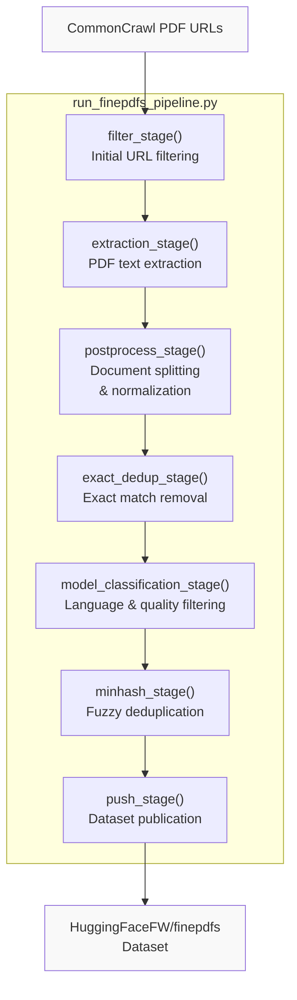
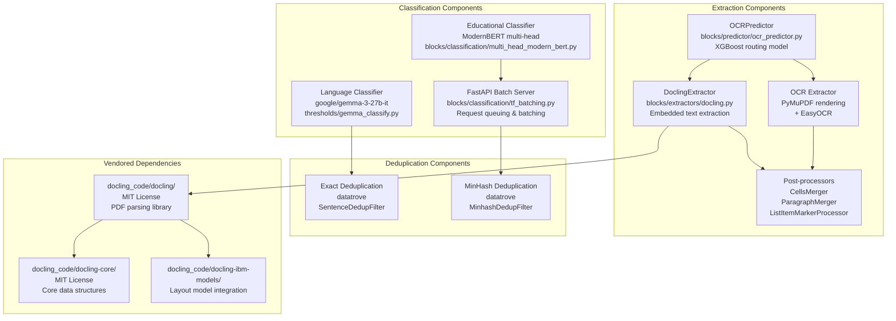
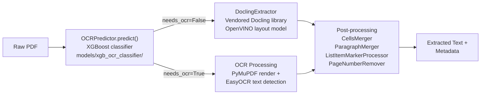
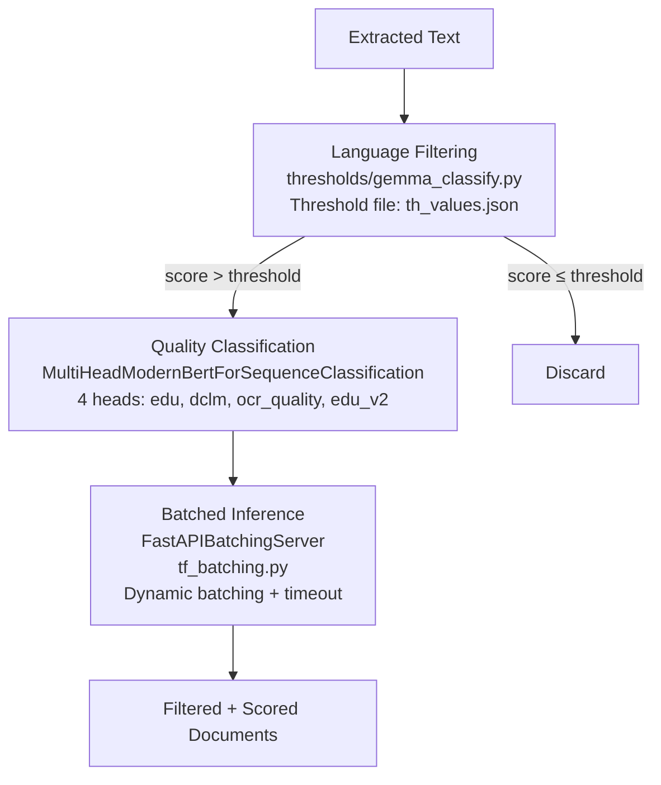
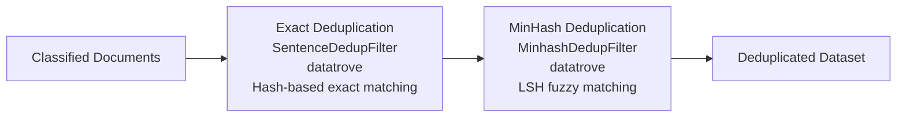
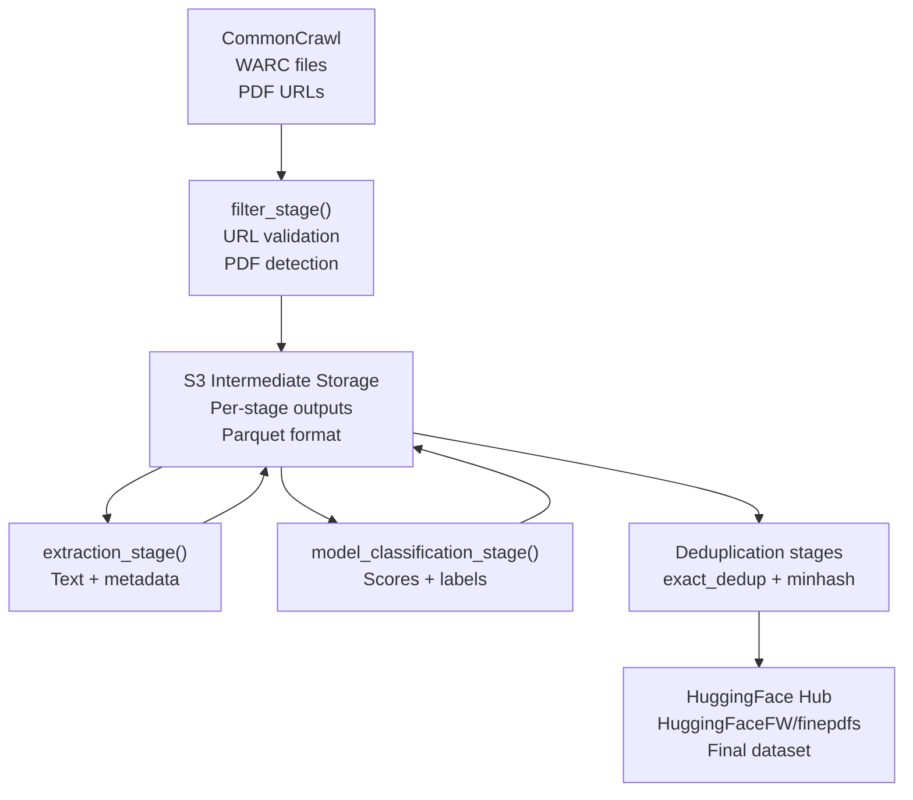

<!-- source: DeepWiki mcp.deepwiki.com · repo huggingface/finepdfs · page 1 Overview · fetched 2026-10-26 -->

# Overview

<details>
<summary>Relevant source files</summary>

The following files were used as context for generating this wiki page:

- [FinePDFs.png](FinePDFs.png)
- [LICENSE](LICENSE)
- [README.md](README.md)

</details>


## Purpose and Scope

FinePDFs is a large-scale PDF processing and dataset generation system designed to extract, filter, classify, and package high-quality text data from CommonCrawl PDF collections. This repository contains the complete end-to-end pipeline code that produced the [HuggingFaceFW/finepdfs](https://huggingface.co/datasets/HuggingFaceFW/finepdfs) dataset.

This overview provides a high-level introduction to the system architecture, core components, and data flow. For specific implementation details:
- Pipeline execution and configuration: see [Quick Start](#1.1)
- Directory layout and vendored dependencies: see [Repository Structure](#1.2)
- Detailed pipeline stages: see [Main Processing Pipeline](#2)
- Model training and evaluation: see [Training Infrastructure](#3) and [Evaluation Infrastructure](#4)

**Sources:** [README.md:1-122](), [run_finepdfs_pipeline.py:1-50]()

## System Goals

The FinePDFs system addresses three primary objectives:

1. **Intelligent PDF Text Extraction**: Automatically route PDFs to appropriate extraction methods (embedded text via Docling or OCR via PyMuPDF) using a trained XGBoost classifier
2. **Multi-Language Quality Filtering**: Apply precision-optimized language detection and educational content classification across 67 languages
3. **Scalable Processing**: Handle billions of PDFs from CommonCrawl using distributed SLURM-based execution and efficient batched inference

The system prioritizes extraction quality and content filtering while minimizing systematic biases that could result from aggressive ML-based filtering.

**Sources:** [README.md:3-7](), [README.md:98-104]()

## High-Level Architecture

### Main Pipeline Orchestration

The entire pipeline is orchestrated by `run_finepdfs_pipeline.py`, which executes sequential stages from raw PDF URLs to final dataset publication:



**Pipeline Stage Functions**

Each stage is implemented as a function in `run_finepdfs_pipeline.py`:

| Stage | Function | Primary Purpose |
|-------|----------|-----------------|
| Filter | `filter_stage()` | Remove non-PDF URLs and apply basic filters |
| Extraction | `extraction_stage()` | Extract text using OCR routing + Docling/PyMuPDF |
| Postprocess | `postprocess_stage()` | Split documents, remove tags, normalize text |
| Exact Dedup | `exact_dedup_stage()` | Remove exact duplicate content |
| Classification | `model_classification_stage()` | Apply language and quality classifiers |
| MinHash | `minhash_stage()` | Fuzzy deduplication using LSH |
| Push | `push_stage()` | Upload final dataset to HuggingFace Hub |

**Sources:** [run_finepdfs_pipeline.py:1-800](), README.md sections on pipeline orchestration

### Core Component Architecture



**Sources:** [blocks/extractors/docling.py:1-200](), [blocks/predictor/ocr_predictor.py:1-150](), [blocks/classification/multi_head_modern_bert.py:1-250](), [blocks/classification/tf_batching.py:1-300]()

## Key Processing Stages

### 1. PDF Extraction with Intelligent Routing

The system uses `OCRPredictor` to classify each PDF as requiring OCR or having extractable embedded text:



The OCR routing classifier was trained on manually annotated data released at `HuggingFaceFW/ocr-annotations` using features extracted from PDF metadata.

**Sources:** [blocks/predictor/ocr_predictor.py:1-150](), [models/xgb_ocr_classifier/](), [README.md:38-39]()

### 2. Multi-Stage Classification

Classification applies two filters sequentially:

1. **Language Classification**: Uses `google/gemma-3-27b-it` with precision-optimized thresholds (F-beta with β=0.1, minimum recall 0.1, minimum precision 0.9)
2. **Educational Quality**: Multi-head ModernBERT classifier for English; language-specific BERT classifiers for other languages



The thresholds were computed using `thresholds/find_th.py` on Gemma-labeled validation data.

**Sources:** [thresholds/find_th.py:1-200](), [blocks/classification/multi_head_modern_bert.py:1-250](), [blocks/classification/tf_batching.py:1-300](), [README.md:45-54]()

### 3. Two-Stage Deduplication

Deduplication occurs in two phases to balance precision and efficiency:



**Sources:** [run_finepdfs_pipeline.py:400-500]()

## Technology Stack

### Core Dependencies

| Component | Technology | Purpose |
|-----------|-----------|---------|
| Extraction | Vendored Docling (MIT) | PDF parsing and layout analysis |
| OCR | PyMuPDF 1.26.1 (AGPL-3.0) + EasyOCR | Render PDFs to images and extract text |
| Classification | vLLM ≥0.8.5.post1 | Fast batched LLM inference for filtering |
| Routing | XGBoost | OCR vs non-OCR decision classifier |
| Deduplication | DataTrove | Distributed deduplication pipelines |
| Training | PyTorch 2.6.0 | Model training and fine-tuning |
| Layout Model | OpenVINO INT8 | Quantized Docling layout model inference |

### Model Artifacts

The system includes several pre-trained models stored in the repository:

- **OCR Classifier**: [models/xgb_ocr_classifier/]() - XGBoost model for routing decisions
- **Layout Model**: [models/heron/]() - INT8-quantized OpenVINO model for Docling layout analysis
- **Language Thresholds**: `th_values.json` - Per-language score cutoffs for filtering
- **Quality Classifiers**: Published on HuggingFace Hub
  - `HuggingFaceFW/finepdfs_edu_classifier_{language}` (67 languages)
  - `HuggingFaceFW/finepdfs_dclm_classifier_eng_Latn`
  - `HuggingFaceFW/finepdfs_ocr_quality_classifier_eng_Latn`

**Sources:** [README.md:10-21](), [README.md:38-39](), [README.md:71-76](), [pyproject.toml:1-100]()

## Data Flow and Storage

### Input/Output Pipeline



All intermediate outputs are stored in Parquet format with configurable output paths. The final dataset is pushed to the HuggingFace Hub using `push_stage()`.

**Sources:** [run_finepdfs_pipeline.py:1-800](), [pipeline_utils/]()

## Repository Structure Overview

The repository is organized into functional modules:

| Directory | Purpose |
|-----------|---------|
| `blocks/` | Core processing blocks: extractors, predictors, classifiers |
| `docling_code/` | Vendored Docling dependencies (MIT license) |
| `models/` | Trained model weights and quantization code |
| `classification/` | Training and labeling code for quality classifiers |
| `thresholds/` | Language threshold discovery and application |
| `pipeline_utils/` | Shared utilities for pipeline orchestration |
| `ablations/` | Experimental variations and ablation studies |

For detailed information about the directory structure, see [Repository Structure](#1.2).

**Sources:** [README.md:78-97]()

## Execution Model

The pipeline is designed for distributed execution on SLURM clusters but can also run locally. Each stage in `run_finepdfs_pipeline.py` uses DataTrove's executor abstraction:

```python
# Example from run_finepdfs_pipeline.py
from datatrove.executor import LocalPipelineExecutor

executor = LocalPipelineExecutor(
    pipeline=[...],  # Stage-specific pipeline
    tasks=args.tasks,
    workers=args.workers,
)
executor.run()
```

For production workloads, the system supports SLURM-based parallel execution across multiple nodes. Training and evaluation workflows also use SLURM for distributed processing (see [Training Infrastructure](#3) and [Evaluation Infrastructure](#4)).

**Sources:** [run_finepdfs_pipeline.py:100-800]()

## License and Attribution

- **Dataset**: ODC-By 1.0 (subject to CommonCrawl terms)
- **Top-level Code**: AGPL-3.0
- **Vendored Docling Components**: MIT (Docling, Docling-Core) and upstream licenses (Docling-IBM-Models)
- **PyMuPDF**: AGPL-3.0

See [THIRD_PARTY_NOTICES.md]() for complete license information.

**Sources:** [LICENSE:1-59](), [README.md:107-109]()

## Getting Started

To begin using the FinePDFs pipeline:

1. **Installation**: Follow the setup instructions in [Quick Start](#1.1)
2. **Run the pipeline**: Execute `run_finepdfs_pipeline.py` with desired parameters
3. **Explore components**: Review individual blocks in `blocks/` for specific functionality
4. **Train models**: Use code in `classification/` for custom quality classifiers
5. **Adjust thresholds**: Modify `th_values.json` for language-specific filtering

For detailed pipeline configuration and execution, see [Main Processing Pipeline](#2).

**Sources:** [README.md:23-33]()

---

