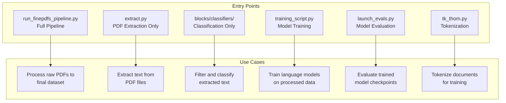
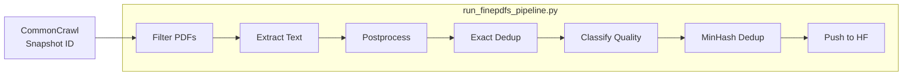
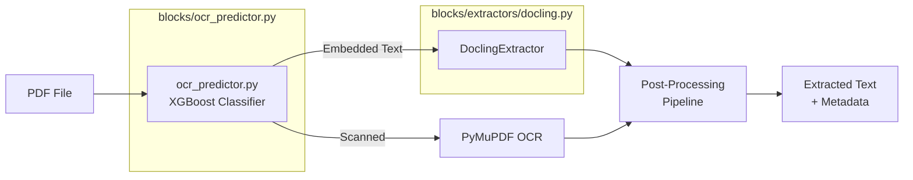

<!-- source: DeepWiki mcp.deepwiki.com · repo huggingface/finepdfs · page 1.1 Quick Start · fetched 2026-10-26 -->

# Quick Start

<details>
<summary>Relevant source files</summary>

The following files were used as context for generating this wiki page:

- [.gitignore](.gitignore)
- [.python-version](.python-version)
- [.vscode/launch.json](.vscode/launch.json)

</details>


This page provides the essential steps to set up and run the FinePDFs pipeline. It covers Python environment setup, dependency installation, and basic commands for executing the main pipeline and individual components. For detailed information about specific subsystems, refer to their dedicated sections: PDF extraction ([2.1](#2.1)), classification ([2.2](#2.2)), training ([3](#3)), and evaluation ([4](#4)).

## Prerequisites

### Python Version

The FinePDFs system requires **Python 3.12** as specified in [.python-version:1]().

```bash
python --version  # Should output Python 3.12.x
```

### System Requirements

The pipeline is designed to run on SLURM-managed compute clusters with:
- Access to S3 storage for intermediate data and checkpoints
- Git LFS for downloading large model files (XGBoost classifiers, layout models)
- Sufficient compute resources for PDF processing and model inference

### Required Access

- **S3 Buckets**: Access to shared storage buckets for datasets, checkpoints, and evaluation results
- **HuggingFace**: Credentials for pushing final datasets and downloading model artifacts
- **SLURM Cluster**: Access to compute cluster for distributed processing

**Sources**: [.python-version:1](), Architecture Diagram 1

## Installation

### Clone Repository

```bash
git clone https://github.com/huggingface/finepdfs.git
cd finepdfs
```

### Install Dependencies

The repository uses a standard Python package structure. Install dependencies using:

```bash
pip install -e .
```

This installs the package in editable mode along with all required dependencies including:
- **DataTrove**: For data processing pipeline orchestration
- **PyMuPDF**: For OCR rendering and PDF manipulation
- **transformers**: For loading and running classification models
- **XGBoost**: For OCR routing classifier
- **FastAPI**: For batched inference server
- **s5cmd**: For efficient S3 operations

### Download Model Artifacts

Large model files are stored via Git LFS. Download them using:

```bash
git lfs pull
```

This downloads:
- OCR routing classifier weights in `models/xgb_ocr_classifier/`
- Quantized Docling layout models in `models/heron/`

**Sources**: [.gitignore:1-15](), Architecture Diagram 2, Section [5.1](#5.1)

## Pipeline Entry Points

The FinePDFs system provides multiple entry points depending on your use case:



**Sources**: Architecture Diagrams 1, 4, and 5

## Running the Main Pipeline

### Basic Command Structure

The main pipeline is executed through `run_finepdfs_pipeline.py`:

```bash
python run_finepdfs_pipeline.py <crawl_id> [options]
```

### Example: Processing a CommonCrawl Snapshot

```bash
python main.py CC-MAIN-2019-47
```

This command processes PDFs from the CommonCrawl snapshot `CC-MAIN-2019-47` through the complete pipeline:

1. **Filter & Route**: Identify and filter PDF documents
2. **Extract**: OCR routing and text extraction
3. **Postprocess**: Clean and normalize extracted text
4. **Dedup (Exact)**: Remove exact duplicates
5. **Classify**: Language and quality filtering
6. **Dedup (MinHash)**: Fuzzy deduplication
7. **Push**: Upload final dataset to HuggingFace



**Sources**: [.vscode/launch.json:13](), Architecture Diagram 5

## Running Individual Components

### PDF Extraction

To run only the extraction component:

```bash
python extract.py
```

This executes the PDF extraction pipeline including:
- OCR routing classification using XGBoost
- Docling-based extraction for embedded text PDFs
- PyMuPDF-based OCR for scanned documents
- Post-processing (cell merging, paragraph fixing, list normalization)



For more details on extraction internals, see [PDF Extraction System](#2.1).

**Sources**: [.vscode/launch.json:17-22](), Architecture Diagram 2

### Classification and Filtering

Classification components can be used independently for quality filtering:

#### Language Classification

Uses Gemma-3-27b-it with optimized thresholds:

```bash
# Language classification with threshold filtering
python blocks/classifiers/language_filter.py --input <data_path>
```

Threshold values are pre-calculated and stored in `th_values.json` using F-beta optimization (β=0.1, minimum recall=0.1).

#### Quality Classification

Multiple quality classifiers can be applied:

```bash
# Educational content classification
python blocks/classifiers/edu_classifier.py --input <data_path>

# DCLM quality classification (English only)
python blocks/classifiers/dclm_classifier.py --input <data_path>

# OCR quality classification
python blocks/classifiers/ocr_quality_classifier.py --input <data_path>
```

For English content, the multi-head ModernBERT architecture allows simultaneous evaluation of all quality dimensions. See [Multi-Head ModernBERT Architecture](#2.2.3) for details.

**Sources**: Architecture Diagram 3

### Batched Inference Server

For production deployment, start the FastAPI batched inference server:

```bash
python tf_batching.py --model <model_path> --batch_size <size> --timeout <seconds>
```

The server provides:
- Request batching for efficient GPU utilization
- Timeout handling for pending requests
- REST API for classification queries

See [Batched Inference API](#2.2.4) for API documentation.

**Sources**: Architecture Diagram 3

### Model Training

Launch distributed training on SLURM cluster:

```bash
python training_script.py \
    --data <dataset_path> \
    --run_name <experiment_name> \
    --lr <learning_rate> \
    --steps <training_steps> \
    --output <checkpoint_dir>
```

This script:
1. Generates nanotron configuration YAML
2. Creates SLURM batch script
3. Downloads training data from S3 using `s5cmd`
4. Submits training job to SLURM cluster
5. Uploads checkpoints to S3

Training configuration and SLURM integration are detailed in [Training Infrastructure](#3).

**Sources**: Architecture Diagram 4

### Model Evaluation

Evaluate trained checkpoints across multiple languages:

```bash
python launch_evals.py \
    --model_name <model_identifier> \
    --checkpoints <checkpoint_dir> \
    --tasks <task_file>
```

Task files define evaluation benchmarks:
- `tasks_eng.txt`: 12 English tasks
- `tasks_zho.txt`: 15 Chinese tasks
- `tasks_ara.txt`: 15 Arabic tasks
- `tasks_fra.txt`: 8 French tasks
- `tasks_rus.txt`: 12 Russian tasks

The evaluation system:
1. Discovers available checkpoints in S3
2. Filters completed evaluations
3. Converts nanotron checkpoints to HuggingFace format
4. Executes lighteval with accelerate
5. Uploads results to S3

See [Evaluation Infrastructure](#4) for comprehensive documentation.

**Sources**: Architecture Diagram 4

## Development and Debugging

### VS Code Configuration

The repository includes VS Code launch configurations for debugging:

#### Debug Main Pipeline

```json
{
    "name": "Python Debugger: main.py",
    "type": "debugpy",
    "request": "launch",
    "program": "main.py",
    "args": ["CC-MAIN-2019-47"],
    "console": "integratedTerminal"
}
```

#### Debug Extraction

```json
{
    "name": "Python Debugger: steps/split_truncation.py",
    "type": "debugpy",
    "request": "launch",
    "program": "extract.py",
    "console": "integratedTerminal"
}
```

These configurations allow step-through debugging of pipeline components. See [Logging and Debugging](#6.2) for additional debugging tools.

**Sources**: [.vscode/launch.json:1-24]()

## Directory Structure Overview

```
finepdfs/
├── blocks/              # Pipeline components (extractors, classifiers)
├── ablations/           # Experimental variations and ablation studies
├── models/              # Pre-trained model weights (Git LFS)
├── docling_code/        # Vendored Docling library
├── run_finepdfs_pipeline.py  # Main pipeline orchestrator
├── training_script.py   # Model training launcher
├── launch_evals.py      # Evaluation orchestrator
└── tk_thom.py          # Tokenization pipeline
```

For detailed repository organization, see [Repository Structure](#1.2).

**Sources**: [.gitignore:13-15](), Architecture Diagram 1

## Next Steps

After completing basic setup and running initial commands:

1. **Customize PDF Extraction**: Learn about OCR routing and Docling configuration in [PDF Extraction System](#2.1)
2. **Configure Quality Filters**: Understand classifier training and threshold tuning in [Classification and Filtering](#2.2)
3. **Scale with SLURM**: Explore distributed computing patterns in [SLURM Integration](#7)
4. **Train Custom Models**: Follow the complete training workflow in [Training Infrastructure](#3)
5. **Evaluate Performance**: Set up multi-language benchmarks in [Evaluation Infrastructure](#4)

For troubleshooting common issues, refer to [Logging and Debugging](#6.2).

**Sources**: Architecture Diagrams 1-5, Table of Contents

---

