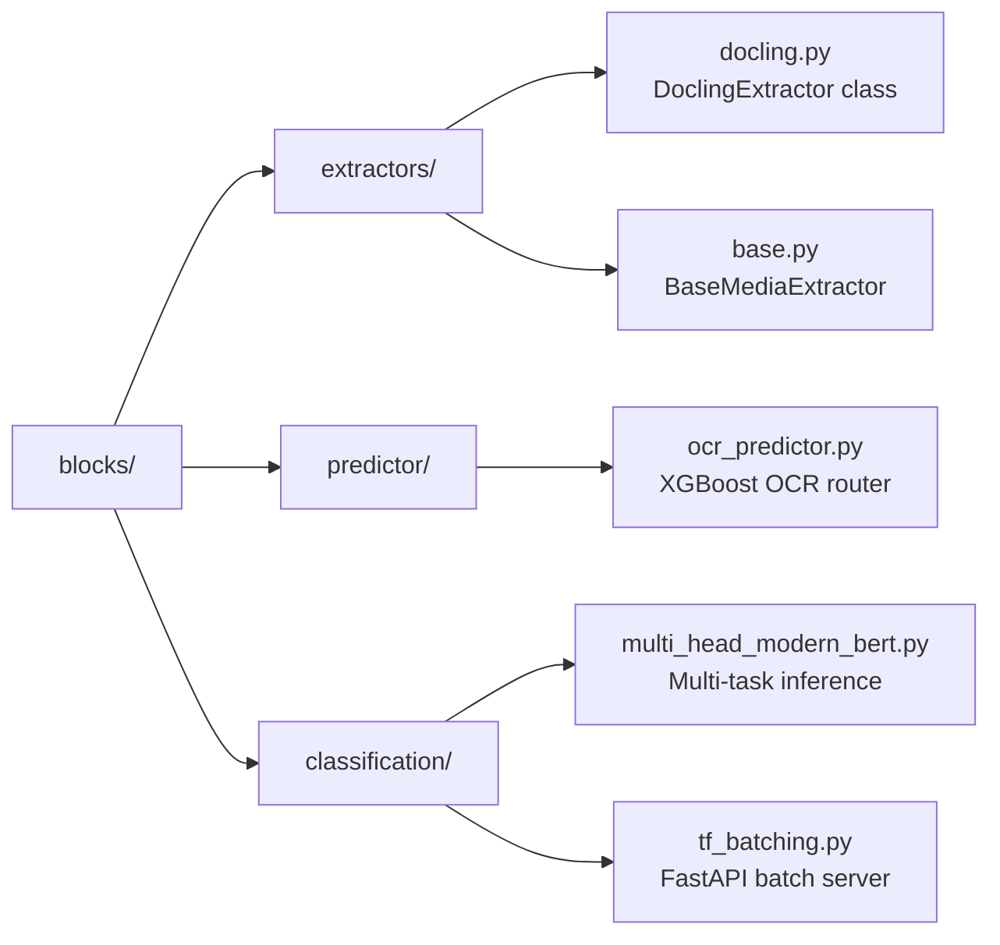
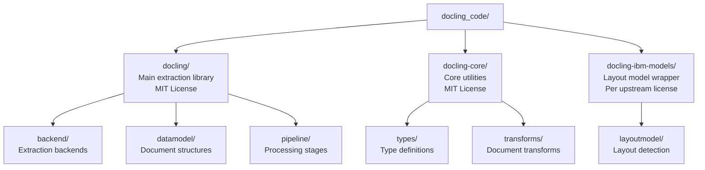
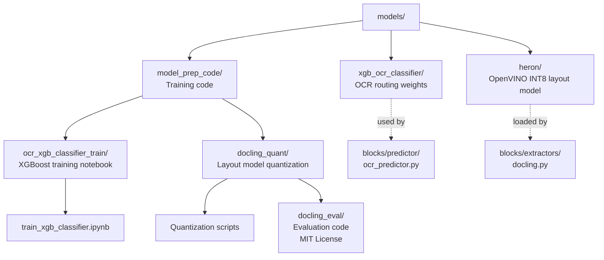
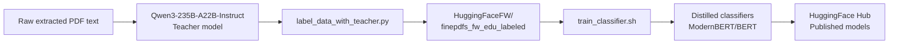
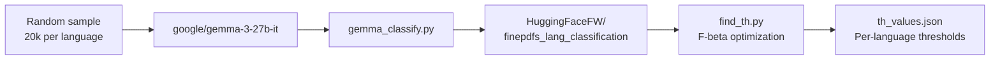

<!-- source: DeepWiki mcp.deepwiki.com · repo huggingface/finepdfs · page 1.2 Repository Structure · fetched 2026-10-26 -->

# Repository Structure

Relevant source files

The following files were used as context for generating this wiki page:

- [.gitignore](.gitignore)
- [README.md](README.md)

## Purpose and Scope

This document describes the high-level organization of the FinePDFs repository, including the purpose of each major directory and key files. It provides a roadmap for navigating the codebase and understanding where specific functionality resides.

For detailed information about specific subsystems, see:
- PDF extraction and OCR routing: [2.1](#2.1)
- Classification and filtering: [2.2](#2.2)
- Training infrastructure: [3](#3)
- Evaluation infrastructure: [4](#4)

---

## Directory Overview

The repository is organized into several top-level directories, each serving a distinct purpose in the PDF processing pipeline:

```mermaid
graph TB
    ROOT["Repository Root"]
    
    ROOT --> PIPELINE["run_finepdfs_pipeline.py<br/>Main pipeline orchestration"]
    ROOT --> PIPELINE_UTILS["pipeline_utils/<br/>Pipeline support code"]
    ROOT --> BLOCKS["blocks/<br/>Reusable components"]
    ROOT --> DOCLING["docling_code/<br/>Vendored Docling libraries"]
    ROOT --> MODELS["models/<br/>Model weights & training code"]
    ROOT --> CLASSIFICATION["classification/<br/>Quality classifier training"]
    ROOT --> THRESHOLDS["thresholds/<br/>Language filter thresholds"]
    ROOT --> ABLATIONS["ablations/<br/>Experimental analyses"]
    ROOT --> TRAINING["training_script.py<br/>Model training orchestration"]
    ROOT --> EVALS["launch_evals.py<br/>Evaluation orchestration"]
    ROOT --> TK["tk_thom.py<br/>Tokenization pipeline"]
    
    BLOCKS --> EXTRACTORS["extractors/<br/>PDF extraction backends"]
    BLOCKS --> PREDICTOR["predictor/<br/>OCR routing classifier"]
    BLOCKS --> BLOCK_CLASS["classification/<br/>Inference servers"]
    
    DOCLING --> DOCLING_MAIN["docling/<br/>Main extraction library"]
    DOCLING --> DOCLING_CORE["docling-core/<br/>Core utilities"]
    DOCLING --> DOCLING_IBM["docling-ibm-models/<br/>Layout models"]
    
    MODELS --> XGB["xgb_ocr_classifier/<br/>OCR routing weights"]
    MODELS --> HERON["heron/<br/>Quantized layout model"]
    MODELS --> PREP["model_prep_code/<br/>Training notebooks"]
```

**Sources:** [README.md:78-96](), [.gitignore:1-15]()

---

## Core Pipeline Orchestration

### run_finepdfs_pipeline.py

The main entry point for the entire PDF processing pipeline. This file contains the end-to-end orchestration logic with distinct functions for each processing stage:

| Stage | Function | Description |
|-------|----------|-------------|
| Filtering | Filter stage logic | Initial data filtering and routing |
| Extraction | Extraction stage logic | PDF text extraction with OCR routing |
| Postprocessing | Postprocess logic | Document structure cleanup |
| Exact Deduplication | Exact dedup logic | Remove exact duplicate documents |
| Classification | Model classification logic | Quality and language filtering |
| MinHash Deduplication | MinHash dedup logic | Fuzzy deduplication |
| Publishing | Push logic | Dataset publishing to HuggingFace |

**Sources:** [README.md:24-36](), [README.md:81-82]()

### pipeline_utils/

Contains utility functions and helper code specifically for pipeline orchestration, such as configuration management and inter-stage data handling.

**Sources:** [README.md:82]()

---

## Building Blocks Directory

The `blocks/` directory contains reusable components that can be composed into larger pipelines. These are designed as modular, testable units.

### blocks/extractors/

Contains PDF extraction implementations:

- **docling.py**: `DoclingExtractor` class that wraps the vendored Docling library for embedded text extraction
- **base.py**: `BaseMediaExtractor` abstract base class defining the extractor interface with timeout handling and error management

**Sources:** [README.md:84-85]()

### blocks/predictor/

Houses the OCR routing logic:

- **ocr_predictor.py**: Implements the XGBoost-based classifier that determines whether a PDF requires OCR processing or can use embedded text extraction. Loads weights from `models/xgb_ocr_classifier/`.

**Sources:** [README.md:85](), [README.md:91]()

### blocks/classification/

Implements fast inference for quality classifiers:

- Multi-headed ModernBERT architecture for simultaneous evaluation of multiple quality dimensions (edu, dclm, ocr_quality)
- FastAPI-based batching server for production inference with request queuing

**Sources:** [README.md:86]()

---

## Vendored Dependencies

The `docling_code/` directory contains exact versions of Docling libraries, modified for performance and extraction clarity. Each subdirectory maintains its own README and LICENSE.

### docling_code/docling/

The main Docling library providing document understanding and text extraction capabilities. Includes:
- Backend implementations for different PDF processing approaches
- Data models for representing document structure
- Pipeline components for multi-stage processing

### docling_code/docling-core/

Core utilities and type definitions used by the main Docling library:
- Type definitions for document elements
- Transform functions for document manipulation

### docling_code/docling-ibm-models/

IBM Research models for layout detection and document understanding, wrapped for use with Docling.

**Sources:** [README.md:87-88](), [README.md:109]()

---

## Model Artifacts and Training Code

The `models/` directory contains trained model weights and the code used to produce them.

### models/xgb_ocr_classifier/

Contains the trained XGBoost model weights for OCR routing. This classifier predicts whether a PDF is scanned (requires OCR) or has embedded text.

Training dataset: `HuggingFaceFW/ocr-annotations`

### models/heron/

OpenVINO-quantized version of the `ds4sd/docling-layout-heron` layout detection model, converted to INT8 for faster inference. Includes quantization and evaluation code (reference implementation).

### models/model_prep_code/

Training notebooks and scripts:
- **ocr_xgb_classifier_train/**: Jupyter notebook for training the OCR routing classifier
- **docling_quant/**: Code for quantizing the Docling layout model to OpenVINO INT8 format, including evaluation utilities (MIT licensed, matching upstream Docling)

**Sources:** [README.md:39](), [README.md:41-42](), [README.md:91-92]()

---

## Classification Training System

The `classification/` directory contains code for training quality classifiers using teacher-student distillation.

| File | Purpose |
|------|---------|
| `label_data_with_teacher.py` | Uses `Qwen3-235B-A22B-Instruct-2507` to label training data for quality dimensions (edu, dclm, ocr_quality, edu_v2) |
| `train_classifier.sh` | Shell script orchestrating the training of distilled BERT/ModernBERT classifiers |

### Training Flow

Published classifier models:
- `HuggingFaceFW/finepdfs_edu_classifier_{language}` - Per-language educational content classifiers
- `HuggingFaceFW/finepdfs_dclm_classifier_eng_Latn` - DCLM quality classifier
- `HuggingFaceFW/finepdfs_ocr_quality_classifier_eng_Latn` - OCR quality classifier
- `HuggingFaceFW/finepdfs_edu_classifier_v2_eng_Latn` - Advanced educational classifier

**Sources:** [README.md:56-76](), [README.md:93]()

---

## Language Filtering System

The `thresholds/` directory contains code for language classification threshold discovery.

Key files:
- **gemma_classify.py**: Runs language classification using Gemma-3-27b-it
- **find_th.py**: Computes optimal thresholds by maximizing F-beta score (β=0.1, prioritizing precision) with constraints:
  - Minimum recall: 0.1
  - Minimum precision: 0.9
  - Minimum score cutoff for reasonable thresholds

The threshold optimization uses 11 workers for parallel processing and outputs `th_values.json`.

**Sources:** [README.md:45-54](), [README.md:96]()

---

## Training and Evaluation Infrastructure

### training_script.py

SLURM-based orchestration for model training using the nanotron framework. Generates SLURM batch scripts dynamically and manages:
- Model configuration YAML generation
- S3 dataset download via `s5cmd`
- Checkpoint storage to S3
- Multi-node distributed training

For details, see [3.1](#3.1).

### launch_evals.py

Automated evaluation system that:
- Discovers checkpoints from S3
- Filters out already-evaluated checkpoints
- Generates SLURM array jobs for parallel evaluation
- Converts nanotron checkpoints to HuggingFace format
- Runs lighteval benchmarks across multiple languages

Supported evaluation tasks are defined in:
- `tasks_eng.txt` - 12 English benchmarks
- `tasks_zho.txt` - 15 Chinese benchmarks
- `tasks_ara.txt` - 15 Arabic benchmarks
- `tasks_fra.txt` - 8 French benchmarks
- `tasks_rus.txt` - 12 Russian benchmarks

Task implementations are in `task_list.py` using `LightevalTaskConfig`.

For details, see [4.1](#4.1) and [4.3](#4.3).

### tk_thom.py

Tokenization pipeline using `DocumentTokenizer` for SLURM-based distributed processing. Handles:
- Document splitting
- Docling tag removal
- Text normalization

For details, see [2.3](#2.3).

**Sources:** [README.md:24]()

---

## Experimental and Analysis Code

### ablations/

Contains experimental analyses and ablation studies. This directory houses code for testing alternative approaches and measuring the impact of different design decisions.

**Note:** Excluded from version control via `.gitignore` are runtime artifacts:
- `finepdfs/` - Downloaded dataset files
- `server_logs/` - Inference server logs
- `logs/` - General pipeline logs

**Sources:** [.gitignore:12-15]()

---

## Configuration and Dependencies

### pyproject.toml

Defines the project dependencies and workspace configuration. Key dependencies include:
- `torch==2.6.0` - PyTorch for model inference
- `vllm>=0.8.5.post1` - Fast LLM inference engine
- `pymupdf==1.26.1` - PDF rendering for OCR (AGPL-3.0 licensed)

The project uses a workspace setup with vendored Docling and a specific `datatrove` branch.

### .gitignore

Excludes from version control:
- Python build artifacts (`__pycache__/`, `*.pyc`, `*.egg-info`)
- Virtual environments (`.venv`)
- Runtime data directories (`finepdfs/`, `server_logs/`, `logs/`)

**Sources:** [README.md:10-21](), [.gitignore:1-15]()

---

## Key File Mappings

The following table maps system functionality to specific files:

| System Component | Primary File(s) | Directory |
|-----------------|-----------------|-----------|
| Pipeline orchestration | `run_finepdfs_pipeline.py` | Root |
| PDF extraction | `blocks/extractors/docling.py` | blocks/extractors/ |
| OCR routing | `blocks/predictor/ocr_predictor.py` | blocks/predictor/ |
| Multi-head inference | `blocks/classification/multi_head_modern_bert.py` | blocks/classification/ |
| Batch inference server | `blocks/classification/tf_batching.py` | blocks/classification/ |
| Docling library | Entire `docling/` subdirectory | docling_code/docling/ |
| OCR classifier weights | Model files | models/xgb_ocr_classifier/ |
| Layout model weights | OpenVINO model files | models/heron/ |
| Classifier training | `label_data_with_teacher.py`, `train_classifier.sh` | classification/ |
| Threshold discovery | `find_th.py`, `gemma_classify.py` | thresholds/ |
| Model training | `training_script.py` | Root |
| Evaluation | `launch_evals.py`, `task_list.py` | Root |
| Tokenization | `tk_thom.py` | Root |

**Sources:** [README.md:78-96]()

---

