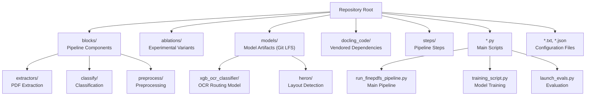
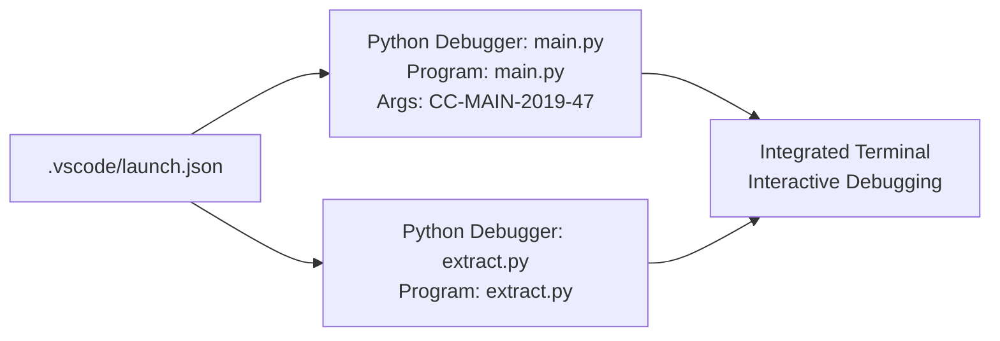
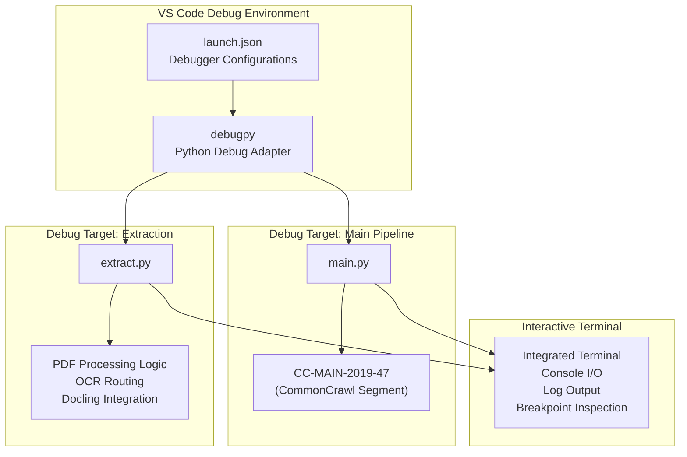
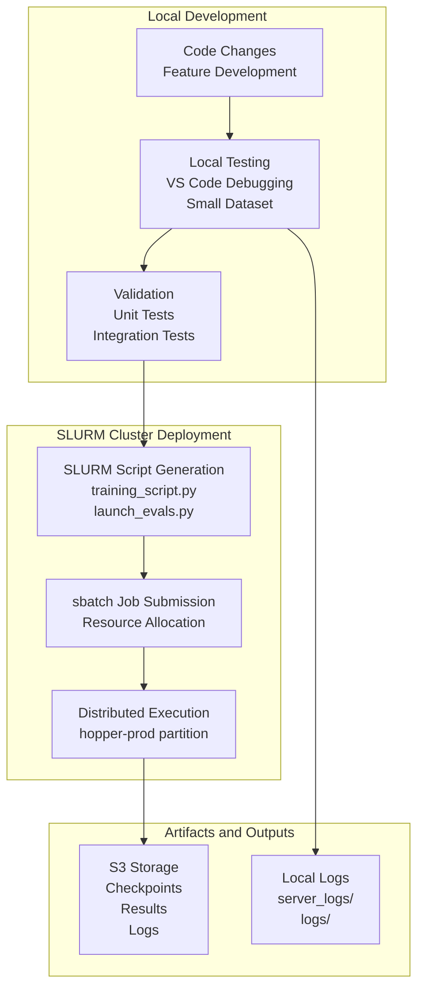
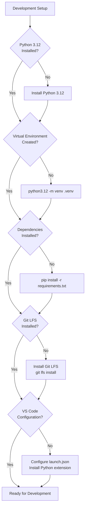

<!-- source: DeepWiki mcp.deepwiki.com · repo huggingface/finepdfs · page 10 Development and Contributing · fetched 2026-10-26 -->

# Development and Contributing

<details>
<summary>Relevant source files</summary>

The following files were used as context for generating this wiki page:

- [.gitignore](.gitignore)
- [.python-version](.python-version)
- [.vscode/launch.json](.vscode/launch.json)
- [LICENSE](LICENSE)

</details>


This document provides guidance for developers who want to contribute to the FinePDFs project or set up a local development environment. It covers development environment setup, code organization conventions, debugging strategies, and contribution workflows.

For general repository structure and system architecture, see [Overview](#1) and [Repository Structure](#1.2). For specific system documentation (pipeline stages, training, evaluation), refer to sections [2](#2) through [9](#9).

---

## Development Environment Setup

### Python Version Requirements

The project requires **Python 3.12** as specified in [.python-version:1]().

```
Python 3.12
```

This version requirement ensures compatibility with all dependencies, particularly the newer features used in the nanotron training framework and modern transformers library versions.

Sources: [.python-version:1]()

---

### Virtual Environment Setup

It is strongly recommended to use a virtual environment to isolate project dependencies. The `.gitignore` configuration excludes virtual environments from version control:

[.gitignore:9-10]()

**Recommended setup:**

```bash
# Create virtual environment with Python 3.12
python3.12 -m venv .venv

# Activate the environment
source .venv/bin/activate  # On Linux/macOS
# or
.venv\Scripts\activate     # On Windows

# Install dependencies
pip install -r requirements.txt
```

The `.venv` directory is automatically ignored by Git, allowing developers to maintain local environments without affecting the repository.

Sources: [.gitignore:9-10](), [.python-version:1]()

---

### Excluded Directories and Build Artifacts

The project's `.gitignore` configuration defines several excluded directories that may be generated during development:

| Directory/Pattern | Purpose | Notes |
|------------------|---------|-------|
| `__pycache__/` | Python bytecode cache | Auto-generated by Python interpreter |
| `*.py[oc]` | Compiled Python files | `.pyc` and `.pyo` files |
| `build/`, `dist/` | Package build artifacts | Generated during package building |
| `wheels/` | Wheel distributions | Python package distribution format |
| `*.egg-info` | Package metadata | Generated by setuptools |
| `finepdfs/` | Dataset output directory | Large-scale dataset artifacts |
| `server_logs/` | Inference server logs | Generated by FastAPI batching server |
| `logs/` | General log files | Various pipeline execution logs |

Sources: [.gitignore:1-15]()

---

## Code Organization Conventions

### Directory Structure Overview

The repository follows a modular organization pattern:



**Key Directories:**

- **`blocks/`**: Reusable pipeline components (extractors, classifiers, preprocessors)
- **`steps/`**: Individual pipeline transformation steps
- **`ablations/`**: Experimental variants and A/B testing code
- **`models/`**: Binary model artifacts tracked with Git LFS
- **`docling_code/`**: Vendored version of Docling library with modifications

Sources: [.gitignore:13-15]()

---

### Module Naming Conventions

Based on the system architecture, the codebase follows these naming patterns:

| Pattern | Example | Purpose |
|---------|---------|---------|
| `*_extractor.py` | `docling.py` (contains `DoclingExtractor`) | PDF extraction implementations |
| `*_predictor.py` | `ocr_predictor.py` | Prediction/classification components |
| `*_utils.py` | `corrupted_utils.py` | Utility functions for specific domains |
| `*_script.py` | `training_script.py` | Executable scripts for SLURM/CLI |
| `tf_*.py` | `tf_batching.py` | TensorFlow/inference-related components |
| `launch_*.py` | `launch_evals.py` | Job orchestration and launching scripts |

---

## Debugging and Testing

### VS Code Debugging Configuration

The repository includes pre-configured launch configurations for debugging in Visual Studio Code:



**Configuration 1: Main Pipeline Debugging**

[.vscode/launch.json:8-15]()

This configuration launches the main pipeline (`main.py`) with a specific CommonCrawl segment (`CC-MAIN-2019-47`) as an argument. Useful for debugging the full pipeline execution.

**Configuration 2: Extraction Step Debugging**

[.vscode/launch.json:16-22]()

This configuration is designed for debugging the extraction process (`extract.py`), allowing developers to step through PDF extraction logic.

Sources: [.vscode/launch.json:1-24]()

---

### Debugging Setup Diagram



Sources: [.vscode/launch.json:8-22]()

---

### Local Testing Strategies

When developing new components, follow these testing patterns:

1. **Unit Testing Individual Components**
   - Test extractors with sample PDFs
   - Verify classifier outputs with known inputs
   - Validate post-processing transformations

2. **Integration Testing Pipeline Stages**
   - Run single pipeline steps in isolation
   - Use VS Code debug configurations with test data
   - Monitor logs in `logs/` directory (gitignored)

3. **SLURM-Independent Development**
   - Many components can be tested locally without SLURM
   - Use small datasets for quick iteration
   - Mock S3 operations for local development

Sources: [.vscode/launch.json:1-24](), [.gitignore:13-15]()

---

## SLURM Development Workflow

### Local vs Cluster Development



**Development Cycle:**

1. **Local Development**: Write and test code locally with small datasets
2. **Validation**: Use VS Code debugger to verify logic with test cases
3. **Script Generation**: Generate SLURM batch scripts for cluster execution
4. **Cluster Testing**: Submit jobs to SLURM for full-scale testing
5. **Result Analysis**: Review outputs in S3 and local logs

Sources: [.vscode/launch.json:1-24](), [.gitignore:13-15]()

---

## Contributing Guidelines

### Development Workflow

```mermaid
graph LR
    FORK["Fork Repository<br/>GitHub Fork"]
    CLONE["Clone Fork<br/>git clone"]
    BRANCH["Create Feature Branch<br/>git checkout -b feature/xyz"]
    DEVELOP["Develop Changes<br/>Code + Tests"]
    COMMIT["Commit Changes<br/>git commit"]
    PUSH["Push to Fork<br/>git push origin"]
    PR["Create Pull Request<br/>GitHub PR"]
    REVIEW["Code Review<br/>Maintainer Review"]
    MERGE["Merge to Main<br/>Integration"]
    
    FORK --> CLONE
    CLONE --> BRANCH
    BRANCH --> DEVELOP
    DEVELOP --> COMMIT
    COMMIT --> PUSH
    PUSH --> PR
    PR --> REVIEW
    REVIEW --> MERGE
```



**Recommended Workflow:**

1. Fork the repository on GitHub
2. Clone your fork locally: `git clone https://github.com/YOUR_USERNAME/finepdfs.git`
3. Set up development environment (Python 3.12, virtual environment)
4. Create a feature branch: `git checkout -b feature/descriptive-name`
5. Make changes and test locally using VS Code debug configurations
6. Commit changes with descriptive commit messages
7. Push to your fork: `git push origin feature/descriptive-name`
8. Create a Pull Request on the main repository

Sources: [.python-version:1](), [.vscode/launch.json:1-24]()

---

### Code Quality Standards

#### Python Code Style

- Follow PEP 8 style guidelines
- Use type hints for function signatures where appropriate
- Document complex functions with docstrings
- Keep functions focused and modular

#### Directory and File Management

Ensure new files respect the `.gitignore` patterns:

- Do not commit `__pycache__/` or `*.pyc` files
- Do not commit large dataset artifacts (`finepdfs/` directory)
- Do not commit build artifacts (`build/`, `dist/`, `wheels/`)
- Do not commit logs (`logs/`, `server_logs/`)

#### Git LFS for Large Files

When adding new model artifacts:

- Store models in the `models/` directory
- Configure Git LFS tracking for the file type
- Ensure files are tracked before committing
- See [Git LFS Configuration](#5.1) for details

Sources: [.gitignore:1-15]()

---

### Documentation Requirements

When contributing new features or modifying existing systems:

| Component Type | Documentation Required |
|---------------|------------------------|
| New pipeline block | Add docstring explaining purpose, inputs, outputs |
| New classifier | Document training data, metrics, inference API |
| SLURM script changes | Update CLI argument documentation |
| Configuration changes | Update relevant wiki pages |
| API changes | Update API Reference page ([#9](#9)) |

---

## License Considerations

### AGPL-3.0 License

The FinePDFs project is licensed under the **GNU Affero General Public License v3.0 (AGPL-3.0)**.

Key implications for contributors:

1. **Copyleft License**: All derivative works must also be licensed under AGPL-3.0
2. **Network Use Clause**: If you modify this software and use it as a network service, you must make the source code available to users
3. **Source Disclosure**: Any modified versions must include source code access
4. **Attribution**: Maintain copyright notices and license text

**License Header Example:**

```python
# Copyright (C) 2024  HuggingFace Inc.
#
# This program is free software: you can redistribute it and/or modify
# it under the terms of the GNU Affero General Public License as
# published by the Free Software Foundation, either version 3 of the
# License, or (at your option) any later version.
```

Sources: [LICENSE:1-59]()

---

### Third-Party Dependencies

The project incorporates several third-party libraries with their own licenses:

| Dependency | License | Usage |
|-----------|---------|-------|
| Docling | MIT | Vendored in `docling_code/` with modifications |
| PyMuPDF | AGPL-3.0 | PDF rendering and OCR processing |
| DataTrove | Apache-2.0 | Dataset processing pipeline framework |
| nanotron | Apache-2.0 | Distributed training framework |
| lighteval | MIT | Evaluation framework |

When contributing, ensure that:
- New dependencies are compatible with AGPL-3.0
- License files are preserved for vendored code
- Third-party code is properly attributed

Sources: [LICENSE:1-59]()

---

## Development Environment Checklist

Before starting development, verify your environment:



**Verification Commands:**

```bash
# Check Python version
python --version  # Should show Python 3.12.x

# Verify virtual environment
which python  # Should point to .venv/bin/python

# Test imports
python -c "import torch; import transformers; print('Dependencies OK')"

# Verify Git LFS
git lfs version  # Should show git-lfs version

# Test VS Code debugging
# Open VS Code, press F5, select "Python Debugger: main.py"
```

Sources: [.python-version:1](), [.gitignore:9-10](), [.vscode/launch.json:1-24]()

---

## Common Development Tasks

### Running Individual Pipeline Components

```bash
# Test PDF extraction on a single file
python -m blocks.extractors.docling path/to/sample.pdf

# Run OCR predictor on test data
python -m blocks.preprocess.ocr_predictor --input test_pdfs/

# Test language classifier
python -m blocks.classify.language_filter --text "sample text"
```

### Testing SLURM Scripts Locally

```bash
# Generate SLURM script without submitting
python training_script.py --data my_dataset --run_name test_run --dry-run

# Validate evaluation task configuration
python launch_evals.py --model_name test_model --list-tasks
```

### Debugging Server Components

```bash
# Start batching inference server locally
python tf_batching.py --port 8000 --debug

# Monitor server logs
tail -f server_logs/inference_*.log
```

Sources: [.gitignore:13-15](), [.vscode/launch.json:1-24]()

---

## Summary

This document covered the essential aspects of developing and contributing to the FinePDFs project:

- **Environment Setup**: Python 3.12, virtual environments, dependency management
- **Code Organization**: Directory structure, naming conventions, excluded files
- **Debugging**: VS Code configurations, local testing strategies
- **SLURM Development**: Local development vs cluster execution patterns
- **Contributing**: Fork-branch-PR workflow, code quality standards
- **Licensing**: AGPL-3.0 requirements and third-party dependencies

For specific technical documentation on individual systems, refer to the relevant sections:
- Pipeline components: [Main Processing Pipeline](#2)
- Training infrastructure: [Training Infrastructure](#3)
- Evaluation system: [Evaluation Infrastructure](#4)
- Model artifacts: [Model Artifacts and Storage](#5)

Sources: [.gitignore:1-15](), [.python-version:1](), [.vscode/launch.json:1-24](), [LICENSE:1-59]()