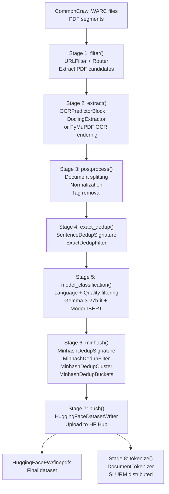
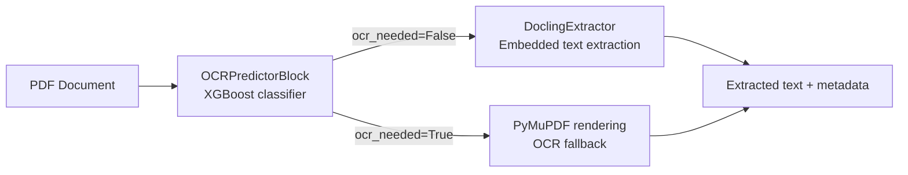
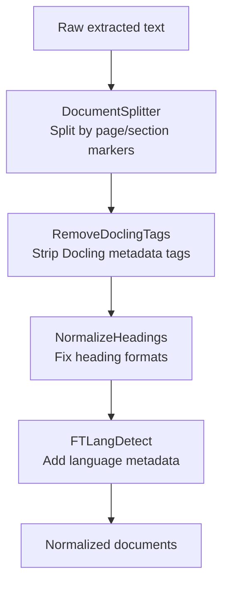
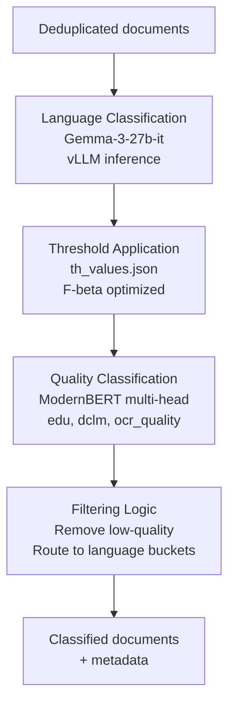
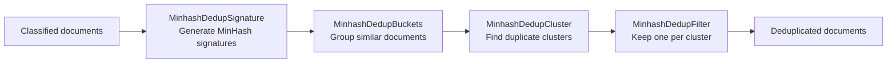
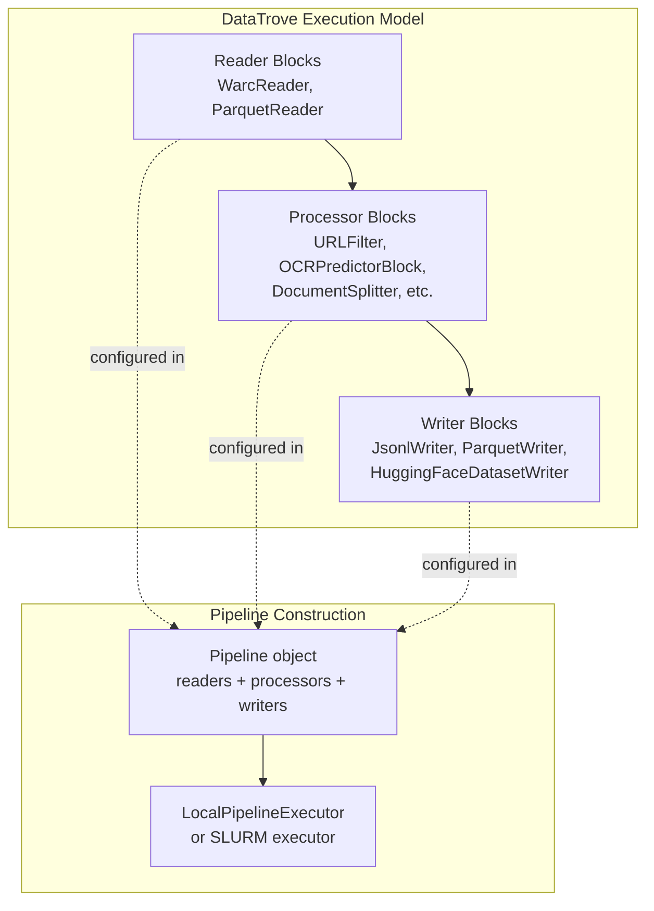
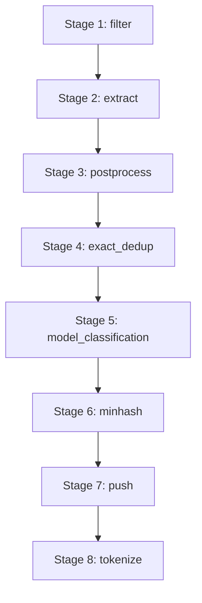

<!-- source: DeepWiki mcp.deepwiki.com · repo huggingface/finepdfs · page 2 Main Processing Pipeline · fetched 2026-10-26 -->

# Main Processing Pipeline

<details>
<summary>Relevant source files</summary>

The following files were used as context for generating this wiki page:

- [README.md](README.md)

</details>


## Purpose and Scope

This document describes the end-to-end FinePDFs processing pipeline that transforms raw CommonCrawl PDF data into a high-quality, deduplicated, and classified text dataset. The pipeline is orchestrated by [run_finepdfs_pipeline.py]() and executes a sequence of filtering, extraction, classification, and deduplication stages.

For detailed information on specific subsystems:
- PDF extraction mechanics: see [PDF Extraction System](#2.1)
- Classification models and inference: see [Classification and Filtering](#2.2)
- Tokenization details: see [Tokenization Pipeline](#2.3)
- Deduplication algorithms: see [Deduplication](#2.4)
- SLURM job orchestration: see [SLURM Integration](#7)

## Pipeline Overview

The FinePDFs pipeline executes eight sequential stages, each operating on the output of the previous stage. The pipeline is designed for distributed execution on SLURM clusters and uses DataTrove as the underlying data processing framework.

### End-to-End Data Flow



**Sources:** [run_finepdfs_pipeline.py:1-500](), [README.md:24-33]()

## Pipeline Entry Point

The pipeline is invoked via command-line interface with the following structure:

```bash
python run_finepdfs_pipeline.py \
  --crawl-ids CC-MAIN-2019-43 \
  --languages eng_Latn \
  [additional options]
```

### Command-Line Arguments

| Argument | Type | Default | Description |
|----------|------|---------|-------------|
| `--crawl-ids` | str[] | required | CommonCrawl crawl identifiers to process |
| `--languages` | str[] | required | Target languages in BCP-47 format (e.g., `eng_Latn`) |
| `--skip-stage` | str[] | `[]` | Stages to skip (e.g., `extract`, `model_classification`) |
| `--steps` | int[] | `range(1,9)` | Specific stages to execute (1-8) |
| `--batch-size` | int | 1000 | Documents per processing batch |
| `--output-folder` | str | derived | Base output directory |

**Sources:** [run_finepdfs_pipeline.py:1-100]()

## Stage-by-Stage Breakdown

### Stage 1: Filtering and Routing (`filter`)

**Function:** Identifies PDF documents from WARC files and routes them for processing.

**Key Components:**
- `URLFilter`: Filters CommonCrawl records to PDF MIME types
- `PDFExtractor`: Initial PDF detection and metadata extraction

**Output Format:** Parquet files containing PDF metadata and download URLs.

**Sources:** [run_finepdfs_pipeline.py](), [blocks/predictor/ocr_predictor.py]()

---

### Stage 2: PDF Extraction (`extract`)

**Function:** Extracts text from PDFs using either embedded text extraction (Docling) or OCR rendering (PyMuPDF), based on OCR routing classification.

**Key Decision Point:**



**Classification Features:**
- PDF file size
- Page count
- Image count
- Font metadata (presence/absence of fonts)
- Encryption status

**Extractors:**
- `DoclingExtractor`: Vendored Docling library for embedded text ([blocks/extractors/docling.py]())
- PyMuPDF: Renders pages as images and performs OCR

For details on extraction internals, see [PDF Extraction System](#2.1).

**Sources:** [blocks/extractors/docling.py](), [blocks/predictor/ocr_predictor.py](), [README.md:38-39]()

---

### Stage 3: Post-Processing (`postprocess`)

**Function:** Normalizes and cleans extracted text through multiple transformation steps.

**Processing Sequence:**



**Transformation Details:**
- `DocumentSplitter`: Segments multi-page documents into logical units
- `RemoveDoclingTags`: Removes Docling-specific markup (e.g., `#DL-...#` tags)
- `NormalizeHeadings`: Standardizes heading formats and whitespace
- `FTLangDetect`: Adds FastText language detection metadata

**Sources:** [run_finepdfs_pipeline.py]()

---

### Stage 4: Exact Deduplication (`exact_dedup`)

**Function:** Removes exact duplicate documents using sentence-level signatures.

**Algorithm Components:**
- `SentenceDedupSignature`: Computes signatures for sentence-level exact matching
- `ExactDedupFilter`: Filters documents with duplicate signatures

**Deduplication Scope:** Cross-document exact matching at sentence granularity.

For algorithmic details, see [Deduplication](#2.4).

**Sources:** [run_finepdfs_pipeline.py]()

---

### Stage 5: Model Classification (`model_classification`)

**Function:** Applies language identification and quality classification using large language models.

**Classification Pipeline:**



**Models Used:**
1. **Language Classifier:** `google/gemma-3-27b-it` via vLLM
   - Outputs language scores for each document
   - Thresholds in `th_values.json` optimize for precision (β=0.1)
   
2. **Quality Classifiers:**
   - English: Multi-head ModernBERT ([blocks/classification/multi_head_modern_bert.py]())
     - Heads: `edu`, `dclm`, `ocr_quality`, `edu_v2`
   - Non-English: Per-language BERT models
     - Single `edu` head

**Threshold Application Logic:**
- Select first `(language, score)` pair where `score > language_threshold`
- If no language qualifies and threshold exists for top language: mark for removal
- Otherwise: route to top-scoring language

For detailed classification architecture, see [Classification and Filtering](#2.2).

**Sources:** [run_finepdfs_pipeline.py](), [README.md:45-54](), [README.md:56-76]()

---

### Stage 6: MinHash Deduplication (`minhash`)

**Function:** Performs fuzzy deduplication using MinHash locality-sensitive hashing.

**Multi-Step Process:**



**Algorithm Parameters:**
- Hash function: MinHash
- Signature size: Configurable (typically 128-256 hashes)
- Similarity threshold: Jaccard similarity threshold

For algorithmic details, see [Deduplication](#2.4).

**Sources:** [run_finepdfs_pipeline.py]()

---

### Stage 7: Dataset Publication (`push`)

**Function:** Uploads processed dataset to HuggingFace Hub.

**Publication Process:**
- `HuggingFaceDatasetWriter`: Writes to HuggingFace dataset format
- Pushes to `HuggingFaceFW/finepdfs` repository
- Includes metadata: language, quality scores, extraction method

**Output Dataset Structure:**
- Columns: `text`, `metadata`, `language`, `quality_scores`
- Format: Parquet partitioned by language
- Location: `HuggingFaceFW/finepdfs`

**Sources:** [run_finepdfs_pipeline.py](), [README.md:7]()

---

### Stage 8: Tokenization (`tokenize`)

**Function:** Tokenizes documents for downstream model training using distributed SLURM processing.

**Tokenization Components:**
- `DocumentTokenizer`: Converts text to token IDs
- SLURM array jobs: Parallel processing across compute nodes
- Additional processing steps:
  - Document splitting by token count
  - Docling tag removal (if not already done)
  - Text normalization

For tokenization internals, see [Tokenization Pipeline](#2.3).

**Sources:** [run_finepdfs_pipeline.py](), [README.md:81]()

## Orchestration Architecture

### DataTrove Integration

The pipeline uses DataTrove as its underlying execution engine. Each stage is implemented as a DataTrove pipeline with specific blocks:



**Key DataTrove Classes:**
- `Pipeline`: Chains readers, processors, and writers
- `LocalPipelineExecutor`: Executes pipeline locally or on single node
- `Block`: Base class for all processing components
- `DocumentsPipeline`: Iterator over documents through processing chain

**Sources:** [run_finepdfs_pipeline.py]()

### Execution Modes

The pipeline supports two execution modes:

1. **Local Execution:**
   - Single machine processing
   - Useful for testing and small datasets
   - Set via `LocalPipelineExecutor`

2. **SLURM Distributed Execution:**
   - Parallel processing across cluster nodes
   - Automatic job submission and dependency management
   - Set via SLURM-specific executor configuration

For SLURM details, see [SLURM Integration](#7).

**Sources:** [run_finepdfs_pipeline.py]()

## Data Formats and Intermediate Storage

### Stage Input/Output Formats

| Stage | Input Format | Output Format | Storage Location |
|-------|-------------|---------------|------------------|
| `filter` | WARC files | Parquet | `{output_folder}/filter/` |
| `extract` | Parquet | Parquet | `{output_folder}/extract/` |
| `postprocess` | Parquet | Parquet | `{output_folder}/postprocess/` |
| `exact_dedup` | Parquet | Parquet | `{output_folder}/exact_dedup/` |
| `model_classification` | Parquet | Parquet | `{output_folder}/model_classification/` |
| `minhash` | Parquet | Parquet | `{output_folder}/minhash/` |
| `push` | Parquet | HF Dataset | HuggingFace Hub |
| `tokenize` | HF Dataset | Tokenized data | `{output_folder}/tokenized/` |

### Document Schema Evolution

```mermaid
flowchart LR
    STAGE1["filter<br/>url, warc_record"]
    STAGE2["extract<br/>+ text, pdf_metadata"]
    STAGE3["postprocess<br/>+ normalized_text"]
    STAGE4["exact_dedup<br/>+ dedup_signature"]
    STAGE5["model_classification<br/>+ language, quality_scores"]
    STAGE6["minhash<br/>+ minhash_signature,<br/>cluster_id"]
    STAGE7["push<br/>Final schema"]
    
    STAGE1 -->|"accumulate"| STAGE2
    STAGE2 -->|"accumulate"| STAGE3
    STAGE3 -->|"accumulate"| STAGE4
    STAGE4 -->|"accumulate"| STAGE5
    STAGE5 -->|"accumulate"| STAGE6
    STAGE6 -->|"finalize"| STAGE7
```



**Sources:** [run_finepdfs_pipeline.py]()

## Error Handling and Robustness

### Per-Stage Error Handling

Each stage implements error handling at multiple levels:

1. **Document-level errors:**
   - Caught within individual processors
   - Failed documents logged but don't stop pipeline
   - Error metadata attached to documents

2. **Stage-level errors:**
   - Pipeline execution continues if possible
   - Failed batches can be retried
   - Error logs written to stage output directory

3. **Corrupted PDF Detection:**
   - Specialized handling in extraction stage
   - See `corrupted_utils.py` for detection logic
   - Corrupted PDFs marked and optionally filtered

For corrupted PDF detection details, see [Corrupted PDF Detection](#2.1.3).

**Sources:** [run_finepdfs_pipeline.py]()

### Logging and Monitoring

**Logging Strategy:**
- Per-stage log files in `{output_folder}/{stage}/logs/`
- DataTrove-level logging for pipeline execution
- Component-specific logging (OCR predictor, extractors, classifiers)

**Log Utilities:**
- `LoggerStream`: Captures PyMuPDF and other library logs ([blocks/extractors/base.py]())

For debugging tools, see [Logging and Debugging](#6.2).

**Sources:** [blocks/extractors/base.py]()

## Configuration and Customization

### Skipping Stages

The pipeline supports selective stage execution:

```bash
# Skip extraction and classification
python run_finepdfs_pipeline.py \
  --crawl-ids CC-MAIN-2019-43 \
  --languages eng_Latn \
  --skip-stage extract model_classification
```

### Running Specific Stages

Execute only specific stages by number:

```bash
# Run only stages 4-6 (dedup → classification → minhash)
python run_finepdfs_pipeline.py \
  --crawl-ids CC-MAIN-2019-43 \
  --languages eng_Latn \
  --steps 4 5 6
```

### Stage Dependencies



**Dependency Rules:**
- Each stage requires the previous stage's output
- Skipping a stage requires its output to exist from a previous run
- Stage 8 (tokenize) requires Stage 7 (push) to complete

**Sources:** [run_finepdfs_pipeline.py]()

## Performance Characteristics

### Pipeline Throughput

**Bottleneck Stages:**
1. **Extraction** (Stage 2): Most computationally expensive
   - Docling layout model inference
   - PyMuPDF rendering for OCR
   - Typical: 10-50 documents/second per worker

2. **Model Classification** (Stage 5): LLM inference intensive
   - Gemma-3-27b-it language classification
   - ModernBERT quality classification
   - Typical: 100-1000 documents/second with batching

3. **MinHash Deduplication** (Stage 6): I/O intensive
   - Multiple passes over data
   - Clustering computation
   - Typical: 1000+ documents/second

### Optimization Strategies

**Parallelization:**
- SLURM array jobs for embarrassingly parallel stages (1, 2, 3)
- Batch processing for model inference (5)
- MapReduce-style processing for deduplication (4, 6)

**Resource Allocation:**
- GPU nodes for extraction (Docling layout model) and classification (LLMs)
- High-memory nodes for deduplication (MinHash signature storage)
- CPU-only nodes for post-processing and filtering

For SLURM resource management, see [SLURM Integration](#7).

**Sources:** [run_finepdfs_pipeline.py](), [README.md:35-36]()

## Production vs. Reference Implementation

The open-source pipeline in this repository is a reference implementation with some differences from the production pipeline:

### Key Differences

| Aspect | Production Pipeline | Reference Implementation |
|--------|-------------------|------------------------|
| LLM Inference Engine | LMDeploy | vLLM |
| Optimization Level | Maximum throughput | Clarity and reproducibility |
| Resource Allocation | Highly optimized | Conservative defaults |
| Monitoring | Comprehensive metrics | Basic logging |

**Production Recommendations:**
- Use LMDeploy for faster inference (evaluated faster than vLLM and sglang)
- Fine-tune batch sizes per hardware configuration
- Implement comprehensive monitoring and alerting
- Add checkpoint/resume functionality for long-running jobs

**Sources:** [README.md:35-36]()

## Related Documentation

- For PDF extraction implementation details: [PDF Extraction System](#2.1)
- For classification model architecture: [Classification and Filtering](#2.2)
- For tokenization implementation: [Tokenization Pipeline](#2.3)
- For deduplication algorithms: [Deduplication](#2.4)
- For distributed execution: [SLURM Integration](#7)
- For utility functions: [Utilities and Supporting Code](#6)

---

