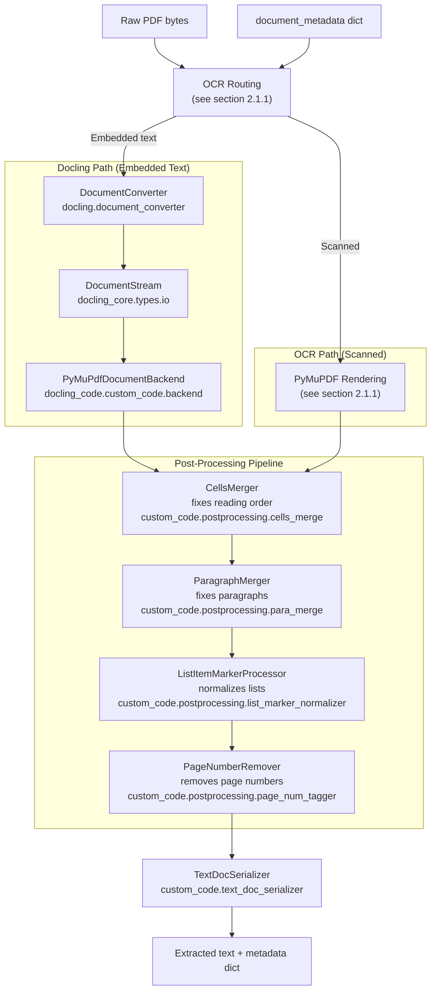
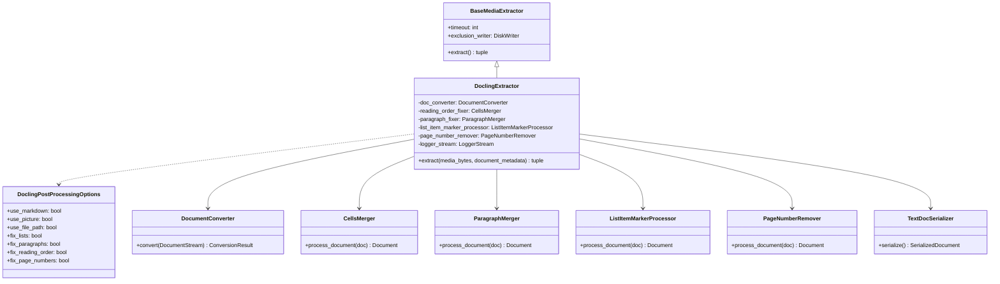
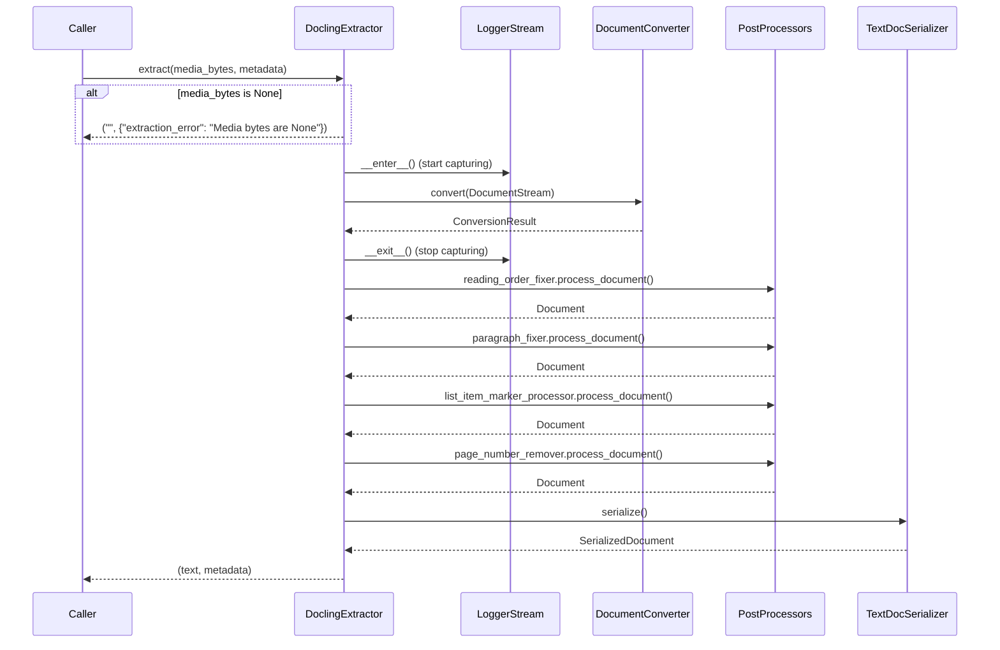

<!-- source: DeepWiki mcp.deepwiki.com · repo huggingface/finepdfs · page 2.1 PDF Extraction System · fetched 2026-10-26 -->

# PDF Extraction System

<details>
<summary>Relevant source files</summary>

The following files were used as context for generating this wiki page:

- [README.md](README.md)
- [THIRD_PARTY_NOTICES.md](THIRD_PARTY_NOTICES.md)
- [blocks/extractors/docling.py](blocks/extractors/docling.py)

</details>


## Purpose and Scope

This document describes the PDF text extraction system that processes raw PDF documents and produces structured text output with metadata. The extraction system implements intelligent routing between embedded text extraction and OCR processing, followed by multi-stage post-processing to improve text quality.

For information about how PDFs are filtered before extraction, see [Main Processing Pipeline](#2). For details on tokenization of extracted text, see [Tokenization Pipeline](#2.3).

## System Overview

The PDF extraction system operates as a two-path pipeline that determines the optimal extraction method for each document. The system uses an XGBoost classifier to route PDFs either to embedded text extraction via Docling or to OCR processing via PyMuPDF rendering. Both paths converge to a unified post-processing pipeline that fixes common extraction issues.

**Key Components:**

| Component | Purpose | Implementation |
|-----------|---------|----------------|
| OCR Routing Classifier | Determines if PDF needs OCR | XGBoost model, see [OCR Routing Classifier](#2.1.1) |
| Docling Extractor | Extracts embedded text | `DoclingExtractor` class |
| OCR Processor | Renders and OCRs scanned PDFs | PyMuPDF-based rendering |
| Post-Processors | Fixes extraction artifacts | Multi-stage pipeline |
| Corruption Detector | Identifies corrupted PDFs | Regex-based detection, see [Corrupted PDF Detection](#2.1.3) |

The system is designed with timeout handling, comprehensive error logging, and metadata tracking to ensure robust processing of large-scale PDF datasets.

Sources: [README.md:1-122](), [blocks/extractors/docling.py:1-107]()

## Extraction Flow

The following diagram illustrates the complete extraction flow, mapping natural language concepts to code entities:



**Flow Description:**

1. **Routing Decision**: PDF bytes and metadata are analyzed by the OCR routing classifier
2. **Extraction**: Routed to either Docling (embedded text) or OCR (scanned) path
3. **Post-Processing**: Both paths converge to a unified post-processing pipeline
4. **Serialization**: Final text is serialized with page breaks and metadata

Sources: [blocks/extractors/docling.py:34-107](), [README.md:38-39](), [README.md:84-92]()

## DoclingExtractor Architecture

The `DoclingExtractor` class is the primary entry point for embedded text extraction. It inherits from `BaseMediaExtractor` (see [Base Extractor Framework](#6.1)) and orchestrates the complete extraction and post-processing pipeline.



**Constructor Parameters:**

The `DoclingExtractor.__init__()` method [blocks/extractors/docling.py:35-55]() accepts:

| Parameter | Type | Default | Description |
|-----------|------|---------|-------------|
| `timeout` | `int` | `10*60` (10 minutes) | Maximum extraction time in seconds |
| `post_processing_options` | `DoclingPostProcessingOptions` | Default instance | Configuration for post-processing steps |
| `exclusion_writer` | `Optional[DiskWriter]` | `None` | Writer for documents that fail extraction |

**Pipeline Configuration:**

The constructor creates a `PdfPipelineOptions` object [blocks/extractors/docling.py:37-42]() with:
- `do_table_structure=False`: Disables table structure analysis
- `do_ocr=False`: Disables OCR (OCR is handled separately)
- `document_timeout`: Set to `timeout - 2` seconds to allow cleanup time
- `accelerator_options`: CPU-only processing with single thread

**Backend Selection:**

The extractor uses `PyMuPdfDocumentBackend` [blocks/extractors/docling.py:46]() as the PDF parsing backend. This is a custom backend implementation located in [docling_code/custom_code/backend/pymupdf_backend.py]().

Sources: [blocks/extractors/docling.py:34-55](), [blocks/extractors/docling.py:24-32]()

## Extraction Method

The `extract()` method [blocks/extractors/docling.py:59-107]() is the core processing function that takes PDF bytes and returns extracted text with metadata.

**Method Signature:**
```python
def extract(self, media_bytes: bytes | None, document_metadata: dict) -> tuple[str, dict]
```

**Processing Steps:**



**Conversion Process** [blocks/extractors/docling.py:69-76]():

1. Wraps `media_bytes` in a `BytesIO` stream
2. Creates a `DocumentStream` with name `"test.pdf"`
3. Calls `doc_converter.convert()` with `raises_on_error=True`
4. Captures all logs from `docling` and `pymupdf` loggers via `LoggerStream`

**Post-Processing Sequence** [blocks/extractors/docling.py:78-81]():

The document passes through four post-processors in strict order:

1. **CellsMerger** (`reading_order_fixer`): Fixes reading order issues by merging cells
2. **ParagraphMerger** (`paragraph_fixer`): Merges split paragraphs
3. **ListItemMarkerProcessor** (`list_item_marker_processor`): Normalizes list item markers
4. **PageNumberRemover** (`page_number_remover`): Removes page number artifacts

All processors except `ListItemMarkerProcessor` are called with `allow_multi_prov=True`.

**Serialization** [blocks/extractors/docling.py:82-94]():

The `TextDocSerializer` is configured with:
- `page_break_placeholder`: `"<--- page break --->"` for splitting pages
- `image_placeholder`: `"<docling_image></docling_image>"` for image locations
- `escape_underscores=False`: Raw underscores preserved
- `escape_html=False`: No HTML escaping

The serialized text is split by page breaks and rejoined without separators [blocks/extractors/docling.py:94]().

Sources: [blocks/extractors/docling.py:59-107]()

## Output Metadata

The extraction method returns a tuple of `(text: str, metadata: dict)`. The metadata dictionary [blocks/extractors/docling.py:96-106]() contains:

| Field | Type | Description |
|-------|------|-------------|
| `num_pages` | `int` | Number of pages extracted |
| `page_offsets` | `List[int]` | Cumulative character offsets for each page boundary |
| `docling_doc_dict` | `dict` | Original Docling document structure (before post-processing) |
| `logs` | `str` | Captured logs from Docling and PyMuPDF, UTF-8 encoded with error handling |
| `version` | `str` | Always `"2.0"` for this implementation |
| `conversion_status` | `str` | Docling ConversionStatus value (e.g., `"SUCCESS"`, `"PARTIAL_SUCCESS"`) |
| `extraction_error` | `str` | (Optional) Present if conversion failed, contains error details |

**Error Handling:**

If the conversion status is not `SUCCESS` or `PARTIAL_SUCCESS` [blocks/extractors/docling.py:104-106](), the metadata includes an `extraction_error` field with:
- Conversion status
- Serialized error objects from Docling
- Complete logger content

All error strings are UTF-8 encoded with `errors="ignore"` to handle problematic characters.

Sources: [blocks/extractors/docling.py:96-107]()

## Post-Processing Pipeline Details

The post-processing pipeline applies four transformations to fix common PDF extraction issues:

### 1. CellsMerger (Reading Order Fix)

**Purpose:** Corrects reading order issues where text cells are extracted in incorrect sequence.

**Location:** [docling_code/custom_code/postprocessing/cells_merge.py]()

**Key Features:**
- Merges adjacent cells that should be part of the same content flow
- Uses `allow_multi_prov=True` to handle cells with multiple provenance sources
- First stage of post-processing [blocks/extractors/docling.py:78]()

### 2. ParagraphMerger

**Purpose:** Merges paragraphs that were incorrectly split during extraction.

**Location:** [docling_code/custom_code/postprocessing/para_merge.py]()

**Key Features:**
- Identifies paragraph boundaries based on formatting and structure
- Uses `allow_multi_prov=True` for multi-source paragraphs
- Second stage of post-processing [blocks/extractors/docling.py:79]()

### 3. ListItemMarkerProcessor

**Purpose:** Normalizes list item markers (bullets, numbers) for consistent formatting.

**Location:** [docling_code/custom_code/postprocessing/list_marker_normalizer.py]()

**Key Features:**
- Standardizes bullet point and numbering formats
- Does not use `allow_multi_prov` parameter
- Third stage of post-processing [blocks/extractors/docling.py:80]()

### 4. PageNumberRemover

**Purpose:** Removes page number artifacts that should not appear in extracted text.

**Location:** [docling_code/custom_code/postprocessing/page_num_tagger.py]()

**Key Features:**
- Identifies and removes common page number patterns
- Final stage of post-processing [blocks/extractors/docling.py:81]()

**Processing Configuration:**

The `DoclingPostProcessingOptions` dataclass [blocks/extractors/docling.py:24-32]() controls which post-processing steps are enabled. Default configuration:

```python
DoclingPostProcessingOptions(
    use_markdown=False,
    use_picture=False,
    use_file_path=False,
    fix_lists=True,
    fix_paragraphs=True,
    fix_reading_order=True,
    fix_page_numbers=True
)
```

Sources: [blocks/extractors/docling.py:24-32](), [blocks/extractors/docling.py:51-54](), [blocks/extractors/docling.py:78-81]()

## Error Handling and Logging

The extraction system implements comprehensive error handling and logging to track processing issues:

### LoggerStream Capture

The `LoggerStream` class [blocks/extractors/docling.py:43]() captures logs from:
- `logging.getLogger("docling")`: Docling library logs
- `logging.getLogger("pymupdf")`: PyMuPDF backend logs

**Usage Pattern** [blocks/extractors/docling.py:69-76]():

```python
with self.logger_stream as log_output:
    # Docling processing happens here
    converted = self.doc_converter.convert(document_stream)
logger_content = log_output.value()
```

The captured logs are stored in the output metadata [blocks/extractors/docling.py:100]() with UTF-8 encoding and error handling to ensure problematic characters don't cause failures.

For more details on `LoggerStream` implementation, see [Logging and Debugging](#6.2).

### Timeout Handling

The system implements two levels of timeout:
1. **Docling timeout**: Set to `timeout - 2` seconds [blocks/extractors/docling.py:36]()
2. **BaseMediaExtractor timeout**: Overall timeout from parent class

This ensures Docling has time to clean up before the overall timeout triggers.

### Runtime Warning Suppression

Runtime warnings are suppressed during conversion [blocks/extractors/docling.py:70-71]():

```python
with warnings.catch_warnings():
    warnings.simplefilter("ignore", category=RuntimeWarning)
```

This prevents noise from NumPy and other libraries during batch processing.

### Conversion Status Tracking

The system tracks Docling's `ConversionStatus` [blocks/extractors/docling.py:102]() which can be:
- `SUCCESS`: Full successful conversion
- `PARTIAL_SUCCESS`: Some content extracted despite issues
- `FAILURE`: Complete conversion failure

Failed conversions generate detailed error metadata [blocks/extractors/docling.py:104-106]() including serialized error objects and complete logs.

Sources: [blocks/extractors/docling.py:36](), [blocks/extractors/docling.py:43](), [blocks/extractors/docling.py:69-76](), [blocks/extractors/docling.py:100](), [blocks/extractors/docling.py:102](), [blocks/extractors/docling.py:104-106]()

## Integration with Vendored Docling

The extraction system uses vendored versions of three Docling packages located in [docling_code/]():

| Package | Location | License | Purpose |
|---------|----------|---------|---------|
| docling | `docling_code/docling/` | MIT | Core document conversion library |
| docling-core | `docling_code/docling-core/` | MIT | Data models and utilities |
| docling-ibm-models | `docling_code/docling-ibm-models/` | See upstream | Layout detection models |

**Why Vendored:**

The README [README.md:87-88]() states these are "exact versions used, modified for better performance/extraction clarity." This allows:
- Precise version control
- Custom performance optimizations
- Extraction clarity improvements
- Independence from upstream breaking changes

**Custom Backend:**

The system uses a custom `PyMuPdfDocumentBackend` [blocks/extractors/docling.py:22]() implementation from [docling_code/custom_code/backend/pymupdf_backend.py]() instead of Docling's default backend.

**Custom Serializer:**

The system uses a custom `TextDocSerializer` [blocks/extractors/docling.py:16]() from [docling_code/custom_code/text_doc_serializer.py]() for fine-grained control over text output formatting.

For details on the quantized layout model used by Docling, see [Docling Integration](#2.1.2).

Sources: [README.md:87-88](), [THIRD_PARTY_NOTICES.md:5-12](), [blocks/extractors/docling.py:11-22](), [blocks/extractors/docling.py:46]()

## Limitations

The README [README.md:98-103]() documents key limitations of the extraction system:

**Docling-Based Extraction:**
- Extracts embedded text only; content in images is missed
- Tables and equations may misalign due to complex layout
- Possible paragraph order issues in multi-column layouts

**OCR-Based Extraction:**
- May hallucinate or miss text, especially for low-resource languages
- Page-level failures can occur for complex layouts
- Quality depends on scan resolution and document condition

**General:**
- No table structure preservation (`do_table_structure=False`)
- No OCR within Docling path (`do_ocr=False`)
- Single-threaded processing (`num_threads=1`)

For detailed trade-offs and production considerations, see the FinePDFs dataset card at [HuggingFaceFW/finepdfs](https://huggingface.co/datasets/HuggingFaceFW/finepdfs).

Sources: [README.md:98-104](), [blocks/extractors/docling.py:37-42]()

---

