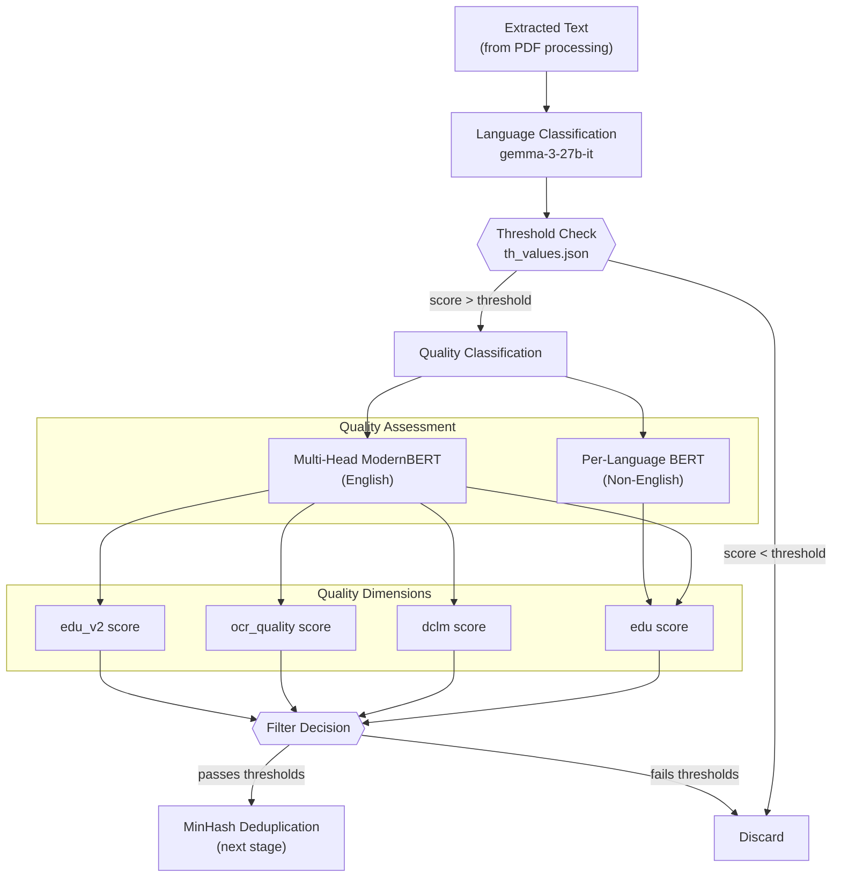
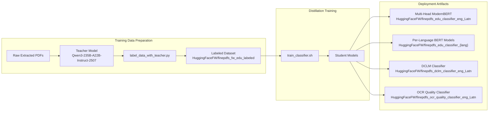
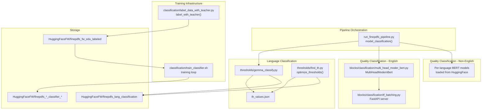
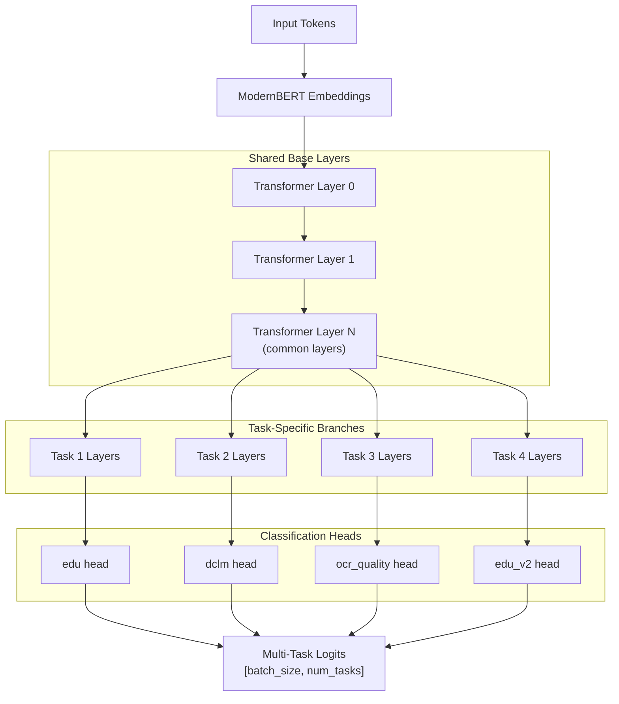
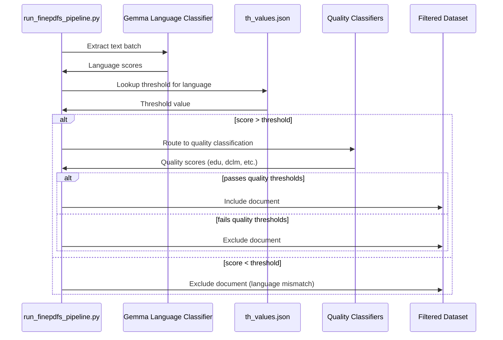

<!-- source: DeepWiki mcp.deepwiki.com · repo huggingface/finepdfs · page 2.2 Classification and Filtering · fetched 2026-10-26 -->

# Classification and Filtering

<details>
<summary>Relevant source files</summary>

The following files were used as context for generating this wiki page:

- [README.md](README.md)
- [blocks/classification/multi_head_moder_bert.py](blocks/classification/multi_head_moder_bert.py)

</details>


## Purpose and Scope

This page provides an overview of the classification and filtering system used in the FinePDFs pipeline. The system performs two main functions: (1) language identification to route documents to the appropriate language bucket, and (2) quality assessment to filter documents based on educational value and content quality.

The classification system operates after PDF extraction and post-processing, but before final deduplication and dataset publication. For detailed information on specific components:
- Language filtering details: [2.2.1](#2.2.1)
- Quality classifier training and architecture: [2.2.2](#2.2.2)
- Multi-head ModernBERT implementation: [2.2.3](#2.2.3)
- Batched inference server: [2.2.4](#2.2.4)

For the broader pipeline context, see [Main Processing Pipeline](#2).

---

## Classification Pipeline Overview

The FinePDFs classification system uses a two-stage approach to filter and categorize extracted PDF content:



**Sources:** [README.md:45-76](), [run_finepdfs_pipeline.py]()

---

## Two-Stage Classification Strategy

The system separates language identification from quality assessment for two key reasons:

1. **Language routing is prerequisite**: Documents must be assigned to a language before quality models can be applied, as quality classifiers are language-specific
2. **Precision-focused filtering**: Language filtering uses strict precision requirements (minimum 0.9) to avoid mis-routing, while quality filtering uses different thresholds optimized for dataset composition

### Language Classification Stage

Language classification uses `google/gemma-3-27b-it` as an LLM-based classifier. The model assigns probability scores for each language, and a threshold optimization process determines cutoff values that maximize precision while maintaining minimum recall.

**Key characteristics:**
- **Model**: `google/gemma-3-27b-it`
- **Optimization metric**: F-beta score with β=0.1 (heavily prioritizing precision)
- **Constraints**: minimum recall 0.1, minimum precision 0.9
- **Threshold storage**: `th_values.json`

For implementation details, see [Language Filtering](#2.2.1).

### Quality Classification Stage

Quality classification evaluates documents across multiple dimensions using distilled classifiers:

| Classifier | Language Coverage | Architecture | Purpose |
|------------|------------------|--------------|---------|
| `edu` | All 67 languages | BERT (non-English), Multi-head ModernBERT (English) | Educational content detection |
| `dclm` | English only | Multi-head ModernBERT | DataComp-LM quality criteria |
| `ocr_quality` | English only | Multi-head ModernBERT | OCR extraction quality |
| `edu_v2` | English only | Multi-head ModernBERT | Advanced educational content (beyond undergraduate) |

**Threshold strategy**: Quality classifiers use top-10% threshold selection, meaning documents scoring in the top 10% of the score distribution are retained.

**Sources:** [README.md:57-76](), [classification/train_classifier.sh]()

---

## Teacher-Student Distillation Architecture

The quality classification system uses knowledge distillation to create efficient inference models:



### Rationale for Distillation

**Performance requirements**: The teacher model (`Qwen3-235B-A22B-Instruct-2507`) provides high-quality labels but is too slow for production inference on millions of documents. Student models achieve 100-1000x speedup while maintaining classification quality.

**Model selection**: The teacher model was selected because it "most closely matched Claude Sonnet 3.7 among open-source LLMs" according to internal evaluations.

**Multi-head optimization**: For English, a multi-head architecture allows simultaneous inference across multiple quality dimensions (edu, dclm, ocr_quality, edu_v2) by sharing the base transformer layers and only specializing the final classification heads.

**Sources:** [README.md:65-76](), [classification/label_data_with_teacher.py](), [classification/train_classifier.sh]()

---

## Code Entity Mapping

The following diagram maps classification system components to their implementations:



**Sources:** [run_finepdfs_pipeline.py](), [blocks/classification/multi_head_moder_bert.py](), [blocks/classification/tf_batching.py](), [thresholds/find_th.py](), [thresholds/gemma_classify.py](), [classification/label_data_with_teacher.py](), [classification/train_classifier.sh]()

---

## Multi-Head Architecture for Efficient Inference

The `MultiHeadModernBert` class in [blocks/classification/multi_head_moder_bert.py:7-269]() implements a specialized architecture that enables efficient multi-task classification:

### Architecture Design



### Layer Sharing Detection

The implementation automatically detects the last common layer by comparing parameters across all loaded models:

```python
# Pseudocode from MultiHeadModernBert.__init__
for layer_idx in range(num_layers):
    if all_models_have_identical_parameters_at_layer(layer_idx):
        last_common_layer = layer_idx + 1
    else:
        break
```

This allows the class to adapt to different fine-tuning strategies where models may share different numbers of base layers.

**Performance benefit**: Shared base layers are computed once per document, reducing inference cost by approximately 75% compared to running four separate models.

For architectural details, see [Multi-Head ModernBERT Architecture](#2.2.3).

**Sources:** [blocks/classification/multi_head_moder_bert.py:7-269]()

---

## Threshold Optimization Process

The system uses distinct threshold optimization strategies for language and quality classification:

### Language Threshold Optimization

The `find_th.py` script optimizes thresholds to maximize F-beta score:

| Parameter | Value | Rationale |
|-----------|-------|-----------|
| `beta` | 0.1 | Heavily prioritizes precision over recall |
| `min_recall` | 0.1 | Ensures at least 10% of target language content is retained |
| `min_precision` | 0.9 | Prevents mis-routing to wrong languages |
| `min_score` | 0.1 | Avoids unreasonably low thresholds |

**Optimization objective:**
```
F_beta = (1 + beta^2) * (precision * recall) / (beta^2 * precision + recall)
```

With β=0.1, the formula becomes:
```
F_0.1 ≈ precision + 0.01 * recall
```

This heavily weights precision, ensuring high-quality language routing.

### Quality Threshold Strategy

Quality classifiers use a simpler top-10% threshold approach:
1. Score all documents in a calibration set
2. Set threshold at 90th percentile of score distribution
3. Documents scoring above this threshold are retained

This ensures a consistent fraction of high-quality documents is selected across different quality dimensions.

**Sources:** [README.md:45-54](), [thresholds/find_th.py]()

---

## Integration with Pipeline

The classification system is invoked by the `model_classification()` function in the main pipeline:



The pipeline processes documents in batches to maximize throughput. For English documents, the multi-head architecture enables parallel quality assessment across all dimensions.

**Sources:** [run_finepdfs_pipeline.py](), [README.md:45-76]()

---

## Published Classification Artifacts

The following datasets and models are published on HuggingFace:

### Labeled Datasets

| Dataset | Purpose | Size |
|---------|---------|------|
| `HuggingFaceFW/finepdfs_lang_classification` | Gemma-labeled language annotations (20k samples/language) | Used for threshold optimization |
| `HuggingFaceFW/finepdfs_fw_edu_labeled` | Teacher-labeled educational content annotations | Training data for student classifiers |

### Trained Classifiers

| Model | Languages | Architecture |
|-------|-----------|--------------|
| `HuggingFaceFW/finepdfs_edu_classifier_eng_Latn` | English | Multi-head ModernBERT |
| `HuggingFaceFW/finepdfs_edu_classifier_{lang}` | 66 non-English languages | BERT |
| `HuggingFaceFW/finepdfs_dclm_classifier_eng_Latn` | English | Multi-head ModernBERT |
| `HuggingFaceFW/finepdfs_ocr_quality_classifier_eng_Latn` | English | Multi-head ModernBERT |
| `HuggingFaceFW/finepdfs_edu_classifier_v2_eng_Latn` | English | Multi-head ModernBERT |

### Language Coverage

The `edu` classifier supports 67 languages listed in `classification/edu_langs.txt`. Languages are specified using BCP-47 codes with script subtags (e.g., `eng_Latn` for English Latin script, `zho_Hans` for Simplified Chinese).

**Sources:** [README.md:71-76](), [classification/edu_langs.txt]()

---

## Summary

The FinePDFs classification and filtering system provides:

1. **Precision-focused language routing** using LLM-based classification with optimized thresholds
2. **Multi-dimensional quality assessment** across educational content, general quality (DCLM), and OCR quality
3. **Efficient inference** through teacher-student distillation and multi-head architectures
4. **Language-specific optimization** with 67 supported languages and per-language models

The system balances three competing objectives:
- **Precision**: Minimize false positives (wrong language, low quality)
- **Recall**: Retain sufficient high-quality content for training
- **Performance**: Enable practical inference on millions of documents

This design enables the production of a high-quality, multilingual dataset while maintaining computational feasibility.

---

