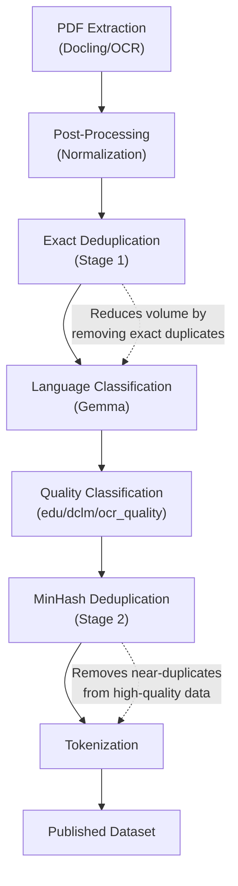
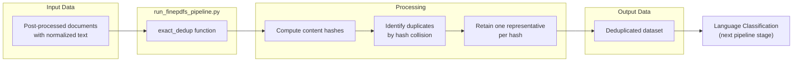
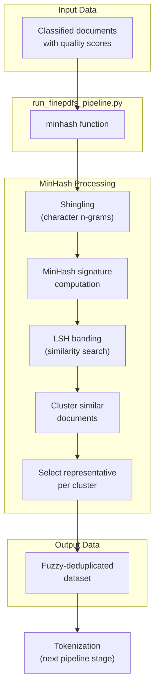
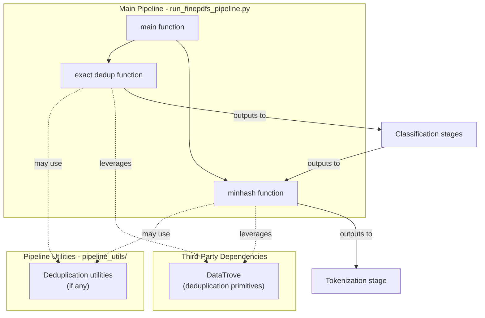

<!-- source: DeepWiki mcp.deepwiki.com · repo huggingface/finepdfs · page 2.4 Deduplication · fetched 2026-10-26 -->

# Deduplication

Relevant source files

The following files were used as context for generating this wiki page:

- [README.md](README.md)

## Purpose and Scope

This document describes the two-stage deduplication strategy used in the FinePDFs pipeline. The system employs exact deduplication followed by MinHash-based fuzzy deduplication to remove duplicate content while balancing computational efficiency with deduplication effectiveness.

For information about the overall pipeline flow, see [Main Processing Pipeline](#2). For details about text extraction that precedes deduplication, see [PDF Extraction System](#2.1). For information about classification stages between deduplication phases, see [Classification and Filtering](#2.2).

**Sources:** [README.md:1-122]()

## Deduplication Strategy Overview

The FinePDFs pipeline implements a two-stage deduplication approach positioned strategically within the processing workflow:

1. **Exact Deduplication**: Applied after PDF extraction and post-processing, before classification. This stage removes documents with identical content hashes, reducing the dataset size before expensive classification operations.

2. **MinHash Deduplication**: Applied after language and quality classification. This stage uses locality-sensitive hashing to identify and remove near-duplicate documents, operating on already-filtered high-quality content.

The two-stage approach optimizes computational resources by performing exact deduplication early (reducing classification workload) and fuzzy deduplication late (operating only on documents that passed quality filters).

**Sources:** [README.md:81]()

**Figure 1: Deduplication Stages in Pipeline Flow**

**Sources:** [README.md:81]()

## Exact Deduplication (Stage 1)

### Purpose and Timing

Exact deduplication occurs immediately after post-processing and before any classification steps. This positioning is intentional: removing exact duplicates early reduces the computational cost of subsequent classification operations (language detection, quality scoring) while maintaining data quality.

The stage operates on normalized, post-processed text where formatting artifacts, page numbers, and other non-content elements have already been removed by the post-processing pipeline.

### Method

Exact deduplication identifies documents with identical content by computing cryptographic hashes of the full document text. Documents with matching hashes are considered duplicates, and only one representative is retained.

This approach guarantees:
- **Zero false positives**: Only truly identical documents are removed
- **Deterministic behavior**: The same input always produces the same output
- **High efficiency**: Hash comparison is O(1) for each document pair

### Integration Points

The exact deduplication step is orchestrated by the main pipeline driver in `run_finepdfs_pipeline.py`, which manages the sequence of operations. The step receives post-processed documents as input and outputs a deduplicated dataset that flows into the language classification stage.

**Sources:** [README.md:81]()

**Figure 2: Exact Deduplication Implementation Flow**

**Sources:** [README.md:81]()

## MinHash Deduplication (Stage 2)

### Purpose and Timing

MinHash deduplication occurs after language classification and quality filtering, operating on documents that have already passed quality thresholds. This late-stage positioning ensures that:

1. Computational resources are focused on high-quality content
2. Near-duplicate detection considers only documents worth retaining
3. Classification results can inform deduplication decisions (e.g., per-language deduplication)

MinHash fuzzy deduplication is necessary because exact deduplication cannot detect near-duplicates—documents that differ slightly due to:
- Minor formatting variations
- OCR inconsistencies between different scans of the same document
- Slight content modifications (corrections, updates, translations of excerpts)
- Extraction artifacts from different PDF processing paths

### Method

MinHash is a locality-sensitive hashing technique that estimates Jaccard similarity between document sets efficiently. The algorithm:

1. **Shingling**: Converts each document into a set of character n-grams (shingles)
2. **MinHash signatures**: Computes multiple hash functions and retains minimum values, creating a compact signature
3. **LSH banding**: Groups signatures into bands for efficient similarity search
4. **Similarity threshold**: Identifies document pairs with estimated Jaccard similarity above a threshold
5. **Deduplication**: Removes duplicates within similarity clusters, retaining one representative

This approach provides:
- **Approximate matching**: Detects near-duplicates even with minor differences
- **Scalability**: O(n) time complexity vs. O(n²) for pairwise comparison
- **Tunable precision/recall**: Configurable similarity threshold and LSH parameters

### Integration Points

The MinHash deduplication step is orchestrated by the main pipeline driver in `run_finepdfs_pipeline.py` as part of the "minhash" function. The step receives classified documents (with language and quality scores) as input and outputs a fuzzy-deduplicated dataset that flows into tokenization.

The implementation likely leverages DataTrove, which is listed as a third-party dependency and provides efficient deduplication primitives for large-scale text processing.

**Sources:** [README.md:81]()

**Figure 3: MinHash Deduplication Implementation Flow**

**Sources:** [README.md:81]()

## Pipeline Integration

### Orchestration

Both deduplication stages are orchestrated by the main pipeline driver located in `run_finepdfs_pipeline.py`. The driver manages:

- **Data flow**: Passing output from one stage as input to the next
- **Error handling**: Capturing and reporting failures in deduplication steps
- **Logging**: Recording statistics about duplicate detection and removal
- **Parallelization**: Coordinating distributed processing (likely via SLURM for large-scale runs)

The pipeline structure ensures that deduplication stages are executed in the correct sequence with appropriate error handling and monitoring.

**Sources:** [README.md:24-32](), [README.md:81]()

### Configuration

The pipeline is configured through command-line arguments to `run_finepdfs_pipeline.py`. While specific deduplication parameters are not explicitly documented in the README, typical configuration options include:

- MinHash signature size
- LSH band configuration
- Jaccard similarity threshold
- Parallelization parameters

**Sources:** [README.md:24-32]()

## Deduplication Impact

The two-stage deduplication strategy provides several benefits:

| Benefit | Description |
|---------|-------------|
| **Computational Efficiency** | Exact dedup reduces classification workload; MinHash operates only on quality-filtered data |
| **Quality Preservation** | MinHash on filtered data avoids removing unique high-quality content that happens to be similar to low-quality content |
| **Scalability** | Both stages scale to large datasets through efficient hashing and distributed processing |
| **Reproducibility** | Deterministic exact dedup + seeded MinHash ensures consistent results across runs |

The exact deduplication stage significantly reduces dataset size before expensive classification operations (language detection with Gemma, quality scoring with ModernBERT). The MinHash stage ensures that the final dataset does not contain near-duplicate documents that would provide redundant training signal.

**Sources:** [README.md:81]()

## Code Structure

**Figure 4: Code Organization for Deduplication**

**Sources:** [README.md:81-83]()

## Workflow Summary

The complete deduplication workflow in the context of the full pipeline:

1. **Pre-Exact Dedup**: Documents are extracted and post-processed
2. **Exact Deduplication**: Identical documents removed via content hashing
3. **Classification**: Language and quality filters applied to remaining documents
4. **MinHash Deduplication**: Near-duplicates removed from high-quality documents
5. **Post-MinHash**: Deduplicated dataset proceeds to tokenization and dataset publication

This workflow balances computational efficiency (early exact dedup), quality preservation (classification before fuzzy dedup), and deduplication effectiveness (two complementary approaches).

**Sources:** [README.md:81]()

---

