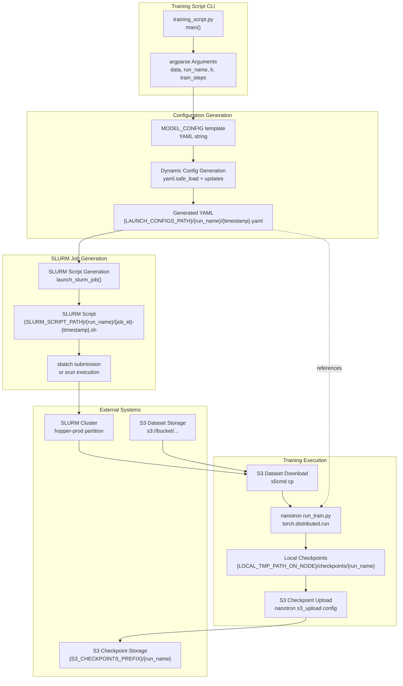
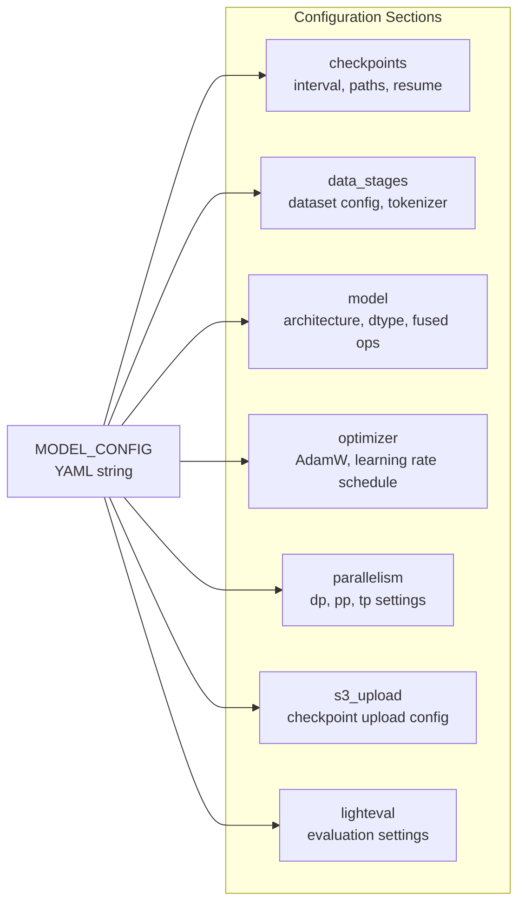
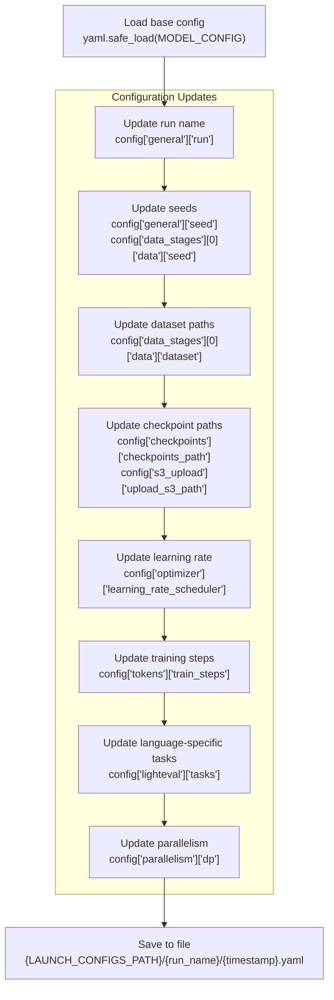
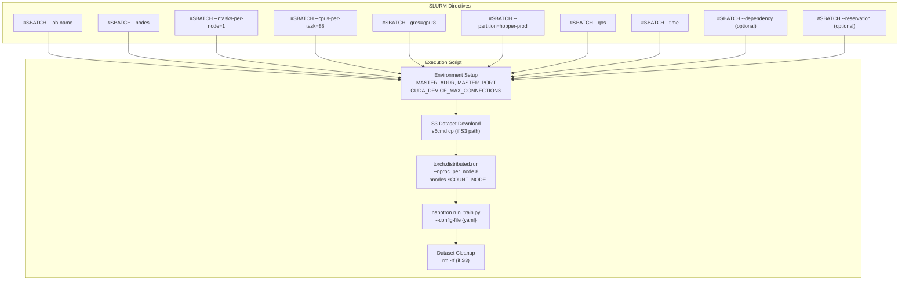
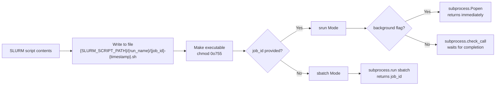
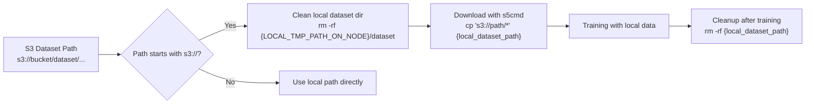

<!-- source: DeepWiki mcp.deepwiki.com · repo huggingface/finepdfs · page 3 Training Infrastructure · fetched 2026-10-26 -->

# Training Infrastructure

<details>
<summary>Relevant source files</summary>

The following files were used as context for generating this wiki page:

- [README.md](README.md)
- [ablations/training/training_script.py](ablations/training/training_script.py)

</details>


## Purpose and Scope

This document describes the training infrastructure used to train language models on the FinePDFs dataset. The system uses the nanotron distributed training framework, orchestrated via SLURM workload manager, with S3 for data storage and checkpoint management. The training pipeline handles dynamic configuration generation, distributed data loading, and automatic checkpoint uploading.

For evaluation of trained models, see [Evaluation Infrastructure](#4). For the dataset preparation that precedes training, see [Main Processing Pipeline](#2).

## Overview

The training infrastructure is centered around [ablations/training/training_script.py](), which serves as a CLI wrapper that generates nanotron configurations and SLURM batch scripts dynamically based on command-line arguments. The system supports multi-node distributed training with automatic S3 data synchronization and checkpoint management.



**Sources:** [ablations/training/training_script.py:1-433]()

## Command-Line Interface

The training script provides a comprehensive CLI for launching training jobs:

| Argument | Type | Default | Description |
|----------|------|---------|-------------|
| `data` | str | required | Dataset folder path (local or S3) |
| `run_name` | str | required | Run identifier |
| `--tokenizer` | str | `user/Llama-3.2-1B-no-bos` | HuggingFace tokenizer path |
| `-d` | str | None | SLURM job dependency ID |
| `--seed` | int | 6 | Model initialization seed |
| `--data-seed` | int | 6 | Data loading seed |
| `--train_steps` / `-ts` | int | 17000 | Total training steps |
| `--priority` / `--qos` / `-p` | str | `normal` | SLURM QoS level |
| `--nodes` | int | 1 | Number of compute nodes |
| `--lr` | float | 5e-4 | Peak learning rate |
| `--background` | flag | False | Run in background (no wait) |
| `--reservation` | str | None | SLURM reservation name |
| `--time` | str | `08:59:00` | SLURM time limit |
| `--resume` | flag | False | Resume from S3 checkpoint |
| `--debug` | flag | False | Enable debug mode (reduced parallelism) |
| `--job_id` | str | None | Existing SLURM job ID for srun execution |

Example usage:

```bash
python ablations/training/training_script.py \
  s3://bucket/dataset/finepdfs-eng_Latn \
  eng_Latn-baseline \
  --nodes 8 \
  --train_steps 17000 \
  --lr 5e-4 \
  --priority high
```

**Sources:** [ablations/training/training_script.py:221-239]()

## Configuration Management

### Model Configuration Template

The system uses a YAML configuration template [ablations/training/training_script.py:26-174]() that defines all training hyperparameters:



Key configuration sections:

- **checkpoints**: Defines checkpoint intervals (500 steps), local paths on compute nodes, and S3 upload behavior [ablations/training/training_script.py:27-35]()
- **data_stages**: Specifies dataset locations, tokenizer, vocabulary size, and data loading settings [ablations/training/training_script.py:36-47]()
- **model**: Architecture definition using Qwen2-like configuration with 28 layers, 2048 hidden size, flash attention, and fused operations [ablations/training/training_script.py:61-99]()
- **optimizer**: AdamW with cosine learning rate decay, gradient clipping, and weight decay [ablations/training/training_script.py:100-120]()
- **parallelism**: Data, pipeline, and tensor parallelism configuration (defaults to DP=64) [ablations/training/training_script.py:121-131]()
- **s3_upload**: Automatic S3 checkpoint upload with configurable concurrency [ablations/training/training_script.py:133-138]()
- **lighteval**: Evaluation interval and task configuration per language [ablations/training/training_script.py:154-173]()

**Sources:** [ablations/training/training_script.py:26-174]()

### Dynamic Configuration Generation

The `main()` function [ablations/training/training_script.py:221-431]() dynamically modifies the configuration template:



Notable configuration logic:

1. **Run naming**: Combines `run_name`, total tokens (in billions), and combined seed: `{run_name}-{tokens}B-seed-{seed + data_seed * 100}` [ablations/training/training_script.py:249-250]()

2. **Dataset path resolution**: If dataset is an S3 path, sets local path to `{LOCAL_TMP_PATH_ON_NODE}/dataset/{run_name}/`; otherwise uses provided path [ablations/training/training_script.py:253-259]()

3. **Learning rate schedule**: Automatically calculates warmup (10% of steps) and decay schedule [ablations/training/training_script.py:314-318]():
   ```
   decay_start_step = 0.1 * train_steps
   decay_steps = train_steps - decay_start_step
   min_decay_lr = lr / 10
   ```

4. **Data parallelism**: Set to `nodes * NUM_GPUS` (8 GPUs per node) [ablations/training/training_script.py:308]()

5. **Language-specific configuration**: Tasks and custom task modules selected based on language prefix in run name [ablations/training/training_script.py:283-295]():

| Language | Custom Tasks Module | Tasks File |
|----------|-------------------|-----------|
| `eng_Latn` | `/admin/home/user/shared/projects/new_training_setup/task_list.py` | `tasks_eng.txt` |
| `fra_Latn` | `lighteval.tasks.multilingual.tasks` | `tasks_fra.txt` |
| `arb_Arab` | `lighteval.tasks.multilingual.tasks` | `tasks_ara.txt` |
| `cmn_Hani` | `lighteval.tasks.multilingual.tasks` | `tasks_zho.txt` |
| `rus_Cyrl` | `lighteval.tasks.multilingual.tasks` | `tasks_rus.txt` |

**Sources:** [ablations/training/training_script.py:176-190](), [ablations/training/training_script.py:184-190](), [ablations/training/training_script.py:241-336]()

## SLURM Job Generation and Submission

### SLURM Script Template

The training script generates a comprehensive SLURM batch script [ablations/training/training_script.py:353-422]():



Key SLURM script components:

1. **Multi-node configuration**: Uses `--ntasks-per-node=1` (critical for proper distributed setup) with 88 CPUs and 8 GPUs per node [ablations/training/training_script.py:356-358]()

2. **Master node discovery**: Automatically determines master address from SLURM nodelist:
   ```bash
   export MASTER_ADDR=$(scontrol show hostnames "$SLURM_JOB_NODELIST" | head -n 1)
   export MASTER_PORT={1024 + random.randint(0, 64511)}
   ```
   [ablations/training/training_script.py:380-382]()

3. **S3 dataset download**: If dataset path starts with `s3://`, downloads to local scratch before training [ablations/training/training_script.py:343-348]():
   ```bash
   srun rm -rf {LOCAL_TMP_PATH_ON_NODE}/dataset
   srun {S5CMD_PATH} cp '{s3_path}/*' {local_dataset_path}
   ```

4. **PyTorch distributed launcher**: Configures multi-node training with c10d rendezvous [ablations/training/training_script.py:397-407]():
   ```bash
   python -u -m torch.distributed.run \
       --nproc_per_node 8 \
       --nnodes $COUNT_NODE \
       --rdzv-backend c10d \
       --rdzv-endpoint $MASTER_ADDR:$MASTER_PORT \
       --rdzv-id $SLURM_JOB_ID \
       --node_rank $SLURM_PROCID
   ```

5. **Random delay for hub access**: Adds random 0-1 second delay to avoid concurrent HuggingFace Hub requests [ablations/training/training_script.py:409-413]()

**Sources:** [ablations/training/training_script.py:353-422]()

### Job Submission Function

The `launch_slurm_job()` helper [ablations/training/training_script.py:192-219]() manages script creation and submission:



The function supports two execution modes:

1. **sbatch mode** (no `job_id`): Submits new SLURM job and returns job ID [ablations/training/training_script.py:218-219]()
2. **srun mode** (with `job_id`): Executes within existing job allocation, with optional background execution [ablations/training/training_script.py:209-217]()

**Sources:** [ablations/training/training_script.py:192-219]()

## S3 Integration

### Data Download

For S3-based datasets, the system automatically downloads data to local scratch storage before training begins [ablations/training/training_script.py:342-348]():



The local dataset path is constructed as: `{LOCAL_TMP_PATH_ON_NODE}/dataset/{run_name}/` where `LOCAL_TMP_PATH_ON_NODE = /scratch/{USER}` [ablations/training/training_script.py:13]()

**Sources:** [ablations/training/training_script.py:13](), [ablations/training/training_script.py:253](), [ablations/training/training_script.py:343-348](), [ablations/training/training_script.py:419-421]()

### Checkpoint Upload

Checkpoint upload to S3 is configured in the nanotron YAML under the `s3_upload` section [ablations/training/training_script.py:133-138]():

```yaml
s3_upload:
  remove_after_upload: true
  s5cmd_concurrency: 5
  s5cmd_numworkers: 16
  s5cmd_path: {S5CMD_PATH}
  upload_s3_path: {S3_CHECKPOINTS_PREFIX}/{run_name}
```

The checkpoint upload path is constructed as: `s3://bucket/experiments/checkpoints/{run_name}` [ablations/training/training_script.py:18](), [ablations/training/training_script.py:273]()

Nanotron handles the actual upload process during training, uploading checkpoints immediately after saving them locally [ablations/training/training_script.py:28-30](). The `remove_after_upload: true` setting ensures local checkpoints are deleted after successful S3 upload to conserve scratch space.

**Sources:** [ablations/training/training_script.py:133-138](), [ablations/training/training_script.py:273]()

## Nanotron Framework Integration

### Training Execution

The system integrates with nanotron by invoking its `run_train.py` script with the dynamically generated configuration [ablations/training/training_script.py:393-396]():

```bash
{NANOTRON_PATH}/run_train.py --config-file {config_path_yaml}
```

Where `NANOTRON_PATH = /shared/user/projects/new_training_setup/nanotron` [ablations/training/training_script.py:16]()

### Key Nanotron Configuration Features

1. **Document masking**: Enabled via `_use_doc_masking: true` in model config [ablations/training/training_script.py:71]() to prevent attention across document boundaries

2. **Optimized operations**:
   - Flash Attention 2: `_attn_implementation: flash_attention_2` [ablations/training/training_script.py:68]()
   - Fused RMSNorm: `_fused_rms_norm: true` [ablations/training/training_script.py:69]()
   - Fused Rotary Embeddings: `_fused_rotary_emb: true` [ablations/training/training_script.py:70]()
   - QKV Packed: `_use_qkv_packed: true` [ablations/training/training_script.py:72]()

3. **Data loading**: Uses nanotron's BRRR dataloader with configuration [ablations/training/training_script.py:38-45]():
   ```yaml
   dataset:
     pad_samples_to_global_batch_size: false
     return_positions: true
     token_size_in_bytes: 4
     use_old_brrr_dataloader: false
   ```

4. **Mixed precision**: Training uses bfloat16 with FP32 gradient accumulation [ablations/training/training_script.py:63](), [ablations/training/training_script.py:101]()

**Sources:** [ablations/training/training_script.py:16](), [ablations/training/training_script.py:38-99](), [ablations/training/training_script.py:393-396]()

## Model Architecture

The default model configuration [ablations/training/training_script.py:61-99]() defines a Qwen2-based architecture:

| Parameter | Value |
|-----------|-------|
| `hidden_size` | 2048 |
| `num_hidden_layers` | 28 |
| `num_attention_heads` | 16 |
| `num_key_value_heads` | 8 (GQA) |
| `intermediate_size` | 6144 |
| `max_position_embeddings` | 4096 |
| `vocab_size` | 128256 |
| `hidden_act` | `silu` |
| `rms_norm_eps` | 1e-6 |
| `rope_theta` | 10000 |

This configuration is approximately 1B parameters. The architecture includes:
- Grouped Query Attention (GQA) with 8 KV heads
- RoPE positional embeddings (non-interleaved)
- SiLU activation function
- Tied input/output embeddings
- Optional z-loss regularization (disabled by default)

**Sources:** [ablations/training/training_script.py:67-99]()

## Training Hyperparameters

### Default Training Configuration

| Category | Parameter | Value |
|----------|-----------|-------|
| **Optimization** | Optimizer | AdamW (fused) |
| | Learning rate | 5e-4 |
| | Weight decay | 0.1 |
| | Gradient clipping | 1.0 |
| | Beta1 / Beta2 | 0.9 / 0.95 |
| | Epsilon | 1e-8 |
| **Schedule** | Warmup steps | 10% of training |
| | Warmup style | Linear |
| | Decay style | Cosine |
| | Min decay LR | LR / 10 |
| **Batch** | Micro batch size | 2 |
| | Gradient accumulation | 4 |
| | Sequence length | 4096 |
| | Global batch size | 2 × 4 × 4096 × DP |
| **Checkpointing** | Checkpoint interval | 500 steps |
| | Save initial state | False |
| | Save final state | True |

The effective tokens per step is calculated as:
```
tokens_per_step = 4096 × 4 × 2 × DP
                = 32768 × DP
```

For 64-way data parallelism (8 nodes × 8 GPUs), this gives **2,097,152 tokens per step**.

**Sources:** [ablations/training/training_script.py:100-120](), [ablations/training/training_script.py:147-152]()

## Logging and Output Management

### Log Directory Structure

The system organizes logs in a hierarchical structure:

```
{TRAINING_LOGS_PATH}/{run_name}/
└── train-{timestamp}-{job_name}-{job_id}
```

Where `TRAINING_LOGS_PATH = /shared/{USER}/logs/pdf_project/experiments/training/logs` [ablations/training/training_script.py:14]()

Configuration files are saved separately:

```
{LAUNCH_CONFIGS_PATH}/{run_name}/
└── {timestamp}.yaml
```

Where `LAUNCH_CONFIGS_PATH = /shared/{USER}/logs/pdf_project/experiments/training/launch-configs` [ablations/training/training_script.py:19]()

SLURM scripts are archived:

```
{SLURM_SCRIPT_PATH}/{run_name}/
└── {job_id}-{timestamp}.sh
```

Where `SLURM_SCRIPT_PATH = /shared/{USER}/logs/pdf_project/experiments/training/slurm-scripts` [ablations/training/training_script.py:20]()

**Sources:** [ablations/training/training_script.py:14](), [ablations/training/training_script.py:19-20](), [ablations/training/training_script.py:201-203](), [ablations/training/training_script.py:339]()

### Logging Configuration

Nanotron logging is configured with [ablations/training/training_script.py:57-60]():

```yaml
logging:
  iteration_step_info_interval: 5
  log_level: info
  log_level_replica: info
```

Additional logging configuration [ablations/training/training_script.py:143-145]():

```yaml
metrics_logging:
  log_level: 1
  log_detail_interval: 200
```

**Sources:** [ablations/training/training_script.py:57-60](), [ablations/training/training_script.py:143-145]()

## Constants and Paths

The training script defines several configurable constants at the top of the file [ablations/training/training_script.py:12-23]():

| Constant | Default Value | Description |
|----------|---------------|-------------|
| `USER` | `$USER` env var | Current user (for path construction) |
| `LOCAL_TMP_PATH_ON_NODE` | `/scratch/{USER}` | Local scratch storage on compute nodes |
| `TRAINING_LOGS_PATH` | `/shared/{USER}/logs/pdf_project/experiments/training/logs` | Training log directory |
| `EVAL_LOGS_PATH` | `/shared/{USER}/logs/pdf_project/experiments/evals` | Evaluation log directory |
| `NANOTRON_PATH` | `/shared/user/projects/new_training_setup/nanotron` | Path to nanotron installation |
| `S5CMD_PATH` | `/shared/user/projects/new_training_setup/training_venv/bin/s5cmd` | Path to s5cmd binary |
| `S3_CHECKPOINTS_PREFIX` | `s3://bucket/experiments/checkpoints` | S3 base path for checkpoints |
| `LAUNCH_CONFIGS_PATH` | `/shared/{USER}/logs/pdf_project/experiments/training/launch-configs` | Config file storage |
| `SLURM_SCRIPT_PATH` | `/shared/{USER}/logs/pdf_project/experiments/training/slurm-scripts` | SLURM script storage |
| `EVALS_OUTPUT_PATH` | `s3://bucket/experiments/evals-test` | S3 path for evaluation results |
| `NUM_GPUS` | 8 | GPUs per node |
| `NUM_CPUS_IN_NODE` | 88 | CPUs per node |

These constants should be modified to match your cluster configuration.

**Sources:** [ablations/training/training_script.py:12-23]()

## Debug Mode

The training script supports a debug mode [ablations/training/training_script.py:298-305]() activated with the `--debug` flag that reduces parallelism for faster iteration:

```python
if args.debug:
    config["parallelism"]["dp"] = 2
    config["parallelism"]["pp"] = 2
    config["parallelism"]["tp"] = 2
    config["tokens"]["micro_batch_size"] = 3
    config["tokens"]["batch_accumulation_per_replica"] = 2
    args.nodes = 1
```

This configures:
- 2-way data parallelism
- 2-way pipeline parallelism
- 2-way tensor parallelism
- Smaller micro batch size (3)
- Reduced gradient accumulation (2)
- Single node execution

Total GPUs used in debug mode: DP × PP × TP = 2 × 2 × 2 = 8 GPUs (1 node)

**Sources:** [ablations/training/training_script.py:298-305]()

## Resume Training

The `--resume` flag enables resuming from a previous checkpoint [ablations/training/training_script.py:276-277]():

```python
if args.resume:
    config["checkpoints"]["resume_checkpoint_path"] = f"{S3_CHECKPOINTS_PREFIX}/{run_name}"
```

When enabled, nanotron will:
1. Download the latest checkpoint from S3 at the specified path
2. Restore model weights, optimizer state, and learning rate scheduler
3. Continue training from the saved step

The checkpoint loading behavior is controlled by [ablations/training/training_script.py:31-32]():
```yaml
load_lr_scheduler: true
load_optimizer: true
```

**Sources:** [ablations/training/training_script.py:31-32](), [ablations/training/training_script.py:238](), [ablations/training/training_script.py:276-277]()

---

