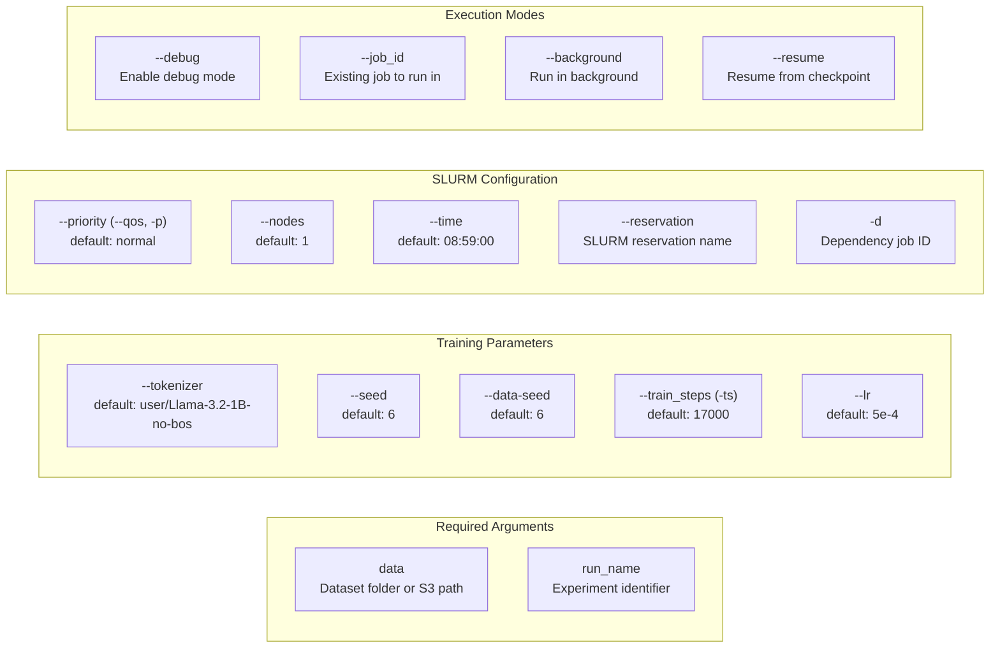
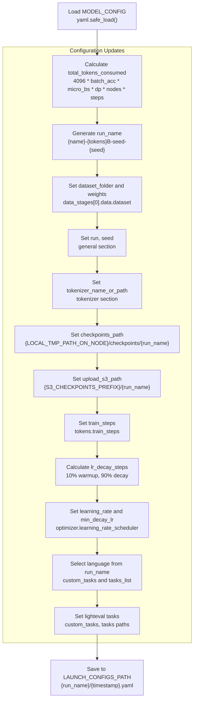
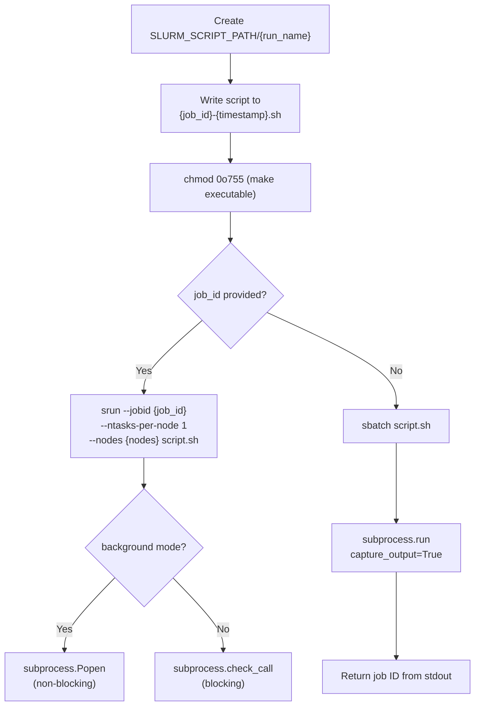

<!-- source: DeepWiki mcp.deepwiki.com · repo huggingface/finepdfs · page 3.1 Training Script and Configuration · fetched 2026-10-26 -->

# Training Script and Configuration

<details>
<summary>Relevant source files</summary>

The following files were used as context for generating this wiki page:

- [ablations/training/training_script.py](ablations/training/training_script.py)

</details>


## Purpose and Scope

This document describes the training orchestration system implemented in `training_script.py`, which provides a command-line interface for launching distributed training jobs on SLURM clusters. The script dynamically generates nanotron configuration files, manages S3 dataset downloads, and submits SLURM batch jobs with appropriate resource allocation and dependencies.

For information about the nanotron framework integration and checkpoint management, see [Nanotron Framework Integration](#3.2). For evaluation orchestration, see [Evaluation Orchestration](#4.1).

## Overview

The training script is located at [ablations/training/training_script.py:1-433]() and serves as the primary entry point for launching training runs. It performs the following key functions:

- Accepts CLI arguments for dataset paths, hyperparameters, and SLURM configuration
- Dynamically generates YAML configuration files for nanotron training
- Creates SLURM batch scripts with appropriate resource requests
- Handles S3 dataset downloading to local scratch storage
- Manages multi-language evaluation task configuration
- Supports job dependencies and background execution

## System Architecture

```mermaid
graph TB
    CLI["CLI Arguments<br/>(main function)"]
    PARSE["argparse.ArgumentParser"]
    CONFIG_LOAD["yaml.safe_load(MODEL_CONFIG)"]
    
    subgraph "Configuration Generation"
        UPDATE_DATA["Update data_stages<br/>dataset_folder, weights"]
        UPDATE_GENERAL["Update general config<br/>run_name, seed"]
        UPDATE_TOKENIZER["Update tokenizer config"]
        UPDATE_CKPT["Update checkpoints path<br/>S3 upload path"]
        UPDATE_TRAIN["Update train_steps<br/>lr_decay_steps"]
        UPDATE_LR["Update learning_rate<br/>min_decay_lr"]
        UPDATE_EVAL["Update lighteval config<br/>custom_tasks, tasks"]
    end
    
    YAML_SAVE["Save YAML to<br/>LAUNCH_CONFIGS_PATH"]
    
    subgraph "SLURM Script Generation"
        BUILD_HEADER["Build SBATCH headers<br/>job-name, nodes, cpus, gpus"]
        BUILD_DATASET["Build dataset download<br/>s5cmd commands"]
        BUILD_ENV["Build environment setup<br/>MASTER_ADDR, MASTER_PORT"]
        BUILD_CMD["Build torch.distributed.run<br/>command"]
    end
    
    SAVE_SCRIPT["Save to SLURM_SCRIPT_PATH"]
    LAUNCH["launch_slurm_job<br/>sbatch or srun"]
    
    CLI --> PARSE
    PARSE --> CONFIG_LOAD
    CONFIG_LOAD --> UPDATE_DATA
    UPDATE_DATA --> UPDATE_GENERAL
    UPDATE_GENERAL --> UPDATE_TOKENIZER
    UPDATE_TOKENIZER --> UPDATE_CKPT
    UPDATE_CKPT --> UPDATE_TRAIN
    UPDATE_TRAIN --> UPDATE_LR
    UPDATE_LR --> UPDATE_EVAL
    UPDATE_EVAL --> YAML_SAVE
    
    YAML_SAVE --> BUILD_HEADER
    BUILD_HEADER --> BUILD_DATASET
    BUILD_DATASET --> BUILD_ENV
    BUILD_ENV --> BUILD_CMD
    BUILD_CMD --> SAVE_SCRIPT
    SAVE_SCRIPT --> LAUNCH
```



**Diagram: Training Script Execution Flow**

Sources: [ablations/training/training_script.py:221-431]()

## Configuration Constants

The script defines several path and resource constants at the module level that control where files are stored and how many resources are allocated:

| Constant | Default Value | Purpose |
|----------|---------------|---------|
| `USER` | `os.environ.get('USER')` | Current system user |
| `LOCAL_TMP_PATH_ON_NODE` | `/scratch/{USER}` | Local scratch space for datasets and checkpoints |
| `TRAINING_LOGS_PATH` | `/shared/{USER}/logs/pdf_project/experiments/training/logs` | Training log output directory |
| `EVAL_LOGS_PATH` | `/shared/{USER}/logs/pdf_project/experiments/evals` | Evaluation log output directory |
| `NANOTRON_PATH` | `/shared/user/projects/new_training_setup/nanotron` | Path to nanotron repository |
| `S5CMD_PATH` | `/shared/user/projects/new_training_setup/training_venv/bin/s5cmd` | S3 transfer utility |
| `S3_CHECKPOINTS_PREFIX` | `s3://bucket/experiments/checkpoints` | S3 bucket for checkpoint storage |
| `LAUNCH_CONFIGS_PATH` | `/shared/{USER}/logs/pdf_project/experiments/training/launch-configs` | Directory for generated YAML configs |
| `SLURM_SCRIPT_PATH` | `/shared/{USER}/logs/pdf_project/experiments/training/slurm-scripts` | Directory for generated SLURM scripts |
| `NUM_GPUS` | `8` | GPUs per node |
| `NUM_CPUS_IN_NODE` | `88` | CPUs per node |

Sources: [ablations/training/training_script.py:11-23]()

## CLI Arguments

The script accepts the following command-line arguments through `argparse.ArgumentParser`:



**Diagram: CLI Argument Categories**

Sources: [ablations/training/training_script.py:222-239]()

### Key Argument Behaviors

- **`data`**: If starts with `s3://`, triggers automatic S3 download to `LOCAL_TMP_PATH_ON_NODE/dataset/{run_name}/`
- **`run_name`**: Automatically modified to include token count and seed: `{run_name}-{total_tokens}B-seed-{combined_seed}` [ablations/training/training_script.py:249-250]()
- **`--debug`**: Reduces parallelism (`dp=2, pp=2, tp=2`) and batch sizes for quick testing [ablations/training/training_script.py:299-305]()
- **`--resume`**: Sets `resume_checkpoint_path` to the S3 checkpoint location [ablations/training/training_script.py:276-277]()
- **`--job_id`**: Uses `srun` instead of `sbatch` to run within an existing SLURM allocation [ablations/training/training_script.py:233]()

## YAML Configuration Structure

The script uses a large template configuration defined in the `MODEL_CONFIG` string [ablations/training/training_script.py:26-174](). This template is loaded as YAML and modified based on CLI arguments.

### Configuration Sections

```mermaid
graph TB
    ROOT["MODEL_CONFIG YAML"]
    
    subgraph "Top-Level Sections"
        CHECKPOINTS["checkpoints:<br/>checkpoint_interval: 500<br/>checkpoints_path<br/>save_final_state: true"]
        DATA_STAGES["data_stages:<br/>- data: dataset config<br/>- name: stable<br/>- start_training_step: 1"]
        GENERAL["general:<br/>project: fine-pdfs<br/>run: tmp<br/>seed: 6"]
        LOGGING["logging:<br/>iteration_step_info_interval: 5<br/>log_level: info"]
        MODEL["model:<br/>dtype: bfloat16<br/>model_config: architecture"]
        OPTIMIZER["optimizer:<br/>accumulate_grad_in_fp32<br/>learning_rate_scheduler<br/>weight_decay: 0.1"]
        PARALLELISM["parallelism:<br/>dp: 64<br/>pp: 1<br/>tp: 1"]
        S3_UPLOAD["s3_upload:<br/>s5cmd_path<br/>upload_s3_path"]
        TOKENIZER["tokenizer:<br/>tokenizer_name_or_path<br/>tokenizer_max_length: 4096"]
        TOKENS["tokens:<br/>batch_accumulation_per_replica: 4<br/>micro_batch_size: 2<br/>sequence_length: 4096"]
        LIGHTEVAL["lighteval:<br/>eval_interval: 500<br/>tasks: task files"]
    end
    
    ROOT --> CHECKPOINTS
    ROOT --> DATA_STAGES
    ROOT --> GENERAL
    ROOT --> LOGGING
    ROOT --> MODEL
    ROOT --> OPTIMIZER
    ROOT --> PARALLELISM
    ROOT --> S3_UPLOAD
    ROOT --> TOKENIZER
    ROOT --> TOKENS
    ROOT --> LIGHTEVAL
```



**Diagram: MODEL_CONFIG Structure**

Sources: [ablations/training/training_script.py:26-174]()

### Model Architecture Configuration

The `model.model_config` section defines the transformer architecture:

| Parameter | Value | Description |
|-----------|-------|-------------|
| `hidden_size` | 2048 | Model dimension |
| `num_hidden_layers` | 28 | Number of transformer layers |
| `num_attention_heads` | 16 | Number of attention heads |
| `num_key_value_heads` | 8 | GQA key/value heads |
| `intermediate_size` | 6144 | FFN intermediate size |
| `max_position_embeddings` | 4096 | Maximum sequence length |
| `vocab_size` | 128256 | Vocabulary size |
| `_use_doc_masking` | true | Enable document masking |
| `_use_qkv_packed` | true | Use packed QKV |
| `_fused_rms_norm` | true | Use fused RMSNorm |
| `_fused_rotary_emb` | true | Use fused rotary embeddings |
| `_attn_implementation` | flash_attention_2 | Flash attention implementation |

Sources: [ablations/training/training_script.py:67-99]()

## Dynamic Configuration Generation

The `main()` function dynamically modifies the configuration based on CLI arguments:



**Diagram: Configuration Generation Flow**

Sources: [ablations/training/training_script.py:242-336]()

### Token Consumption Calculation

The script calculates total tokens consumed using the formula:

```
total_tokens = sequence_length × batch_accumulation_per_replica × micro_batch_size × dp × train_steps
             = 4096 × 4 × 2 × (NUM_GPUS × nodes) × train_steps
```

This value is displayed and incorporated into the `run_name` [ablations/training/training_script.py:245-246]().

### Learning Rate Schedule

The learning rate scheduler uses a warmup-cosine decay schedule with automatically calculated steps:

- **Warmup steps**: 10% of `train_steps` (linear warmup)
- **Decay steps**: 90% of `train_steps` (cosine decay)
- **Min decay LR**: `learning_rate / 10`

Sources: [ablations/training/training_script.py:313-325]()

## Multi-Language Task Configuration

The script supports language-specific evaluation tasks through two dictionaries:

```python
custom_tasks = {
    "eng_Latn": "/admin/home/user/shared/projects/new_training_setup/task_list.py",
    "fra_Latn": "lighteval.tasks.multilingual.tasks",
    "arb_Arab": "lighteval.tasks.multilingual.tasks",
    "cmn_Hani": "lighteval.tasks.multilingual.tasks",
    "rus_Cyrl": "lighteval.tasks.multilingual.tasks",
}

tasks_list = {
    "eng_Latn": "/admin/home/user/shared/projects/new_training_setup/tasks_txt/tasks_eng.txt",
    "fra_Latn": "/admin/home/user/shared/projects/new_training_setup/tasks_txt/tasks_fra.txt",
    "arb_Arab": "/admin/home/user/shared/projects/new_training_setup/tasks_txt/tasks_ara.txt",
    "cmn_Hani": "/admin/home/user/shared/projects/new_training_setup/tasks_txt/tasks_zho.txt",
    "rus_Cyrl": "/.../tasks_txt/tasks_rus.txt",
}
```

Language is detected from the `run_name` prefix (e.g., `eng_Latn-experiment` → `eng_Latn`). If no matching language is found, the script defaults to English [ablations/training/training_script.py:289-292]().

Sources: [ablations/training/training_script.py:176-196](), [ablations/training/training_script.py:283-295]()

## SLURM Job Script Generation

The script generates a complete SLURM batch script programmatically:

```mermaid
graph TB
    START["Build SBATCH Script"]
    
    subgraph "SBATCH Headers"
        JOB_NAME["#SBATCH --job-name={job_name}"]
        NODES["#SBATCH --nodes={args.nodes}"]
        NTASKS["#SBATCH --ntasks-per-node=1"]
        CPUS["#SBATCH --cpus-per-task={NUM_CPUS_IN_NODE}"]
        GPUS["#SBATCH --gres=gpu:{NUM_GPUS}"]
        PARTITION["#SBATCH --partition=hopper-prod"]
        OUTPUT["#SBATCH --output={TRAINING_LOGS_PATH}"]
        QOS["#SBATCH --qos={args.priority}"]
        TIME["#SBATCH --time={args.time}"]
        EXCLUSIVE["#SBATCH --exclusive"]
        DEP["#SBATCH --dependency=afterok:{args.d}"]
        RES["#SBATCH --reservation={args.reservation}"]
    end
    
    subgraph "Script Body"
        DATASET_DL["Dataset Download<br/>s5cmd cp S3 to LOCAL_TMP_PATH"]
        SLURM_ENV["SLURM Environment Setup<br/>MASTER_ADDR, MASTER_PORT"]
        MODULE["module load cuda/12.4"]
        LAUNCHER["torch.distributed.run launcher<br/>--nproc_per_node, --nnodes"]
        CMD["nanotron run_train.py<br/>--config-file {yaml_path}"]
        CLEANUP["rm -rf local dataset"]
    end
    
    SAVE["Save to SLURM_SCRIPT_PATH<br/>{run_name}/{job_id}-{timestamp}.sh"]
    EXECUTE["Execute: sbatch script.sh<br/>or srun --jobid {job_id} script.sh"]
    
    START --> JOB_NAME
    JOB_NAME --> NODES
    NODES --> NTASKS
    NTASKS --> CPUS
    CPUS --> GPUS
    GPUS --> PARTITION
    PARTITION --> OUTPUT
    OUTPUT --> QOS
    QOS --> TIME
    TIME --> EXCLUSIVE
    EXCLUSIVE --> DEP
    DEP --> RES
    
    RES --> DATASET_DL
    DATASET_DL --> SLURM_ENV
    SLURM_ENV --> MODULE
    MODULE --> LAUNCHER
    LAUNCHER --> CMD
    CMD --> CLEANUP
    
    CLEANUP --> SAVE
    SAVE --> EXECUTE
```



**Diagram: SLURM Script Generation and Execution**

Sources: [ablations/training/training_script.py:350-422]()

### SLURM Environment Variables

The generated script sets up the distributed training environment:

| Variable | Value | Purpose |
|----------|-------|---------|
| `HOSTNAMES` | `scontrol show hostnames "$SLURM_JOB_NODELIST"` | List of allocated nodes |
| `MASTER_ADDR` | First hostname from `SLURM_JOB_NODELIST` | Master node for coordination |
| `MASTER_PORT` | `1024 + random.randint(0, 64511)` | Random port for c10d backend |
| `COUNT_NODE` | Count of allocated nodes | Number of nodes in job |
| `TMPDIR` | `LOCAL_TMP_PATH_ON_NODE` | Temporary directory path |
| `CUDA_DEVICE_MAX_CONNECTIONS` | `1` | CUDA connection limit |

Sources: [ablations/training/training_script.py:379-386]()

### Torch Distributed Launch

The script uses `torch.distributed.run` with the following arguments:

```bash
python -u -m torch.distributed.run \
    --nproc_per_node {NUM_GPUS} \
    --nnodes $COUNT_NODE \
    --rdzv-backend c10d \
    --rdzv-endpoint $MASTER_ADDR:$MASTER_PORT \
    --rdzv-id $SLURM_JOB_ID \
    --node_rank $SLURM_PROCID \
    --role $SLURMD_NODENAME: \
    --max_restarts 0 \
    --tee 3
```

This launcher spawns 8 processes per node (one per GPU) and coordinates them using the rendezvous backend.

Sources: [ablations/training/training_script.py:397-407]()

### S3 Dataset Download

If the `data` argument starts with `s3://`, the script generates commands to download the dataset:

```bash
srun rm -rf {LOCAL_TMP_PATH_ON_NODE}/dataset
srun {S5CMD_PATH} cp '{s3_path}/*' {local_dataset_path}
```

After training completes, the local dataset is cleaned up:

```bash
srun rm -rf {local_dataset_path}
```

Sources: [ablations/training/training_script.py:342-348](), [ablations/training/training_script.py:418-421]()

## Job Launch Process

The `launch_slurm_job()` function handles job submission:



**Diagram: Job Launch Decision Flow**

Sources: [ablations/training/training_script.py:192-219]()

### Execution Modes

1. **Standard mode** (`job_id=None`): Uses `sbatch` to submit a new job, returns job ID
2. **In-job mode** (`job_id` provided, `background=False`): Uses `srun --jobid` and blocks until completion
3. **Background mode** (`job_id` provided, `background=True`): Uses `srun --jobid` with `subprocess.Popen`, logs to files

### Output Files

The script creates the following output files:

| File Type | Path Pattern | Purpose |
|-----------|-------------|---------|
| YAML config | `{LAUNCH_CONFIGS_PATH}/{run_name}/{timestamp}.yaml` | nanotron configuration |
| SLURM script | `{SLURM_SCRIPT_PATH}/{run_name}/{job_id}-{timestamp}.sh` | Batch submission script |
| Training logs | `{TRAINING_LOGS_PATH}/{run_name}/train-{timestamp}-{job_name}-{job_id}` | stdout/stderr from training |

Sources: [ablations/training/training_script.py:333-339](), [ablations/training/training_script.py:201-202](), [ablations/training/training_script.py:360]()

## Example Usage

```bash
# Basic training run
python training_script.py \
    s3://bucket/datasets/my_dataset \
    eng_Latn-experiment \
    --train_steps 20000 \
    --lr 3e-4 \
    --nodes 2

# Debug mode with local dataset
python training_script.py \
    /shared/data/local_dataset \
    test-run \
    --debug \
    --train_steps 100

# Resume from checkpoint with job dependency
python training_script.py \
    s3://bucket/datasets/my_dataset \
    eng_Latn-experiment \
    --resume \
    -d 12345 \
    --train_steps 30000

# Background execution in existing allocation
python training_script.py \
    /data/dataset \
    my-run \
    --job_id 67890 \
    --background
```

Sources: [ablations/training/training_script.py:222-239]()

---

