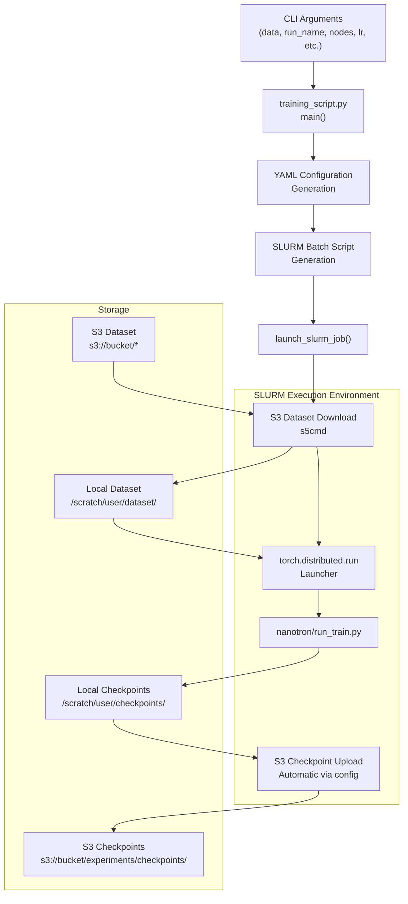
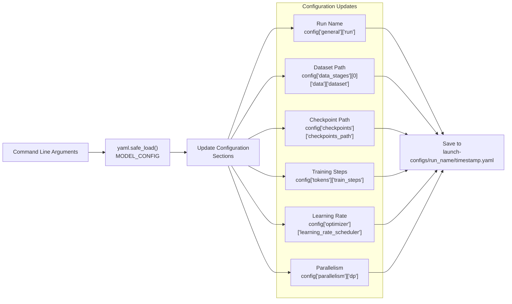
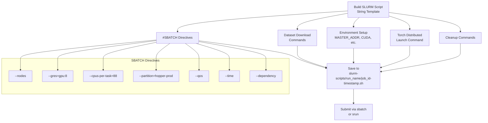
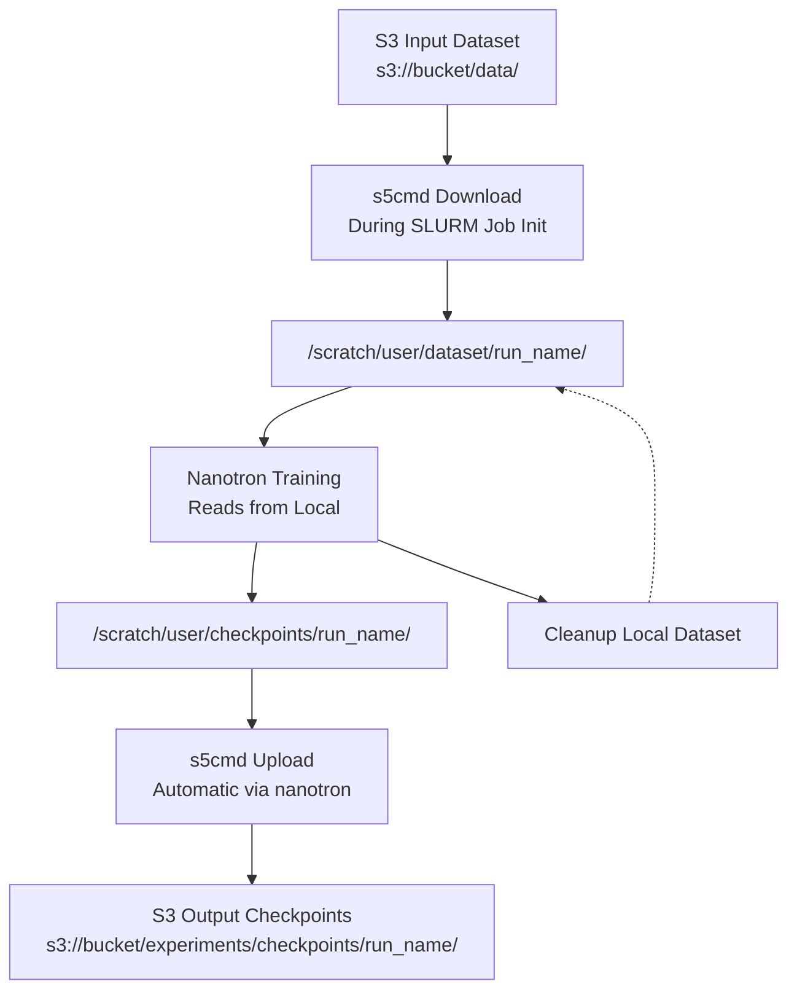
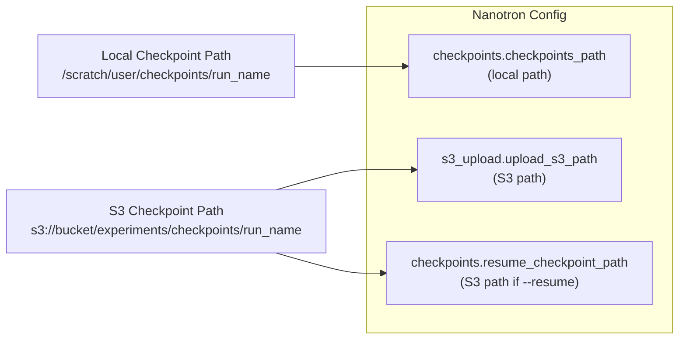
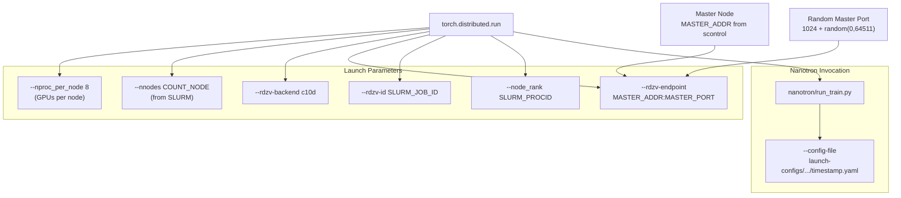

<!-- source: DeepWiki mcp.deepwiki.com · repo huggingface/finepdfs · page 3.2 Nanotron Framework Integration · fetched 2026-10-26 -->

# Nanotron Framework Integration

<details>
<summary>Relevant source files</summary>

The following files were used as context for generating this wiki page:

- [README.md](README.md)
- [ablations/training/training_script.py](ablations/training/training_script.py)

</details>


## Purpose and Scope

This page documents the integration between the FinePDFs training infrastructure and the nanotron distributed training framework. The integration is implemented in [ablations/training/training_script.py:1-433]() and provides a high-level wrapper that generates nanotron-compatible configurations, manages SLURM job submission, handles S3 data transfers, and orchestrates distributed training execution.

For information about the evaluation pipeline that follows training, see [Evaluation Orchestration](#4.1). For details about the multi-language evaluation tasks themselves, see [Multi-Language Evaluation Tasks](#4.3).

---

## System Architecture

The nanotron integration consists of several interconnected components that transform training parameters into a fully configured, distributed training job:

### High-Level Integration Flow



**Sources:** [ablations/training/training_script.py:1-433]()

---

## Configuration Generation

The training script generates a complete nanotron configuration YAML file dynamically based on command-line arguments. The configuration follows nanotron's expected schema and includes all necessary training parameters.

### Configuration Template Structure

The base configuration template is defined in [ablations/training/training_script.py:26-174]() and includes the following major sections:

| Configuration Section | Purpose | Key Parameters |
|----------------------|---------|----------------|
| `checkpoints` | Checkpoint saving/loading behavior | `checkpoint_interval`, `checkpoints_path`, `resume_checkpoint_path` |
| `data_stages` | Dataset configuration | `dataset_folder`, `tokenizer_name`, `vocab_size` |
| `general` | Project metadata | `project`, `run`, `seed` |
| `model` | Model architecture | `hidden_size`, `num_hidden_layers`, `num_attention_heads` |
| `optimizer` | Optimization settings | `learning_rate`, `weight_decay`, `adam_beta1/beta2` |
| `parallelism` | Distributed training | `dp`, `pp`, `tp`, `context_parallel_size` |
| `tokens` | Batch and sequence configuration | `micro_batch_size`, `sequence_length`, `train_steps` |
| `s3_upload` | S3 checkpoint upload | `upload_s3_path`, `s5cmd_path`, `remove_after_upload` |
| `lighteval` | Evaluation integration | `eval_interval`, `tasks`, `output_dir` |

### Dynamic Configuration Flow



**Sources:** [ablations/training/training_script.py:241-336]()

### Key Configuration Logic

#### Run Naming Convention

The run name is automatically augmented with metadata to ensure uniqueness:

[ablations/training/training_script.py:245-250]()

The naming format is: `{base_run_name}-{total_tokens_B}B-seed-{combined_seed}` where `combined_seed = args.seed + (args.data_seed * 100)`.

#### Dataset Path Resolution

The script supports both local and S3 dataset paths. If an S3 path is provided, it's converted to a local staging path for download during job execution:

[ablations/training/training_script.py:252-260]()

#### Learning Rate Scheduler

The learning rate scheduler is configured with warmup and decay phases based on total training steps:

[ablations/training/training_script.py:313-325]()

- Warmup steps: 10% of total training steps
- Decay starts: After warmup (90% of training)
- Minimum decay LR: 1/10th of peak learning rate
- Decay style: Cosine

#### Parallelism Strategy

Data parallelism is automatically scaled based on the number of nodes:

[ablations/training/training_script.py:307-308]()

For debug mode, a different parallelism configuration is used [ablations/training/training_script.py:299-305]().

---

## SLURM Job Generation and Submission

The training script generates complete SLURM batch scripts dynamically and submits them to the cluster.

### SLURM Script Generation



**Sources:** [ablations/training/training_script.py:350-422]()

### SLURM Batch Script Structure

The generated SLURM script follows this structure:

1. **SBATCH Directives** [ablations/training/training_script.py:353-366]()
   - Job name, nodes, GPUs, CPUs per task
   - Partition (`hopper-prod`), QoS, time limits
   - Optional dependency and reservation

2. **Environment Setup** [ablations/training/training_script.py:368-391]()
   - Timing and logging utilities
   - SLURM hostnames discovery
   - Master address/port configuration
   - CUDA module loading

3. **Dataset Download** (if S3) [ablations/training/training_script.py:342-348]()
   ```bash
   rm -rf /scratch/user/dataset
   s5cmd cp 's3://path/*' /scratch/user/dataset/run_name/
   ```

4. **Torch Distributed Launch** [ablations/training/training_script.py:393-415]()
   - Configuration of `torch.distributed.run`
   - Launch of `nanotron/run_train.py` with config file

5. **Cleanup** [ablations/training/training_script.py:418-421]()
   - Remove local dataset if downloaded from S3

### Job Submission Function

The `launch_slurm_job()` function handles both direct submission and execution within an existing allocation:

[ablations/training/training_script.py:192-219]()

This function supports:
- **New job submission**: Uses `sbatch` to create a new job
- **Execution in existing allocation**: Uses `srun --jobid` to run within an allocated job
- **Background execution**: Non-blocking execution with log redirection
- **Foreground execution**: Blocking execution until completion

---

## S3 Integration

The system uses S3 for both input datasets and output checkpoints, with the `s5cmd` tool providing high-performance transfers.

### S3 Data Flow



**Sources:** [ablations/training/training_script.py:342-348](), [ablations/training/training_script.py:418-421](), [ablations/training/training_script.py:133-138]()

### S3 Configuration Parameters

The S3 upload configuration is embedded in the nanotron config [ablations/training/training_script.py:133-138]():

| Parameter | Value | Purpose |
|-----------|-------|---------|
| `s5cmd_path` | `/shared/user/projects/.../s5cmd` | Path to s5cmd binary |
| `upload_s3_path` | `s3://bucket/experiments/checkpoints/{run_name}` | Target S3 prefix for checkpoints |
| `s5cmd_concurrency` | 5 | Number of concurrent S3 operations |
| `s5cmd_numworkers` | 16 | Number of worker threads |
| `remove_after_upload` | `true` | Delete local checkpoints after upload |

### Dataset Download Command

When the dataset path starts with `s3://`, the script generates download commands [ablations/training/training_script.py:344-348]():

```bash
rm -rf /scratch/user/dataset
s5cmd cp 's3://input-path/*' /scratch/user/dataset/run_name/
```

The downloaded data is then referenced in the nanotron configuration [ablations/training/training_script.py:256-260]().

---

## Checkpoint Management

The checkpoint system operates with a two-tier storage model: local fast storage during training and S3 for long-term persistence.

### Checkpoint Path Configuration



**Sources:** [ablations/training/training_script.py:271-277]()

### Checkpoint Intervals

Checkpoints are saved at regular intervals defined in the configuration [ablations/training/training_script.py:27-35]():

- `checkpoint_interval`: 500 steps
- `save_final_state`: true (save at end of training)
- `save_initial_state`: false (don't save before training starts)

### Resume Functionality

The `--resume` flag enables continuing training from a previous checkpoint [ablations/training/training_script.py:238](), [ablations/training/training_script.py:276-277]():

When enabled:
1. `resume_checkpoint_path` is set to the S3 checkpoint location
2. Nanotron automatically downloads and loads the checkpoint
3. Training continues from the saved step with restored optimizer state

The configuration includes flags for loading both optimizer and learning rate scheduler state [ablations/training/training_script.py:31-32]():
- `load_lr_scheduler`: true
- `load_optimizer`: true

---

## Nanotron Execution

The actual nanotron training is launched via `torch.distributed.run`, which coordinates multiple processes across nodes.

### Distributed Launch Configuration



**Sources:** [ablations/training/training_script.py:380-415]()

### Environment Variables

The SLURM script configures several critical environment variables [ablations/training/training_script.py:380-386]():

| Variable | Configuration | Purpose |
|----------|--------------|---------|
| `HOSTNAMES` | `scontrol show hostnames "$SLURM_JOB_NODELIST"` | List of all nodes in job |
| `MASTER_ADDR` | First hostname from nodelist | Coordination endpoint |
| `MASTER_PORT` | `1024 + random.randint(0, 64511)` | Random port for rendezvous |
| `COUNT_NODE` | Node count from hostnames | Number of nodes |
| `TMPDIR` | `/scratch/user` | Temporary directory |
| `CUDA_DEVICE_MAX_CONNECTIONS` | `"1"` | CUDA optimization |

### Launch Command Structure

The actual launch command is assembled as [ablations/training/training_script.py:393-407]():

```bash
python -u -m torch.distributed.run \
    --nproc_per_node 8 \
    --nnodes $COUNT_NODE \
    --rdzv-backend c10d \
    --rdzv-endpoint $MASTER_ADDR:$MASTER_PORT \
    --rdzv-id $SLURM_JOB_ID \
    --node_rank $SLURM_PROCID \
    --role $SLURMD_NODENAME: \
    --max_restarts 0 \
    --tee 3 \
    nanotron/run_train.py \
    --config-file launch-configs/run_name/timestamp.yaml
```

Key flags:
- `--nproc_per_node 8`: Launch 8 processes per node (one per GPU)
- `--rdzv-backend c10d`: Use PyTorch's c10d backend for rendezvous
- `--max_restarts 0`: Don't automatically restart on failure
- `--tee 3`: Stream stdout/stderr to both console and logs

### Random Delay for Hub Requests

To avoid concurrent HuggingFace Hub requests from all nodes, a small random delay is added [ablations/training/training_script.py:409-413]():

```bash
random_milliseconds=$(( RANDOM % 1001 ))
sleep_time=$(bc <<< "scale=3; $random_milliseconds / 1000")
sleep $sleep_time
```

This prevents race conditions when downloading models or tokenizers from the Hub.

---

## Language-Specific Evaluation Configuration

The training script automatically configures language-specific evaluation tasks based on the run name.

### Task Configuration Mapping

The script maintains mappings for custom task definitions and task lists [ablations/training/training_script.py:176-190]():

```python
custom_tasks = {
  "eng_Latn": "/admin/home/user/shared/.../task_list.py",
  "fra_Latn": "lighteval.tasks.multilingual.tasks",
  "arb_Arab": "lighteval.tasks.multilingual.tasks",
  "cmn_Hani": "lighteval.tasks.multilingual.tasks",
  "rus_Cyrl": "lighteval.tasks.multilingual.tasks",
}

tasks_list = {
  "eng_Latn": ".../tasks_txt/tasks_eng.txt",
  "fra_Latn": ".../tasks_txt/tasks_fra.txt",
  "arb_Arab": ".../tasks_txt/tasks_ara.txt",
  "cmn_Hani": ".../tasks_txt/tasks_zho.txt",
  "rus_Cyrl": ".../tasks_txt/tasks_rus.txt",
}
```

### Automatic Language Detection

The language is extracted from the run name [ablations/training/training_script.py:283-295]():

1. Parse language from first component of run name (e.g., `eng_Latn-experiment-name`)
2. Look up corresponding custom tasks and task list files
3. Default to English if language not found
4. Update lighteval configuration in the YAML

This enables automatic evaluation with appropriate benchmarks for each language during or after training.

---

## Constants and Configuration Paths

The script defines several system-wide constants at the top [ablations/training/training_script.py:11-23]():

| Constant | Value | Purpose |
|----------|-------|---------|
| `LOCAL_TMP_PATH_ON_NODE` | `/scratch/{USER}` | Fast local storage on compute nodes |
| `TRAINING_LOGS_PATH` | `/shared/{USER}/logs/.../training/logs` | Training log output directory |
| `EVAL_LOGS_PATH` | `/shared/{USER}/logs/.../evals` | Evaluation log output directory |
| `NANOTRON_PATH` | `/shared/user/projects/.../nanotron` | Path to nanotron installation |
| `S5CMD_PATH` | `/shared/user/projects/.../s5cmd` | Path to s5cmd binary |
| `S3_CHECKPOINTS_PREFIX` | `s3://bucket/experiments/checkpoints` | S3 prefix for all checkpoints |
| `LAUNCH_CONFIGS_PATH` | `/shared/{USER}/logs/.../launch-configs` | Directory for generated YAML configs |
| `SLURM_SCRIPT_PATH` | `/shared/{USER}/logs/.../slurm-scripts` | Directory for generated SLURM scripts |
| `EVALS_OUTPUT_PATH` | `s3://bucket/experiments/evals-test` | S3 path for evaluation results |
| `NUM_GPUS` | 8 | GPUs per node |
| `NUM_CPUS_IN_NODE` | 88 | CPUs per node |

These paths follow a consistent organization pattern with logs, configs, and scripts separated into dedicated directories under a shared filesystem.

**Sources:** [ablations/training/training_script.py:11-23]()

---

## Command-Line Interface

The training script provides a comprehensive CLI for configuring training runs:

### Main Arguments

| Argument | Type | Default | Description |
|----------|------|---------|-------------|
| `data` | str | (required) | Dataset folder path (local or S3) |
| `run_name` | str | (required) | Name for this training run |
| `--tokenizer` | str | `user/Llama-3.2-1B-no-bos` | HuggingFace tokenizer identifier |
| `-d` | str | None | SLURM job dependency (afterok) |
| `--seed` | int | 6 | Random seed for model initialization |
| `--data-seed` | int | 6 | Random seed for data sampling |
| `--train_steps` / `-ts` | int | 17000 | Total training steps |
| `--priority` / `--qos` / `-p` | str | `normal` | SLURM QoS level |
| `--nodes` | int | 1 | Number of compute nodes |
| `--debug` | flag | False | Enable debug mode (reduced parallelism) |
| `--job_id` | str | None | Existing SLURM job ID for srun execution |
| `--lr` | float | 5e-4 | Peak learning rate |
| `--background` | flag | False | Run in background (non-blocking) |
| `--reservation` | str | None | SLURM reservation name |
| `--time` | str | `08:59:00` | SLURM time limit |
| `--resume` | flag | False | Resume from S3 checkpoint |

**Sources:** [ablations/training/training_script.py:222-239]()

### Example Usage

```bash
# Basic training run
python training_script.py \
    s3://bucket/data/eng-dataset/ \
    eng_Latn-baseline \
    --train_steps 10000 \
    --nodes 4

# Resume previous run with higher learning rate
python training_script.py \
    s3://bucket/data/eng-dataset/ \
    eng_Latn-baseline \
    --resume \
    --lr 1e-3 \
    --train_steps 20000

# Debug mode with dependency
python training_script.py \
    /local/dataset/ \
    debug-run \
    --debug \
    -d 12345 \
    --train_steps 100
```

---

## Integration with Evaluation System

The training configuration includes built-in integration with the lighteval evaluation system [ablations/training/training_script.py:154-173]():

### Lighteval Configuration

```yaml
lighteval:
  output_dir: s3://bucket/experiments/evals-test
  logs_path: /shared/user/logs/.../evals
  local_checkpoint_dir: /scratch/user/evals-ckpt
  upload_to_wandb: false
  eval_interval: 500  # Evaluate every 500 steps
  eval_interval_file: null
  nanotron_path: /shared/.../nanotron
  batch_size: 8
  slurm:
    gpus_per_node: 8
    hf_cache: "/shared/user/.cache/huggingface"
    partition: "hopper-prod"
    cpus_per_task: 88
    qos: "normal"
    time: "01:59:00"
  tasks:
    tasks: /admin/home/user/shared/.../tasks_eng.txt
    custom_tasks: /admin/home/user/shared/.../task_list.py
    max_samples: 1000
```

This configuration enables:
- Automatic evaluation at regular intervals during training
- Language-specific task selection
- SLURM-based distributed evaluation
- Results uploaded to S3

For details on how evaluations are launched and managed, see [Evaluation Orchestration](#4.1).

**Sources:** [ablations/training/training_script.py:154-173]()

---

