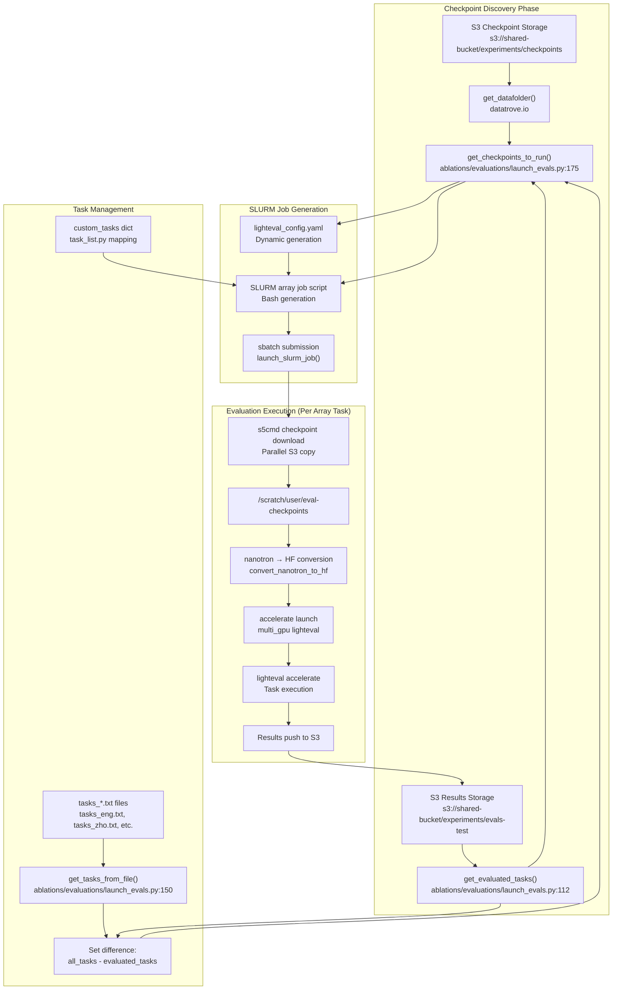
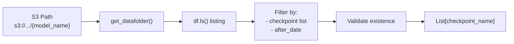
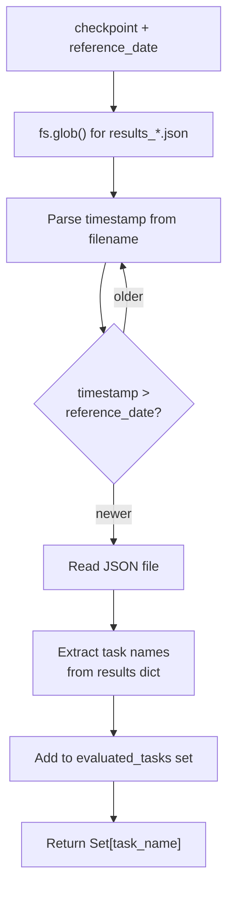
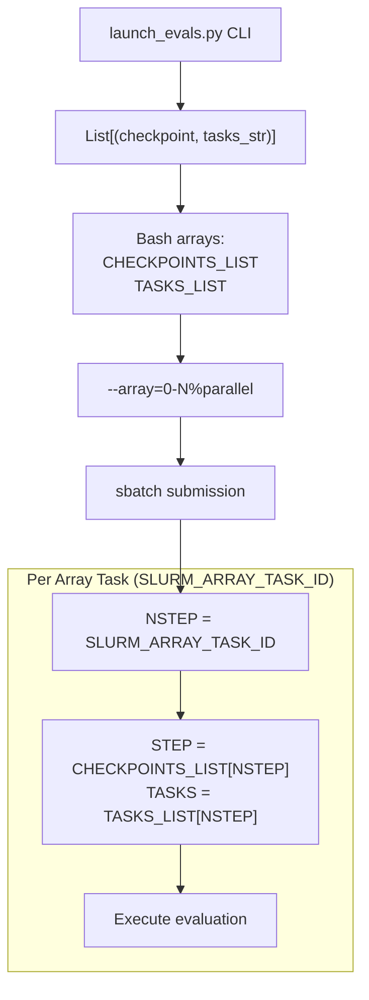
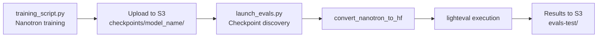

<!-- source: DeepWiki mcp.deepwiki.com · repo huggingface/finepdfs · page 4 Evaluation Infrastructure · fetched 2026-10-26 -->

# Evaluation Infrastructure

<details>
<summary>Relevant source files</summary>

The following files were used as context for generating this wiki page:

- [README.md](README.md)
- [ablations/evaluations/launch_evals.py](ablations/evaluations/launch_evals.py)

</details>


## Purpose and Scope

The Evaluation Infrastructure provides automated, large-scale model evaluation capabilities for checkpoints produced during training. This system discovers checkpoints from S3, converts them from nanotron format to HuggingFace format, and executes multi-language benchmark evaluations using the lighteval framework on SLURM compute clusters.

For information about the training system that produces these checkpoints, see [Training Infrastructure](#3). For details on the task definitions used in evaluation, see [Task Definitions](#4.2).

**Sources:** [README.md:1-122](), [ablations/evaluations/launch_evals.py:1-512]()

---

## System Architecture

The evaluation infrastructure orchestrates three major phases: checkpoint discovery and filtering, checkpoint conversion, and distributed evaluation execution.



**Sources:** [ablations/evaluations/launch_evals.py:1-512]()

---

## Checkpoint Discovery and Filtering

### Checkpoint Enumeration

The `get_checkpoints_to_run()` function [ablations/evaluations/launch_evals.py:175-224]() discovers available checkpoints from S3 storage and determines which require evaluation.

**Process:**
1. Uses `get_datafolder()` from datatrove to list S3 checkpoint directories
2. Filters checkpoints based on CLI arguments (`--checkpoints` parameter)
3. Validates that requested checkpoints exist in S3
4. Applies date filtering if `--after-date` is specified



**Key Constants:**
- `S3_EVALS_RESULTS_PREFIX`: `s3://shared-bucket/experiments/evals-test` [ablations/evaluations/launch_evals.py:20]()
- Default checkpoint prefix: `s3://shared-bucket/experiments/checkpoints` [ablations/evaluations/launch_evals.py:264]()

**Sources:** [ablations/evaluations/launch_evals.py:175-224]()

---

### Task-Level Filtering

The system avoids redundant evaluations by checking which tasks have already been completed for each checkpoint.

**Implementation:** `get_evaluated_tasks()` [ablations/evaluations/launch_evals.py:112-148]()



**Result File Pattern:** `results_{timestamp}.json` where timestamp format is `%Y-%m-%dT%H-%M-%S.%f` [ablations/evaluations/launch_evals.py:78-79]()

**Task Extraction:** Reads the `results` key from JSON and strips `:_average` suffix to get base task names [ablations/evaluations/launch_evals.py:141-143]()

**Sources:** [ablations/evaluations/launch_evals.py:112-148]()

---

### Remaining Task Calculation

For each checkpoint, the system computes remaining tasks as a set difference:

```
remaining_tasks = all_tasks_from_file - evaluated_tasks_from_s3
```

**Implementation:** [ablations/evaluations/launch_evals.py:216-224]()

| Step | Function | Purpose |
|------|----------|---------|
| 1 | `get_tasks_from_file()` | Parse task list file into dict of `(task_parts, full_line)` |
| 2 | `get_evaluated_tasks()` | Get set of already-completed tasks from S3 |
| 3 | Set difference | Compute `remaining = all - evaluated` |
| 4 | Format | Join remaining tasks with commas for CLI |

**Sources:** [ablations/evaluations/launch_evals.py:150-173](), [ablations/evaluations/launch_evals.py:216-224]()

---

## SLURM Array Job Orchestration

### Job Configuration

The evaluation system uses SLURM array jobs to parallelize evaluation across checkpoints. Each array task evaluates one checkpoint with its remaining tasks.

**Key Parameters:**

| Parameter | CLI Argument | Default | Description |
|-----------|--------------|---------|-------------|
| Nodes | Fixed | 1 | Single node per evaluation |
| GPUs | `--gpus` | 8 | GPUs per evaluation task |
| Parallel tasks | `--parallel` | 5 | Max concurrent array tasks |
| Time limit | `--time_limit` | 1:50:00 | Wall time per task |
| Partition | Fixed | hopper-prod | SLURM partition |
| CPUs | Fixed | 88 | CPUs per node |

**Sources:** [ablations/evaluations/launch_evals.py:24-27](), [ablations/evaluations/launch_evals.py:288-290]()

---

### Array Job Structure



**Bash Array Generation:** [ablations/evaluations/launch_evals.py:346-347]()

```python
bash_ckpts_list = "(" + " ".join(f'"{item[0]}"' for item in checkpoints_with_tasks) + ")"
bash_tasks_list = "(" + " ".join(f'"{item[1]}"' for item in checkpoints_with_tasks) + ")"
```

**Array Indexing in SLURM Script:** [ablations/evaluations/launch_evals.py:428-430]()

```bash
NSTEP=$((SLURM_ARRAY_TASK_ID))
STEP=${CHECKPOINTS_LIST[$NSTEP]}
TASKS_TO_EVAL=${TASKS_LIST[$NSTEP]}
```

**Sources:** [ablations/evaluations/launch_evals.py:346-347](), [ablations/evaluations/launch_evals.py:381-499]()

---

### Directory Structure

The system creates a structured directory hierarchy for launch scripts, logs, and configurations:

```
/shared/{USER}/logs/pdf_project/experiments/evals/logs/{model_name}/
├── launch_scripts/
│   └── multi-step/
│       └── [generated sbatch scripts]
├── logs/
│   └── multi-step/
│       └── eval-{jobid}_{arrayid}.out
└── model_config/
    └── multi-step/
        └── model_config-{timestamp}.yaml
```

**Directory Creation:** [ablations/evaluations/launch_evals.py:336-343]()

**Sources:** [ablations/evaluations/launch_evals.py:19](), [ablations/evaluations/launch_evals.py:336-343]()

---

## Checkpoint Conversion Process

### S3 Download with s5cmd

Each array task downloads its assigned checkpoint from S3 to local scratch space using `s5cmd` for parallel transfer.

**Download Configuration:** [ablations/evaluations/launch_evals.py:442-448]()

```bash
s5cmd --stat cp \
    --concurrency 50 \
    --exclude "optimizer/*" \
    --exclude "random/*" \
    --exclude "lr_scheduler/*" \
    --part-size 100 \
    "{s3_path}/$STEP/*" "$LOCAL_DOWNLOAD_CHECKPOINT_FOLDER/"
```

**Optimizations:**
- `--concurrency 50`: Parallel file transfers
- `--exclude` patterns: Skip optimizer/scheduler state (not needed for inference)
- `--part-size 100`: 100MB chunks for large files
- Random suffix prevents path collisions: `/scratch/{USER}/eval-checkpoints/{model_name}-$RANDOM_NUMBER/$STEP` [ablations/evaluations/launch_evals.py:437]()

**Sources:** [ablations/evaluations/launch_evals.py:435-448]()

---

### Nanotron to HuggingFace Conversion

After download, checkpoints are converted from nanotron format to HuggingFace format for compatibility with lighteval.

**Conversion Command:** [ablations/evaluations/launch_evals.py:459-462]()

```bash
torchrun --standalone --nproc_per_node=1 \
    -m examples.llama.convert_nanotron_to_hf \
    --checkpoint_path $LOCAL_DOWNLOAD_CHECKPOINT_FOLDER \
    --save_path $LOCAL_DOWNLOAD_CHECKPOINT_FOLDER/hf_model \
    --check_conversion
```

**Key Details:**
- Script location: `{NANOTRON_PATH}/examples/llama/convert_nanotron_to_hf` [ablations/evaluations/launch_evals.py:459]()
- Nanotron path constant: `/shared/projects/new_training_setup/nanotron` [ablations/evaluations/launch_evals.py:21]()
- Output directory: `{checkpoint_folder}/hf_model` - appended to checkpoint path
- `--check_conversion`: Validates conversion correctness

**Sources:** [ablations/evaluations/launch_evals.py:21](), [ablations/evaluations/launch_evals.py:453-465]()

---

## Lighteval Execution

### Configuration Generation

Each evaluation task generates a dynamic lighteval configuration YAML file.

**Configuration Structure:** [ablations/evaluations/launch_evals.py:468-478]()

```yaml
model_parameters:
  model_name: $LOCAL_DOWNLOAD_CHECKPOINT_FOLDER/hf_model
  batch_size: <user_specified or null>
  trust_remote_code: true
  dtype: bfloat16
  model_name_override: {formatted_model_name}/$STEP
  generation_parameters:
    repetition_penalty: 1.2
```

**Key Parameters:**
- `model_name`: Points to converted HF checkpoint
- `model_name_override`: Used for result identification (includes checkpoint step)
- `batch_size`: User-configurable via `--batch_size` CLI arg [ablations/evaluations/launch_evals.py:289]()
- `dtype`: Fixed to bfloat16 for efficiency

**Sources:** [ablations/evaluations/launch_evals.py:350-366](), [ablations/evaluations/launch_evals.py:468-478]()

---

### Accelerate Launch

Lighteval is executed using `accelerate` for multi-GPU inference.

**Launch Command:** [ablations/evaluations/launch_evals.py:482-492]()

```bash
CUDA_DEVICE_MAX_CONNECTIONS=1 accelerate launch \
    --multi_gpu \
    --num_processes {gpus} \
    -m lighteval accelerate \
    --custom-tasks {custom_tasks_path} \
    --dataset-loading-processes {CPUS_PER_NODE} \
    --max-samples 1000 \
    --output-dir {logging_dir} \
    --save-details \
    $LIGHTEVAL_CONFIG_PATH \
    "$TASKS_TO_EVAL"
```

**Parameter Mapping:**

| Parameter | Value | Source |
|-----------|-------|--------|
| `--num_processes` | `args.gpus` (default 8) | [ablations/evaluations/launch_evals.py:290]() |
| `--custom-tasks` | Language-specific task module | [ablations/evaluations/launch_evals.py:29-35]() |
| `--dataset-loading-processes` | 88 (CPUS_PER_NODE) | [ablations/evaluations/launch_evals.py:24]() |
| `--max-samples` | 1000 | Hard-coded limit |
| `--output-dir` | S3_EVALS_RESULTS_PREFIX | [ablations/evaluations/launch_evals.py:20]() |
| Tasks string | Comma-separated remaining tasks | Computed per checkpoint |

**Sources:** [ablations/evaluations/launch_evals.py:482-492]()

---

## Language-Specific Configuration

### Task Module Mapping

Different languages use different task definition modules.

**custom_tasks Dictionary:** [ablations/evaluations/launch_evals.py:29-35]()

```python
custom_tasks = {
  "eng_Latn": "/admin/home/user/shared/projects/new_training_setup/task_list.py",
  "fra_Latn": "lighteval.tasks.multilingual.tasks",
  "arb_Arab": "lighteval.tasks.multilingual.tasks",
  "cmn_Hani": "lighteval.tasks.multilingual.tasks",
  "rus_Cyrl": "lighteval.tasks.multilingual.tasks",
}
```

**tasks_list Dictionary:** [ablations/evaluations/launch_evals.py:37-43]()

```python
tasks_list = {
  "eng_Latn": "/admin/home/user/.../tasks_eng.txt",
  "fra_Latn": "/admin/home/user/.../tasks_fra.txt",
  "arb_Arab": "/admin/home/user/.../tasks_ara.txt",
  "cmn_Hani": "/admin/home/user/.../tasks_zho.txt",
  "rus_Cyrl": "/admin/home/user/.../tasks_rus.txt",
}
```

**Language Detection:** [ablations/evaluations/launch_evals.py:308-315]()

Language is extracted from model name by taking first two underscore-separated components: `language = "_".join(formatted_model_name.split("_")[:2])`

**Sources:** [ablations/evaluations/launch_evals.py:29-43](), [ablations/evaluations/launch_evals.py:308-315]()

---

## CLI Interface

### Command-Line Arguments

The `launch_evals.py` script provides extensive CLI configuration.

**Essential Arguments:**

| Argument | Type | Default | Description |
|----------|------|---------|-------------|
| `model_name` | str | Required | Model name(s) on S3, comma-separated |
| `--s3_prefix` | str | `s3://shared-bucket/experiments/checkpoints` | S3 checkpoint base path |
| `--checkpoints` | str | "all" | Specific checkpoints or "all" |
| `--logging_dir` | str | S3_EVALS_RESULTS_PREFIX | Results destination |
| `--overwrite` | flag | False | Re-evaluate completed checkpoints |
| `--after-date` | str | None | Filter checkpoints by date (DD-MM-YYYY HH:MM:SS) |

**Execution Control:**

| Argument | Type | Default | Description |
|----------|------|---------|-------------|
| `--parallel` | int | 5 | Max concurrent array tasks |
| `--gpus` | int | 8 | GPUs per evaluation |
| `--batch_size` | int | None | Inference batch size |
| `--time_limit` | str | "1:50:00" | SLURM time limit |

**Advanced Options:**

| Argument | Type | Default | Description |
|----------|------|---------|-------------|
| `--seed` | str | "6" | Seeds for model template |
| `--model-template` | str | "{model_name}" | Template for model naming |
| `--run-all` | flag | False | Chain jobs sequentially |
| `-d` | str | None | SLURM dependency job ID |
| `--debug` | flag | False | Write launch script to file |

**Sources:** [ablations/evaluations/launch_evals.py:256-299]()

---

### Example Usage

**Evaluate all checkpoints for a model:**
```bash
python ablations/evaluations/launch_evals.py \
  1p46G-control-english-fw-ft-bl-28BT-seed-6
```

**Evaluate specific checkpoints:**
```bash
python ablations/evaluations/launch_evals.py \
  model_name \
  --checkpoints 1000,2000,3000
```

**Incremental evaluation (only new checkpoints):**
```bash
python ablations/evaluations/launch_evals.py \
  model_name \
  --after-date "01-01-2025 00:00:00"
```

**Multiple models with dependency chaining:**
```bash
python ablations/evaluations/launch_evals.py \
  model1,model2,model3 \
  --run-all \
  --parallel 10
```

**Sources:** [ablations/evaluations/launch_evals.py:256-299]()

---

## Job Naming and Tracking

### Job Name Construction

Job names include model name and optionally task count for tracking.

**Job Name Format:** [ablations/evaluations/launch_evals.py:377-382]()

```python
total_remaining_tasks = sum(len(tasks.split(',')) for _, tasks in checkpoints_with_tasks)
all_possible_tasks = len(read_tasks_from_file(tasks_list_path))
task_suffix = f"_{total_remaining_tasks}tasks" if total_remaining_tasks < all_possible_tasks * len(checkpoints_with_tasks) else ""

job_name = f"{args.job_prefix}eval-{formatted_model_name}{task_suffix}"
```

**Example:** `eval-1p46G-control-english-fw-ft-bl-28BT-seed-6_47tasks` indicates 47 tasks remaining across all checkpoints

**Sources:** [ablations/evaluations/launch_evals.py:377-382]()

---

### Log Files

SLURM writes combined stdout/stderr to structured log files.

**Log Pattern:** [ablations/evaluations/launch_evals.py:391-392]()
```
{eval_logs_path}/eval-{SLURM_ARRAY_JOB_ID}_{SLURM_ARRAY_TASK_ID}.out
```

**Example:**
```
/shared/user/logs/pdf_project/experiments/evals/logs/model_name/logs/multi-step/eval-1234567_0.out
/shared/user/logs/pdf_project/experiments/evals/logs/model_name/logs/multi-step/eval-1234567_1.out
...
```

Each file contains the complete output for one checkpoint evaluation.

**Sources:** [ablations/evaluations/launch_evals.py:391-392]()

---

## Cleanup and Resource Management

### Scratch Space Cleanup

After evaluation completes, the downloaded checkpoint is removed from scratch.

**Cleanup Code:** [ablations/evaluations/launch_evals.py:494-497]()

```bash
echo "Cleaning up downloaded checkpoint $STEP..."
rm -rf "$LOCAL_DOWNLOAD_CHECKPOINT_FOLDER"
echo "Cleanup complete."
```

**Rationale:** Checkpoints can be 10s of GB; cleanup prevents scratch space exhaustion across many array tasks.

**Sources:** [ablations/evaluations/launch_evals.py:494-497]()

---

### SLURM Requeue

The job script includes `#SBATCH --requeue` [ablations/evaluations/launch_evals.py:394]() to automatically restart tasks that fail due to node failures or other transient issues.

**Sources:** [ablations/evaluations/launch_evals.py:394]()

---

## Environment Configuration

### Module and Path Setup

The SLURM script configures environment variables and loads required modules.

**Environment Setup:** [ablations/evaluations/launch_evals.py:398-420]()

```bash
# Ensure cache is on shared not on admin
export TMPDIR=/scratch/{USER}/tmp
source /admin/home/user/shared/projects/new_training_setup/training_venv/bin/activate
mkdir -p $TMPDIR

# SLURM hostnames and master address
export HOSTNAMES=`scontrol show hostnames "$SLURM_JOB_NODELIST"`
export MASTER_ADDR=$(scontrol show hostnames "$SLURM_JOB_NODELIST" | head -n 1)
export MASTER_PORT={master_port}
export COUNT_NODE=`scontrol show hostnames "$SLURM_JOB_NODELIST" | wc -l`

# CUDA/NCCL Settings
export CUDA_DEVICE_MAX_CONNECTIONS="1"

module purge
module load cuda/12.4
```

**Random Master Port:** [ablations/evaluations/launch_evals.py:374]()
```python
master_port = 1024 + random.randint(0, 64511)
```
Prevents port conflicts when multiple jobs run on the same node.

**Sources:** [ablations/evaluations/launch_evals.py:374](), [ablations/evaluations/launch_evals.py:398-420]()

---

## Integration with Training System

The evaluation system discovers checkpoints produced by the training infrastructure documented in [Training Infrastructure](#3).

**Checkpoint Flow:**



**Common S3 Paths:**
- Training writes: `s3://shared-bucket/experiments/checkpoints/{model_name}/{step}/`
- Evaluation reads: Same path
- Evaluation writes: `s3://shared-bucket/experiments/evals-test/results/{model_name}/{step}/`

**Sources:** [ablations/evaluations/launch_evals.py:20](), [ablations/evaluations/launch_evals.py:264]()

---

