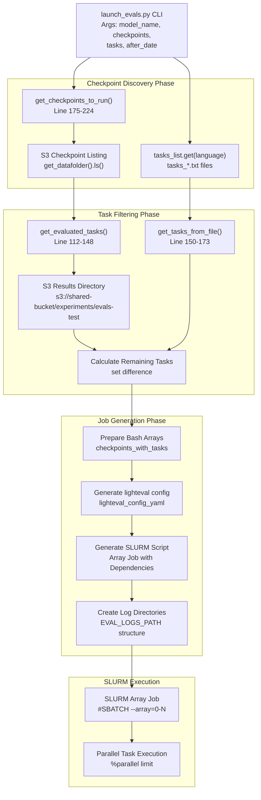
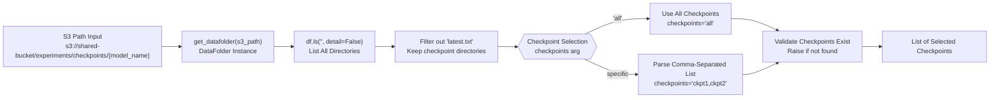
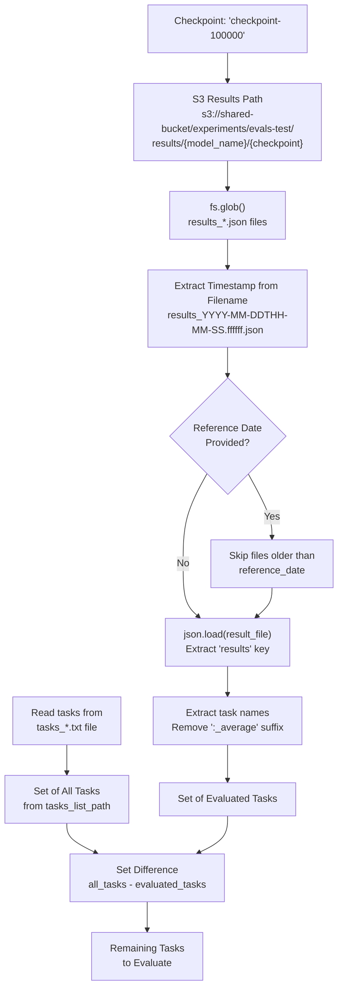
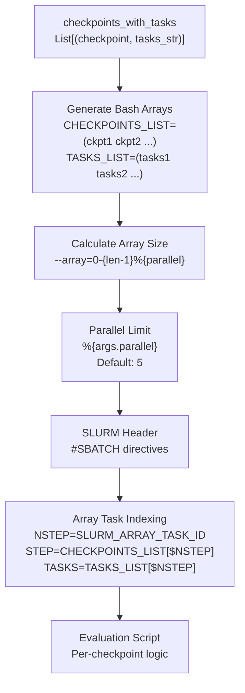
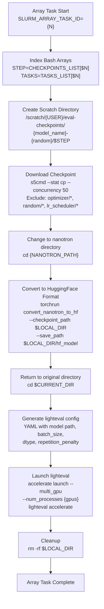
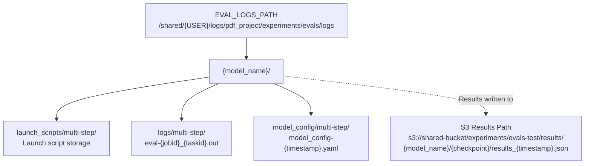

<!-- source: DeepWiki mcp.deepwiki.com · repo huggingface/finepdfs · page 4.1 Evaluation Orchestration · fetched 2026-10-26 -->

# Evaluation Orchestration

<details>
<summary>Relevant source files</summary>

The following files were used as context for generating this wiki page:

- [ablations/evaluations/launch_evals.py](ablations/evaluations/launch_evals.py)

</details>


This document describes the automated checkpoint evaluation orchestration system implemented in `launch_evals.py`. This system discovers model checkpoints on S3, determines which evaluation tasks need to be run, and generates SLURM array jobs to evaluate multiple checkpoints in parallel using the lighteval framework.

For information about specific evaluation tasks and their definitions, see [Task Definitions](#4.2). For details on multi-language benchmark coverage, see [Multi-Language Evaluation Tasks](#4.3).

## Overview

The evaluation orchestration system serves as the entry point for running comprehensive model evaluations across multiple checkpoints and tasks. It automates the following workflow:

1. **Checkpoint Discovery**: Lists available checkpoints from S3 storage
2. **Task Filtering**: Determines which tasks remain to be evaluated for each checkpoint
3. **Job Generation**: Creates SLURM array jobs for parallel evaluation
4. **Checkpoint Conversion**: Converts nanotron checkpoints to HuggingFace format
5. **Evaluation Execution**: Runs lighteval on each checkpoint with remaining tasks

The system is designed for incremental evaluation, tracking completed tasks to avoid redundant computation and enabling evaluation of new checkpoints as they become available during training.

Sources: [ablations/evaluations/launch_evals.py:1-512]()

## System Architecture



**Diagram: Evaluation Orchestration Data Flow** - This diagram shows how the system progresses from CLI arguments through checkpoint discovery, task filtering, and SLURM job generation to parallel execution.

Sources: [ablations/evaluations/launch_evals.py:175-224](), [ablations/evaluations/launch_evals.py:112-148](), [ablations/evaluations/launch_evals.py:301-512]()

## Checkpoint Discovery and Selection

The `get_checkpoints_to_run()` function [ablations/evaluations/launch_evals.py:175-224]() implements checkpoint discovery with several filtering mechanisms:

### Checkpoint Discovery Process



**Diagram: Checkpoint Discovery Logic** - Shows how checkpoints are discovered from S3 and filtered based on CLI arguments.

Sources: [ablations/evaluations/launch_evals.py:192-203]()

### Date-Based Filtering

The system supports temporal filtering via the `--after-date` argument, which enables re-evaluation of checkpoints after a specific date:

```python
# Date parsing: DD-MM-YYYY HH:MM:SS format
reference_date = parse_date(after_date)  # Line 45-51
```

When a reference date is provided, the system checks result file timestamps to determine if re-evaluation is needed [ablations/evaluations/launch_evals.py:127-136]().

Sources: [ablations/evaluations/launch_evals.py:45-51](), [ablations/evaluations/launch_evals.py:192-224]()

## Task Filtering and Incremental Evaluation

The system implements incremental evaluation by tracking completed tasks and only running evaluations for remaining tasks. This significantly reduces computation for checkpoints that have already been partially evaluated.

### Task Filtering Workflow



**Diagram: Task Filtering Logic** - Illustrates how the system determines which tasks remain to be evaluated for each checkpoint.

Sources: [ablations/evaluations/launch_evals.py:112-148](), [ablations/evaluations/launch_evals.py:215-223]()

### Task File Format

Tasks are read from language-specific files defined in the `tasks_list` dictionary [ablations/evaluations/launch_evals.py:37-43]():

| Language | Task File Path | Line Reference |
|----------|---------------|----------------|
| `eng_Latn` | `/admin/home/user/shared/projects/new_training_setup/tasks_txt/tasks_eng.txt` | 38 |
| `fra_Latn` | `/admin/home/user/shared/projects/new_training_setup/tasks_txt/tasks_fra.txt` | 39 |
| `arb_Arab` | `/admin/home/user/shared/projects/new_training_setup/tasks_txt/tasks_ara.txt` | 40 |
| `cmn_Hani` | `/admin/home/user/shared/projects/new_training_setup/tasks_txt/tasks_zho.txt` | 41 |
| `rus_Cyrl` | `/admin/home/user/shared/projects/new_training_setup/tasks_txt/tasks_rus.txt` | 42 |

Task files use a pipe-delimited format where the last segment is removed before comparison [ablations/evaluations/launch_evals.py:167]().

Sources: [ablations/evaluations/launch_evals.py:37-43](), [ablations/evaluations/launch_evals.py:150-173]()

## SLURM Array Job Generation

The system generates a single SLURM array job that evaluates multiple checkpoints in parallel, with each array task handling one checkpoint and its remaining tasks.

### Array Job Structure



**Diagram: SLURM Array Job Construction** - Shows how checkpoints and tasks are packaged into bash arrays for SLURM array job execution.

Sources: [ablations/evaluations/launch_evals.py:345-348](), [ablations/evaluations/launch_evals.py:387](), [ablations/evaluations/launch_evals.py:424-430]()

### SLURM Configuration Parameters

The following constants define SLURM resource allocation [ablations/evaluations/launch_evals.py:24-27]():

| Parameter | Value | Description |
|-----------|-------|-------------|
| `CPUS_PER_NODE` | 88 | CPUs allocated per node |
| `GPUS_PER_NODE` | 8 | Default GPUs per task (overridable with `--gpus`) |
| `PARTITION` | `hopper-prod` | SLURM partition for job submission |
| `NODES` | 1 | Single node per array task |

### Job Dependencies

The system supports job dependencies through two mechanisms:

1. **Explicit Dependency** (`-d` argument): Wait for a specific job to complete [ablations/evaluations/launch_evals.py:369-370]()
2. **Sequential Execution** (`--run-all` flag): Chain jobs across multiple models [ablations/evaluations/launch_evals.py:371-372]()

Dependencies are formatted as `afterok:{job_id}` or `afterany:{job_id}` and passed to the `#SBATCH --dependency` directive [ablations/evaluations/launch_evals.py:393]().

Sources: [ablations/evaluations/launch_evals.py:24-27](), [ablations/evaluations/launch_evals.py:368-393]()

## Evaluation Execution Workflow

Each SLURM array task executes the following workflow for its assigned checkpoint:



**Diagram: Individual Evaluation Task Workflow** - Details the steps executed within each SLURM array task to evaluate a single checkpoint.

Sources: [ablations/evaluations/launch_evals.py:428-499]()

### Checkpoint Download and Conversion

The checkpoint download process uses `s5cmd` with optimizations [ablations/evaluations/launch_evals.py:442-448]():

```bash
s5cmd --stat cp \
    --concurrency 50 \
    --exclude "optimizer/*" \
    --exclude "random/*" \
    --exclude "lr_scheduler/*" \
    --part-size 100 \
    "{s3_path}/$STEP/*" "$LOCAL_DOWNLOAD_CHECKPOINT_FOLDER/"
```

Key optimizations:
- **Concurrency 50**: Parallel downloads for faster transfer
- **Exclude patterns**: Skip optimizer state, random state, and learning rate scheduler to reduce transfer size
- **Part size 100**: Configure multipart upload chunk size

The conversion from nanotron to HuggingFace format is performed using nanotron's conversion script [ablations/evaluations/launch_evals.py:459-462]():

```bash
torchrun --standalone --nproc_per_node=1 \
    -m examples.llama.convert_nanotron_to_hf \
    --checkpoint_path $LOCAL_DOWNLOAD_CHECKPOINT_FOLDER \
    --save_path $LOCAL_DOWNLOAD_CHECKPOINT_FOLDER/hf_model \
    --check_conversion
```

Sources: [ablations/evaluations/launch_evals.py:442-462]()

### Lighteval Configuration

Each array task generates a checkpoint-specific lighteval configuration file [ablations/evaluations/launch_evals.py:468-478]():

```yaml
model_parameters:
  model_name: $LOCAL_DOWNLOAD_CHECKPOINT_FOLDER/hf_model
  batch_size: {batch_size or null}
  trust_remote_code: true
  dtype: bfloat16
  model_name_override: {model_name}/$STEP
  generation_parameters:
    repetition_penalty: 1.2
```

The `model_name_override` field ensures results are tagged with the checkpoint identifier for easy tracking in the output JSON files.

Sources: [ablations/evaluations/launch_evals.py:468-478]()

### Lighteval Execution

The lighteval framework is launched using `accelerate` for multi-GPU execution [ablations/evaluations/launch_evals.py:482-492]():

| Parameter | Value | Description |
|-----------|-------|-------------|
| `--multi_gpu` | - | Enable multi-GPU mode |
| `--num_processes` | `{gpus}` | Number of GPU processes (typically 8) |
| `--custom-tasks` | `{custom_tasks_path}` | Path to custom task definitions |
| `--dataset-loading-processes` | `{CPUS_PER_NODE}` | Parallel dataset loading (88 processes) |
| `--max-samples` | 1000 | Maximum samples per task |
| `--output-dir` | `{logging_dir}` | S3 directory for results |
| `--save-details` | - | Save detailed evaluation results |

The actual command:

```bash
CUDA_DEVICE_MAX_CONNECTIONS=1 accelerate launch \
    --multi_gpu \
    --num_processes {args.gpus} \
    -m lighteval accelerate \
    --custom-tasks {custom_tasks_path} \
    --dataset-loading-processes {CPUS_PER_NODE} \
    --max-samples 1000 \
    --output-dir {args.logging_dir} \
    --save-details \
    $LIGHTEVAL_CONFIG_PATH \
    "$TASKS_TO_EVAL"
```

Sources: [ablations/evaluations/launch_evals.py:482-492]()

## Directory Structure and Logging

The system creates a structured directory hierarchy for launch scripts, logs, and configurations:



**Diagram: Directory Structure** - Shows the organization of launch scripts, logs, and configuration files.

The directories are created at [ablations/evaluations/launch_evals.py:336-343]():

```python
eval_launch_script_path = os.path.join(EVAL_LOGS_PATH, formatted_model_name, "launch_scripts", "multi-step")
eval_logs_path = os.path.join(EVAL_LOGS_PATH, formatted_model_name, "logs", "multi-step")
model_config_path = os.path.join(EVAL_LOGS_PATH, formatted_model_name, "model_config", "multi-step")

os.makedirs(eval_launch_script_path, exist_ok=True)
os.makedirs(eval_logs_path, exist_ok=True)
os.makedirs(model_config_path, exist_ok=True)
```

Sources: [ablations/evaluations/launch_evals.py:19-20](), [ablations/evaluations/launch_evals.py:336-343]()

## Command-Line Interface

The `launch_evals.py` script provides a comprehensive CLI for configuring evaluation runs:

### Required Arguments

| Argument | Type | Description |
|----------|------|-------------|
| `model_name` | `str` | Model name on S3 (comma-separated for multiple models) |

### Optional Arguments

| Argument | Type | Default | Description |
|----------|------|---------|-------------|
| `--s3_prefix` | `str` | `s3://shared-bucket/experiments/checkpoints` | S3 path to model checkpoints |
| `--checkpoints` (`-ckpts`) | `str` | `all` | Comma-separated list of checkpoints or "all" |
| `--model-template` | `str` | `{model_name}` | Template for model name formatting |
| `--run-all` | `flag` | `False` | Run models in sequence with dependencies |
| `--tasks` | `str` | `/admin/home/user/shared/projects/new_training_setup/tasks.txt` | Tasks file path |
| `--custom-tasks` | `str` | `/admin/home/user/shared/projects/new_training_setup/task_list.py` | Custom task definitions |
| `--offline-datasets` | `flag` | `False` | Disable dataset downloading |
| `--seed` | `str` | `6` | Comma-separated list of seeds for model template |
| `--qos` | `str` | `normal` | SLURM QoS |
| `--time_limit` | `str` | `1:50:00` | SLURM time limit |
| `--parallel` (`-p`) | `int` | `5` | Simultaneous array tasks |
| `--batch_size` (`-bs`) | `int` | `None` | Batch size for evaluation |
| `--gpus` (`-g`) | `int` | `8` | GPUs per task |
| `--logging_dir` | `str` | `s3://shared-bucket/experiments/evals-test` | S3 results directory |
| `-d` | `str` | `None` | Dependency job ID |
| `--overwrite` (`-ow`) | `flag` | `False` | Overwrite existing results |
| `--after-date` | `str` | `None` | Only re-evaluate after this date (DD-MM-YYYY HH:MM:SS) |
| `--job-prefix` | `str` | `""` | Prefix for job name |
| `--debug` | `flag` | `False` | Debug mode (save script locally) |

Sources: [ablations/evaluations/launch_evals.py:256-299]()

### Example Usage

**Evaluate all checkpoints for a model:**
```bash
python launch_evals.py eng_Latn_XXXX-model-name
```

**Evaluate specific checkpoints:**
```bash
python launch_evals.py eng_Latn_XXXX-model-name \
    --checkpoints checkpoint-100000,checkpoint-200000
```

**Re-evaluate after a specific date:**
```bash
python launch_evals.py eng_Latn_XXXX-model-name \
    --after-date "01-01-2024 00:00:00"
```

**Evaluate multiple models in sequence:**
```bash
python launch_evals.py model1,model2,model3 --run-all
```

**Use multiple seeds with model template:**
```bash
python launch_evals.py "model-{seed}" \
    --model-template "{model_name}" \
    --seed "1,2,3"
```

Sources: [ablations/evaluations/launch_evals.py:301-512]()

## Language Detection and Task Assignment

The system automatically detects the language from the model name and assigns appropriate custom tasks and task lists [ablations/evaluations/launch_evals.py:307-315]():

```python
language = "_".join(formatted_model_name.split("_")[:2])
custom_tasks_path = custom_tasks.get(language)
tasks_list_path = tasks_list.get(language)

if custom_tasks_path is None and tasks_list_path is None:
    print(f"Language {language} not found in custom_tasks or tasks_list, defaulting to English")
    custom_tasks_path = custom_tasks.get("eng_Latn")
    tasks_list_path = tasks_list.get("eng_Latn")
```

The language code is extracted from the first two underscore-separated segments of the model name (e.g., `eng_Latn_model-name` → `eng_Latn`).

Sources: [ablations/evaluations/launch_evals.py:29-43](), [ablations/evaluations/launch_evals.py:307-315]()

## Job Naming and Summary

The system generates descriptive job names and provides detailed summaries of launched evaluations:

### Job Name Generation

Job names include checkpoint counts and task information [ablations/evaluations/launch_evals.py:377-382]():

```python
total_remaining_tasks = sum(len(tasks.split(',')) for _, tasks in checkpoints_with_tasks)
all_possible_tasks = len(read_tasks_from_file(tasks_list_path))
task_suffix = f"_{total_remaining_tasks}tasks" if total_remaining_tasks < all_possible_tasks * len(checkpoints_with_tasks) else ""
job_name = f"{args.job_prefix}eval-{formatted_model_name}{task_suffix}"
```

Example job names:
- `eval-eng_Latn_model-name` (all tasks)
- `eval-eng_Latn_model-name_47tasks` (partial tasks remaining)

### Evaluation Summary

Upon successful launch, the system logs a detailed summary [ablations/evaluations/launch_evals.py:508-511]():

```
{formatted_model_name} evals launched with id={launched_id}. 
Total: {len(checkpoints_with_tasks)} checkpoints, {total_remaining_tasks} tasks remaining.
Details:
  checkpoint-100000: 12 tasks
  checkpoint-200000: 15 tasks
  checkpoint-300000: 20 tasks
Local logs: {eval_logs_path}
```

Sources: [ablations/evaluations/launch_evals.py:377-382](), [ablations/evaluations/launch_evals.py:503-511]()

## Error Handling and Validation

The system includes several validation mechanisms:

### Checkpoint Validation

```python
not_found_checkpoints = [ckpt for ckpt in selected_checkpoints if ckpt not in avail_checkpoints]
if len(not_found_checkpoints) > 0:
    raise ValueError(f"Checkpoints not found in \"{s3_path}\": {not_found_checkpoints}")
```

This validates that all specified checkpoints exist before attempting to schedule evaluation jobs [ablations/evaluations/launch_evals.py:201-203]().

### Date Format Validation

```python
def parse_date(date_string: Optional[str]) -> Optional[datetime]:
    if date_string is None:
        return None
    try:
        return datetime.strptime(date_string, "%d-%m-%Y %H:%M:%S")
    except ValueError:
        raise ValueError("Invalid date format. Use 'DD-MM-YYYY HH:MM:SS'")
```

The date parser ensures correct format and provides clear error messages [ablations/evaluations/launch_evals.py:45-51]().

### S3 Access Error Handling

```python
try:
    result_files = fs.glob(f"{path_prefix}/{glob_pattern}")
except FileNotFoundError:
    result_files = []
except Exception as e:
    logger.warning(f"Error accessing S3 path {s3_results_path}: {e}")
    result_files = []
```

S3 operations are wrapped in try-except blocks to gracefully handle missing directories and access errors [ablations/evaluations/launch_evals.py:59-65]().

Sources: [ablations/evaluations/launch_evals.py:45-51](), [ablations/evaluations/launch_evals.py:59-65](), [ablations/evaluations/launch_evals.py:201-203]()

---

