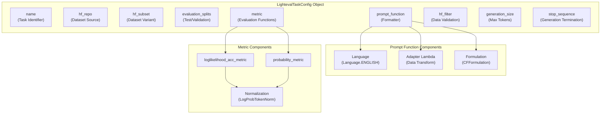
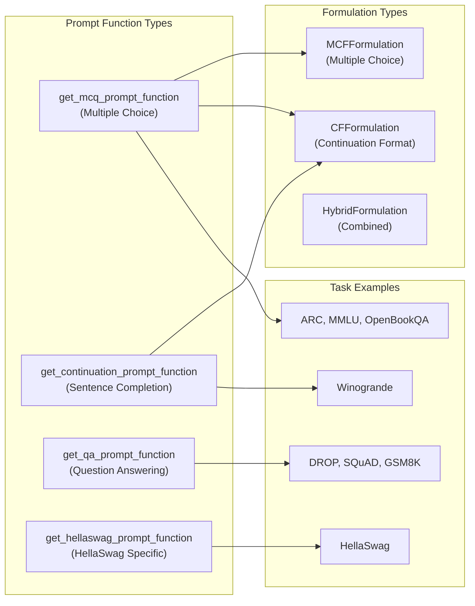
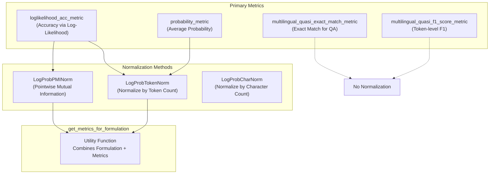
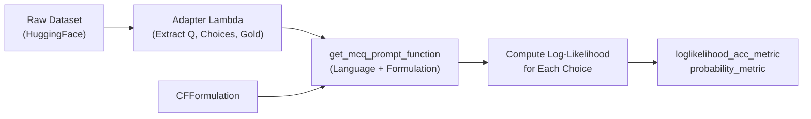
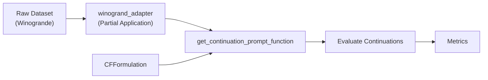
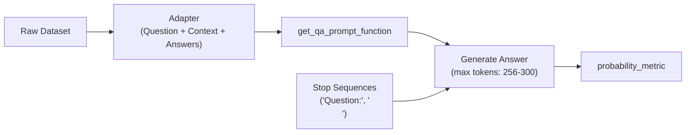
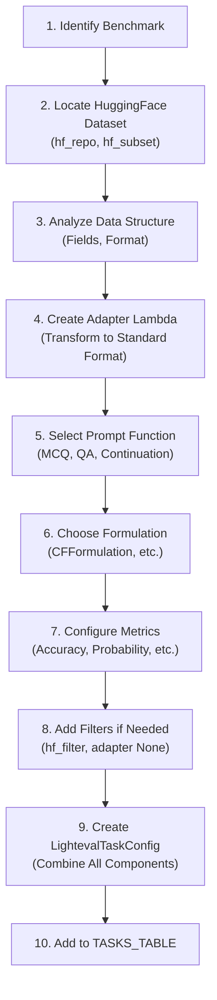

<!-- source: DeepWiki mcp.deepwiki.com · repo huggingface/finepdfs · page 4.2 Task Definitions · fetched 2026-10-26 -->

# Task Definitions

<details>
<summary>Relevant source files</summary>

The following files were used as context for generating this wiki page:

- [ablations/evaluations/task_list.py](ablations/evaluations/task_list.py)

</details>


This page documents the evaluation task definition system used in FinePDFs, which relies on the `lighteval` framework. Task definitions specify how to load benchmark datasets, format prompts, evaluate model outputs, and compute metrics. These configurations are consumed by the evaluation orchestration system (see [4.1](#4.1)) and applied across multiple languages (see [4.3](#4.3)).

For information about running evaluations and checkpoint discovery, see [4.1 Evaluation Orchestration](#4.1). For the complete list of supported benchmarks across languages, see [4.3 Multi-Language Evaluation Tasks](#4.3).

## Overview

The task definition system is centered around the `LightevalTaskConfig` class from the lighteval library. Each task configuration encapsulates:

- **Dataset source**: HuggingFace repository and subset identifiers
- **Prompt formatting**: Language-specific prompt functions and formulations
- **Evaluation metrics**: Accuracy, perplexity, F1, exact match, etc.
- **Data filtering**: Optional lambda functions to exclude invalid samples
- **Generation parameters**: For generative tasks like QA

All task definitions are stored in [ablations/evaluations/task_list.py](ablations/evaluations/task_list.py:1-444)() and aggregated into the `TASKS_TABLE` list.

Sources: [ablations/evaluations/task_list.py](ablations/evaluations/task_list.py:1-444)()

## LightevalTaskConfig Structure

### Core Components



### Configuration Parameters

| Parameter | Type | Purpose | Example |
|-----------|------|---------|---------|
| `name` | str | Unique task identifier | `"arc_cf:easy"` |
| `suite` | tuple | Task suite grouping | `("lighteval",)` |
| `hf_repo` | str | HuggingFace dataset repository | `"allenai/ai2_arc"` |
| `hf_subset` | str | Dataset configuration name | `"ARC-Easy"` |
| `evaluation_splits` | tuple | Splits to evaluate on | `("test",)` |
| `few_shots_split` | str | Split for few-shot examples | `"validation"` |
| `hf_avail_splits` | list | Available dataset splits | `["train", "validation"]` |
| `prompt_function` | callable | Function to format prompts | `get_mcq_prompt_function(...)` |
| `metric` | list/tuple | Evaluation metrics | `[loglikelihood_acc_metric(...)]` |
| `hf_filter` | callable | Optional sample filter | `lambda line: len(line["answer"]) > 0` |
| `generation_size` | int | Max generation tokens (for QA) | `256` |
| `stop_sequence` | list | Generation stop tokens | `["\n", "Question:"]` |

Sources: [ablations/evaluations/task_list.py](ablations/evaluations/task_list.py:81-106)(), [ablations/evaluations/task_list.py](ablations/evaluations/task_list.py:181-201)()

## Prompt Functions and Formulations

### Prompt Function Types

The system uses specialized prompt functions for different task types, all imported from the lighteval library:



### Formulation Objects

**CFFormulation (Continuation Format)**: Evaluates by computing log-likelihood of each choice as a continuation of the question. Used for most multiple choice tasks.

**MCFFormulation (Multiple Choice Format)**: Presents choices with letter labels (A, B, C, D) and expects the model to generate a letter.

**HybridFormulation**: Combines both approaches, useful for certain task types.

Sources: [ablations/evaluations/task_list.py](ablations/evaluations/task_list.py:5-5)(), [ablations/evaluations/task_list.py](ablations/evaluations/task_list.py:81-106)()

### Adapter Functions

Adapters transform raw dataset samples into standardized formats expected by prompt functions. They are typically lambda functions:

**Multiple Choice Adapter Example** (ARC):
```python
lambda line: {
    "question": line["question"],
    "choices": line["choices"]["text"],
    "gold_idx": line["choices"]["label"].index(line["answerKey"]),
}
```

**QA Adapter Example** (SQuAD v2):
```python
lambda line: {
    "question": line["question"],
    "context": line["context"],
    "choices": [ans for ans in line["answers"]["text"] if len(ans) > 0],
}
```

**Complex Adapter Example** (MMLU Redux with error handling):
```python
def mmlu_redux_prompt(line):
    if line["error_type"] not in ["wrong_groundtruth", "ok"]:
        return None  # Skip invalid samples
    gold_idx = line["answer"] if line["error_type"] != "wrong_groundtruth" else line["correct_answer"]
    if gold_idx is None:
        return None
    try:
        gold_idx = LETTER_INDICES.index(gold_idx)
    except ValueError:
        gold_idx = int(gold_idx)
    return {
        "question": line["question"],
        "choices": line["choices"],
        "gold_idx": int(gold_idx),
    }
```

Sources: [ablations/evaluations/task_list.py](ablations/evaluations/task_list.py:83-90)(), [ablations/evaluations/task_list.py](ablations/evaluations/task_list.py:246-253)(), [ablations/evaluations/task_list.py](ablations/evaluations/task_list.py:136-154)()

## Metrics and Normalization

### Metric Types



### Common Metric Configurations

**Multiple Choice Tasks** (ARC, MMLU, OpenBookQA):
```python
metric=get_metrics_for_formulation(
    CFFormulation(),
    [
        loglikelihood_acc_metric(normalization=LogProbTokenNorm()),
        loglikelihood_acc_metric(normalization=LogProbPMINorm()),
        probability_metric(normalization=LogProbTokenNorm()),
    ],
)
```

**Generative QA Tasks** (GSM8K, DROP, SQuAD):
```python
metric=[
    probability_metric(normalization=LogProbTokenNorm()),
    # Commented out: multilingual_quasi_exact_match_metric(Language.ENGLISH, "prefix"),
    # Commented out: multilingual_quasi_f1_score_metric(Language.ENGLISH),
]
```

### Normalization Strategies

| Normalization | Purpose | When to Use |
|---------------|---------|-------------|
| `LogProbTokenNorm` | Divide log-prob by token count | Default for most tasks; accounts for length bias |
| `LogProbPMINorm` | Pointwise mutual information | Alternative metric; less sensitive to unconditional probabilities |
| `LogProbCharNorm` | Divide log-prob by character count | Useful for character-level analysis |

Sources: [ablations/evaluations/task_list.py](ablations/evaluations/task_list.py:1-17)(), [ablations/evaluations/task_list.py](ablations/evaluations/task_list.py:97-103)(), [ablations/evaluations/task_list.py](ablations/evaluations/task_list.py:196-199)()

## Task Definition Patterns

### Pattern 1: Multiple Choice with Continuation Format

Used for: ARC, MMLU Redux, OpenBookQA, PIQA, XCSQA



**Example Task Configuration**:

[ablations/evaluations/task_list.py:81-106]()
```python
arcs = [LightevalTaskConfig(
    name=f"arc_cf:{subset}",
    prompt_function=get_mcq_prompt_function(
        Language.ENGLISH,
        lambda line: {
            "question": line["question"],
            "choices": line["choices"]["text"],
            "gold_idx": line["choices"]["label"].index(line["answerKey"]),
        },
        formulation=CFFormulation(),
    ),
    suite=("lighteval",),
    hf_repo="allenai/ai2_arc",
    hf_subset="ARC-Easy" if subset == "easy" else "ARC-Challenge",
    evaluation_splits=("test",),
    few_shots_split="validation",
    metric=get_metrics_for_formulation(
        CFFormulation(),
        [
            loglikelihood_acc_metric(normalization=LogProbTokenNorm()),
            probability_metric(normalization=LogProbTokenNorm()),
        ],
    ),
) for subset in ["easy", "challenge"]]
```

Sources: [ablations/evaluations/task_list.py](ablations/evaluations/task_list.py:81-106)()

### Pattern 2: Sentence Completion

Used for: Winogrande



**Example Task Configuration**:

[ablations/evaluations/task_list.py:329-349]()
```python
winogrande_tasks = [
    LightevalTaskConfig(
        name=f"winogrande_{formulation.name.lower()}",
        suite=("lighteval",),
        prompt_function=get_continuation_prompt_function(
            Language.ENGLISH,
            partial(winogrand_adapter, Language.ENGLISH),
            formulation=formulation,
        ),
        hf_repo="allenai/winogrande",
        hf_subset="winogrande_xl",
        evaluation_splits=["validation"],
        metric=get_metrics_for_formulation(formulation, [
            loglikelihood_acc_metric(normalization=LogProbTokenNorm()),
            probability_metric(normalization=LogProbTokenNorm()),
        ]),
    ) for formulation in [CFFormulation()]
]
```

Sources: [ablations/evaluations/task_list.py](ablations/evaluations/task_list.py:329-349)()

### Pattern 3: Generative Question Answering

Used for: GSM8K, DROP, SQuAD v2, TREB QA, WikiTableQuestions



**Example Task Configuration**:

[ablations/evaluations/task_list.py:181-201]()
```python
gsm8k = LightevalTaskConfig(
    name="gsm8k",
    suite=["lighteval"],
    prompt_function=get_qa_prompt_function(
        Language.ENGLISH,
        lambda line: {
            "question": line["question"],
            "choices": [f"{line['answer'].split('####')[-1].strip()}"],
        },
    ),
    hf_repo="gsm8k",
    hf_subset="main",
    evaluation_splits=["test"],
    generation_size=256,
    metric=[
        probability_metric(normalization=LogProbTokenNorm()),
    ],
    stop_sequence=["Question:", "Question", "question", "question:", "\n"],
)
```

Sources: [ablations/evaluations/task_list.py](ablations/evaluations/task_list.py:181-201)()

### Pattern 4: Special Format Tasks

**HellaSwag** uses a custom prompt function due to its unique two-part context structure:

[ablations/evaluations/task_list.py:107-134]()
```python
hellaswag_task = [
    LightevalTaskConfig(
        name=f"hellaswag_cf",
        suite=["lighteval"],
        prompt_function=get_hellaswag_prompt_function(
            language=Language.ENGLISH,
            adapter=lambda line: {
                "ctx_a": line["ctx_a"],
                "ctx_b": line["ctx_b"],
                "continuations": line["endings"],
                "gold_idx": int(line["label"]),
            },
            formulation=CFFormulation(),
        ),
        hf_repo="Rowan/hellaswag",
        hf_subset="default",
        evaluation_splits=["validation"],
        metric=get_metrics_for_formulation(
            CFFormulation(),
            [
                loglikelihood_acc_metric(normalization=LogProbTokenNorm()),
                probability_metric(normalization=LogProbTokenNorm()),
            ],
        ),
    )
]
```

Sources: [ablations/evaluations/task_list.py](ablations/evaluations/task_list.py:107-134)()

## Data Filtering

### Sample Validation

Some tasks require filtering invalid samples using the `hf_filter` parameter:

**SQuAD v2** (filter samples without valid answers):
```python
hf_filter=lambda line: any(ans for ans in line["answers"]["text"] if len(ans) > 0)
```

**XCSQA** (filter samples with empty choices):
```python
hf_filter=lambda x: all(
    len(x["question"]["choices"]["text"][i].strip()) > 0 
    for i in range(len(x["question"]["choices"]["text"]))
)
```

**TREB QA** (filter samples with multiple tables):
```python
hf_filter=lambda line: len(line["Table_markdown"]) == 1
```

### Adapter-Level Filtering

Adapters can return `None` to skip invalid samples:

[ablations/evaluations/task_list.py:136-154]()
```python
def mmlu_redux_prompt(line):
    if line["error_type"] not in ["wrong_groundtruth", "ok"]:
        return None  # Skip this sample
    gold_idx = line["answer"] if line["error_type"] != "wrong_groundtruth" else line["correct_answer"]
    if gold_idx is None:
        return None  # Skip this sample
    # ... process valid sample
    return result
```

Sources: [ablations/evaluations/task_list.py](ablations/evaluations/task_list.py:257-257)(), [ablations/evaluations/task_list.py](ablations/evaluations/task_list.py:285-287)(), [ablations/evaluations/task_list.py](ablations/evaluations/task_list.py:392-392)(), [ablations/evaluations/task_list.py](ablations/evaluations/task_list.py:136-154)()

## Complete Task Inventory

### Registered Tasks

The `TASKS_TABLE` list aggregates all task definitions:

[ablations/evaluations/task_list.py:431-444]()
```python
TASKS_TABLE = [
    *arcs,                  # ARC-Easy, ARC-Challenge
    *hellaswag_task,        # HellaSwag
    *mmlu_redux,            # MMLU Redux (79 subsets)
    *openbook_qa_tasks,     # OpenBookQA
    *winogrande_tasks,      # Winogrande
    *piqa_tasks,            # PIQA
    gsm8k,                  # GSM8K
    drop_qa,                # DROP
    squad_v2,               # SQuAD v2
    *en_xcsqa,              # XCSQA English
    treb_qa,                # TREB QA
    wikitablequestions,     # WikiTableQuestions
]
```

### Task Count by Type

| Task Type | Count | Examples |
|-----------|-------|----------|
| Multiple Choice (CF) | 90+ | ARC (2), MMLU Redux (79), OpenBookQA, PIQA, XCSQA |
| Sentence Completion | 1 | Winogrande |
| Generative QA | 5 | GSM8K, DROP, SQuAD v2, TREB QA, WikiTableQuestions |
| Special Format | 1 | HellaSwag |

### MMLU Redux Subsets

The system defines 79 MMLU Redux subsets covering diverse academic domains:

[ablations/evaluations/task_list.py:21-79]()

Categories include:
- **STEM**: mathematics, physics, chemistry, computer science, engineering
- **Humanities**: history, philosophy, law, religion
- **Social Sciences**: sociology, psychology, economics, business
- **Medicine**: clinical knowledge, medical genetics, professional medicine
- **Miscellaneous**: miscellaneous general knowledge

Sources: [ablations/evaluations/task_list.py](ablations/evaluations/task_list.py:431-444)(), [ablations/evaluations/task_list.py](ablations/evaluations/task_list.py:21-79)()

## Task Definition Workflow



Sources: [ablations/evaluations/task_list.py](ablations/evaluations/task_list.py:1-444)()

## Integration with Evaluation System

Task definitions from `task_list.py` are consumed by:

1. **launch_evals.py** (see [4.1](#4.1)): Reads task files (e.g., `tasks_eng.txt`) which reference task names from `TASKS_TABLE`
2. **lighteval framework**: Loads task configurations and executes evaluation logic
3. **Task filtering**: The evaluation orchestrator can filter to run only specific tasks or skip completed ones

The task names used in task files must exactly match the `name` field in `LightevalTaskConfig` objects. For example:
- `arc_cf:easy` corresponds to one of the ARC task configurations
- `mmlu_redux_cf:anatomy` corresponds to a specific MMLU subset
- `gsm8k` corresponds to the GSM8K task

Sources: [ablations/evaluations/task_list.py](ablations/evaluations/task_list.py:431-444)()

---

