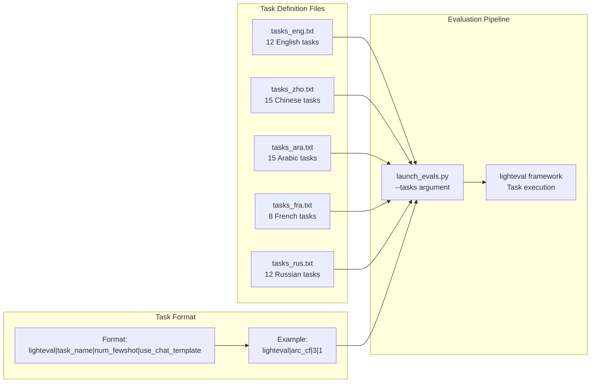
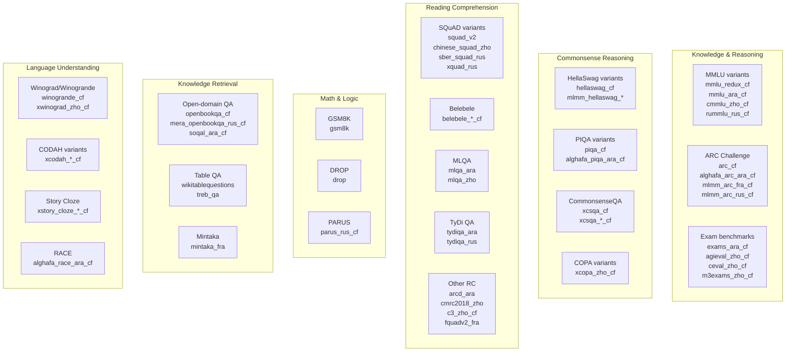
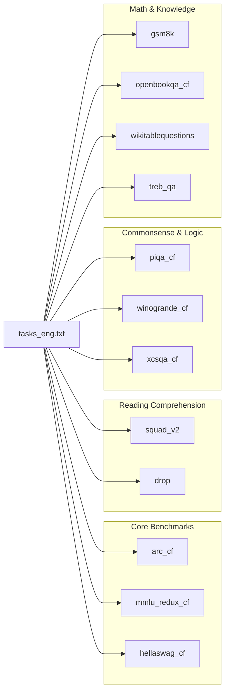
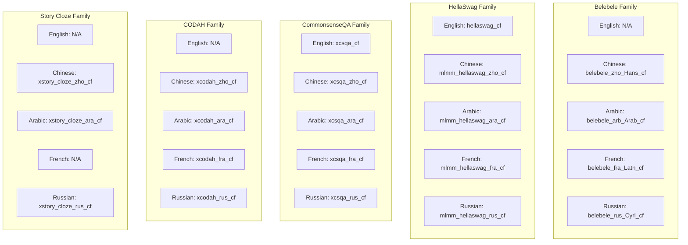
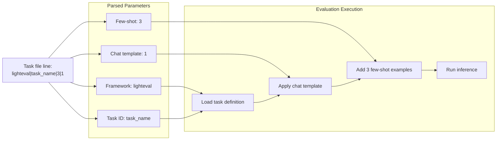
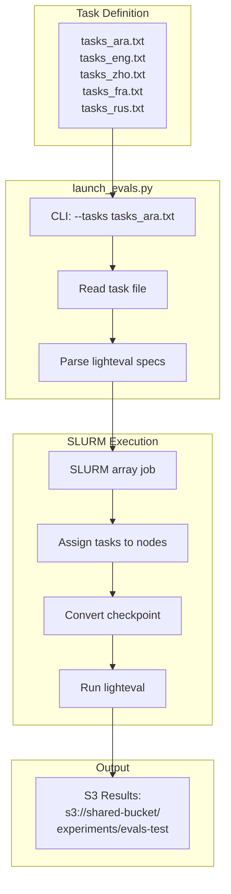

<!-- source: DeepWiki mcp.deepwiki.com · repo huggingface/finepdfs · page 4.3 Multi-Language Evaluation Tasks · fetched 2026-10-26 -->

# Multi-Language Evaluation Tasks

<details>
<summary>Relevant source files</summary>

The following files were used as context for generating this wiki page:

- [ablations/evaluations/tasks_txt/tasks_ara.txt](ablations/evaluations/tasks_txt/tasks_ara.txt)
- [ablations/evaluations/tasks_txt/tasks_eng.txt](ablations/evaluations/tasks_txt/tasks_eng.txt)
- [ablations/evaluations/tasks_txt/tasks_fra.txt](ablations/evaluations/tasks_txt/tasks_fra.txt)
- [ablations/evaluations/tasks_txt/tasks_rus.txt](ablations/evaluations/tasks_txt/tasks_rus.txt)
- [ablations/evaluations/tasks_txt/tasks_zho.txt](ablations/evaluations/tasks_txt/tasks_zho.txt)

</details>


## Purpose and Scope

This page documents the comprehensive multi-language evaluation task coverage in the FinePDFs evaluation infrastructure. It catalogs the specific benchmark tasks defined for each supported language (English, Chinese, Arabic, French, Russian) and explains how these tasks are organized and specified in the task definition files.

For information about how these task lists are used in the evaluation pipeline, see [Evaluation Orchestration](#4.1). For details about the underlying task configuration system and prompt functions, see [Task Definitions](#4.2).

## Task File Structure

The evaluation system uses plain text task files located in [ablations/evaluations/tasks_txt/]() to define which benchmarks to evaluate for each language. Each language has a dedicated task file following the naming convention `tasks_<language_code>.txt`.

### File Format

Each line in a task file follows the lighteval task specification format:

```
lighteval|<task_name>|<num_fewshot>|<use_chat_template>
```

Where:
- `lighteval` - Framework identifier
- `<task_name>` - Unique identifier for the benchmark task (e.g., `arc_cf`, `mmlu_ara_cf`)
- `<num_fewshot>` - Number of few-shot examples (typically `3`)
- `<use_chat_template>` - Whether to use chat template formatting (`1` = yes, `0` = no)

**Diagram: Task File Format and Loading**



Sources: [ablations/evaluations/tasks_txt/tasks_eng.txt](), [ablations/evaluations/tasks_txt/tasks_ara.txt](), [ablations/evaluations/tasks_txt/tasks_zho.txt](), [ablations/evaluations/tasks_txt/tasks_fra.txt](), [ablations/evaluations/tasks_txt/tasks_rus.txt]()

## Language Coverage Overview

The evaluation suite covers five languages with varying task counts:

| Language | Code | Task File | Task Count | Script/Writing System |
|----------|------|-----------|------------|----------------------|
| English | eng | `tasks_eng.txt` | 12 | Latin |
| Chinese | zho | `tasks_zho.txt` | 15 | Hans (Simplified) |
| Arabic | ara | `tasks_ara.txt` | 15 | Arabic script |
| French | fra | `tasks_fra.txt` | 8 | Latin |
| Russian | rus | `tasks_rus.txt` | 12 | Cyrillic |

**Total**: 62 unique benchmark tasks across 5 languages

Sources: [ablations/evaluations/tasks_txt/]()

## Task Categories by Benchmark Type

Tasks are organized by evaluation category across languages:

**Diagram: Task Categories Across Languages**



Sources: [ablations/evaluations/tasks_txt/tasks_eng.txt:1-12](), [ablations/evaluations/tasks_txt/tasks_ara.txt:1-15](), [ablations/evaluations/tasks_txt/tasks_zho.txt:1-15](), [ablations/evaluations/tasks_txt/tasks_fra.txt:1-8](), [ablations/evaluations/tasks_txt/tasks_rus.txt:1-12]()

## English Tasks (eng)

English evaluation covers the broadest range of benchmark types with 12 tasks:

| Task Name | Category | Description | Few-shot |
|-----------|----------|-------------|----------|
| `arc_cf` | Reasoning | ARC Challenge - science questions | 3 |
| `hellaswag_cf` | Commonsense | Sentence completion | 3 |
| `mmlu_redux_cf` | Knowledge | Massive Multitask Language Understanding | 3 |
| `xcsqa_cf` | Commonsense | Cross-lingual CommonsenseQA | 3 |
| `squad_v2` | Reading Comp. | Stanford Question Answering Dataset v2 | 3 |
| `openbookqa_cf` | Knowledge | Open-book question answering | 3 |
| `winogrande_cf` | Language | Winograd Schema Challenge | 3 |
| `piqa_cf` | Commonsense | Physical Interaction QA | 3 |
| `gsm8k` | Math | Grade School Math 8K | 3 |
| `drop` | Reading Comp. | Discrete Reasoning Over Paragraphs | 3 |
| `wikitablequestions` | Knowledge | Wikipedia table-based QA | 3 |
| `treb_qa` | Knowledge | TriviaQA subset | 3 |

**Diagram: English Task Pipeline**



Sources: [ablations/evaluations/tasks_txt/tasks_eng.txt:1-12]()

## Chinese Tasks (zho)

Chinese evaluation includes 15 tasks with strong coverage of Chinese-specific benchmarks:

| Task Name | Category | Description | Few-shot |
|-----------|----------|-------------|----------|
| `agieval_zho_cf` | Exam | Chinese AGI evaluation benchmark | 3 |
| `ceval_zho_cf` | Exam | Chinese Evaluation Benchmark | 3 |
| `cmmlu_zho_cf` | Knowledge | Chinese MMLU | 3 |
| `m3exams_zho_cf` | Exam | Multilingual exam benchmark | 3 |
| `belebele_zho_Hans_cf` | Reading Comp. | Belebele (Simplified Chinese) | 3 |
| `c3_zho_cf` | Reading Comp. | Chinese cloze test | 3 |
| `cmrc2018_zho` | Reading Comp. | Chinese Machine Reading Comprehension | 3 |
| `chinese_squad_zho` | Reading Comp. | Chinese SQuAD | 3 |
| `xcodah_zho_cf` | Commonsense | Cross-lingual CODAH | 3 |
| `xcopa_zho_cf` | Commonsense | Cross-lingual COPA | 3 |
| `xcsqa_zho_cf` | Commonsense | Cross-lingual CommonsenseQA | 3 |
| `mlmm_hellaswag_zho_cf` | Commonsense | Multilingual HellaSwag | 3 |
| `xwinograd_zho_cf` | Language | Cross-lingual Winograd | 3 |
| `xstory_cloze_zho_cf` | Language | Cross-lingual Story Cloze | 3 |
| `mlqa_zho` | Reading Comp. | Multilingual QA | 3 |

**Notable Features**:
- Four Chinese-specific exam benchmarks: `agieval_zho_cf`, `ceval_zho_cf`, `cmmlu_zho_cf`, `m3exams_zho_cf`
- Comprehensive reading comprehension coverage with five dedicated tasks
- All tasks use Simplified Chinese (Hans) script

Sources: [ablations/evaluations/tasks_txt/tasks_zho.txt:1-15]()

## Arabic Tasks (ara)

Arabic evaluation comprises 15 tasks with extensive Alghafa benchmark coverage:

| Task Name | Category | Description | Few-shot |
|-----------|----------|-------------|----------|
| `exams_ara_cf` | Exam | Arabic exam benchmark | 3 |
| `mmlu_ara_cf` | Knowledge | Arabic MMLU | 3 |
| `alghafa_arc_ara_cf:easy` | Reasoning | Alghafa ARC (easy variant) | 3 |
| `alghafa_sciqa_ara_cf` | Reasoning | Alghafa Science QA | 3 |
| `belebele_arb_Arab_cf` | Reading Comp. | Belebele (Arabic script) | 3 |
| `soqal_ara_cf` | Knowledge | Arabic open-domain QA | 3 |
| `mlqa_ara` | Reading Comp. | Multilingual QA | 3 |
| `tydiqa_ara` | Reading Comp. | TyDi QA Arabic | 3 |
| `alghafa_race_ara_cf` | Reading Comp. | Alghafa RACE | 3 |
| `arcd_ara` | Reading Comp. | Arabic Reading Comprehension | 3 |
| `xcodah_ara_cf` | Commonsense | Cross-lingual CODAH | 3 |
| `alghafa_piqa_ara_cf` | Commonsense | Alghafa PIQA | 3 |
| `xcsqa_ara_cf` | Commonsense | Cross-lingual CommonsenseQA | 3 |
| `mlmm_hellaswag_ara_cf` | Commonsense | Multilingual HellaSwag | 3 |
| `xstory_cloze_ara_cf` | Language | Cross-lingual Story Cloze | 3 |

**Notable Features**:
- Heavy use of Alghafa framework tasks (6 tasks prefixed with `alghafa_`)
- Five dedicated reading comprehension tasks
- Note: `alghafa_arc_ara_cf:easy` uses task variant syntax with colon separator

Sources: [ablations/evaluations/tasks_txt/tasks_ara.txt:1-15]()

## French Tasks (fra)

French evaluation includes 8 focused tasks:

| Task Name | Category | Description | Few-shot |
|-----------|----------|-------------|----------|
| `global_mmlu_cs_fra_cf` | Knowledge | Global MMLU (French) | 3 |
| `mlmm_arc_fra_cf:challenge` | Reasoning | Multilingual ARC Challenge | 3 |
| `mintaka_fra` | Knowledge | Mintaka QA dataset | 3 |
| `belebele_fra_Latn_cf` | Reading Comp. | Belebele (French Latin) | 3 |
| `fquadv2_fra` | Reading Comp. | French Question Answering Dataset v2 | 3 |
| `xcodah_fra_cf` | Commonsense | Cross-lingual CODAH | 3 |
| `xcsqa_fra_cf` | Commonsense | Cross-lingual CommonsenseQA | 3 |
| `mlmm_hellaswag_fra_cf` | Commonsense | Multilingual HellaSwag | 3 |

**Notable Features**:
- Focused on cross-lingual benchmarks (5 tasks with `x*` or `mlmm_` prefix)
- Note: `mlmm_arc_fra_cf:challenge` uses task variant syntax
- Latin script notation in `belebele_fra_Latn_cf`

Sources: [ablations/evaluations/tasks_txt/tasks_fra.txt:1-8]()

## Russian Tasks (rus)

Russian evaluation covers 12 tasks with Cyrillic script:

| Task Name | Category | Description | Few-shot |
|-----------|----------|-------------|----------|
| `mlmm_arc_rus_cf:challenge` | Reasoning | Multilingual ARC Challenge | 3 |
| `rummlu_rus_cf` | Knowledge | Russian MMLU | 3 |
| `mera_openbookqa_rus_cf` | Knowledge | MERA OpenBookQA | 3 |
| `belebele_rus_Cyrl_cf` | Reading Comp. | Belebele (Cyrillic) | 3 |
| `tydiqa_rus` | Reading Comp. | TyDi QA Russian | 3 |
| `sber_squad_rus` | Reading Comp. | Sberbank SQuAD Russian | 3 |
| `xquad_rus` | Reading Comp. | Cross-lingual SQuAD | 3 |
| `parus_rus_cf` | Logic | Russian logic reasoning | 3 |
| `xcodah_rus_cf` | Commonsense | Cross-lingual CODAH | 3 |
| `xcsqa_rus_cf` | Commonsense | Cross-lingual CommonsenseQA | 3 |
| `mlmm_hellaswag_rus_cf` | Commonsense | Multilingual HellaSwag | 3 |
| `xstory_cloze_rus_cf` | Language | Cross-lingual Story Cloze | 3 |

**Notable Features**:
- Cyrillic script notation in `belebele_rus_Cyrl_cf`
- Four reading comprehension tasks including Russian-specific SQuAD variants
- Unique `parus_rus_cf` logic reasoning task

Sources: [ablations/evaluations/tasks_txt/tasks_rus.txt:1-12]()

## Cross-Lingual Task Coverage

Several benchmark families appear across multiple languages, enabling cross-lingual performance comparison:

**Diagram: Cross-Lingual Task Families**



### Cross-Lingual Task Matrix

| Task Family | eng | zho | ara | fra | rus | Total Languages |
|-------------|-----|-----|-----|-----|-----|-----------------|
| Belebele | ❌ | ✓ | ✓ | ✓ | ✓ | 4 |
| HellaSwag | ✓ | ✓ | ✓ | ✓ | ✓ | 5 |
| CommonsenseQA (xcsqa) | ✓ | ✓ | ✓ | ✓ | ✓ | 5 |
| CODAH (xcodah) | ❌ | ✓ | ✓ | ✓ | ✓ | 4 |
| Story Cloze | ❌ | ✓ | ✓ | ❌ | ✓ | 3 |
| ARC Challenge | ✓ | ❌ | ✓ | ✓ | ✓ | 4 |
| MMLU variants | ✓ | ✓ | ✓ | ✓ | ✓ | 5 |

Sources: [ablations/evaluations/tasks_txt/tasks_eng.txt](), [ablations/evaluations/tasks_txt/tasks_zho.txt](), [ablations/evaluations/tasks_txt/tasks_ara.txt](), [ablations/evaluations/tasks_txt/tasks_fra.txt](), [ablations/evaluations/tasks_txt/tasks_rus.txt]()

## Task Naming Conventions

Task identifiers follow several naming patterns:

### Prefix Patterns

| Prefix | Meaning | Example |
|--------|---------|---------|
| `x*` | Cross-lingual benchmark | `xcsqa_cf`, `xcodah_ara_cf` |
| `mlmm_*` | Multilingual/multi-modal benchmark | `mlmm_hellaswag_zho_cf` |
| `alghafa_*` | Alghafa framework (Arabic) | `alghafa_arc_ara_cf` |
| `mera_*` | MERA framework (Russian) | `mera_openbookqa_rus_cf` |
| `global_*` | Global benchmark variant | `global_mmlu_cs_fra_cf` |

### Suffix Patterns

| Suffix | Meaning | Example |
|--------|---------|---------|
| `_cf` | Chain-of-thought format | Most tasks |
| `_<lang>` | Language code | `tydiqa_ara`, `mlqa_zho` |
| `_<script>` | Writing system | `belebele_rus_Cyrl_cf` |
| `:variant` | Task variant specifier | `alghafa_arc_ara_cf:easy` |

### Script Notation

Tasks explicitly specify writing systems when needed:

- `Hans` - Simplified Chinese (汉字简体)
- `Arab` - Arabic script (العربية)
- `Cyrl` - Cyrillic script (Кириллица)
- `Latn` - Latin script

Sources: [ablations/evaluations/tasks_txt/tasks_ara.txt:3](), [ablations/evaluations/tasks_txt/tasks_zho.txt:5](), [ablations/evaluations/tasks_txt/tasks_fra.txt:2](), [ablations/evaluations/tasks_txt/tasks_rus.txt:1]()

## Task Configuration Parameters

All tasks in the evaluation suite use consistent configuration:

### Few-Shot Settings

```
num_fewshot = 3
```

All 62 tasks use 3-shot evaluation, providing consistent few-shot prompting across languages and benchmarks.

### Chat Template Usage

```
use_chat_template = 1
```

All tasks use chat template formatting (value `1`), ensuring prompts are formatted appropriately for instruction-tuned models.

**Diagram: Task Configuration Flow**



Sources: [ablations/evaluations/tasks_txt/tasks_eng.txt:1](), [ablations/evaluations/tasks_txt/tasks_ara.txt:1]()

## Task Distribution Analysis

### Tasks by Category

| Category | Task Count | Percentage |
|----------|------------|------------|
| Reading Comprehension | 18 | 29% |
| Commonsense Reasoning | 17 | 27% |
| Knowledge & Exams | 15 | 24% |
| Language Understanding | 7 | 11% |
| Math & Logic | 3 | 5% |
| Other | 2 | 3% |

### Tasks by Language Distribution

| Language | Task Count | Unique Tasks | Shared Tasks |
|----------|------------|--------------|--------------|
| Arabic | 15 | 10 | 5 |
| Chinese | 15 | 10 | 5 |
| Russian | 12 | 7 | 5 |
| English | 12 | 7 | 5 |
| French | 8 | 3 | 5 |

**Note**: "Shared tasks" refers to tasks that are part of cross-lingual benchmark families (e.g., CommonsenseQA, HellaSwag).

Sources: [ablations/evaluations/tasks_txt/]()

## Integration with Evaluation Pipeline

These task files are consumed by the evaluation orchestration system:

1. **Task Selection**: [launch_evals.py]() reads task files based on `--tasks` argument
2. **Checkpoint Iteration**: Each task is run against discovered model checkpoints
3. **SLURM Array Jobs**: Tasks are distributed across compute nodes
4. **Result Collection**: Outputs are stored in S3 bucket at `s3://shared-bucket/experiments/evals-test`

For details on the orchestration flow, see [Evaluation Orchestration](#4.1).

**Diagram: Task File to Execution Flow**



Sources: [ablations/evaluations/tasks_txt/]()

---

